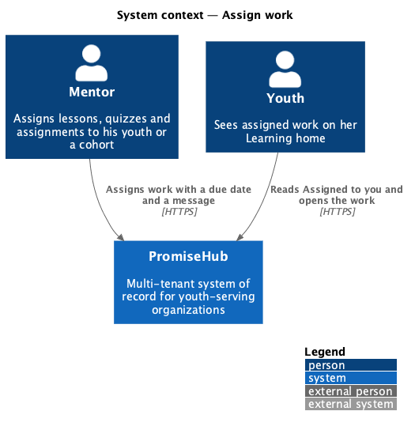
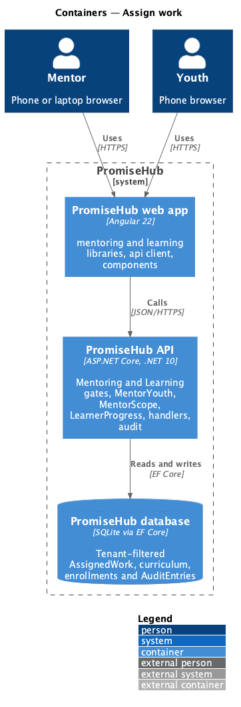
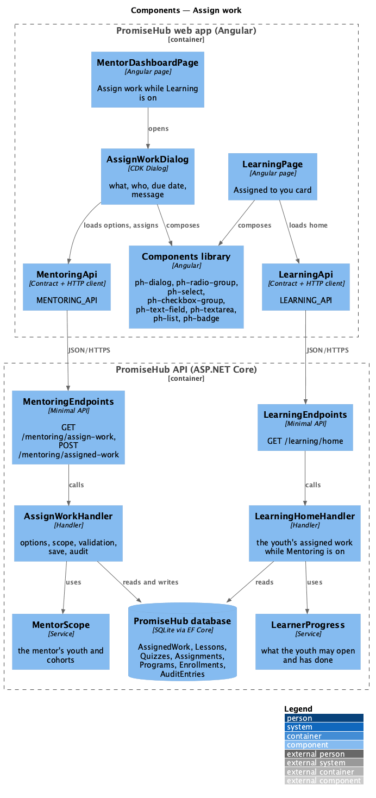
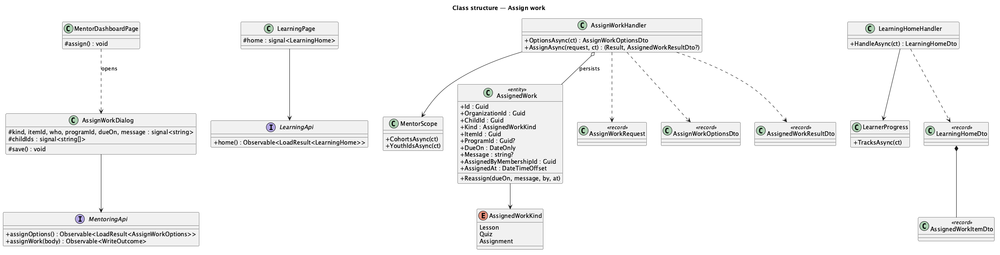
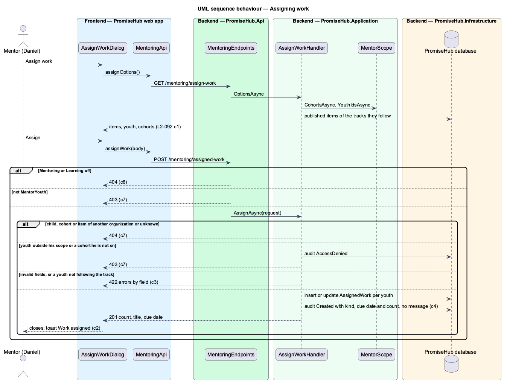
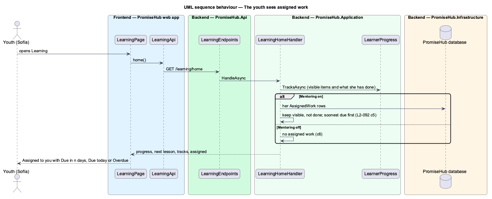

# Assign work

## Overview

A mentor steers his youth by pointing them at the next thing worth doing: a lesson to read before Tutoring night, a quiz to try, an assignment to hand in. **Assign work** lets him pick one published lesson, quiz or assignment, choose who it is for (some of his youth, or a whole cohort he is on), set a due date and add a short message. Each youth then sees it at the top of her Learning home under **Assigned to you**, with when it is due and who asked, until she has done it.

Assigning reads Learning content, so it lives in the Mentoring module and needs Learning on as well. With Learning off the dashboard offers no Assign work and both endpoints answer 404; with Mentoring off the endpoints answer 404 and the Learning home shows no Assigned to you card.

Terms used in this document:

- **work item** — a published lesson, quiz or assignment of a published module of a published track (`AssignedWorkKind` `Lesson`, `Quiz`, `Assignment`)
- **assigned work** — one `AssignedWork` row: the organization, the child, the kind and item, the cohort it went through (null for chosen youth), the due date, the optional message, who assigned it and when
- **cohort** — a program the mentor leads or supports (`CohortMentor`); its youth are the children on its active roster that day
- **follows a track** — the youth has an active enrollment in a non-archived program whose track is the item's track
- **done** — a lesson completed, a quiz with an attempt scored or awaiting approval, or an assignment with a submission

Ported from Waypoint `mentoring/assign-work` (`L2-MENTOR-008`), with tenancy, the Mentoring and Learning module gates, PromiseHub roles and Learning content. Waypoint's reminder cadence, the message sent as a message thread, whole-module items and program-administrator assigning are deferred. Decisions are recorded in ADR 0063.

## Description

Frontend:

- **`AssignWorkDialog`** (`frontend/projects/mentoring/`, mock `assign-work`) — CDK Dialog through `PhDialogs`, opened from the dashboard. Loads `MENTORING_API.assignOptions()`, then offers What are you assigning? (`ph-radio-group` Lesson, Quiz, Assignment with hints), the item of that kind (`ph-select`, "title · module"), Who is it for? (`ph-radio-group` A whole cohort, Youth I choose), the cohort (`ph-select`, "name · n youth") or his youth (`ph-checkbox-group`, each with the cohort and At risk as its hint), Due date (`ph-text-field` type date) and Message (`ph-textarea`, optional, counter to 500). It checks the required fields, then shows the server's 422 errors beside each field and in `ph-error-summary`; busy and failed states; with no item, "Nothing to assign yet" and Close. It closes with the server's count, title and due date.
- **`MentorDashboardPage`** — Assign work (primary) in the header while Learning is on; after assigning, the toast "Work assigned" with "Last in Line · 4 youth · Due Fri 13 Nov".
- **`LearningPage`** (`frontend/projects/learning/`, mock `learn-home`) — the Assigned to you card when `assigned` is not empty: one `ph-list-item` link per item with the kind, module, due date and mentor as meta, the message as the text variant and a `ph-badge` (info Due in n days or Due tomorrow, warning Due today, danger Overdue). Words in `assigned-words.ts`.

API client (`frontend/projects/api/`): `MENTORING_API.assignOptions()` answering `LoadResult<AssignWorkOptions>` (items, youth, cohorts) and `assignWork(AssignWork)` answering `WriteOutcome<AssignedWorkResult>`; `LearningHome.assigned: AssignedWorkItem[]`.

Backend:

- **`AssignedWork`** (`PromiseHub.Domain/Mentoring/`) — tenant-owned; `MaximumMessage` 500; `Reassign(dueOn, message, by, at)`. **`AssignedWorkKind`** enum.
- **`AssignWorkHandler`** (`PromiseHub.Application/Mentoring/`):
  - `OptionsAsync()` — the mentor's youth (`MentorScope.YouthIdsAsync`), their active enrollments and the tracks those programs follow; the published lessons (not deleted), quizzes and assignments of published modules of those published tracks, by track, module position and title; his cohorts (`MentorScope.CohortsAsync`) with at least one youth on the active roster; and which of his youth have an open at-risk flag.
  - `AssignAsync(AssignWorkRequest)` — 404 for an item, child or cohort outside the organization or unknown; 403 audited as AccessDenied for a child outside his scope or a cohort he is not on; 422 by field (`kind`, `itemId`, `who`, `childIds`, `programId`, `dueOn`, `message`); a draft or unpublished item answers `itemId` "Choose what to assign."; each recipient must follow the item's track. Inserts or updates one row per recipient, audits Created on `AssignedWork` once (the item's id, "Daniel Osei assigned Last in Line to 4 youth", `Kind`, `DueOn`, `Youth`), never the message, and answers the count, title and due date.
- **`LearningHomeHandler`** — while Mentoring is on, adds `Assigned`: the caller's rows (child of her membership) whose item is visible in `LearnerProgress.TracksAsync`, not done, by due date then title, with `DaysLeft` from the organization's today, the module, who assigned it and the message.
- **Endpoints** — `GET /mentoring/assign-work` and `POST /mentoring/assigned-work` (201) in `MentoringEndpoints`' Learning group: Mentoring and Learning on, `MentorYouth`.
- **Persistence** — `AssignedWork` set with the tenant query filter, a unique index on organization, child, kind and item; migration `AssignedWork`.

Open questions: none. Deferred: assigning a whole module, reminders before the due date, notifying the youth, the message as a message thread, program directors assigning, and a mentor's list of what he assigned and who has done it.

## Requirements

| L2 ID | Refines (L1) | Requirement |
|-------|--------------|-------------|
| `L2-092` | `L1-024` | A mentor assigns a published lesson, quiz or assignment of a track his youth follow to one or more of his youth, or to a whole cohort he is on, with a due date and an optional message. Each youth sees it on her Learning home under Assigned to you until she has done it. Assigning needs Learning content, so it is offered and answered only while both Mentoring and Learning are on. |
| `L2-068` | `L1-023` | The Learning home and what a youth may open (cross-referenced, not repeated). |
| `L2-065` | `L1-003` | Every Mentoring read is scoped on the server to what the signed-in mentor is assigned: their youth, and the cohorts they lead or support. |
| `L2-032` | `L1-017` | Audit trail (cross-referenced, not repeated). |
| `L2-007` | `L1-003` | Role-based authorization on the server (cross-referenced, not repeated). |

## Diagrams

### System context

Mentors assign work; youth see it on their Learning home.

### Containers

### Components

The dashboard opens the dialog; the Learning home reads the youth's assigned work through the existing home handler.

### Class structure

### Behaviour — assigning work

The gates answer first; the handler checks the organization, the mentor's scope, the fields and the tracks, then saves one row per youth and audits once.

### Behaviour — the youth sees assigned work

