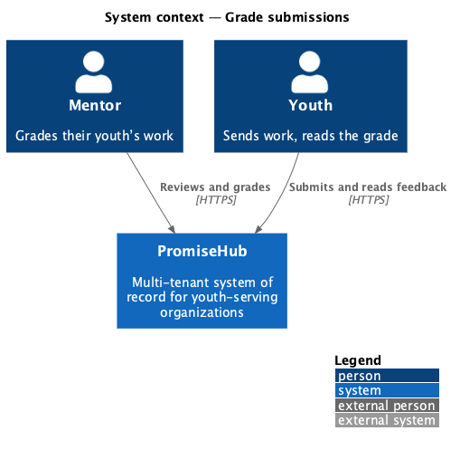
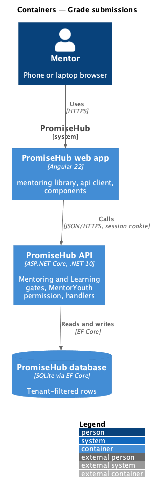
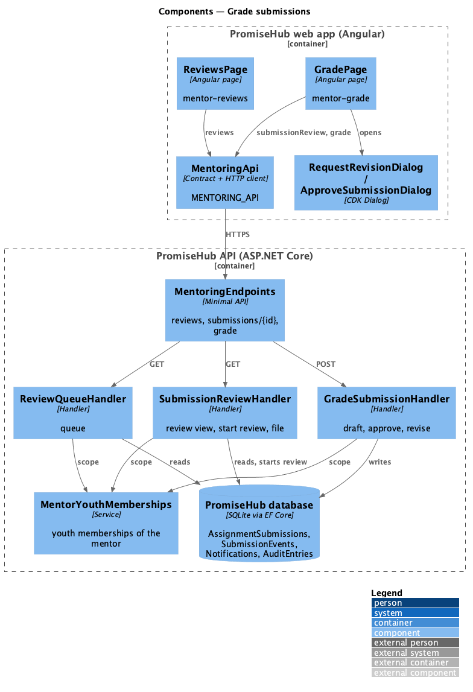
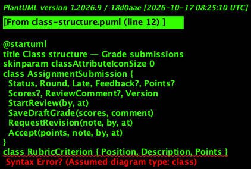
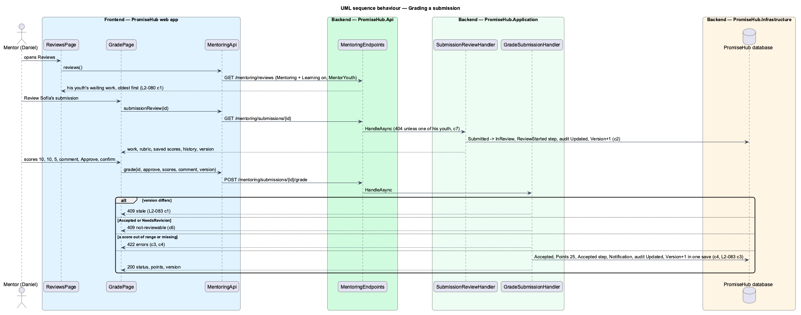

# Grade submissions

## Overview

A youth sends an assignment to her mentor ([submit-assignments](../../learning/submit-assignments/README.md)) and follows it ([track-and-revise-submissions](../../learning/track-and-revise-submissions/README.md)). This slice is the mentor's side: a review queue of the work their youth have sent, and a grade page that scores each rubric criterion, totals it on the server and approves the work, sends it back with a note, or keeps a draft grade. It closes the learning loop.

Terms used in this document:

- **review queue** — the submissions of the mentor's youth that are Submitted or In review, and their quiz attempts awaiting approval ([approve-quiz-assessments](../approve-quiz-assessments/README.md)), oldest first
- **mentor's youth** — the children `MentorScope` answers (ADR 0049); their youth accounts are the memberships whose `ChildId` is one of them
- **decision** — `draft` (keep scores and comment, nothing visible changes), `approve` (Accepted with points) or `revise` (Needs revision with a note)
- **scores** — whole points per rubric criterion, 0 to the criterion's points; the total is their sum
- **version** — the submission's concurrency token ([protect-concurrent-updates](../../platform/protect-concurrent-updates/README.md))

Ported from Waypoint `mentoring/grade-submissions` (`L2-MENTOR-003`) with tenancy, the Mentoring and Learning gates and ADR 0057.

## Description

Frontend (`frontend/projects/mentoring/`, both routes matched only while Mentoring and Learning are on):

- **`ReviewsPage`** (`/mentoring/reviews`, mock `mentor-reviews`) — `ph-tabs` filters All, Assignments and Quizzes on the client; `ph-table` rows with the youth, work, type, submitted time and Late, and a Review link to the grade page or Quiz approvals; empty, error and loading states.
- **`GradePage`** (`/mentoring/reviews/submissions/:id`, mock `mentor-grade`) — what the youth sent beside the rubric (`ph-text-field` number per criterion), the running total, the comment (`ph-textarea`), Save draft, Request revision (opens `RequestRevisionDialog`) and Approve (opens `ApproveSubmissionDialog`); the error summary, failed, conflict (Load the latest) and outcome states; the `unsaved-changes` guard while scores or the comment differ from what was loaded.
- **`MentorDashboardPage`** — offers Reviews with the waiting count while Learning is on.

API client (`MENTORING_API`): `reviews()`, `submissionReview(id)`, `submissionFileUrl(id)`, `grade(id, request)`; contracts `ReviewItem`, `SubmissionReview`, `RubricScore`, `GradeRequest`, `GradeOutcome`.

Backend (`PromiseHub.Application/Mentoring/`):

- **`MentoringEndpoints`** — `GET /mentoring/reviews`, `GET /mentoring/submissions/{{id}}`, `GET /mentoring/submissions/{{id}}/file`, `POST /mentoring/submissions/{{id}}/grade`, gated by Mentoring and Learning and the `MentorYouth` permission.
- **`MentorYouthMemberships`** — the youth memberships of the mentor's youth.
- **`ReviewQueueHandler`** — reads submissions and awaiting attempts of those memberships only.
- **`SubmissionReviewHandler`** — 404 unless the submission belongs to one of those memberships; starts the review on first open (audited `Updated`); answers the work, rubric with saved scores, comment, history and version; streams the file.
- **`GradeSubmissionHandler`** — checks the version (409 `stale`), the status (409 `not-reviewable`), each score against its criterion (422), a note for `revise` and every score for `approve`; then `SaveDraftGrade`, `Accept` or `RequestRevision`, a `Notification` to the youth membership, an audit entry, and one save.
- **`AssignmentSubmission`** — gains `Scores` (JSON keyed by criterion), `ReviewComment` and `Version`; `SaveDraftGrade` keeps both and advances the version.

## Requirements

| L2 ID | Refines (L1) | Requirement |
|-------|--------------|-------------|
| `L2-080` | `L1-024` | A mentor works a queue of the work their youth have sent, grades an assignment submission against its rubric with a comment, and approves it, sends it back for revision or saves a draft grade. |
| `L2-083` | `L1-018` | A save against a version of a record that has since changed is refused instead of silently overwriting it. |
| `L2-065` | `L1-003` | Every Mentoring read is scoped on the server to what the signed-in mentor is assigned: their youth, and the cohorts they lead or support. A mentor can open the cohort page of a cohort they are on and nothing else. |
| `L2-007` | `L1-003` | Permissions are enforced per endpoint and per field by role; the UI reflects them but never substitutes for them. |
| `L2-032` | `L1-017` | Every change and every sensitive view is recorded and searchable by admins. |

## Diagrams

### System context

### Containers

### Components

### Class structure

### Behaviour — grading a submission

Opening the submission starts the review; the grade is checked against the version, the status and the rubric before one save.

## Open questions

- Badges on approval arrive with prompt 64; telling a guardian, and push or email to the youth, with prompts 73 and 75.
- Coding project submissions (L2-070) are not in the queue yet.
