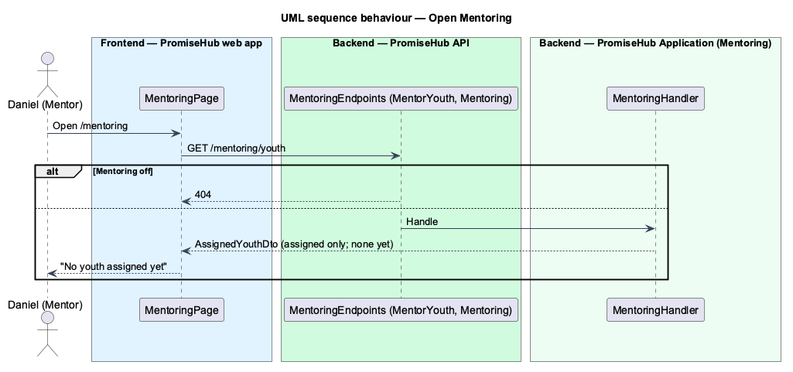

# List assigned youth

## Overview

The first slice of the **Mentoring** module (`L1-024`). A mentor sees only the youth assigned to them. Assignments arrive with prompt 54, so until then the list is empty and the Mentoring page says that a program director assigns youth.

## Description

- **`MentoringHandler`** (`PromiseHub.Application/Mentoring/`) returns `AssignedYouthDto(youth)` for the caller's membership: an empty list while no assignment exists.
- **`GET /mentoring/youth`** (`MentoringEndpoints`) requires `Permission.MentorYouth` (Mentor) and `RequireModule(ModuleId.Mentoring)`.
- **`MENTORING_API`** with `HttpMentoringApi.youth()`.
- **`MentoringPage`** (`frontend/projects/mentoring/`) composes `ph-page-header`, `ph-card` and `ph-empty-state` (`mentoring`), loaded by `moduleRoute('mentoring', 'Mentoring', …)`.

## Requirements

| L2 ID | Refines (L1) | Requirement |
|-------|--------------|-------------|
| `L2-005` | `L1-002` | A module that is off is neither served nor rendered. |
| `L2-007` | `L1-003` | Permissions are enforced per endpoint and per field by role; the UI reflects them but never substitutes for them. |

## Diagrams

### Behaviour — open Mentoring

The gate answers 404 while Mentoring is off; a mentor gets only assigned youth (`L2-007` criterion 10).

