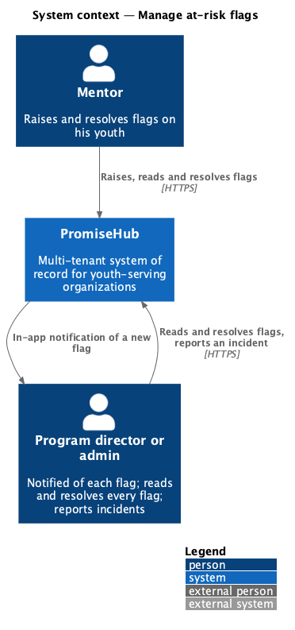
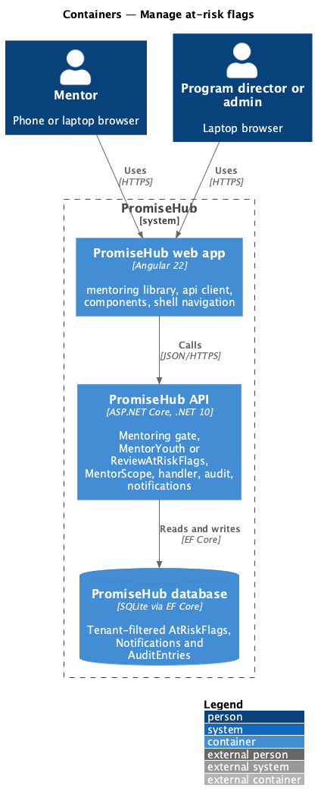
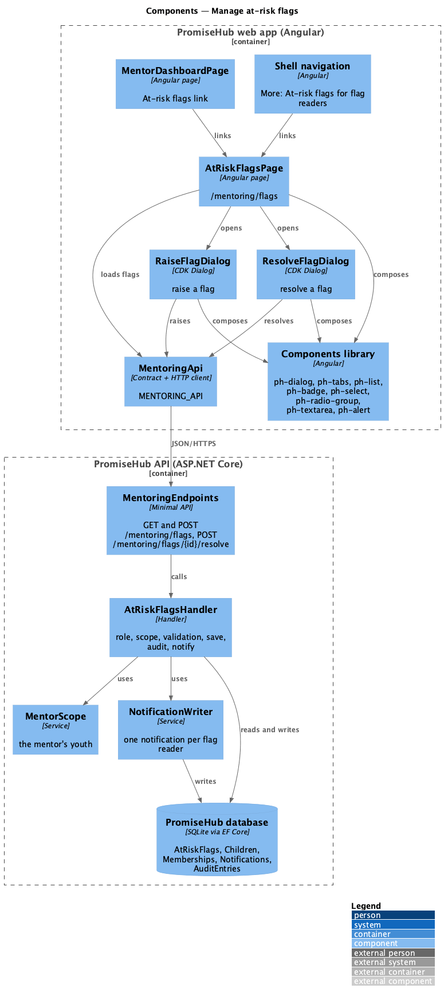
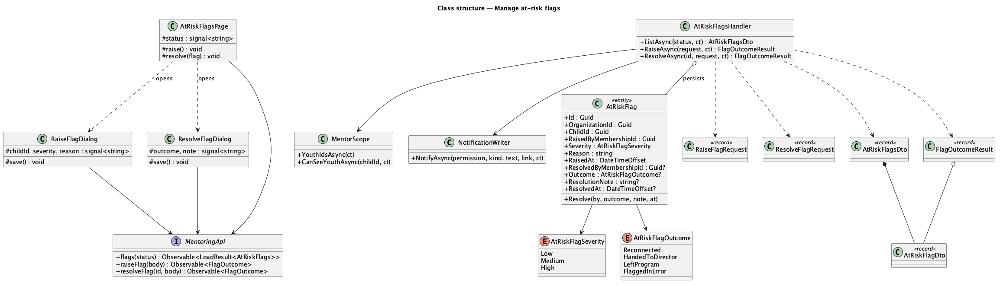
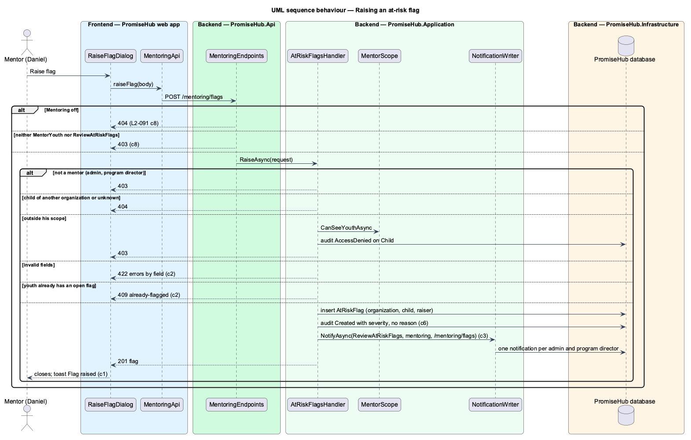
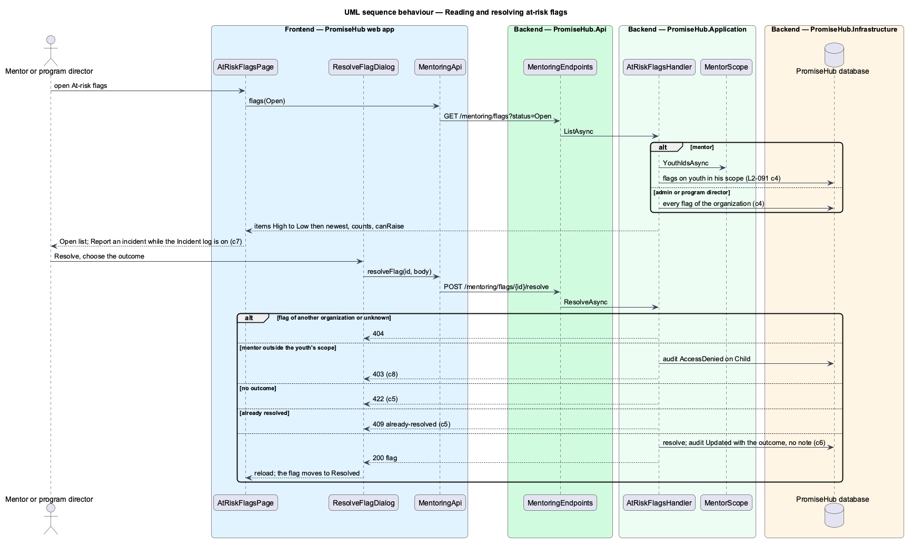

# Manage at-risk flags

## Overview

A mentor sometimes worries about one of his youth: missed sessions, a change at home, a remark that stays with him. An **at-risk flag** puts that worry on record. He raises it on the youth with why he is worried and how serious it is; admins and program directors are notified at once and can read every flag of the organization; and the flag stays open until a mentor of that youth, an admin or a program director resolves it with an outcome. The open list is the follow-up queue for safeguarding: catching youth who are slipping before it becomes an incident.

An at-risk flag is not an incident. An incident (`incidents/report-and-review-incident`) records something that happened, such as an injury, and is reviewed by supervisors. While the Incident log is on, staff reading a flag can report an incident from it; mentors, who do not report incidents, are told in the dialog not to wait for a flag when someone is hurt or in danger.

Terms used in this document:

- **at-risk flag** — one `AtRiskFlag` row: the organization, the child, who raised it and when, the severity, the reason, and once resolved who resolved it, when, the outcome and an optional note
- **severity** — how serious it is: Low (keep an eye on it), Medium (needs a plan this week) or High (needs attention today)
- **open** — not yet resolved; a youth has at most one open flag
- **outcome** — how a flag was resolved: Reconnected, back on track (`Reconnected`); Handed to the program director (`HandedToDirector`); Left the program (`LeftProgram`); Flagged in error (`FlaggedInError`)
- **flag reader** — a role holding `ReviewAtRiskFlags`: Admin and Program director
- **mentor scope** — the youth `MentorScope` answers for the caller (ADR 0049)

Ported from Waypoint `mentoring/manage-at-risk-flags` (`L2-MENTOR-007`), with tenancy, the Mentoring module gate, PromiseHub roles and a severity. Waypoint's automatic signals and its message action are deferred. Decisions are recorded in ADR 0062.

## Description

Frontend (`frontend/projects/mentoring/`):

- **`AtRiskFlagsPage`** (`/mentoring/flags`, mock `mentor-flags`) — `ph-page-header` with Raise a flag for a mentor (breadcrumb to Mentoring), `ph-tabs` Open · n and Resolved · n (`?status=Resolved`), one `ph-list-item` per flag with the youth, Raised by and when, the reason, a `ph-badge` for the severity and, when resolved, the outcome, who and when and the note; actions View record (mentor), Resolve, and Report an incident (flag readers while the Incident log is on, linking to `/incidents/new`); raised toast, empty, loading, error and forbidden states.
- **`RaiseFlagDialog`** (mock `raise-flag`) — CDK Dialog through `PhDialogs`: Youth (`ph-select` of his youth), How serious is it? (`ph-radio-group` with hints), Why are you worried? (`ph-textarea`, counter to 1,000), an info `ph-alert`; checks the required fields, then the server's 422 errors beside each field and in `ph-error-summary`; already-flagged (409), busy and failed.
- **`ResolveFlagDialog`** (mock `resolve-flag`) — the youth and flag in a `ph-description-list`, How was it resolved? (`ph-radio-group`), Note (`ph-textarea`, optional, to 1,000); invalid, already-resolved (409), busy and failed.
- **`MentorDashboardPage`** — At-risk flags in the header.
- Navigation (`frontend/projects/promisehub/`) — More offers At-risk flags to admins and program directors while Mentoring is on.
- Words: `severityLabel`, `outcomeLabel` in `flag-words.ts`.

API client (`frontend/projects/api/`): `MENTORING_API.flags(status)` answering `LoadResult<AtRiskFlags>` (items, both counts, the caller's youth for the dialog, `canRaise`), `raiseFlag(RaiseAtRiskFlag)` and `resolveFlag(id, ResolveAtRiskFlag)` answering `FlagOutcome` (a `WriteOutcome` or the 409 codes `already-flagged` and `already-resolved`).

Backend:

- **`AtRiskFlag`** (`PromiseHub.Domain/Mentoring/`) — tenant-owned; `MaximumText` 1,000; `Resolve(by, outcome, note, at)`. **`AtRiskFlagSeverity`** and **`AtRiskFlagOutcome`** enums.
- **`Permission.ReviewAtRiskFlags`** — held by Admin and Program director.
- **`AtRiskFlagsHandler`** (`PromiseHub.Application/Mentoring/`):
  - `ListAsync(status)` — a mentor: flags on youth in his scope; a flag reader: every flag of the organization. Open: High, Medium, Low, then newest raised; Resolved: newest resolved first. Answers both counts, the mentor's youth (empty for a flag reader) and `CanRaise`.
  - `RaiseAsync(RaiseFlagRequest)` — mentors only (a flag reader answers 403); 404 for a child outside the organization, 403 audited as AccessDenied on `Child` outside `MentorScope`; 422 by field (youth, severity, reason required and at most 1,000); 409 `already-flagged` when the youth has an open flag; inserts the flag, audits Created on `AtRiskFlag` with the youth's name, who raised it and `Severity`, never the reason, and notifies every flag reader through `NotificationWriter` (kind `mentoring`, link `/mentoring/flags`) in the same save.
  - `ResolveAsync(id, ResolveFlagRequest)` — 404 for a flag outside the organization; a mentor outside the youth's scope 403 audited; 422 for a missing outcome or a long note; 409 `already-resolved`; resolves and audits Updated with the outcome, never the note.
- **`NotificationsHandler`** — kind `mentoring` belongs to Mentoring, so flag notices hide while it is off.
- **Endpoints** — `GET /mentoring/flags`, `POST /mentoring/flags` (201) and `POST /mentoring/flags/{id}/resolve` (200) in their own group of `MentoringEndpoints`: Mentoring on, and `MentorYouth` or `ReviewAtRiskFlags`.
- **Persistence** — `AtRiskFlags` set with the tenant query filter, an index on organization, child and resolved; migration `AtRiskFlags`.

Open questions: none. Deferred: Waypoint's automatic signals (inactivity, missed sessions, progress below the cohort), messaging a flagged youth (Messages has no youth recipients yet), the at-risk banner on the youth record (`L2-064`), prefilling the incident form with the child.

## Built so far

Prompt 68 delivered everything above in four slices: raising a flag and the mentor's list (`POST` and `GET /mentoring/flags`, `AtRiskFlagsPage`, `RaiseFlagDialog`, reached from the dashboard's At-risk flags; `ph-list-item` gained actions under its text, `phListActions`); admins and program directors notified in app and reading every flag, with At-risk flags in More (`ReviewAtRiskFlags`, kind `mentoring`); resolving with an outcome and the Resolved tab (`POST /mentoring/flags/{id}/resolve`, `ResolveFlagDialog`; the note shows after the outcome line); and Report an incident on open flags for admins and program directors while the Incident log is on. Acceptance tests: `backend/tests/PromiseHub.Api.Tests/AtRiskFlagsTests.cs`, `e2e/tests/mentoring/at-risk-flags.spec.ts`.

## Requirements

| L2 ID | Refines (L1) | Requirement |
|-------|--------------|-------------|
| `L2-091` | `L1-024` | A mentor raises an at-risk flag on one of his youth when he is worried about them, with why and how serious it is (Low, Medium or High). Admins and program directors are notified and read every flag of the organization; the flag stays open until a mentor of that youth, an admin or a program director resolves it with an outcome. While the Incident log is on, staff who read a flag can report an incident from it. |
| `L2-065` | `L1-003` | Every Mentoring read is scoped on the server to what the signed-in mentor is assigned: their youth, and the cohorts they lead or support. |
| `L2-040` | `L1-021` | In-app notifications (cross-referenced, not repeated). |
| `L2-032` | `L1-017` | Audit trail (cross-referenced, not repeated). |
| `L2-023` | `L1-011` | Reporting and reviewing incidents (cross-referenced, not repeated). |
| `L2-007` | `L1-003` | Role-based authorization on the server (cross-referenced, not repeated). |

## Diagrams

### System context

Mentors raise and resolve flags on their youth; admins and program directors are notified, read every flag and resolve them.

### Containers

### Components

One page opens both dialogs; the handler writes the flag, its audit entry and the notifications in one save.

### Class structure

### Behaviour — raising a flag

The gates answer first; the handler checks the role, the organization, the mentor's scope, the fields and the open flag, then saves, audits and notifies.

### Behaviour — reading and resolving flags

