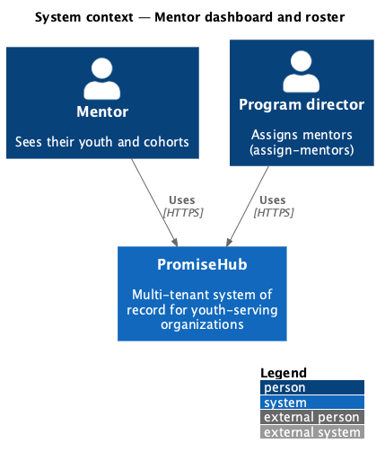
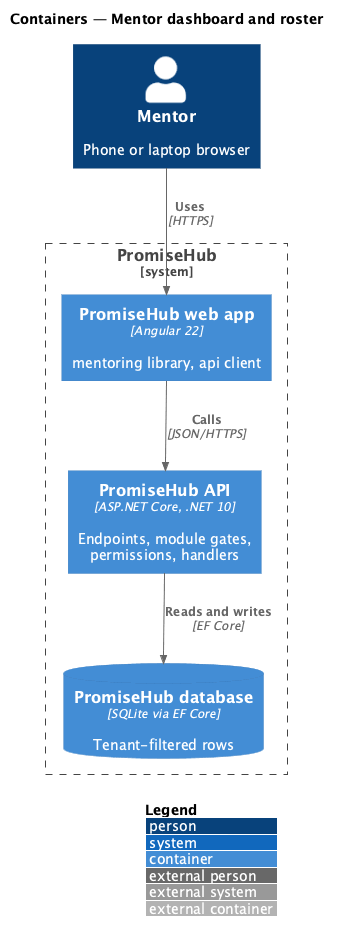
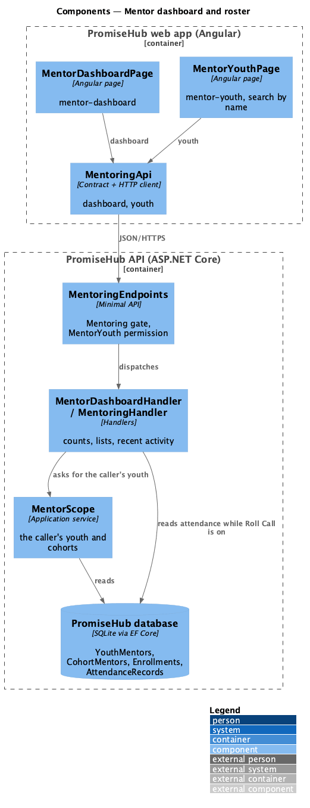
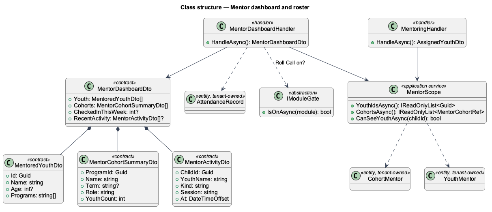
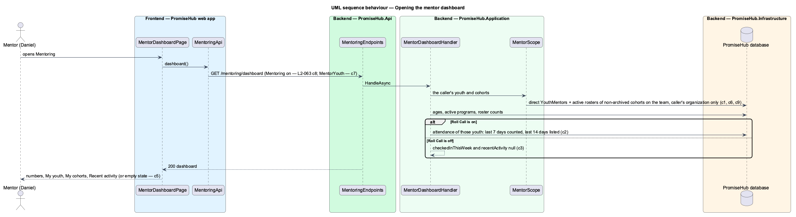

# Manage mentor roster

## Overview

A **mentor** in PromiseHub is a Mentor membership in one organization (ADR 0043). Prompt 54 decided who a mentor's youth are ([assign-mentors](../assign-mentors/README.md)): the youth assigned to them directly plus every youth on the active roster of each cohort (program) they lead or support. This feature is what a mentor does with that roster: Mentoring opens on a **dashboard** that counts their youth and cohorts, lists them and shows the latest attendance of their youth, and **My youth** lists every youth with a search by name.

Terms used in this document:

- **mentor scope** — the set of youth and cohorts the signed-in mentor is assigned, computed on the server for every request
- **cohort on the team** — a program that is not archived whose lead or supporting mentors include the caller
- **recent activity** — attendance changes (checked in, signed out, absent) of the mentor's youth at sessions that have started, from Roll Call

Ported from Waypoint `mentoring/manage-mentor-roster` (`L2-MENTOR-001`), with tenancy, the Mentoring and Roll Call module gates and PromiseHub types. Waypoint's pending reviews, average progress and at-risk counts wait for grading, lessons and flags (prompts 57, 63, 68).

## Description

Frontend (`frontend/projects/mentoring/`):

- **`MentorDashboardPage`** (`/mentoring`, mock `mentor-dashboard`) — three `ph-stat` numbers (My youth, My cohorts and, while Roll Call is on, Checked in this week), the first five youth as `ph-list-item` links with View all, the cohorts as links to `mentor-group`, and the Recent activity `ph-timeline` only when the API sends it. Empty, error (Try again) and forbidden (403) states use `ph-empty-state`.
- **`MentorYouthPage`** (`/mentoring/youth`, mock `mentor-youth`) — every youth with age and programs; a `ph-text-field` of type search filters by name on the client, with the no-results state and Clear search.

API client (`frontend/projects/api/`): **`MentoringApi`** behind `MENTORING_API` gains `dashboard()`; `youth()` answers rows with `age` and `programs`. Contracts `MentorDashboard`, `MentorCohortSummary`, `MentorActivity`, `MentoredYouth`.

Backend:

- **`MentoringEndpoints`** (`PromiseHub.Api`) — `GET /mentoring/dashboard` and `GET /mentoring/youth`, each with `RequireModule(Mentoring)` and `RequirePermission(MentorYouth)` (Mentor only).
- **`MentorScope`** (`PromiseHub.Application/Mentoring/`) — the one place that computes the caller's youth ids and cohorts from `YouthMentors` and `CohortMentors`; shared by every Mentoring read ([scope-data-by-role](../../identity/scope-data-by-role/README.md)).
- **`MentorDashboardHandler`** — builds `MentorDashboardDto`: youth (name, age from the date of birth, active non-archived program names), cohorts (id, name, term, Lead or Supporting, active roster count), and while Roll Call is on `CheckedInThisWeek` (distinct youth checked in or signed out at a session that started in the last 7 days) and `RecentActivity` (the last five changes in 14 days, newest first). The module state comes from `IModuleGate`.
- **`MentoringHandler`** — `GET /mentoring/youth`, now with age and programs.

Rules: no youth outside the mentor scope is ever counted or listed; another organization's rows are filtered by the tenant query filter (ADR 0002); the dashboard is read only and not audited.

Open questions: Waypoint's export of the roster and the on-track, at-risk and new filters are deferred to the flags prompt (68).

## Built so far

Prompt 55 delivered everything above. Acceptance tests: `backend/tests/PromiseHub.Api.Tests/MentorDashboardTests.cs`, `e2e/tests/mentoring/mentor-dashboard.spec.ts`, `e2e/tests/mentoring/mentor-pages-responsive.spec.ts`.

## Requirements

| L2 ID | Refines (L1) | Requirement |
|-------|--------------|-------------|
| `L2-063` | `L1-024` | A mentor opens Mentoring and sees, computed on the server over only the youth and cohorts assigned to them, how many youth and cohorts they have, who those youth are, and their latest attendance; My youth lists every assigned youth and can be searched by name. |
| `L2-065` | `L1-003` | Every Mentoring read is scoped on the server to what the signed-in mentor is assigned: their youth, and the cohorts they lead or support. |
| `L2-062` | `L1-024` | A mentor's list of youth is the youth assigned to them plus the youth of every cohort they lead or support. |

## Diagrams

### System context

Who uses this slice of PromiseHub.

### Containers

The web app calls the API; the API owns the database and checks the organization's modules and the caller's role on every request.

### Components

The pages and client in the web app, and the endpoints, scope service and handlers in the API.

### Class structure

The handlers, the scope service and the contracts they answer.

### Behaviour — opening the dashboard

The steps in order, with the requirement criterion each enforces.

