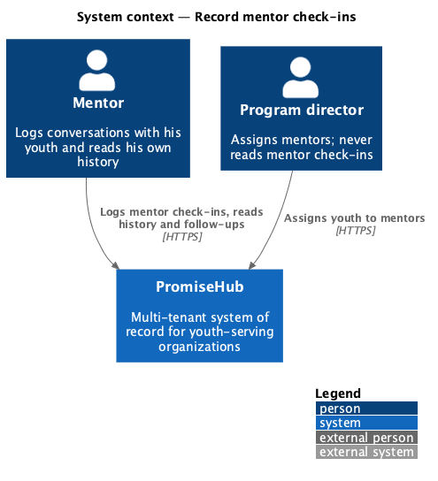
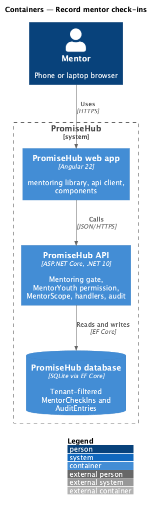
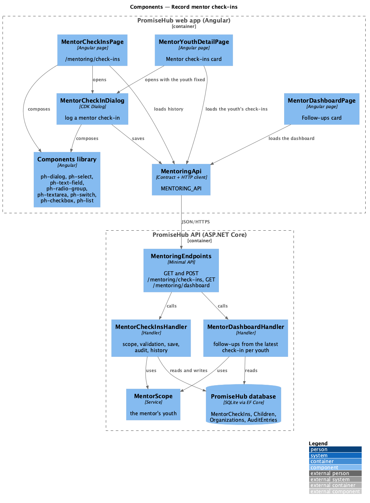
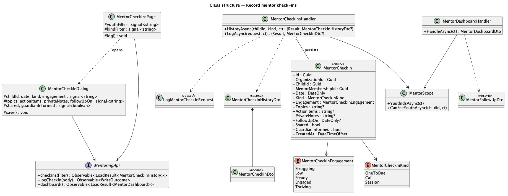
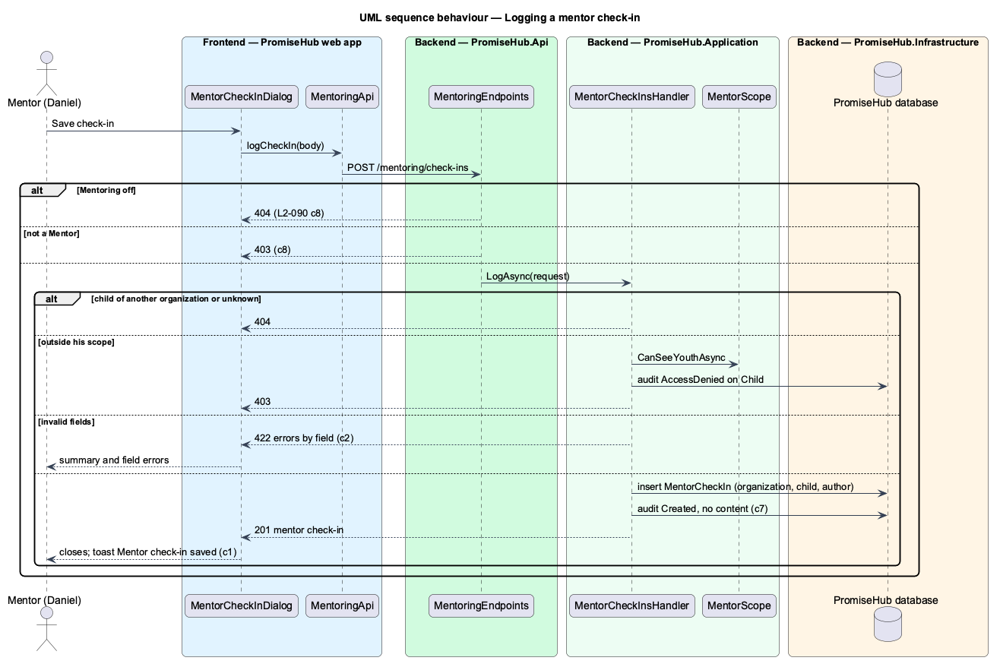
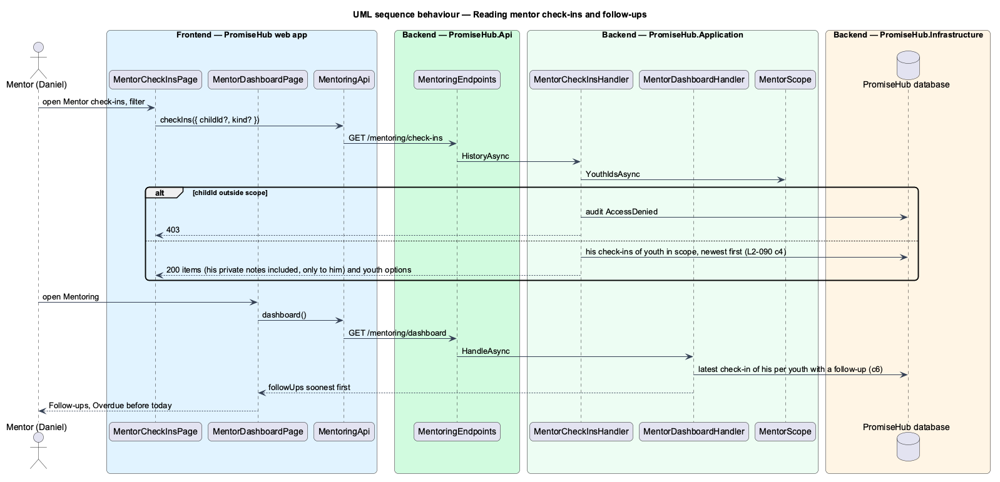

# Record mentor check-ins

## Overview

A mentor stays in touch with each youth he mentors through conversations: a one-to-one chat, a phone call, a moment at a session. A **mentor check-in** is his record of one such conversation: when and how they met, how it went, what they talked about, the action items, private notes and when to follow up. He logs one from his history or from the youth's record, reads them back newest first, and sees the follow-ups that are coming due on his dashboard. Copy always says "mentor check-in", never just "check-in", so it is never confused with Roll Call's check-in of a child at a session.

Terms used in this document:

- **mentor check-in** — one `MentorCheckIn` row: the organization, the child, the mentor who wrote it, the date, the kind, how it went, optional topics, action items, private notes and follow-up date, whether it is shared and whether the guardian was informed
- **kind** — how they met: 1:1 (`OneToOne`), Call or Session
- **how it went** — the engagement: Struggling, Low, Steady, Engaged or Thriving
- **private notes** — words only the mentor who wrote them reads, even when the check-in is shared (Waypoint's prayer requests)
- **shared** — marked for the youth and guardian; until the guardian portal (prompt 73) reads it, a shared check-in is still answered only to its author
- **follow-up** — the date the mentor plans to talk again; the latest check-in of his per youth with one sets that youth's follow-up
- **mentor scope** — the youth `MentorScope` answers for the caller (ADR 0049)

Ported from Waypoint `mentoring/record-check-ins` (`L2-MENTOR-006`), with tenancy, the Mentoring module gate and PromiseHub types. Decisions are recorded in ADR 0061.

## Description

Frontend (`frontend/projects/mentoring/`):

- **`MentorCheckInsPage`** (`/mentoring/check-ins`, mock `mentor-check-in-history`) — breadcrumb, Log a mentor check-in, Youth and Type filters (`ph-select`), one `ph-list-item` per check-in with the youth, kind, date, how it went, topics, action items, follow-up, guardian informed, his private notes and a Shared or Private `ph-badge`; filtered, no-results, empty, saved (toast), loading, error and forbidden states.
- **`MentorCheckInDialog`** (mock `mentor-check-in`) — CDK Dialog through `PhDialogs`: Youth (`ph-select`, or fixed when opened from a record), Date and Next follow-up (`ph-text-field` type date), How you met and How it went (`ph-radio-group`), What you talked about, Action items and Private notes (`ph-textarea`), Share with the youth and guardian (`ph-switch`), Guardian was informed (`ph-checkbox`); checks the required fields, then the server's 422 errors beside each field and in `ph-error-summary`; busy and failed. Closes with the saved check-in.
- **`MentorYouthDetailPage`** — a Mentor check-ins card with his check-ins of that youth, Log a mentor check-in in the header and All mentor check-ins.
- **`MentorDashboardPage`** — a Follow-ups card (Overdue before today, each linking to the record) and Mentor check-ins in the header.
- Words: `checkInKindLabel`, `engagementLabel` in `check-in-words.ts`.

API client (`frontend/projects/api/`): `MENTORING_API.checkIns({ childId?, kind? })` answering `LoadResult<MentorCheckInHistory>` (items and the youth options), `MENTORING_API.logCheckIn(LogMentorCheckIn)` answering `WriteOutcome`; `MentorDashboard.followUps`.

Backend:

- **`MentorCheckIn`** (`PromiseHub.Domain/Mentoring/`) — tenant-owned; limit `MaximumText` 2,000. **`MentorCheckInKind`** and **`MentorCheckInEngagement`** enums.
- **`MentorCheckInsHandler`** (`PromiseHub.Application/Mentoring/`) — `LogAsync(LogMentorCheckInRequest)`: 404 for a child outside the organization, 403 audited as AccessDenied on `Child` outside `MentorScope`, 422 by field (youth, date not after the organization's today, kind, engagement, text limits, follow-up not before the date), then inserts the row and audits Created on `MentorCheckIn` with the youth's name and author and `Kind`, `Shared`, `GuardianInformed`, `HasFollowUp`, never the words. `HistoryAsync(childId?, kind?)`: the caller's check-ins of youth in his scope, newest first by date then creation, with his youth as filter options; a `childId` outside the organization 404, outside his scope 403 audited.
- **`MentorDashboardHandler`** — adds `FollowUps`: for each youth in scope, the caller's latest check-in (by date, then creation) when it has a follow-up date, soonest first, with `Overdue` when before the organization's today.
- **Endpoints** — `GET` and `POST /mentoring/check-ins` in the Mentoring group of `MentoringEndpoints` (Mentoring, MentorYouth); `POST` answers 201.
- **Persistence** — `MentorCheckIns` set with the tenant query filter, an index on organization, mentor and child; migration `MentorCheckIns`.

Open questions: none. The youth and guardian view of shared check-ins waits for the guardian portal (prompt 73); editing or deleting a mentor check-in is not part of Waypoint's journey and is not built.

## Built so far

Prompt 67 delivered everything above in three slices: logging a mentor check-in from the youth record (`POST /mentoring/check-ins`, `MentorCheckInDialog`); the history (`GET /mentoring/check-ins`, `MentorCheckInsPage` with its filters, reached from the dashboard's Mentor check-ins, and the record's Mentor check-ins card); and follow-ups on the dashboard (`MentorDashboardDto.FollowUps`, the Follow-ups card). The dialog's sharing switch reads "Share with the youth and guardian" wherever it opens; Recent activity's empty line now speaks of attendance so nothing calls Roll Call a mentor check-in. Acceptance tests: `backend/tests/PromiseHub.Api.Tests/MentorCheckInsTests.cs`, `e2e/tests/mentoring/mentor-check-in.spec.ts`, `e2e/tests/mentoring/mentor-check-in-history.spec.ts`, `e2e/tests/mentoring/mentor-follow-ups.spec.ts`.

## Requirements

| L2 ID | Refines (L1) | Requirement |
|-------|--------------|-------------|
| `L2-090` | `L1-024` | A mentor logs a mentor check-in, a conversation with one of his youth: when and how they met, how it went, what they talked about, action items, private notes and a follow-up date, private unless he shares it. He reads his mentor check-ins on a history page and on the youth's record, and his follow-ups on his dashboard. |
| `L2-065` | `L1-003` | Every Mentoring read is scoped on the server to what the signed-in mentor is assigned: their youth, and the cohorts they lead or support. |
| `L2-007` | `L1-003` | Role-based authorization on the server (cross-referenced, not repeated). |
| `L2-032` | `L1-017` | Audit trail (cross-referenced, not repeated). |

## Diagrams

### System context

Only mentors read mentor check-ins; program directors assign the youth they cover.

### Containers

### Components

The history page and the youth record both open the one dialog; the dashboard reads follow-ups from the same rows.

### Class structure

### Behaviour — logging a mentor check-in

The gates answer first; the handler then checks the organization and the mentor's scope, validates, saves and audits without the words.

### Behaviour — reading the history and follow-ups

