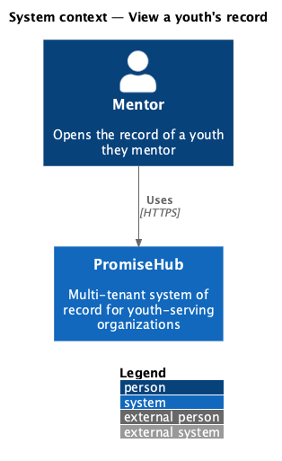
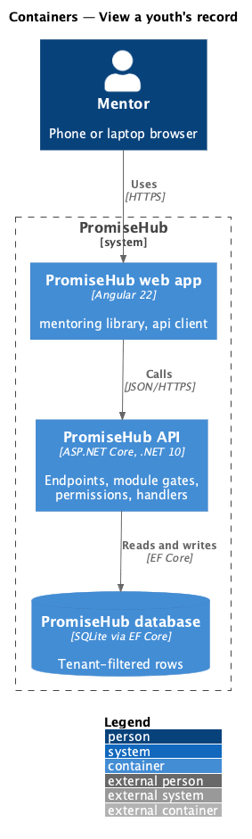
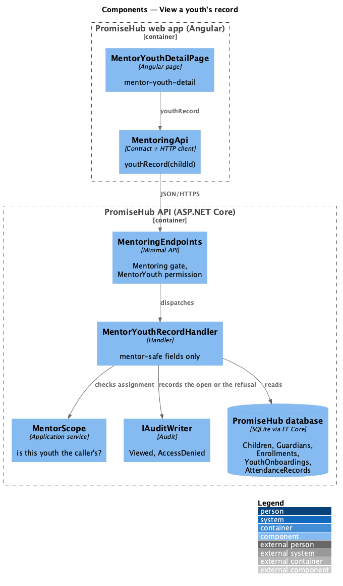
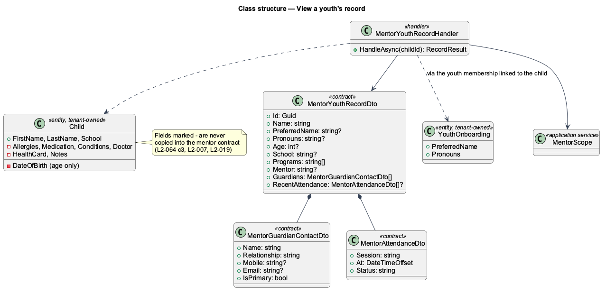
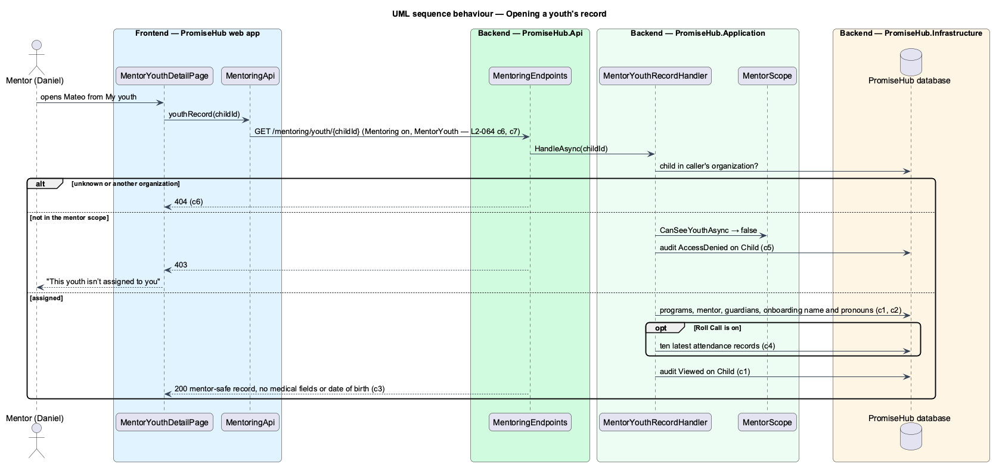

# View a youth's record

## Overview

A mentor needs to know who their youth are and how to reach their families, but not the medical details that staff on site use at check-in. This feature is the mentor's view of one youth: the name the youth goes by, pronouns, age, school, programs, mentor, the household's guardian contacts and recent attendance. It opens from My youth, the dashboard or a cohort page, and only for a youth in the caller's **mentor scope** (the youth assigned to them directly or through a cohort they lead or support, [manage-mentor-roster](../manage-mentor-roster/README.md)).

Terms used in this document:

- **mentor-safe record** — the subset of a child record a mentor may read; it never contains the date of birth (only the age), allergies, medication, conditions, doctor, red alert or instruction, health card, staff notes or approved pickups
- **goes by** — the preferred name a youth chose in first-run setup (L2-059), read through the youth membership linked to the child

Ported from Waypoint `mentoring/view-youth-record` (`L2-MENTOR-002` criteria 1, 3 and 4). Progress, check-ins, submissions, competencies and the at-risk banner wait for prompts 57, 63, 67 and 68.

## Description

Frontend (`frontend/projects/mentoring/`):

- **`MentorYouthDetailPage`** (`/mentoring/youth/:childId`, mock `mentor-youth-detail`) — `ph-breadcrumb`, `ph-page-header`, an About `ph-description-list`, guardians in a `ph-call-list` (each mobile a tel: link, the email and "Primary contact" as its line; a guardian without a mobile as a `ph-list-item`), Recent attendance as a `ph-table` (only when the API sends it) and an info `ph-alert` saying medical details stay with staff. A 403 shows the forbidden state, a 404 the not-found state, any other failure the error state with Try again.

API client: **`MentoringApi.youthRecord(childId)`** answering `LoadResult<MentorYouthRecord>`, with `forbidden` for a 403.

Backend:

- **`GET /mentoring/youth/{childId}`** in `MentoringEndpoints` — `RequireModule(Mentoring)`, `RequirePermission(MentorYouth)`.
- **`MentorYouthRecordHandler`** (`PromiseHub.Application/Mentoring/`) — loads the child through the tenant filter (404 when absent), asks `MentorScope.CanSeeYouthAsync` (403 and an `AccessDenied` audit entry on `Child` when not), then builds `MentorYouthRecordDto` field by field so a restricted field can never leak by accident. Guardians come from the child's household, primary first; the preferred name and pronouns from the `YouthOnboarding` of a youth membership linked to the child, when setup was completed; attendance from `AttendanceRecords` joined to `Events` that have started, newest ten, while Roll Call is on. Each successful open is audited as `Viewed` on `Child`.

Open questions: whether a mentor should see a guardian's preferred language is deferred to messaging (prompt 66).

## Built so far

Prompt 55 delivered everything above. Acceptance tests: `backend/tests/PromiseHub.Api.Tests/MentorYouthRecordTests.cs`, `e2e/tests/mentoring/mentor-youth-record.spec.ts`.

## Requirements

| L2 ID | Refines (L1) | Requirement |
|-------|--------------|-------------|
| `L2-064` | `L1-024` | A mentor opens one of their youth and sees what a mentor needs to stay in touch: who the youth is, their programs and mentor, how to reach their guardians and their recent attendance, never the date of birth, medical details, health card, staff notes or pickups. |
| `L2-065` | `L1-003` | Every Mentoring read is scoped on the server to what the signed-in mentor is assigned. |
| `L2-007` | `L1-003` | Permissions are enforced per endpoint and per field by role; the UI reflects them but never substitutes for them. |
| `L2-019` | `L1-008` | Medical fields are role-restricted and every open is audited. |
| `L2-011` | `L1-005` | A household holds guardians and children; each child carries medical details, school, language, notes and approved pickups. |

## Diagrams

### System context

Who uses this slice of PromiseHub.

### Containers

The web app calls the API; the API owns the database and checks the module and role on every request.

### Components

The page and client in the web app; the endpoint, handler, scope service and audit writer in the API.

### Class structure

The mentor-safe contract and the entities it is copied from; the restricted fields of `Child` are never copied.

### Behaviour — opening a record

Not found, not assigned and assigned, with the criterion each step enforces.

