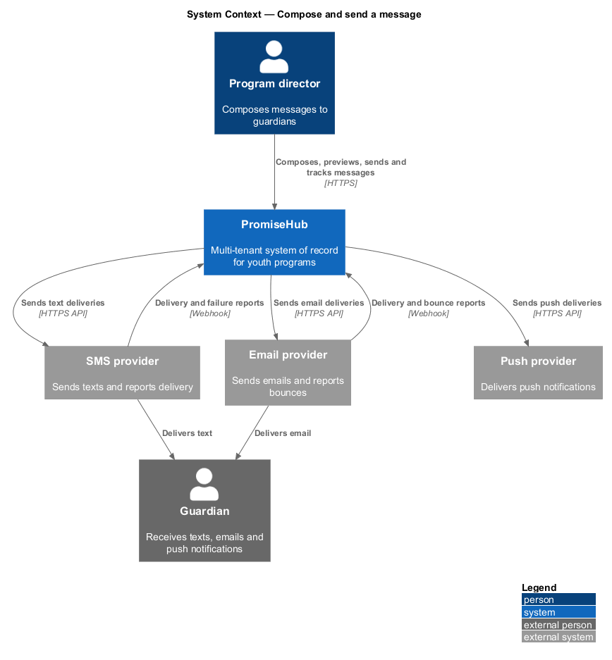
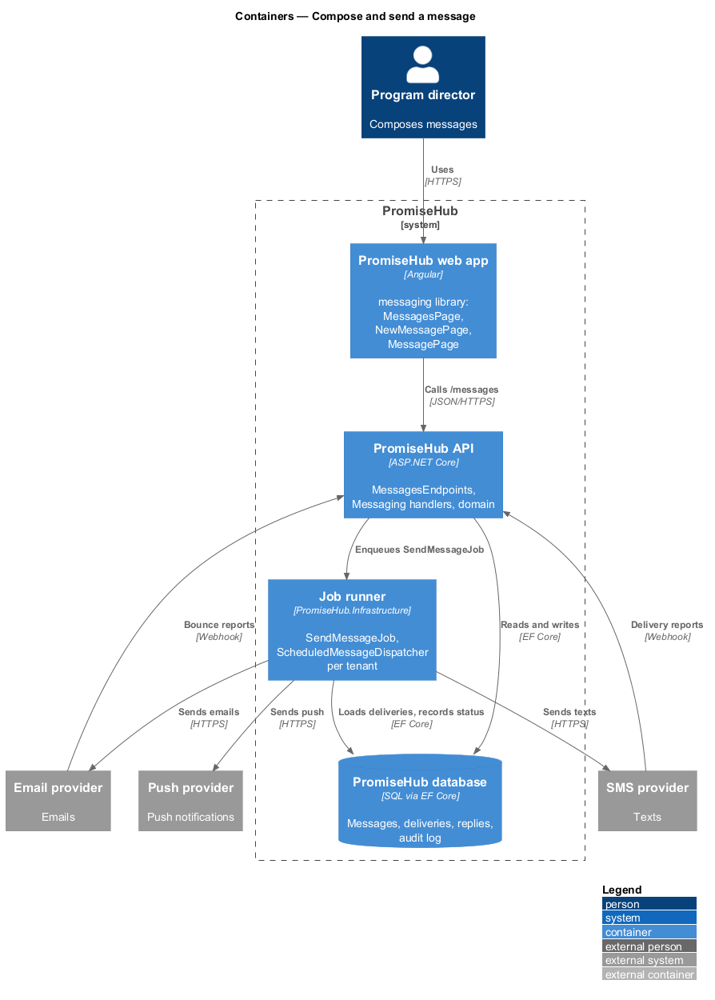
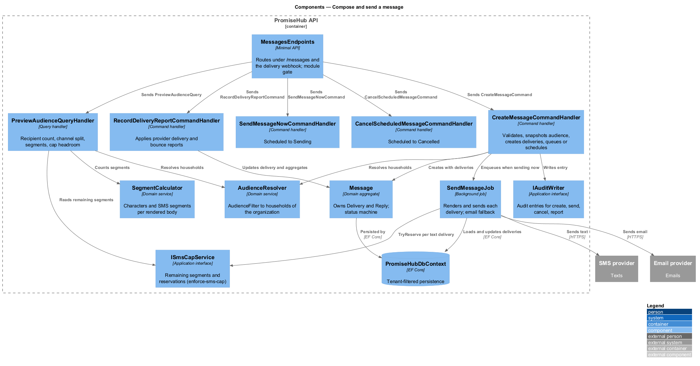
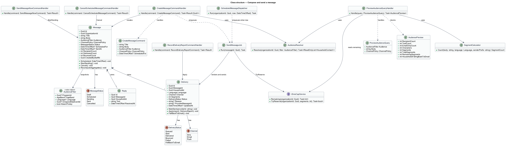
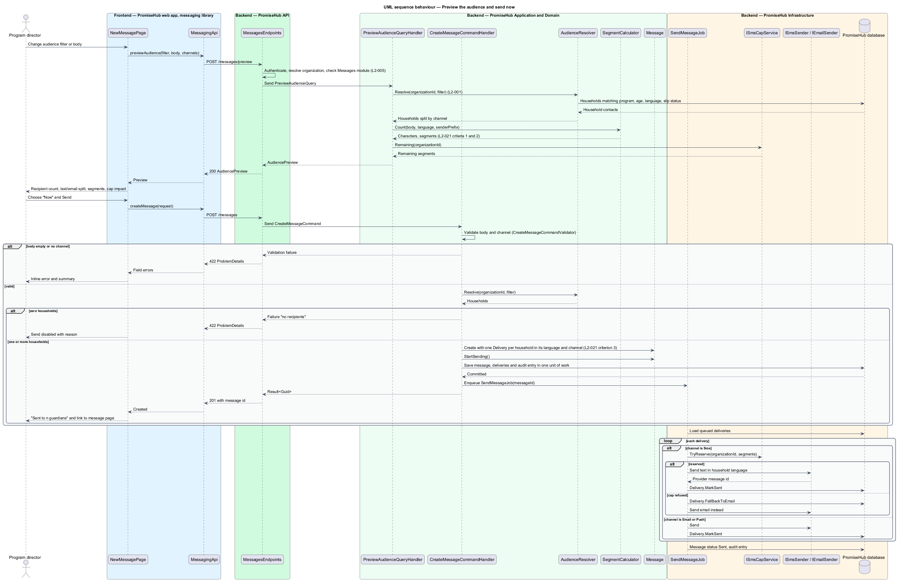
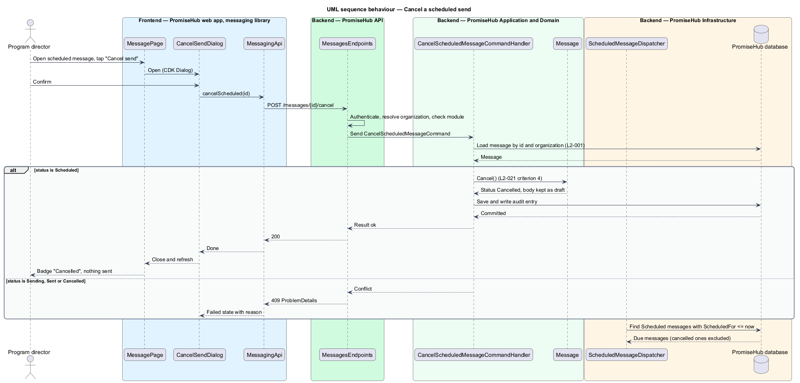
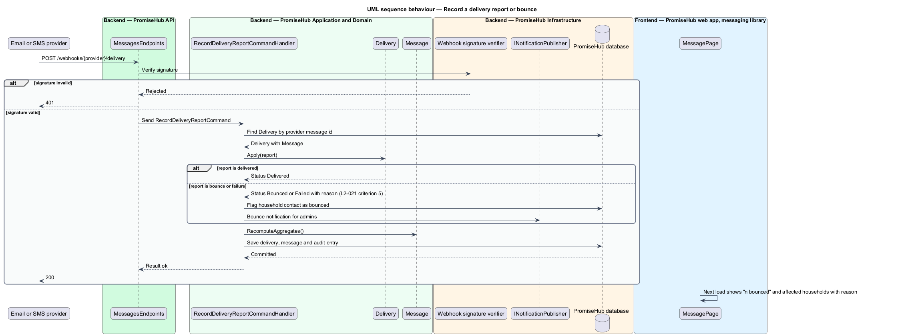

# Compose and send a message

## Overview

PromiseHub is a multi-tenant, phone-first system of record for small youth-serving non-profits. The Messages module lets staff reach the guardians of enrolled children by text, email and push without leaving the app. This feature covers the staff side of that module: composing a message to a filtered audience, previewing its cost, sending it now or at a scheduled time, and tracking what happened to each household afterwards.

A message is addressed to households, not to individual guardians. Each household has a preferred language and a contact channel, so one composed message fans out into one delivery per household, rendered in that household's language and sent over the channel the household can receive. Staff see one row in Messages with an aggregate status and can open it to see per-household delivery, replies and bounces.

Local terms:

- **message** — staff-authored communication addressed to a set of households through one or more channels
- **audience filter** — combination of program, age band, language and status criteria that selects the households a message reaches
- **recipient preview** — server-computed count of matching households, split by channel, together with the SMS segment estimate
- **SMS segment** — unit of text-message billing, 160 GSM-7 characters for a single-segment message and 153 per segment thereafter
- **delivery** — one outbound copy of a message to one household over one channel, carrying its own status
- **bounce** — delivery that the email or SMS provider reports as undeliverable, with a provider reason

The slice spans the `new-message`, `messages` and `message` screens and the `send-now` and `cancel-send` dialogs. The per-organization SMS cap that limits text sending is designed separately in `messaging/enforce-sms-cap`; this feature consumes the cap state the other feature exposes.

## Description

### Frontend

The Angular feature library `frontend/projects/messaging/` owns the pages and dialogs. It composes screens from `frontend/projects/components/` and calls the backend only through the typed client in `frontend/projects/api/`.

- **`MessagesPage`** — lists sent, scheduled and draft messages for the active organization (`messages`). Filter chips All, Text, Email, Scheduled and Drafts narrow the list. Each row shows title, sent time, recipient count, audience summary, channels and an aggregate badge: `Sending`, `Delivered`, `Scheduled`, `Cancelled` or `n bounced`. The page renders loading, empty, error, no-results and long states.
- **`NewMessagePage`** — the composer (`new-message`). The Who card holds the audience filter: program select, age select, language select and the narrowing checkboxes for unsigned slips and children absent today. The What card holds the body textarea with a character counter, the Send-by radio group (text with email fallback, email only, text only) and the When radio group (now or schedule with a date-time). A recipient-count status region shows the recipient preview. States: default, invalid, submitting, success, error (preview failed, form stays editable), no-results (zero recipients disables Send with a reason) and over-cap.
- **`MessagePage`** — one message (`message`). Shows the rendered SMS preview with its segment count, the languages it was sent in, delivery KPIs (Delivered, Opened link, Replied, Bounced), the per-household delivery list with status and reason, and replies. The scheduled state shows Edit, Send now and Cancel send actions. Partial state renders delivery when replies fail to load.
- **`SendNowDialog`** — CDK dialog (`send-now`) that confirms sending a scheduled message ahead of its time.
- **`CancelSendDialog`** — CDK dialog (`cancel-send`) that confirms cancelling a scheduled message; the message is kept as a draft.
- **`estimateSegments`** — pure function in `frontend/projects/messaging/` that estimates characters and segments for the typed body while the user types. The server-side value from the recipient preview replaces it on each debounced preview response, so the displayed count never disagrees with what the backend will bill.
- **`MessagingApi`** — service in `frontend/projects/api/` behind the `MESSAGING_API` injection token. Methods: `listMessages(filter)`, `previewAudience(request)`, `createMessage(request)`, `getMessage(id)`, `sendNow(id)`, `cancelScheduled(id)`.

Pages never call `HttpClient` directly and never compute authorization; the server decides every count and status.

### Backend

`PromiseHub.Api` exposes `MessagesEndpoints` as minimal-API routes under `/messages`. The endpoints authenticate, resolve the active organization from the membership, check that the Messages module is on (404 otherwise, per `L2-005`) and dispatch to `PromiseHub.Application/Messaging/`.

| Route | Handler | Purpose |
|---|---|---|
| `GET /messages` | `ListMessagesQueryHandler` | Rows for `MessagesPage` with chip filter |
| `POST /messages/preview` | `PreviewAudienceQueryHandler` | Recipient preview for the composer |
| `POST /messages` | `CreateMessageCommandHandler` | Create and either queue now or schedule |
| `GET /messages/{id}` | `GetMessageQueryHandler` | Message with deliveries and replies |
| `POST /messages/{id}/send-now` | `SendMessageNowCommandHandler` | Promote a scheduled message to sending |
| `POST /messages/{id}/cancel` | `CancelScheduledMessageCommandHandler` | Cancel a scheduled message |
| `POST /webhooks/{provider}/delivery` | `RecordDeliveryReportCommandHandler` | Provider delivery and bounce reports |

Application components in `PromiseHub.Application/Messaging/`:

- **`AudienceFilter`** — value object with `ProgramId`, `AgeBand`, `Language`, `UnsignedSlipEventId` and `AbsentToday`, each optional. `AudienceResolver` turns it into the set of households of the active organization, reading the Roster, Slips and Roll Call data of that organization only (`L2-001`).
- **`SegmentCalculator`** — domain service that computes GSM-7 or UCS-2 encoding, character count and segment count for a body rendered in a household language with the organization's sender prefix. Thresholds: 160 characters for one GSM-7 segment and 153 per segment above that; UCS-2 bodies use 70 and 67.
- **`PreviewAudienceQueryHandler`** — resolves the audience, splits households into text-capable and email-only, multiplies text recipients by the segment count, and asks `ISmsCapService` (owned by `enforce-sms-cap`) how many segments remain. The response carries `RecipientCount`, `TextCount`, `EmailOnlyCount`, `Characters`, `Segments`, `TotalSegments`, `RemainingSegments` and `HouseholdsFallingBackToEmail`.
- **`CreateMessageCommand`** and **`CreateMessageCommandHandler`** — `CreateMessageCommandValidator` requires a non-empty body of at most 480 characters (the composer counter limit) and a channel choice. The handler requires the `Messages.Send` permission, creates a `Message` with its `AudienceFilter` snapshot, resolves the audience once and creates one `Delivery` per household in the household's language and channel. With "Now" chosen it sets status `Sending` and enqueues a `SendMessageJob`; otherwise it sets `Scheduled` with `ScheduledFor`. The command is one unit of work.
- **`SendMessageJob`** — job in the per-tenant job runner (see `platform/run-background-jobs`). It renders each pending `Delivery`, calls `ISmsCapService.TryReserve(segments)` per text delivery, and hands the payload to `ISmsSender`, `IEmailSender` or `IPushSender`. A text delivery refused by the cap is re-targeted to email when the household has one and recorded as `FellBackToEmail`. The job is idempotent per delivery and retries with backoff per `L2-034`.
- **`ScheduledMessageDispatcher`** — job that runs every minute per tenant, finds `Scheduled` messages whose `ScheduledFor` has passed, moves them to `Sending` and enqueues `SendMessageJob`.
- **`SendMessageNowCommandHandler`** and **`CancelScheduledMessageCommandHandler`** — transition a `Scheduled` message to `Sending` or `Cancelled`. Both reject any other state with a 409 ProblemDetails. Cancelling before the dispatcher runs guarantees nothing is sent (`L2-021` criterion 4).
- **`RecordDeliveryReportCommandHandler`** — translates a provider callback into a `DeliveryStatus` (`Delivered`, `Bounced`, `Failed`) and a reason on the matching `Delivery`, then recomputes the parent `Message` aggregates (`DeliveredCount`, `BouncedCount`). A bounce also raises an in-app notification for admins (see `notifications/notify-in-app`) and flags the guardian contact on the household.
- **`GetMessageQueryHandler`** — returns the message, its deliveries ordered with bounced first and showing household name, channel, status, reason and time, and the replies.

Domain entities in `PromiseHub.Domain/Messaging/`: `Message` (aggregate root), `Delivery`, `Reply`, enums `MessageStatus` (`Draft`, `Scheduled`, `Sending`, `Sent`, `Cancelled`), `DeliveryStatus` (`Queued`, `Sent`, `Delivered`, `Bounced`, `Failed`, `FellBackToEmail`) and `Channel` (`Sms`, `Email`, `Push`). Every entity carries `OrganizationId`.

`PromiseHub.Infrastructure` provides `PromiseHubDbContext` mappings with a global query filter on `OrganizationId`, the `SmsProvider`, `EmailProvider` and `PushProvider` adapters behind `ISmsSender`, `IEmailSender` and `IPushSender`, the webhook signature check for delivery reports, and the job runner. Every create, send, cancel and delivery report writes an audit entry through `IAuditWriter` (see `audit/record-and-search-audit`).

### Undecided details

- Provider identities for SMS, email and push are `<TO SUPPLY>`.
- Whether a reply to a text is matched to a message by provider conversation id or by the most recent message to that household is `<TO SUPPLY>`.
- The translation service behind the composer help text "Machine-translated per household language" is `<TO SUPPLY>`; the design assumes the sender writes one body and the renderer produces the Spanish and French copies.

## Requirements

The feature realizes the following level-2 (L2) requirement and enforces the cross-cutting ones listed with it.

| L2 ID | Refines (L1) | Requirement |
|-------|--------------|-------------|
| `L2-021` | `L1-010` | Staff compose a message to guardians filtered by program, age, language or slip status, choose channels, preview the SMS segment count and send now or later. |
| `L2-001` | `L1-001` | Every tenant-owned table carries the organization id; every query, search, export and background job filters by the organization of the signed-in person's active membership, never by a value from the client. |
| `L2-005` | `L1-002` | A module that is off is neither served nor rendered. |

## Diagrams

### System context

Staff compose and send messages through PromiseHub, which delivers them through external SMS, email and push providers and receives delivery reports back from them.

### Containers

The composer in the PromiseHub web app calls the PromiseHub API; the API persists the message and its deliveries in the database and enqueues the send job, which the job runner executes against the providers.

### Components

Inside the API, `MessagesEndpoints` dispatches queries and commands to the Messaging handlers; `AudienceResolver` and `SegmentCalculator` compute the preview, and `SendMessageJob` performs delivery with the cap check.

### Class structure

`Message` owns its `Delivery` and `Reply` children and a snapshot of the `AudienceFilter`; the handlers depend on `AudienceResolver`, `SegmentCalculator` and `ISmsCapService`.

### Behaviour — preview the audience and send now

The composer requests a recipient preview on each change, then creates the message; the handler fans it out into deliveries and the job delivers each one, falling back to email when the cap refuses a text.

### Behaviour — cancel a scheduled send

Cancelling a scheduled message before the dispatcher runs marks it cancelled and keeps it as a draft; the dispatcher never picks it up.

### Behaviour — record a delivery report or bounce

Provider callbacks update the matching delivery, recompute the message aggregates and raise a bounce notification for admins.

