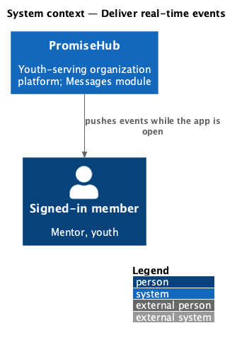
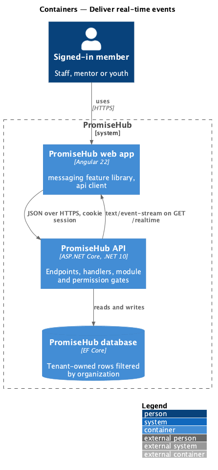
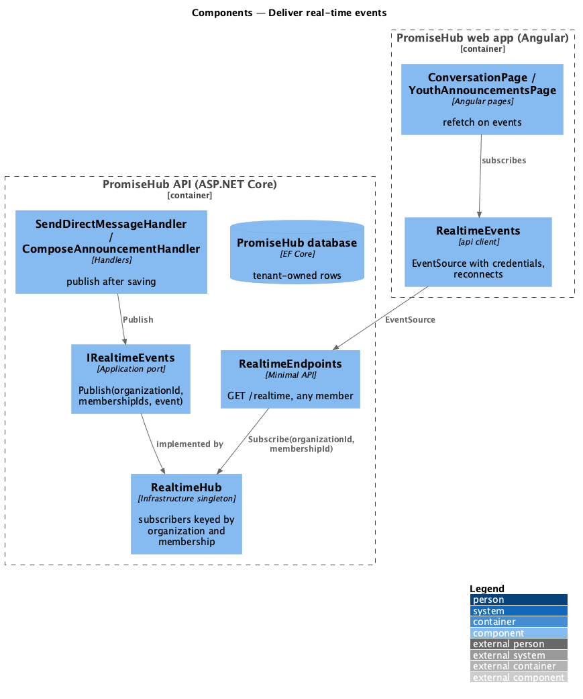
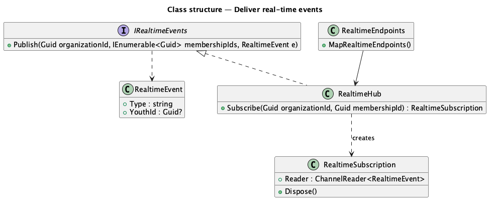
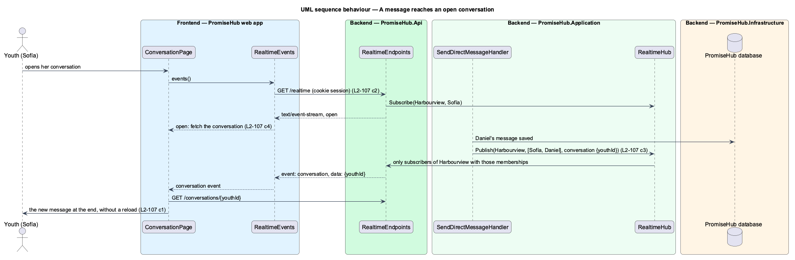
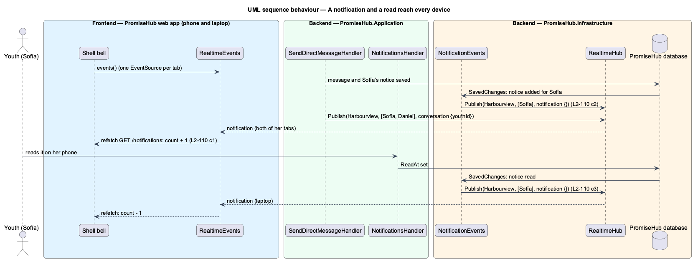

# Deliver real-time events

## Overview

A conversation only feels like a conversation when a reply shows up without pressing reload. **Deliver real-time events** keeps one server-sent event stream open per signed-in tab and pushes a small event when something the member may read has changed: a direct message in one of her conversations, or an announcement sent to her. The event names what changed and nothing else; the page then fetches it through the ordinary, permission-checked endpoint.

Terms used in this document:

- **event stream** — `GET /realtime`, a `text/event-stream` response held open for the signed-in member in the active organization, with a comment every 25 seconds to keep proxies from closing it
- **event** — `conversation` with `{ "youthId": … }`, `announcement` with `{}`, or `notification` with `{}` (prompt 75)
- **subscriber** — one open stream, keyed by organization id and membership id

Ported from Waypoint `non-functional/deliver-realtime-events` (`L2-NFR-005`). Waypoint's SignalR hub with bearer tokens becomes a server-sent event stream on PromiseHub's cookie session (ADR 0005, ADR 0068): the browser's `EventSource` sends the cookie, reconnects on its own and needs no extra package. Prompt 75 adds notifications to the same stream (`L2-110`, ADR 0069); Waypoint's `non-functional/deliver-realtime-events` is ported once, here, for both.

## Description

- **`IRealtimeEvents`** and **`RealtimeEvent`** (`PromiseHub.Application/Messaging/`) — the port handlers publish to after saving: an organization id, the recipient membership ids and the event.
- **`RealtimeHub`** (`PromiseHub.Infrastructure/Messaging/`) — a singleton holding one bounded channel per subscriber; `Publish` writes only to subscribers whose organization and membership match, so another tenant's members never receive an event.
- **`RealtimeEndpoints`** (`PromiseHub.Api/Endpoints/`) — `GET /realtime` with `AllowAnyMember()`; the tenant and membership come from the session, never from the request; anonymous answers 401. It writes `event:`/`data:` lines as events arrive and a keep-alive comment every 25 seconds, and removes the subscriber when the client goes.
- **`RealtimeEvents`** with `REALTIME_EVENTS` and `EventSourceRealtimeEvents` (`frontend/projects/api/src/lib/realtime/`) — an `Observable` over `EventSource(apiBase + '/realtime', { withCredentials: true })` emitting `open` on every (re)connection and each named event; pages subscribe only while open, so nothing is opened elsewhere; one `EventSource` per tab is shared by every subscriber (the shell's bell, the notification center and the page).
- **`NotificationEvents`** (`PromiseHub.Infrastructure/Notifications/`) — an EF Core save interceptor: after a save that adds notices it publishes `notification` to each recipient, and after a save that reads notices to the reader, so every producer and every device follow without each handler publishing (`L2-110`).
- **`ConversationPage`**, **`ConversationsPage`** and **`YouthAnnouncementsPage`** refetch on `open` and on their events, so a dropped connection loses nothing and the server's answer replaces the list, never adding a message twice.

Open questions: none. Deferred: presence and typing indicators, scale-out across several API instances (a single instance holds the subscribers; a shared broker would replace `RealtimeHub` behind the same port).

## Built so far

Prompt 74 delivered everything above: `IRealtimeEvents`, `RealtimeEvent`, `RealtimeHub` and `RealtimeSubscription`, `RealtimeEndpoints`, `REALTIME_EVENTS` with `EventSourceRealtimeEvents`, and the quiet refetch on the conversation, conversations and announcements pages. Acceptance tests: `backend/tests/PromiseHub.Api.Tests/RealtimeTests.cs` and `e2e/tests/messaging/realtime.spec.ts` (the fake API answers the stream as a long poll, so every response ends with a reconnection). It is estimated at 90%, not 100%, because two parts are deferred by ADR 0068: no event fires at a scheduled announcement's send time (its readers see it on their next fetch), and the stream runs on one API instance only (scale-out needs a shared broker).

Prompt 75 added the `notification` event through the `NotificationEvents` save interceptor, shared the `EventSource` between subscribers and made the bell and the notification center follow it (`RealtimeTests.cs`, `e2e/tests/notifications/receive-notifications.spec.ts`).

## Requirements

| L2 ID | Refines (L1) | Requirement |
|-------|--------------|-------------|
| `L2-107` | `L1-018` | A message or announcement reaches the people it is for while they have the app open, without a reload, and only them. |
| `L2-110` | `L1-018` | A new notification reaches its recipient's open app at once, the bell and the center follow without a reload, and a read on one device shows on the others. |
| `L2-001` | `L1-001` | Tenant isolation (cross-referenced). |

## Diagrams

### System context

### Containers

### Components

### Class structure

### Behaviour — a message reaches an open conversation

### Behaviour — a notification and a read reach every device

A notice saved for Sofía tells her open tabs; reading it on one tells the others.

