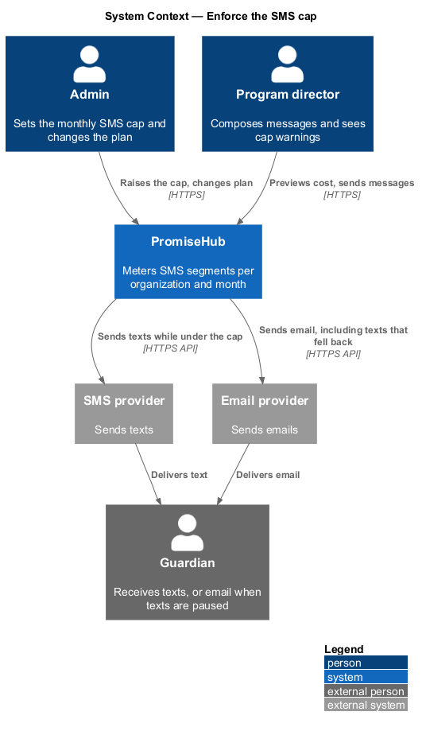
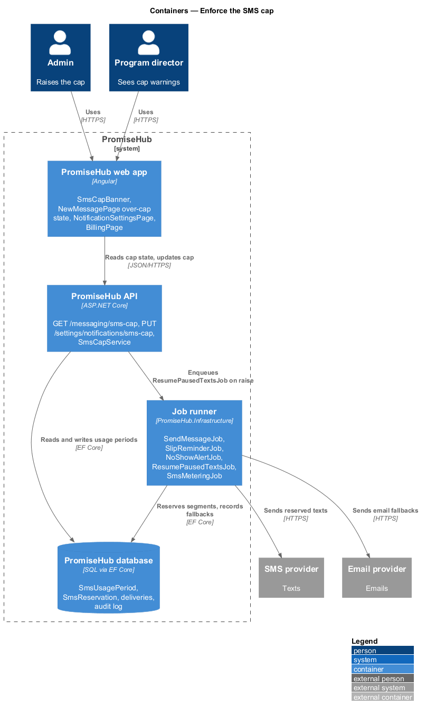
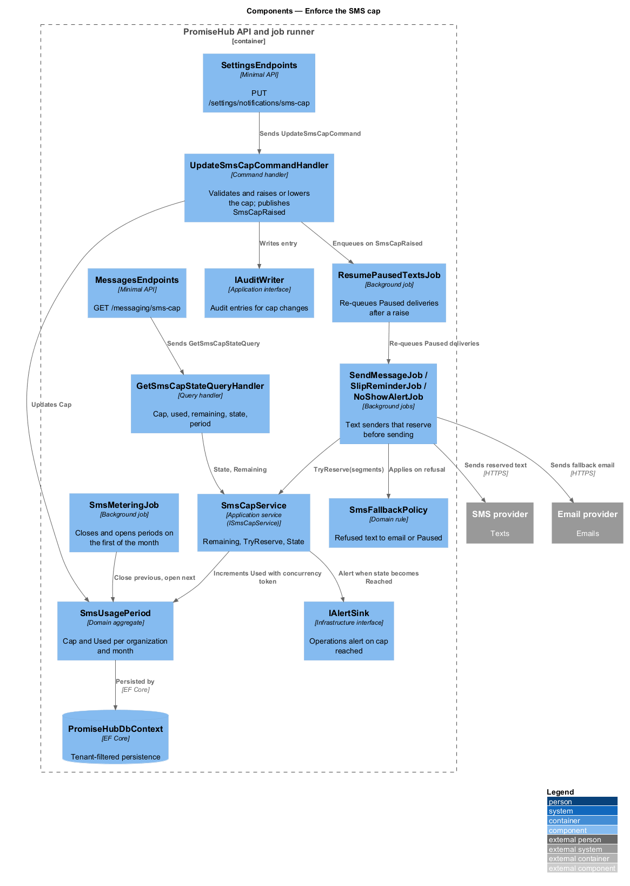
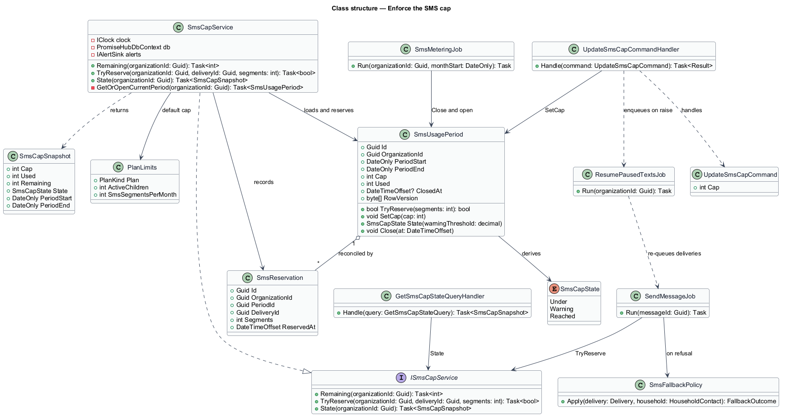
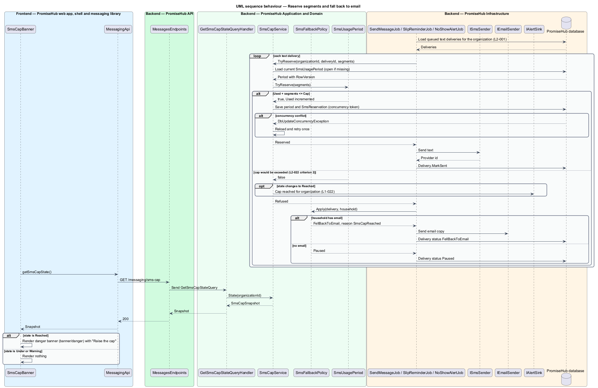
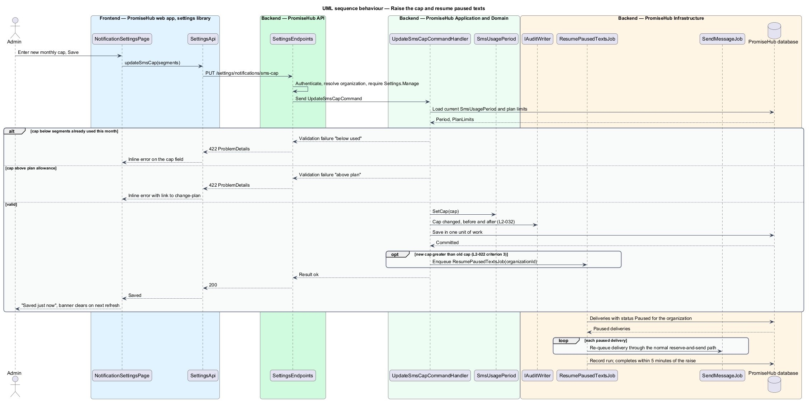
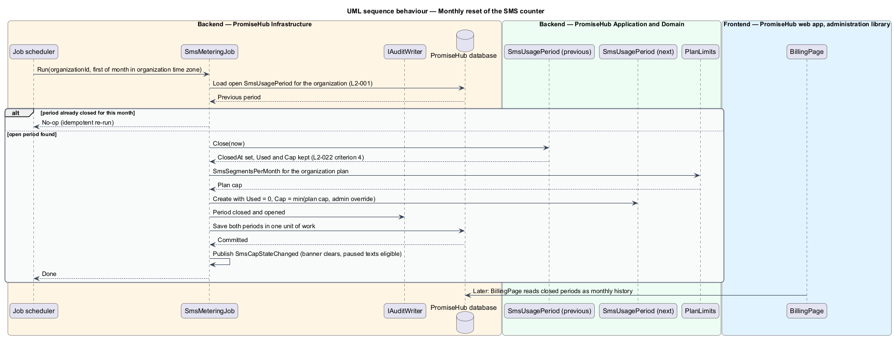

# Enforce the SMS cap

## Overview

PromiseHub sends text messages to guardians on behalf of each organization: staff-composed messages, permission-slip reminders and no-show alerts. Texts cost money per segment, so every organization carries a monthly cap on SMS segments that depends on its plan. This feature meters segment use against that cap, warns before the cap is reached, pauses texts at the cap while email continues, resumes texts when the cap is raised, and resets the counter each month without losing history.

The cap is a tenant-level control. The composer in `messaging/compose-and-send-message` shows its effect before a send; the reminder and no-show jobs in `slips/remind-and-clear` and `attendance/alert-no-show-and-end-session` consult it before each text; `billing/meter-plan-and-usage` shows the running total. This feature owns the counter, the reservation rule and the fallback rule that all of those consume.

Local terms:

- **SMS segment** — unit of text-message billing, 160 GSM-7 characters for a single-segment message and 153 per segment thereafter
- **segment cap** — maximum number of SMS segments an organization may send in one calendar month, set by its plan and adjustable by an admin within the plan's allowance
- **usage period** — calendar month in the organization's time zone over which segments are counted
- **cap state** — one of `Under`, `Warning` and `Reached`, derived from used segments against the cap
- **paused text** — text delivery that the cap refused and that was sent by email instead or held for retry
- **automatic text** — text the system originates on a schedule without a staff send, such as a slip reminder or a no-show alert

The slice spans the over-cap state of `new-message`, the SMS cap field on `settings-notifications`, the danger banner (`banner/danger`), the plan change dialog `change-plan` and the usage meter on `billing`.

## Description

### Frontend

- **`NewMessagePage`** (in `frontend/projects/messaging/`) renders the `AudiencePreview` fields `RemainingSegments` and `HouseholdsFallingBackToEmail` returned by the preview endpoint. When `TotalSegments` exceeds `RemainingSegments` the recipient-count region shows the warning "will exceed the cap" and the number of households that get email only; when the cap state is `Reached` the text channel choices are disabled and the page shows the over-cap state (`new-message/over-cap`).
- **`SmsCapBanner`** — component in `frontend/projects/components/` rendered by the shell when the session's cap state is `Reached`. Copy follows `banner/danger`: the segments used of the cap, that texts pause until the first of next month, that email still sends, and a primary action to raise the cap that routes to `settings-notifications`. The shell reads the cap state from `SessionApi` once per session and refreshes it after any send.
- **`NotificationSettingsPage`** (in `frontend/projects/settings/`) holds the "Monthly SMS cap (segments)" field with help text showing segments used this month. Validation rejects a value below the segments already used in the current period and a value above the plan allowance.
- **`BillingPage`** (in `frontend/projects/administration/`) shows the SMS meter and per-month history; design in `billing/meter-plan-and-usage`.
- **`MessagingApi`** gains `getSmsCapState()`; **`SettingsApi`** behind `SETTINGS_API` gains `updateSmsCap(segments)`.

### Backend

`PromiseHub.Api` exposes `GET /messaging/sms-cap` (cap, used, remaining, state, period) through `MessagesEndpoints` and `PUT /settings/notifications/sms-cap` through `SettingsEndpoints`. Both require authentication and the Messages module; the PUT additionally requires the `Settings.Manage` permission.

Application components in `PromiseHub.Application/Messaging/`:

- **`ISmsCapService`** — the contract every text sender uses. `Remaining(organizationId)` returns the segments left in the current period; `TryReserve(organizationId, segments)` atomically increments the period counter when the result stays within the cap and returns `false` otherwise; `State(organizationId)` returns the `SmsCapState`.
- **`SmsCapService`** — implementation. It loads the organization's `SmsUsagePeriod` for the current month, creating it on first use with the cap from `PlanLimits` for the organization's plan or the admin override, whichever is lower. Reservation uses an optimistic concurrency token on the period row so concurrent jobs cannot overspend. The `Warning` threshold is `<TO SUPPLY>`; the mock meter colours the bar at 60 percent but the specification states no value.
- **`SmsFallbackPolicy`** — domain rule applied by `SendMessageJob`, `SlipReminderJob` and `NoShowAlertJob`: when `TryReserve` fails, the delivery is re-targeted to email when the household has an email, recorded as `FellBackToEmail` with reason `SmsCapReached`, and otherwise recorded as `Paused`. Email sending never consults the cap (`L2-022` criterion 2).
- **`UpdateSmsCapCommand`** and **`UpdateSmsCapCommandHandler`** — validate the new cap against segments used and the plan allowance, update the current `SmsUsagePeriod.Cap`, write an audit entry and publish `SmsCapRaised` when the new cap exceeds the old one.
- **`ResumePausedTextsJob`** — enqueued on `SmsCapRaised` and also on a plan upgrade from `billing/meter-plan-and-usage`. It finds deliveries in state `Paused` for the organization, re-queues them through the normal send path, and completes within 5 minutes of the raise (`L2-022` criterion 3). Deliveries that already fell back to email are not re-sent as texts.
- **`SmsMeteringJob`** — runs on the first of each month per tenant in the organization's time zone. It closes the previous `SmsUsagePeriod`, opens a new one with `Used = 0` and the plan cap, and raises `SmsCapStateChanged` so the banner clears. Closed periods are kept for Billing (`L2-022` criterion 4).
- **`GetSmsCapStateQueryHandler`** — returns cap, used, remaining, state and period boundaries for the banner, composer and Billing.

Domain entities in `PromiseHub.Domain/Messaging/`: `SmsUsagePeriod` (`OrganizationId`, `PeriodStart`, `PeriodEnd`, `Cap`, `Used`, `ClosedAt`, concurrency token) and `SmsReservation` (one row per reservation with the delivery id, segments and time, for reconciliation against provider invoices). `PlanLimits` in `PromiseHub.Domain/Billing/` supplies the per-plan default cap; the specification states no numeric value, so the defaults are `<TO SUPPLY>`.

`PromiseHub.Infrastructure` maps both entities in `PromiseHubDbContext` with the tenant filter, hosts the three jobs in the per-tenant job runner and raises the operations alert on cap conditions required by `L1-022` through `IAlertSink`.

### Undecided details

- Default segment caps per plan (`PlanLimits.SmsSegmentsPerMonth`) are `<TO SUPPLY>`; the mocks show 2,000 on Standard and 200 on Free as an assumption.
- The `Warning` threshold is `<TO SUPPLY>`.
- Whether a `Paused` text with no email fallback is retried after the monthly reset or dropped is `<TO SUPPLY>`.

## Requirements

The feature realizes the following level-2 (L2) requirement and the cross-cutting ones its slice enforces.

| L2 ID | Refines (L1) | Requirement |
|-------|--------------|-------------|
| `L2-022` | `L1-010` | Each organization has a monthly SMS segment cap by plan; at the cap, texts pause and email continues. |
| `L2-014` | `L1-006` | A slip belongs to one event, has a plain-language body, optional questions, a sign-by date and reminder schedule, and is sent by SMS and email. |
| `L2-001` | `L1-001` | Every tenant-owned table carries the organization id; every query, search, export and background job filters by the organization of the signed-in person's active membership, never by a value from the client. |

`L2-014` appears because its fourth acceptance criterion (texts skipped at the cap, emails sent, sender told which households got email only) is enforced by `SmsFallbackPolicy` in this slice.

## Diagrams

### System context

Admins set the cap and staff see its effect; PromiseHub meters texts sent through the SMS provider and lets email continue through the email provider.

### Containers

The web app reads the cap state and shows the banner and composer warning; the API and the job runner share the cap service, which persists usage periods in the database.

### Components

`SmsCapService` sits between every text-sending job and the provider; `SmsMeteringJob` and `ResumePausedTextsJob` manage the period lifecycle.

### Class structure

`SmsUsagePeriod` is the metered aggregate; `SmsCapService` reserves against it, and the jobs depend on `SmsFallbackPolicy` and `ISmsCapService`.

### Behaviour — reserve segments and fall back to email

A text-sending job reserves segments per delivery; a refusal routes the delivery to email or pauses it, and the banner reflects the `Reached` state.

### Behaviour — raise the cap and resume paused texts

An admin raises the cap in settings or through a plan change; the handler validates, audits and triggers the resume job, which re-queues paused texts within 5 minutes.

### Behaviour — monthly reset

On the first of the month the metering job closes the period, opens the next one with a zero counter and keeps the closed period for Billing.

