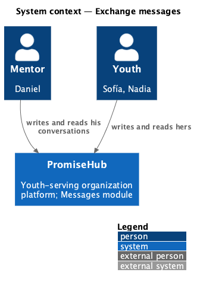
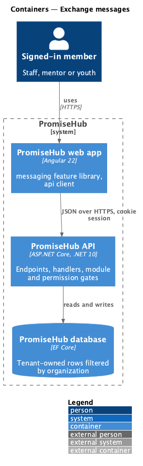
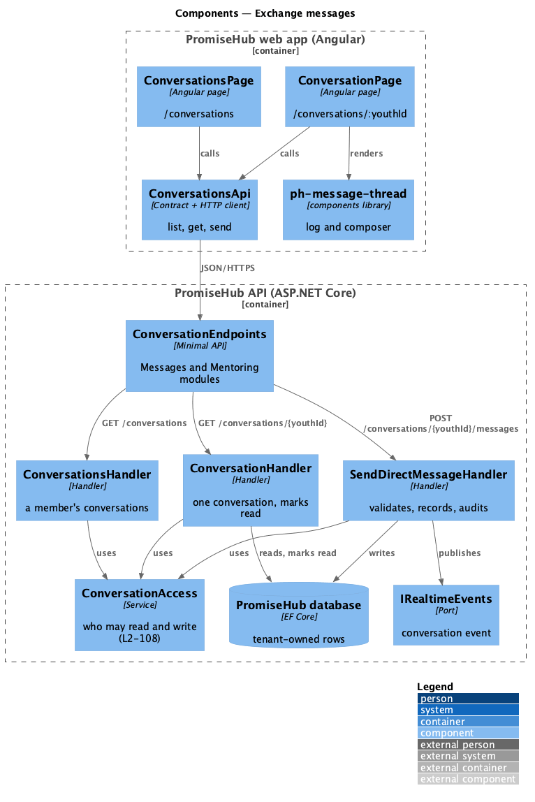
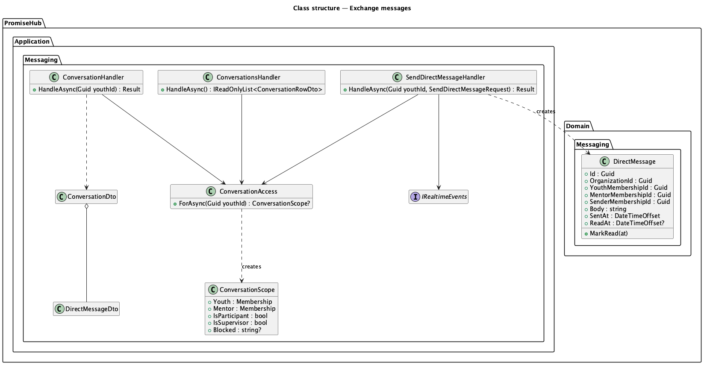
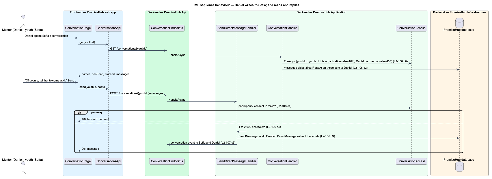

# Exchange messages

## Overview

A mentor and the youth he mentors need a direct way to talk between sessions: a question about a reflection, a room change, a word of encouragement. **Exchange messages** gives each youth account with an assigned mentor one conversation with that mentor. Either of them writes; both see what is new; the conversation is kept. Nobody else writes in it: the safeguards are in safeguard-direct-messages, and the near-real-time arrival of a message in deliver-realtime-events.

Terms used in this document:

- **conversation** — every `DirectMessage` of one youth membership with her current mentor; identified in routes by the youth's membership id
- **mentor of a youth** — the membership named by the `YouthMentor` row of the youth's linked child (L2-062)
- **participant** — the youth or her current mentor

Ported from Waypoint `engagement/exchange-messages` (`L2-ENGAGE-007`). Waypoint keys threads by the two user ids; PromiseHub keys them by the youth and records the mentor on each message, so a reassigned youth starts a new conversation with the new mentor (ADR 0068). Waypoint's group broadcast is deferred.

## Description

Frontend (`frontend/projects/messaging/`):

- **`ConversationsPage`** (`/conversations`, mock `conversations`) — a mentor's conversations, a youth's one conversation, or every conversation for a supervisor; each row a `ph-list-item` link with the other person, the last message (“You:” when it was the reader's) and a trailing New count, Waiting for consent badge or time; empty, loading, error and forbidden states. It refetches on a `conversation` event.
- **`ConversationPage`** (`/conversations/:youthId`, mock `conversation`) — the other person's name, a `ph-message-thread` (log and composer), Sending… while a send is in flight, Not sent with Try again when it fails, the server's field error, the blocked alert and a read-only view for supervisors. It refetches on a `conversation` event naming this youth.
- **`ph-message-thread`** (`frontend/projects/components/`) — the design system's message thread: a labelled ordered log in a polite live region, day separators, theirs and the reader's own, sending and failed messages said in words, a composer with a labelled textarea and Send; inputs for the messages, `canSend`, `sending`, `error`; output `send`.

API client (`frontend/projects/api/src/lib/messaging/`): `ConversationsApi` with `CONVERSATIONS_API` and `HttpConversationsApi`: `list()`, `get(youthId)`, `send(youthId, body)`.

Backend:

- **`DirectMessage`** (`PromiseHub.Domain/Messaging/`) — tenant-owned; no update or delete is offered. Migration `DirectMessages`.
- **`ConversationAccess`** (`PromiseHub.Application/Messaging/`) — resolves a youth membership of the active organization, her mentor and the caller's standing (participant, supervisor or neither) and whether consent blocks it.
- **`ConversationsHandler`**, **`ConversationHandler`** and **`SendDirectMessageHandler`** — list, read (marking the caller's received messages read) and send (1 to 2,000 characters, stored and returned as plain text; Angular renders it as text, never as markup), auditing `Created DirectMessage` with the two names only.
- **`ConversationEndpoints`** — `GET /conversations`, `GET /conversations/{youthId}`, `POST /conversations/{youthId}/messages`, gated by the Messages and Mentoring modules and `RequireAnyPermission(MentorYouth, Learn, SuperviseConversations)`; the handlers decide per conversation.

Open questions: none. Deferred: a mentor's broadcast to a group, attachments, editing and deleting (never offered, by L2-108).

## Built so far

Prompt 74 delivered everything above: `DirectMessage` (migration `AnnouncementsAndDirectMessages`), `ConversationAccess` and `ConversationScope`, `ConversationsHandler`, `ConversationHandler`, `SendDirectMessageHandler` with `SendDirectMessageOutcome`, `ConversationEndpoints`, `ConversationsApi`, `ph-message-thread` (`PhMessageThread`, `ThreadMessage`), `ConversationsPage` and `ConversationPage`, and Messages in the youth and mentor navigation. Acceptance tests: `backend/tests/PromiseHub.Api.Tests/ConversationsTests.cs` and `e2e/tests/messaging/conversations.spec.ts`.

## Requirements

| L2 ID | Refines (L1) | Requirement |
|-------|--------------|-------------|
| `L2-106` | `L1-024` | A mentor and each youth he mentors write to each other in one conversation; each sees what is new; nobody else writes in it. |
| `L2-108` | `L1-024` | Safeguards for minors in direct messages (dependency). |
| `L2-107` | `L1-018` | Near-real-time delivery of messages and announcements (dependency). |
| `L2-032` | `L1-017` | Audit trail (cross-referenced). |

## Diagrams

### System context

### Containers

### Components

Every handler asks `ConversationAccess` first, so the tenant, the participant check and the consent check are one rule.

### Class structure

### Behaviour — Daniel writes to Sofía

