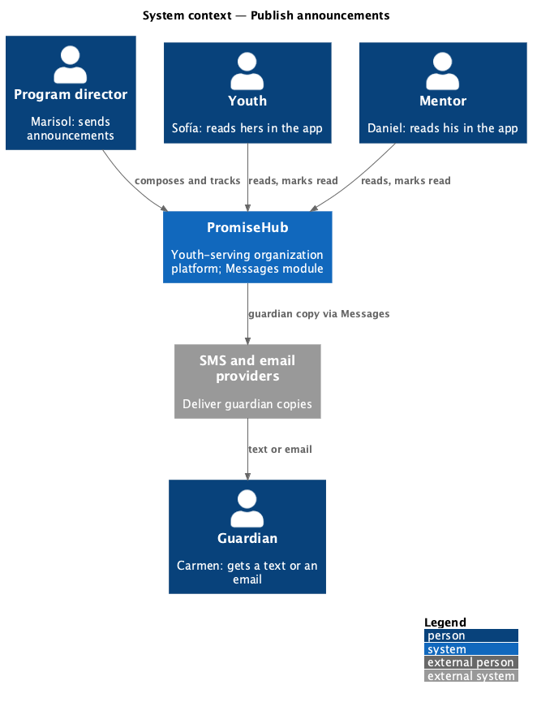
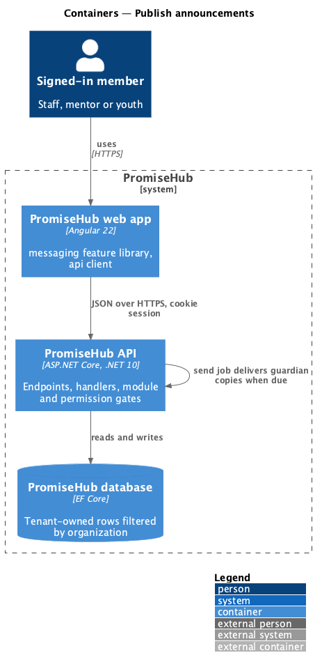
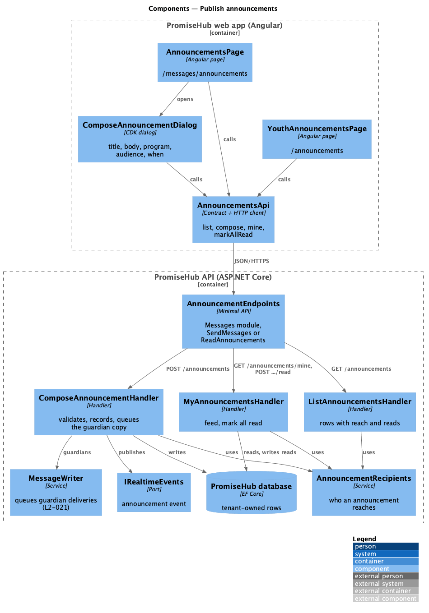
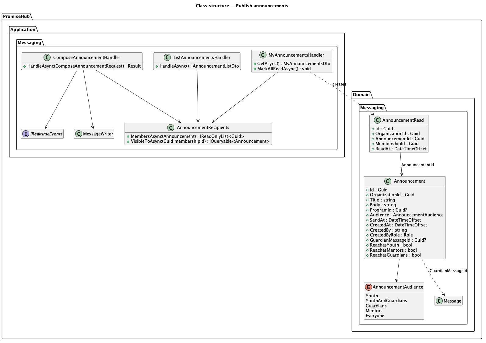
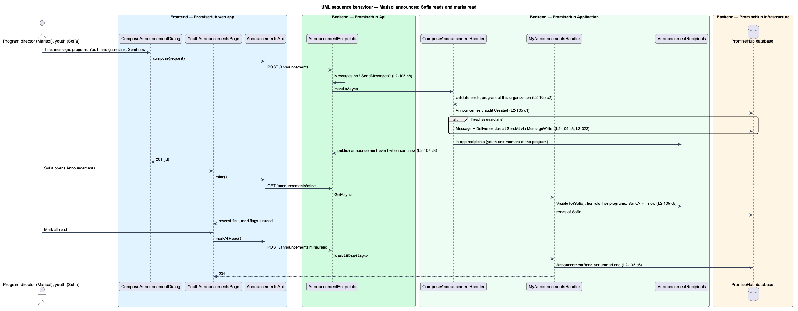

# Publish announcements

## Overview

Staff need one way to tell a program, or everyone, what is coming: a trip, a room change, a huddle for mentors. **Publish announcements** lets an admin, program director or site lead (the Send messages permission) write an announcement once, aim it at a program or the whole organization and at youth, guardians, mentors or everyone, send it now or at a later time, and see how many of the people it reached in the app have read it. Youth and mentors read the announcements aimed at them in the app and mark them read; guardians, who have no accounts (L1-013), get the same words as a Messages-module message by text or email and read it on the guardian pages (L2-103).

Terms used in this document:

- **announcement** — an `Announcement` row: title, body, an optional program (none means all programs), an audience and a send time
- **audience** — `AnnouncementAudience`: `Youth`, `YouthAndGuardians`, `Guardians`, `Mentors` or `Everyone`
- **in-app recipient** — a youth account whose linked child is actively enrolled in the program (any program for all programs) when the audience includes youth, and a mentor of the program's team or of a youth enrolled in it (every mentor for all programs) when it includes mentors
- **guardian copy** — a `Message` with `Source = Messages` and one `Delivery` per household of the enrolled children, written by the existing `MessageWriter` with deliveries due at the send time, so the send job, the SMS cap (L2-022) and the guardian pages work unchanged
- **scheduled** — `SendAt` later than now; nobody sees it and no delivery is due until then

Ported from Waypoint `engagement/publish-announcements` (`L2-ENGAGE-006`). A cohort is a program (ADR 0043); Waypoint's per-user read rows stay per member; its guardian accounts become guardian copies (ADR 0068).

## Description

Frontend (`frontend/projects/messaging/`):

- **`AnnouncementsPage`** (`/messages/announcements`, mock `announcements`) — breadcrumb back to Messages, New announcement, two `ph-stat`s (sent this month with the scheduled count; read in the app), and a `ph-list` of text rows with the program and audience, the body, when and by whom, the households sent the guardian copy, and a trailing `ph-badge` (Scheduled, or Read by n of n). Toasts for sent and scheduled; empty, loading, error and forbidden states. Linked from the Messages page.
- **`ComposeAnnouncementDialog`** (CDK dialog via `PhDialogs`, mock `compose-announcement`) — Title, Message with a counter, Program, Who hears it (radio group with hints), When (Send now or Schedule for later with date and time), an info alert about guardian texts and the SMS cap, the error summary and per-field errors from the server, busy and failed states.
- **`YouthAnnouncementsPage`** (`/announcements`, mock `youth-announcements`) — for youth and mentors: Mark all read, a `ph-list` with New badges, who sent each, their role, when and the program; success, mark-failed, empty, loading and error states. It refetches on an `announcement` event (deliver-realtime-events).

API client (`frontend/projects/api/src/lib/messaging/`): `AnnouncementsApi` with `ANNOUNCEMENTS_API` and `HttpAnnouncementsApi`: `list()`, `compose(request)`, `mine()`, `markAllRead()`.

Backend:

- **`Announcement`**, **`AnnouncementAudience`** and **`AnnouncementRead`** (`PromiseHub.Domain/Messaging/`), tenant-owned, with the migration `Announcements`. A read is unique per announcement and member.
- **`AnnouncementRecipients`** (`PromiseHub.Application/Messaging/`) — the one targeting rule: the in-app recipients of an announcement, and the announcements visible to a member (sent, aimed at her role, of her programs or all programs). Both read enrollments, `CohortMentor` and `YouthMentor` of the active organization only.
- **`ComposeAnnouncementHandler`** — validates (title 1 to 120, body 1 to 2,000, an audience, a send time from now on), answers 404 for a program outside the organization, records the announcement, queues the guardian copy through `MessageWriter` with `dueAt = SendAt`, audits `Created Announcement`, and publishes an `announcement` event to the in-app recipients when it is sent now.
- **`ListAnnouncementsHandler`** — every announcement of the organization, newest send time first, with status, reach, reads and the guardian copy's household count.
- **`MyAnnouncementsHandler`** — the member's feed with read flags and the unread count; `MarkAllReadAsync` adds an `AnnouncementRead` for each unread one (idempotent; not audited, as it changes no record anyone relies on).
- **`AnnouncementEndpoints`** (`PromiseHub.Api/Endpoints/`) — `GET` and `POST /announcements` (Send messages), `GET /announcements/mine` and `POST /announcements/mine/read` (`ReadAnnouncements`: youth and mentors); every route gated by the Messages module.

Open questions: none. Deferred: drafts, a recipient estimate while composing, editing or cancelling a scheduled announcement, an event at a scheduled announcement's time (its recipients see it on their next fetch).

## Built so far

Prompt 74 delivered everything above: `Announcement`, `AnnouncementAudience` and `AnnouncementRead` with the migration `AnnouncementsAndDirectMessages`, `AnnouncementRecipients`, `ComposeAnnouncementHandler` (with `MessageWriter.Queue`'s new `dueAt`), `ListAnnouncementsHandler`, `MyAnnouncementsHandler` and `RoleWords`, the `ReadAnnouncements` permission, `AnnouncementEndpoints`, `AnnouncementsApi`, `AnnouncementsPage`, `ComposeAnnouncementDialog` and `YouthAnnouncementsPage`, and Announcements in the youth and mentor menu. Acceptance tests: `backend/tests/PromiseHub.Api.Tests/AnnouncementsTests.cs`, `MyAnnouncementsTests.cs`, `e2e/tests/messaging/announcements.spec.ts` and `youth-announcements.spec.ts`.

## Requirements

| L2 ID | Refines (L1) | Requirement |
|-------|--------------|-------------|
| `L2-105` | `L1-010` | Admins, program directors and site leads (Send messages) publish an announcement to one program or the whole organization, aimed at youth, youth and guardians, guardians, mentors or everyone, now or at a later time; youth and mentors read the ones aimed at them in the app and mark them read; staff see how many have read each one. |
| `L2-021` | `L1-010` | Composing and sending messages (cross-referenced: the guardian copy). |
| `L2-022` | `L1-020` | SMS cap per organization (cross-referenced). |
| `L2-032` | `L1-017` | Audit trail (cross-referenced). |

## Diagrams

### System context

Staff publish; youth and mentors read in the app; guardians are reached by the existing text and email providers.

### Containers

### Components

The handlers share `AnnouncementRecipients`, so who an announcement reaches, who may read it and how reads are counted follow one rule.

### Class structure

### Behaviour — Marisol announces; Sofía reads and marks read

