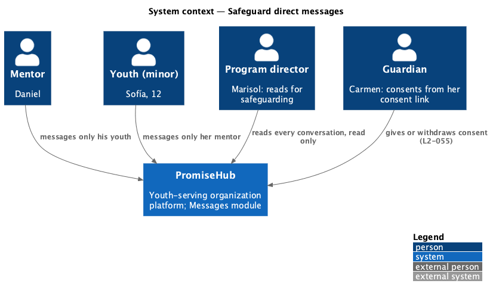
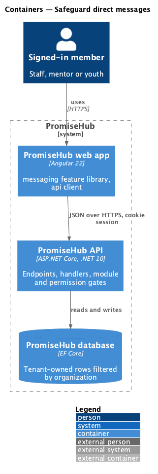
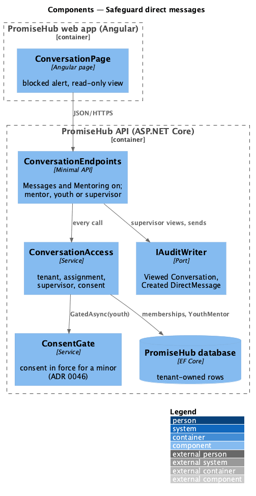
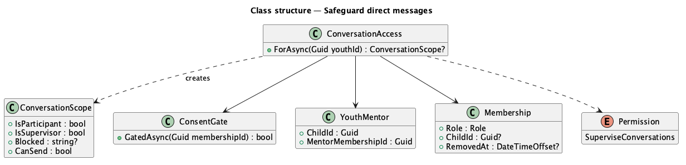
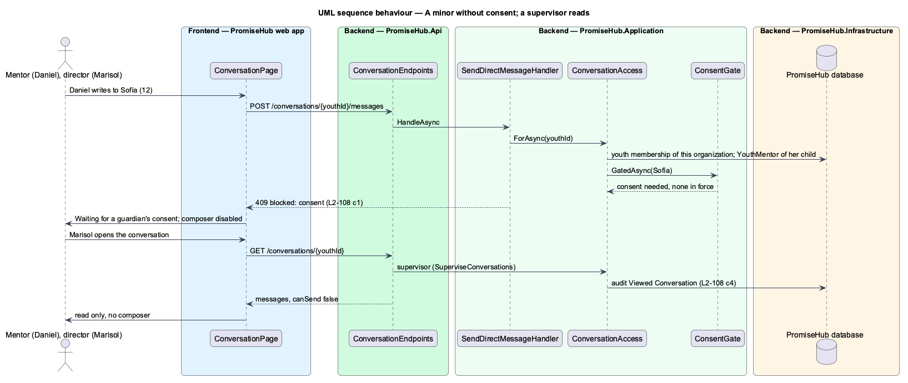

# Safeguard direct messages

## Overview

PromiseHub serves minors, so a private channel between an adult and a child has to follow policy, not convenience. **Safeguard direct messages** holds the rules every direct message obeys: only a mentor and the youth assigned to him write in their conversation; a minor's conversation waits until a guardian's consent is in force; nothing is edited or deleted; and program directors and admins can read every conversation, read only, with each opening recorded.

Terms used in this document:

- **minor** — a youth whose linked child is under the organization's consent age or has no date of birth (ADR 0046)
- **blocked** — `consent` when consent is required and not in force; the conversation is readable but nobody can send
- **supervisor** — a member holding the new `SuperviseConversations` permission: admins and program directors

Ported from Waypoint `consent-and-safeguarding/enforce-minor-safeguards` (`L2-CONSENT-004`) for messages; the consent gate for Learning is guardian/enforce-minor-safeguards (L2-057), which this design reuses.

## Description

- **`ConversationAccess.ForAsync(youthId)`** (`PromiseHub.Application/Messaging/`) — answers null when the youth membership is not a Youth membership of the active organization (404); otherwise the youth, her current mentor, whether the caller is a participant (the youth herself or that mentor) or a supervisor, and `Blocked = "consent"` when `ConsentGate.GatedAsync` says so. Neither participant nor supervisor is 403.
- **`SendDirectMessageHandler`** — refuses a supervisor and anyone else with 403 and a blocked conversation with 409 before validating the words; a reassigned youth's former mentor is no longer a participant.
- **`ConversationHandler`** — for a supervisor answers `canSend = false`, marks nothing read and records `Viewed Conversation` with the two names.
- **`ConversationsHandler`** — for a supervisor lists every conversation of the organization with at least one message.
- **`Permission.SuperviseConversations`** — Admin and ProgramDirector (`RolePermissions`).
- **`ConversationPage`** — the warning alert “Waiting for a guardian’s consent” with the composer disabled, and the read-only view with the audit hint.

Open questions: none. Deferred: notifying a supervisor of keywords, retention periods specific to messages (the organization's retention applies), media consent.

## Requirements

| L2 ID | Refines (L1) | Requirement |
|-------|--------------|-------------|
| `L2-108` | `L1-024` | Messages between an adult and a youth exist only inside the mentoring assignment, wait for a guardian's consent for a minor, are kept, and are readable by program directors. |
| `L2-057` | `L1-023` | The consent gate for minors (cross-referenced). |
| `L2-032` | `L1-017` | Audit trail (cross-referenced). |

## Diagrams

### System context

### Containers

### Components

### Class structure

### Behaviour — a minor without consent; a supervisor reads

