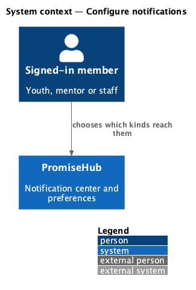
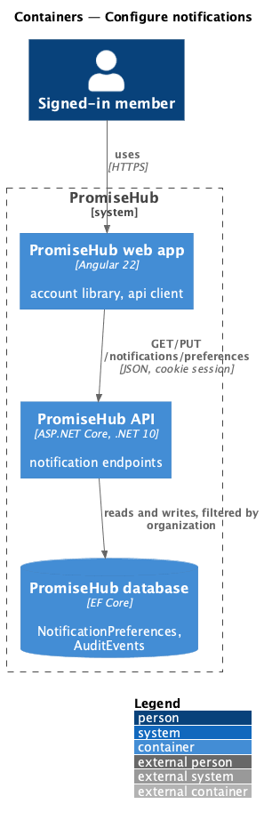
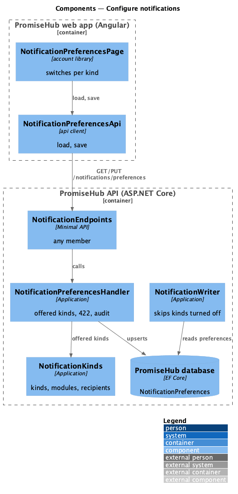
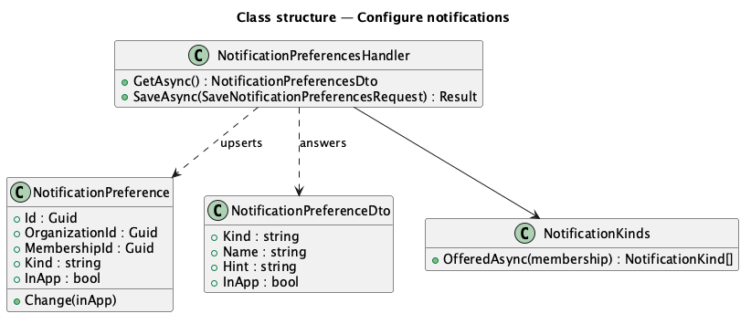
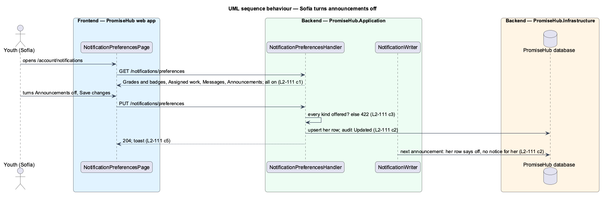

# Configure notifications

## Overview

A youth who does not want every announcement in her center, or a director who only wants incidents, chooses for herself which kinds of notification reach her. **Configure notifications** gives each member of an organization a page of switches, one per kind that member receives, and makes every producer respect them. It is personal: the organization-wide settings (no-show delay, supervisor incident emails and the SMS cap, `L2-040` criterion 6) stay in Settings › Notifications, which admins and program directors manage.

Terms used in this document:

- **preference** — one `NotificationPreference` row: an organization, a membership, a kind and whether it reaches the member in the app; a missing row means on
- **offered kind** — a kind the member's role or permissions receive whose modules are all on (`NotificationKinds`)

Ported from Waypoint `platform-services/configure-notifications` (`L2-PLATFORM-003`, ADR 0069). Waypoint's optional email channel per kind, push and quiet hours are deferred.

## Description

### Backend

- **`NotificationPreference`** (`PromiseHub.Domain/Notifications/`) — tenant-owned; unique per membership and kind; `Change(bool inApp)`.
- **`NotificationPreferencesHandler`** (`PromiseHub.Application/Notifications/`) — `GetAsync` answers the offered kinds in the order of `NotificationKinds.All`, each with its kind, name, hint and in-app switch; `SaveAsync` refuses a kind that is not offered with 422 (`kinds`), upserts the caller's rows, records one audit event (`NotificationPreferences`, Updated, the kinds turned off) and saves. Rows of kinds that are no longer offered (a module turned off) are kept.
- **`NotificationEndpoints`** — `GET /notifications/preferences` and `PUT /notifications/preferences` with `AllowAnyMember()`; the membership and organization come from the session, so nobody reads or changes another person's choices.
- **`NotificationWriter`** — reads the recipients' preferences for the kind before adding notices and skips anyone who turned it off.

### Frontend

- **`NotificationPreferencesApi`** with `NOTIFICATION_PREFERENCES_API` and `HttpNotificationPreferencesApi` (`frontend/projects/api/src/lib/notifications/`) — `load()` and `save(choices)`.
- **`NotificationPreferencesPage`** (`frontend/projects/account/`, `/account/notifications`, mock `account-notifications`) — breadcrumb to Your account, a titled card of `ph-switch` controls with descriptions, Save changes with a busy state, a danger `ph-alert` when the save fails, a success toast, the empty state for a role with nothing to choose, loading and error states.
- **`AccountPage`** — a Notifications card whose button opens the page.

Open questions: none. Deferred by ADR 0069: email per kind, push, quiet hours and youth onboarding defaults.

## Requirements

| L2 ID | Refines (L1) | Requirement |
|-------|--------------|-------------|
| `L2-111` | `L1-021` | Each person chooses which kinds of notification reach them in the app. |
| `L2-109` | `L1-021` | Notifications from Learning, Mentoring and Messages (cross-referenced). |
| `L2-032` | `L1-017` | Audit (cross-referenced). |
| `L2-001` | `L1-001` | Tenant isolation (cross-referenced). |

## Diagrams

### System context

Each member sets their own preferences in PromiseHub.

### Containers

The account library's page reads and saves through the API.

### Components

The page uses the preferences API; the handler checks offered kinds and audits; the writer reads the rows.

### Class structure

A preference belongs to one membership and kind.

### Behaviour — Sofía turns announcements off

The save is audited and the next announcement creates no notice for her.

