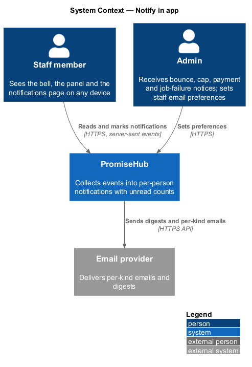
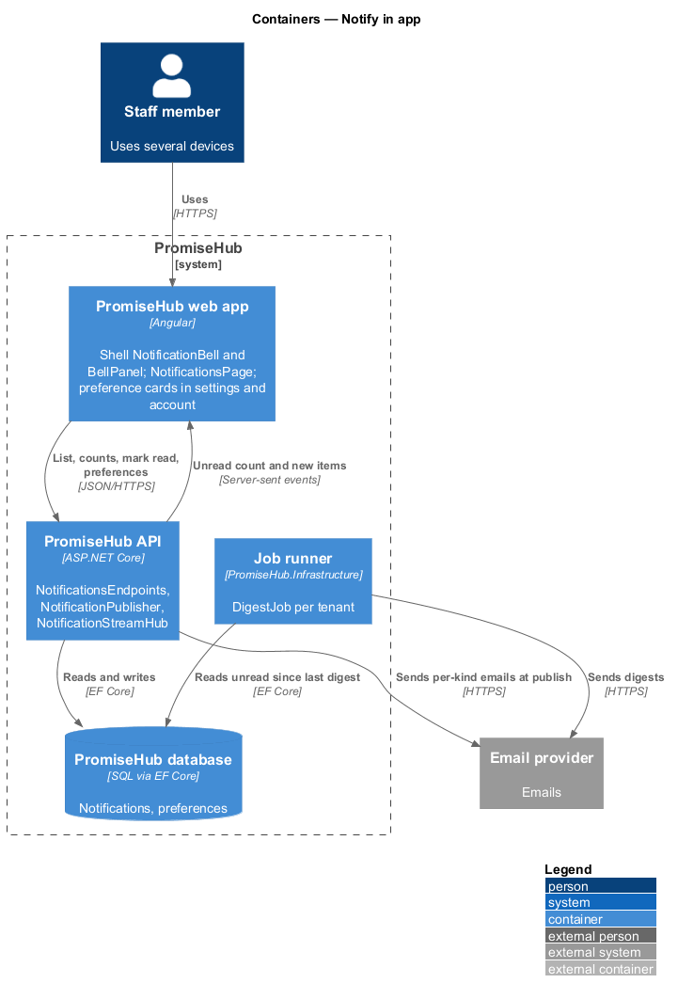
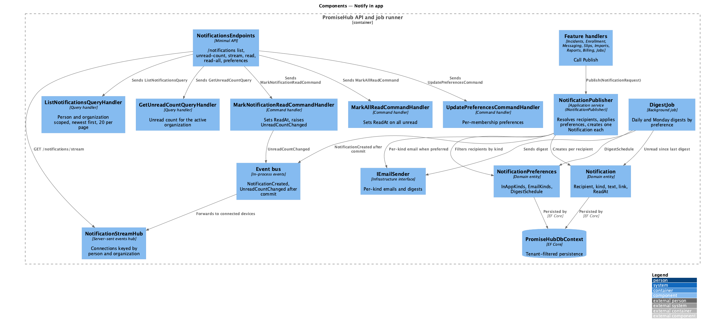
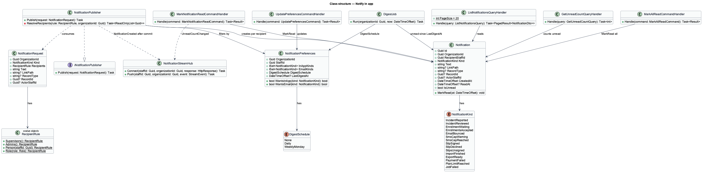
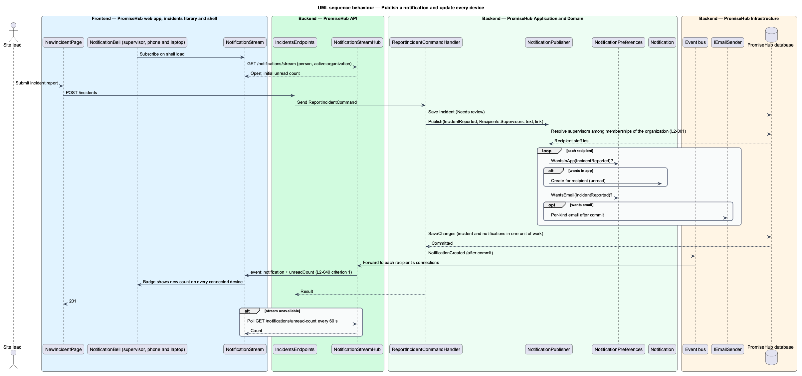
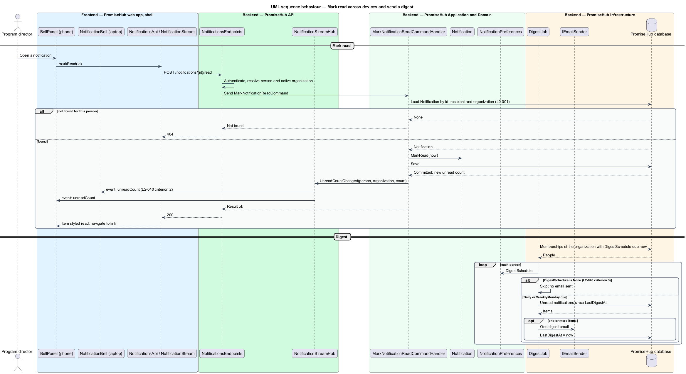

# Notify in app

## Overview

Staff at a youth-serving organization depend on knowing what needs their attention without watching every page: an incident to review, enrollments waiting, an email that bounced, a text cap about to be reached, a slip a guardian just signed. PromiseHub collects those events into one notification center per person. A bell in the shell shows the unread count, a dropdown panel lists the latest items, a full page lists everything, and preferences decide which items also arrive as email digests.

A notification is addressed to one person in one organization. The same event can produce notifications for several people (every supervisor on a new incident) and the same person can carry separate unread counts in each organization they belong to. Reading a notification on one device marks it read for every device of that person, because read state lives on the server, not in the browser.

Local terms:

- **notification** — item addressed to one staff member in one organization describing an event that needs attention or confirms an outcome, with a link to the record
- **notification kind** — category of event, such as incident reported, enrollment waiting, bounce, cap warning, slip signed, import finished or export ready
- **unread count** — number of a person's notifications in the active organization that have not been marked read
- **bell panel** — dropdown opened from the shell bell that shows the newest notifications and a link to the full page
- **digest** — scheduled email summarizing a person's unread notifications, sent according to their preferences
- **notification preference** — per-person setting that controls which kinds arrive in app, which are emailed, and whether digests are sent

The slice spans the bell panel (`bell`, unread, read and empty states), the `notifications` page (default, read, loading, empty, error) and the staff-email and digest switches of `settings-notifications` and the personal notification switches of `account`. The no-show alert and slip reminder settings that share the `settings-notifications` screen belong to `attendance/alert-no-show-and-end-session` and `slips/remind-and-clear`.

## Description

### Frontend

The shell (`frontend/projects/promisehub/`) hosts the bell; the pages live in `frontend/projects/settings/` and `frontend/projects/account/`; all use `frontend/projects/components/` and `NotificationsApi` from `frontend/projects/api/`.

- **`NotificationBell`** — component in `frontend/projects/components/` that renders the bell button with an unread badge and opens `BellPanel` as a CDK overlay. The shell feeds it the unread count from `NotificationsApi.unreadCount()` and refreshes the count through the `NotificationStream` described below.
- **`BellPanel`** — overlay (`bell`) listing the newest notifications with avatar or icon, text, link and time, a Mark all read action when unread items exist, an empty state and a See all link to the page. It closes on Escape and traps focus.
- **`NotificationsPage`** — the full list (`notifications`), newest first, with unread styling, Mark all read, a Settings link, and loading, empty, error and read states.
- **`NotificationStream`** — service in `frontend/projects/api/` that subscribes to server-sent events at `GET /notifications/stream` and emits `unreadCount` and new notifications. When the stream is unavailable it falls back to polling `unreadCount()` every 60 seconds. The stream is per session and carries only the active organization's notifications.
- **`NotificationSettingsPage`** (`settings-notifications`, Staff emails card) and the personal notifications card on **`AccountPage`** (`account`) edit `NotificationPreferences` through `NotificationsApi.updatePreferences()`.
- **`NotificationsApi`** — behind the `NOTIFICATIONS_API` injection token: `list(page)`, `unreadCount()`, `markRead(id)`, `markAllRead()`, `getPreferences()`, `updatePreferences(prefs)`.

### Backend

`PromiseHub.Api` exposes `NotificationsEndpoints`: `GET /notifications`, `GET /notifications/unread-count`, `GET /notifications/stream` (server-sent events), `POST /notifications/{id}/read`, `POST /notifications/read-all`, `GET /notifications/preferences`, `PUT /notifications/preferences`. All require authentication; each resolves the active organization and the person so every query is scoped to that pair. Notifications are not a module and are always on; a notification whose source module is off is not created, because the source event never fires (`L2-005`).

Application components in `PromiseHub.Application/Notifications/`:

- **`INotificationPublisher`** — the contract other features call: `Publish(NotificationRequest)`. A request names the organization, the kind, the recipient rule (`Recipients.Supervisors`, `Recipients.Admins`, `Recipients.Person(id)`, `Recipients.Role(role)`), the text, the link and the related record. The publisher resolves recipients to memberships of that organization, filters by each recipient's preferences, creates one `Notification` per recipient in the same unit of work as the caller, and raises `NotificationCreated` for the stream after commit.
- **`NotificationPreferences`** — per membership: `InAppKinds`, `EmailKinds`, `DigestSchedule` (`None`, `Daily`, `WeeklyMonday`), and the switches shown in the mocks (email on new incidents, email on bounces, weekly summary, unsigned slips the day before, Monday summary, text when no-show alerts go out). Defaults are `<TO SUPPLY>` per role.
- **`MarkNotificationReadCommandHandler`** and **`MarkAllReadCommandHandler`** — set `ReadAt` on the person's notifications in the active organization and publish `UnreadCountChanged` so every connected device of that person updates (`L2-040` criterion 2).
- **`ListNotificationsQueryHandler`** and **`GetUnreadCountQueryHandler`** — read the person's notifications in the active organization, newest first, 20 per page (`L2-040` criterion 1).
- **`NotificationStreamHub`** — in `PromiseHub.Api`, holds server-sent event connections keyed by person and organization and forwards `NotificationCreated` and `UnreadCountChanged` from an in-process event bus (`<TO SUPPLY>` whether a distributed backplane is needed when the API runs on more than one instance).
- **`DigestJob`** — per-tenant job that runs daily at the organization's digest hour and on Monday 8 am for weekly summaries. It gathers each person's unread notifications since the last digest, skips people whose `DigestSchedule` is `None` (`L2-040` criterion 3), renders one email through `IEmailSender` and records `LastDigestAt`. Email-per-kind sends (incident, bounce) go out at publish time through the same sender when the recipient's `EmailKinds` include the kind.

Domain in `PromiseHub.Domain/Notifications/`: `Notification` (`Id`, `OrganizationId`, `RecipientStaffId`, `Kind`, `Text`, `LinkPath`, `RecordType`, `RecordId`, `ActorStaffId`, `CreatedAt`, `ReadAt`), `NotificationKind` enum, `NotificationPreferences`.

`PromiseHub.Infrastructure` provides the `PromiseHubDbContext` mappings with an index on `(OrganizationId, RecipientStaffId, ReadAt, CreatedAt)`, the `EmailProvider`, the job runner and the event bus.

Sources that publish in phase 1: `incidents/report-and-review-incident` (incident reported, incident reviewed), `enrollment/enroll-guardian` (enrollment waiting, enrollments accepted), `messaging/compose-and-send-message` (bounce), `messaging/enforce-sms-cap` (cap warning, cap reached), `slips/sign-slip` (slip signed, slip declined), `imports/import-roster` (import finished), `reports/export-report` (export ready), `billing/meter-plan-and-usage` (payment failed, limit reached) and `platform/run-background-jobs` (job failed, for admins per `L2-034`).

### Undecided details

- Default preferences per role are `<TO SUPPLY>`.
- Retention of read notifications is `<TO SUPPLY>`.
- Whether server-sent events need a distributed backplane is `<TO SUPPLY>`.

## Built so far

Slice 35 delivered `Notification`, `NotificationWriter` (incident reports notify reviewers), `GET /notifications` with read and read-all, module-hidden kinds, the bell's unread count in the shell and the notification center at `/notifications` (ADR 0029). The bell panel, other producers, digests and push are not built.

Prompt 68 added the `mentoring` kind: raising an at-risk flag (`mentoring/manage-at-risk-flags`, `L2-091`) notifies every holder of `ReviewAtRiskFlags` (admins and program directors) through `NotificationWriter`, linking to `/mentoring/flags`, without the reason. `NotificationsHandler` maps `mentoring` to the Mentoring module, so those notices are hidden while it is off and come back when it is on.

Slice 36 added `NotificationSettings` with `GET`/`PUT /settings/notifications`, the no-show delay, supervisor incident emails and the SMS cap honoured by the jobs, and `SettingsNotificationsPage` (ADR 0030).

## Requirements

The feature realizes the following level-2 (L2) requirement and enforces the cross-cutting ones listed with it.

| L2 ID | Refines (L1) | Requirement |
|-------|--------------|-------------|
| `L2-040` | `L1-021` | A notification center lists what needs attention (incidents to review, enrollments to review, bounces, cap warnings) with unread counts. |
| `L2-001` | `L1-001` | Every tenant-owned table carries the organization id; every query, search, export and background job filters by the organization of the signed-in person's active membership, never by a value from the client. |
| `L2-034` | `L1-018` | Uptime target, backups and resilient jobs. |

`L2-034` appears for its third criterion, which surfaces job failures in the admin notification center.

## Diagrams

### System context

Staff read notifications in PromiseHub; digests and per-kind emails go through the email provider.

### Containers

The shell bell and the notifications page call the API and listen to its event stream; the job runner sends digests.

### Components

Feature handlers publish through `INotificationPublisher`; the hub pushes counts to devices; `DigestJob` emails summaries by preference.

### Class structure

`Notification` is per recipient and organization; `NotificationPublisher` fans a request out by recipient rule and preferences.

### Behaviour — publish a notification and update every device

An incident report publishes to supervisors; each connected device of each recipient receives the new count over the stream.

### Behaviour — mark read across devices and send a digest

Opening a notification marks it read on the server and decrements the count on every device; the digest job skips people who disabled digests.

