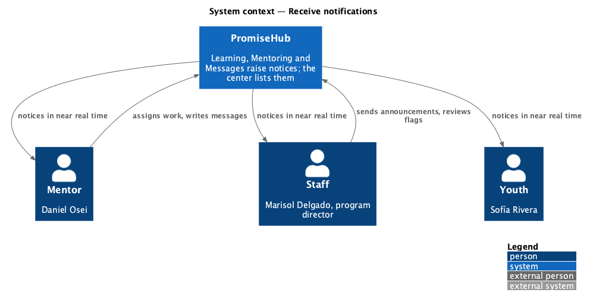
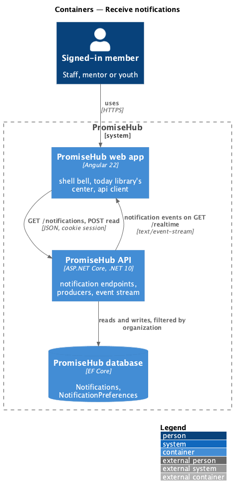
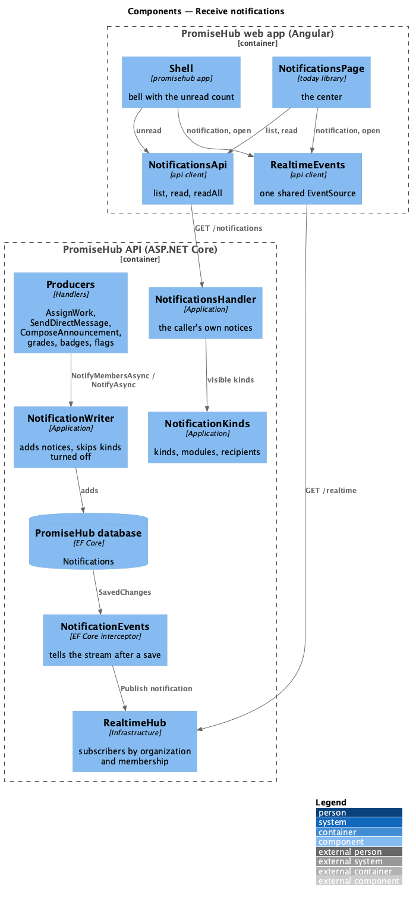
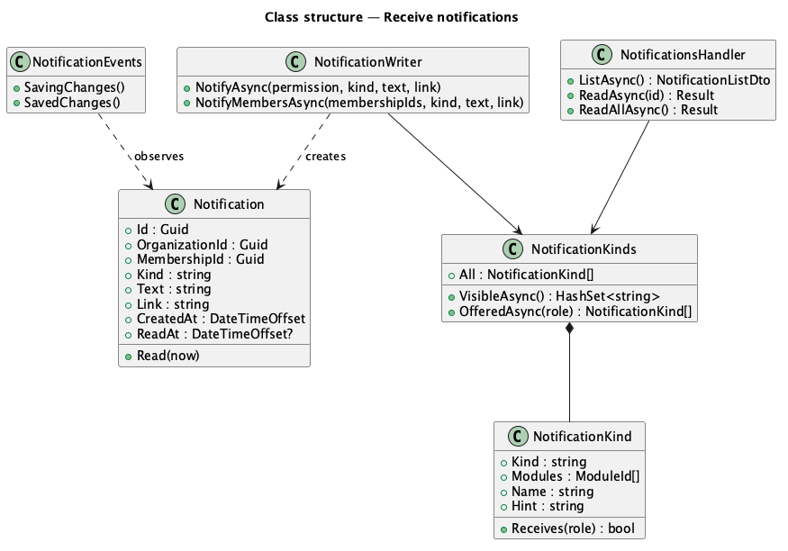
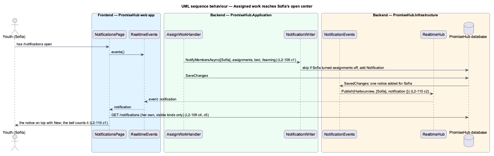

# Receive notifications

## Overview

Youth, mentors and staff each need to hear about what concerns them without checking every page: a grade, a badge, a quiz assigned for Friday, a message from a mentor, an announcement for a program, an at-risk flag to review. **Receive notifications** extends PromiseHub's notification center (`notify-in-app`, `L2-040`) to every member of an organization and adds the notices that Learning, Mentoring and Messages raise. Each notice reaches its recipient's open app at once (`messaging/deliver-realtime-events`) and respects the recipient's own choices (`configure-notifications`).

Terms used in this document:

- **notice** — one `Notification` row: an organization, the recipient membership, a kind, a sentence, a link and when it was read
- **kind** — the category of a notice, which also names the modules it belongs to: `incidents`, `learning` (grades, quiz approvals, badges), `assignments` (assigned work), `mentoring` (at-risk flags), `messages` (a direct message), `announcements` (an announcement sent now), `requests` and `staff`
- **producer** — a handler whose action creates notices, through `NotificationWriter`

Notifications are not a module. A kind follows its modules: a notice is never created while its module is off, because the producing endpoint answers 404, and a notice already received is hidden while any of its modules is off and listed again when they are back on. Ported from Waypoint `engagement/receive-notifications` (`L2-ENGAGE-008`, ADR 0043, ADR 0069).

## Description

### Backend

- **`NotificationKinds`** (`PromiseHub.Application/Notifications/`) — the one table of kinds: the modules each needs (`assignments` needs Learning and Mentoring, `messages` Messages and Mentoring, `announcements` Messages), who receives it (a role or a permission) and its name and hint for the preferences page. `VisibleAsync` answers the kinds whose modules are all on.
- **`NotificationWriter`** — `NotifyAsync(permission, kind, text, link)` adds a notice for every current member whose role holds the permission; `NotifyMembersAsync(membershipIds, kind, text, link)` for named members. Both skip a member who turned the kind off (`NotificationPreference`, `configure-notifications`). The caller saves. Every producer uses it: `GradeSubmissionHandler`, `QuizApprovalHandler`, `BadgeAwarder`, `BadgeAwardCommand`, `AssignWorkHandler`, `SendDirectMessageHandler`, `ComposeAnnouncementHandler`, `ReportIncidentHandler`, `AtRiskFlagsHandler`, `DataRequestHandler` and `InvitationHandler`.
- **New producers.** `AssignWorkHandler` notifies the youth accounts linked to the children it assigned to ("Daniel Osei assigned you the Servant Leadership quiz, due Fri 13 Nov.", link `/learning`); `SendDirectMessageHandler` notifies the other participant ("New message from Daniel Osei", link `/conversations/{youthId}`, never the words); `ComposeAnnouncementHandler` notifies the in-app recipients of an announcement sent now (`AnnouncementRecipients.MembersAsync`, "Marisol Delgado posted an announcement: {title}", link `/announcements`).
- **`NotificationsHandler`** — `GET /notifications`, `POST /notifications/{id}/read` and `POST /notifications/read-all` (`AllowAnyMember()`), unchanged in shape: the caller's own notices in the active organization, newest first, kinds filtered through `NotificationKinds`; reading another person's or organization's notice answers 404.
- **`NotificationEvents`** (`PromiseHub.Infrastructure/Notifications/`) — the save interceptor that tells the stream (`messaging/deliver-realtime-events`, `L2-110`).

### Frontend

- **`NotificationsPage`** (`frontend/projects/today/`, `/notifications`, mock `notifications`) — every role's center: each notice is a `ph-list-item` link with the kind's name and the time in its meta and an info `ph-badge` New while unread; Mark all read; a ghost Settings button to `/account/notifications`. It refetches quietly on `notification` and `open` events from `REALTIME_EVENTS`.
- **`Shell`** (`frontend/projects/promisehub/`) — the bell's unread count refetches on navigation, on reads and on `notification` and `open` events.
- **`EventSourceRealtimeEvents`** — shares one `EventSource` between every subscriber of a tab and adds the `notification` event.

Open questions: none. Deferred by ADR 0069: due-soon and session reminders, notices to a mentor on a submission or a quiz to approve, a notice at a scheduled announcement's send time.

## Built so far

Prompt 75 delivered everything above: `NotificationKinds`, `NotificationWriter.NotifyMembersAsync` with every producer moved onto it, the `assignments`, `messages` and `announcements` producers, `NotificationEvents`, the shared `EventSource`, and the center's kind names, New badges, Settings link and quiet refetch, with the bell following the stream. Acceptance tests: `backend/tests/PromiseHub.Api.Tests/ReceiveNotificationsTests.cs`, `RealtimeTests.cs` and `e2e/tests/notifications/receive-notifications.spec.ts`. It is estimated at 90%, not 100%, because ADR 0069 defers reminders, a mentor's notices on submissions and quizzes to approve, and a notice at a scheduled announcement's send time.

## Requirements

| L2 ID | Refines (L1) | Requirement |
|-------|--------------|-------------|
| `L2-109` | `L1-021` | Each person's notification center lists what concerns them in the organization they are signed in to, from every module that is on, with a link to act on it. |
| `L2-110` | `L1-018` | A new notification reaches its recipient's open app at once, the bell and the center follow without a reload, and a read on one device shows on the others. |
| `L2-040` | `L1-021` | In-app notifications (cross-referenced). |
| `L2-005` | `L1-002` | Module gates (cross-referenced). |
| `L2-001` | `L1-001` | Tenant isolation (cross-referenced). |

## Diagrams

### System context

Members receive notices from PromiseHub while the app is open and on their next visit.

### Containers

The web app reads notices from the API and listens to its event stream.

### Components

Producers add notices through `NotificationWriter`; the save interceptor tells the hub; the center and the bell refetch.

### Class structure

`NotificationKinds` decides which kinds a member sees and may choose; `NotificationWriter` applies each member's preference.

### Behaviour — assigned work reaches Sofía's open center

Daniel assigns a quiz; Sofía's notice is saved, the stream tells her tab and the center shows it with New.

