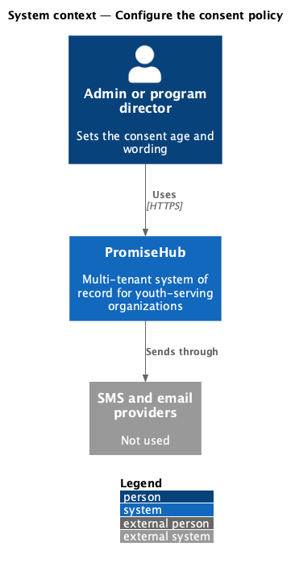
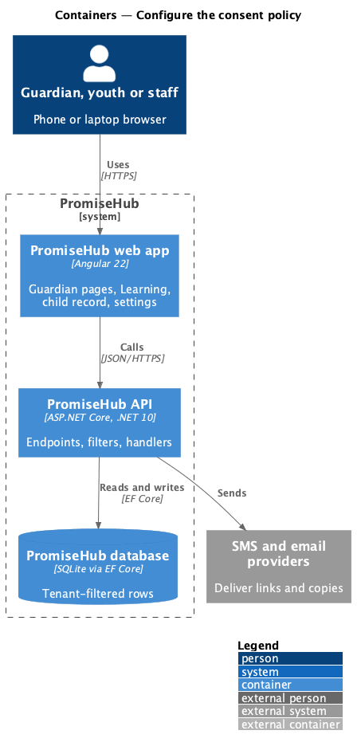
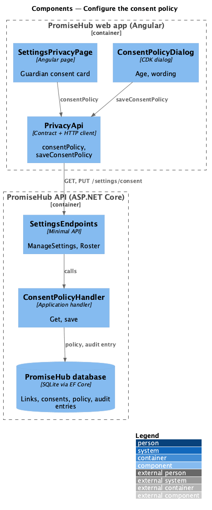
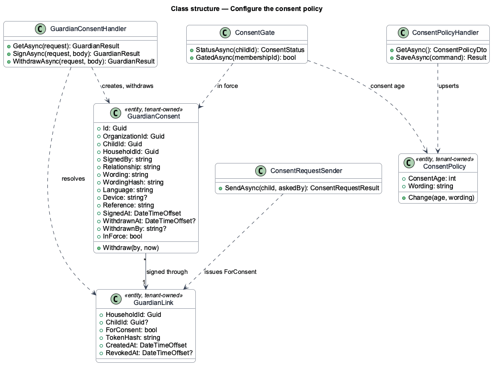
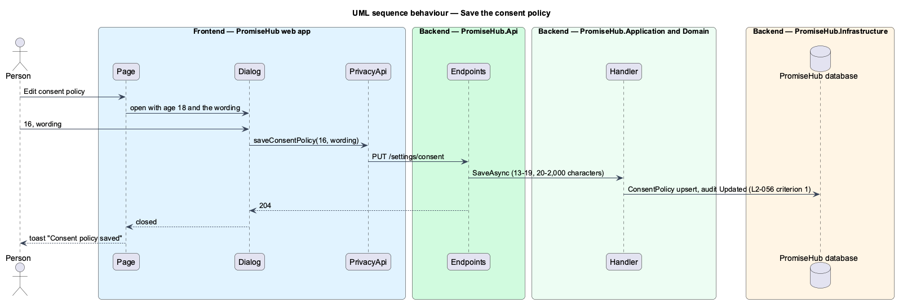

# Configure the consent policy

## Overview

Organizations set their own consent age and wording: a camp in a province where the age of majority is 19 asks for consent under 19; another wants its own wording. The **consent policy** is a privacy setting, shown as its own card on Settings › Privacy and data and, while Learning is on, as the Learning card of Settings › Organization (ADR 0073); both edit the same row in the same dialog.

Terms used in this document:

- **consent policy** — `ConsentPolicy`: consent age 13 to 19 (default 18) and wording of 20 to 2,000 characters; an organization without a row uses the defaults

Ported from Waypoint `program-administration/configure-consent-policy`, with tenancy, the Roster and Learning module gates and PromiseHub types (ADR 0043, ADR 0046).

## Description

Frontend:

- **`SettingsPrivacyPage`** (`frontend/projects/settings/`) — Guardian consent card (`ph-description-list`) with **Edit consent policy**, shown while Roster is on.
- **`SettingsOrganizationPage`** — Learning card with the same facts and **Edit consent policy**, rendered only while Learning is on; it reads and saves through `ORGANIZATION_SETTINGS_API.learning` and `saveLearning`.
- **`ConsentPolicyDialog`** — CDK dialog, given where it saves (Privacy or Learning) by its caller, with `ph-select` (age) and `ph-textarea` (wording); inline 422 errors; toast "Consent policy saved".
- **`PrivacyApi.consentPolicy`, `PrivacyApi.saveConsentPolicy`** (`frontend/projects/api/`).

Backend:

- **`ConsentPolicyHandler`** (`Application/Organizations/`) — `GetAsync` returns the row or the defaults; `SaveAsync` validates the age and the wording, upserts the row and audits Updated on `ConsentPolicy`.
- **`SettingsEndpoints`** — `GET`/`PUT /settings/consent` under `ManageSettings` and `RequireModule(Roster)`; `GET`/`PUT /settings/learning` under `ManageSettings` and `RequireModule(Learning)`, through the same handler.

Every row is tenant-owned and filtered by the organization (ADR 0002); a guardian link puts the request in its own organization (ADR 0015).

## Built so far

Prompt 52 delivered the Privacy card: the Guardian consent card on `SettingsPrivacyPage`, `ConsentPolicyDialog`, `PrivacyApi.consentPolicy` and `saveConsentPolicy`, `ConsentPolicyHandler`, `ConsentPolicy` with its migration. Acceptance tests: `backend/tests/PromiseHub.Api.Tests/ConsentPolicyTests.cs`, `e2e/tests/settings/consent-policy.spec.ts`. Prompt 79 added the Learning card, `/settings/learning` and `ConsentPolicyDialogData`; acceptance tests `LearningSettingsTests.cs` and `e2e/tests/settings/organization-module-defaults.spec.ts`. Waypoint's re-consent each term and media consent are deferred (ADR 0073).

## Requirements

| L2 ID | Refines (L1) | Requirement |
|-------|--------------|-------------|
| `L2-056` | `L1-023` | A youth whose linked child record is under the organization's consent age cannot use Learning until a guardian has consented. Admins set the age and the wording; the youth can ask a guardian for consent from the gate. |
| `L2-124` | `L1-023` | While Learning is on, Settings › Organization shows a Learning card with the guardian consent policy (the age under which youth need a guardian's consent and the wording guardians sign), edited in the `consent-policy` dialog. |
| `L2-030` | `L1-015` | Privacy settings: the region and how long consent records are kept. |
| `L2-032` | `L1-017` | Every sensitive action is audited with who, what and when, in its organization only. |

## Diagrams

### System context

Who uses this slice and which outside systems PromiseHub talks to.

### Containers

The web app calls the API; the API owns the database and the providers.

### Components

The page, its API client, and the endpoints, filters and handlers behind them.

### Class structure

The consent record, the consent link, the policy and the services that read and write them.

### Behaviour — save the consent policy

The steps in order, with the requirement each enforces.

