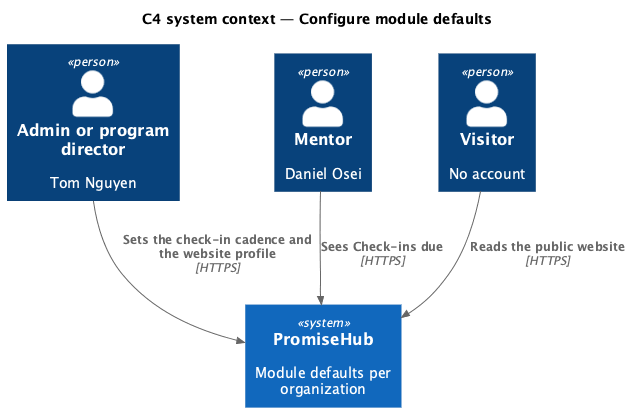
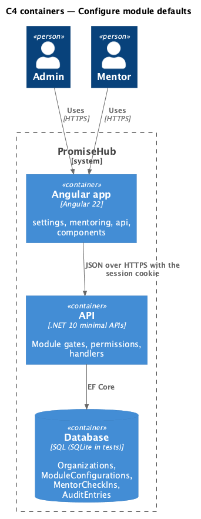
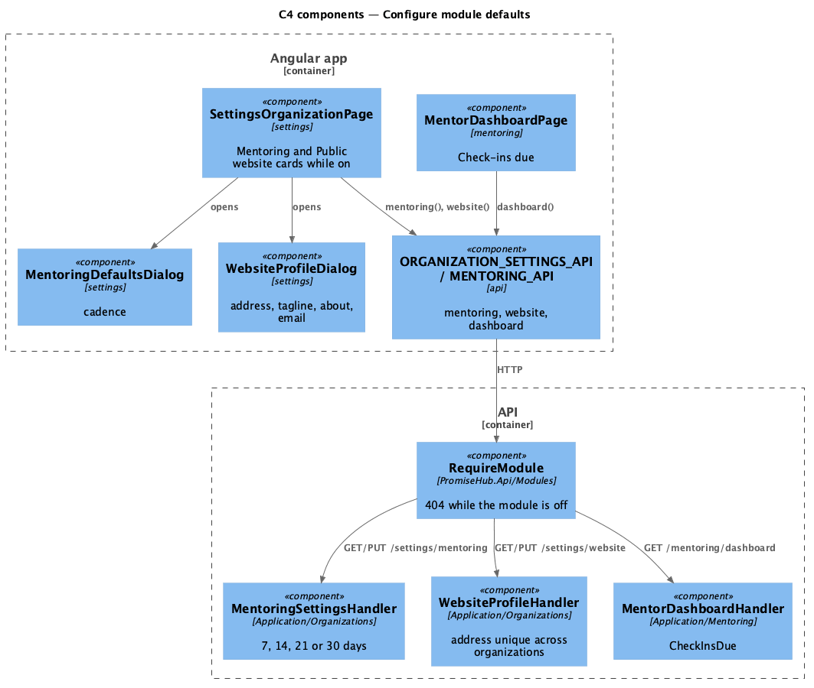
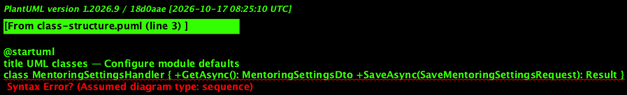
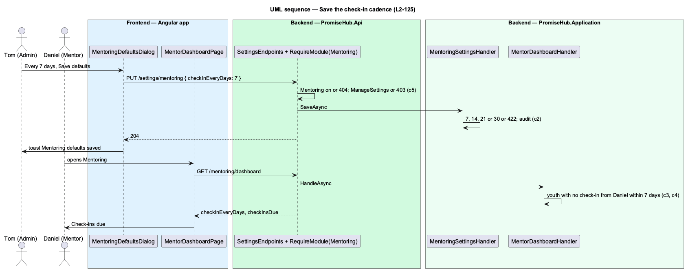
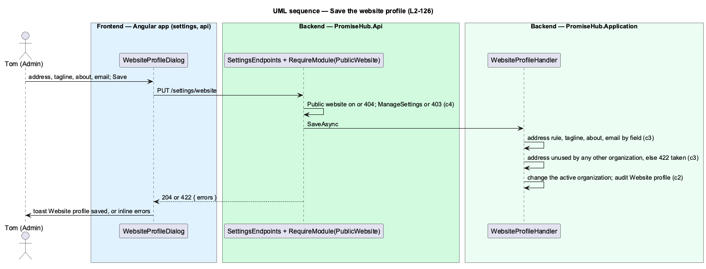

# Configure module defaults

## Overview

Some modules bring settings an organization chooses once for everyone. Mentoring asks how often each mentor should check in with each youth; Public website asks what visitors see about the organization and at which address. These **module defaults** sit on Settings › Organization (`settings-organization`) below the profile, one card per module, and appear only while their module is on (ADR 0073). The Learning card, the guardian consent policy, is designed in `configure-consent-policy`.

Tom Nguyen (Admin) at Harbourview, where Mentoring is on, changes the cadence from every 14 days to every 7 in the `mentoring-defaults` dialog. Daniel Osei's mentor dashboard then lists under **Check-ins due** each of his youth he has not logged a mentor check-in with in the last 7 days. With Public website on, Tom edits the address, tagline, about and public email in the `website-profile` dialog. At Northgate, where both modules are off, Grace sees neither card and their endpoints answer 404.

Terms used in this document:

- **check-in cadence** — `Organization.MentorCheckInDays`: 7, 14, 21 or 30 days, 14 until changed
- **check-in due** — a youth in a mentor's scope whose latest mentor check-in from that mentor is dated on or before the organization's today minus the cadence, or who has none
- **website address** — `Organization.WebsiteSlug`, the name after `/site/`, unique across organizations

Ported from Waypoint journey 31 and `L2-ADMIN-006`; the public pages themselves are prompt 81.

## Description

Frontend:

- **`SettingsOrganizationPage`** (`frontend/projects/settings/`) — renders the Mentoring and Public website cards only when their module is on in the session's module configuration, and only then calls `ORGANIZATION_SETTINGS_API.mentoring()` and `.website()`.
- **`MentoringDefaultsDialog`** — `ph-select` of the four cadences; closes with true once saved; toast "Mentoring defaults saved".
- **`WebsiteProfileDialog`** — `ph-text-field` (address, tagline, public email), `ph-textarea` with a count (about), `ph-error-summary`; toast "Website profile saved".
- **`MentorDashboardPage`** (`frontend/projects/mentoring/`) — Check-ins due card (`ph-list`, warning `ph-badge` Due, the cadence in the footer, an empty state when none are due).

Backend:

- **`MentoringSettingsHandler`** (`Application/Organizations/`) — `GetAsync` and `SaveAsync` (7, 14, 21 or 30, else 422), audits Updated on `MentoringSettings`.
- **`WebsiteProfileHandler`** — `GetAsync` and `SaveAsync`: the address rule, a tagline of 1 to 120 characters, about up to 1,000, an email or empty; an address another organization uses answers 422 "Another organization uses this address. Choose another.", checked across tenants without returning anything of the other organization; audits Updated on `Organization` ("Website profile").
- **`PublicWebsiteHandler`** — `PublicSiteDto` gains `Tagline`, `About` and `Email`.
- **`MentorDashboardHandler`** — `MentorDashboardDto` gains `CheckInEveryDays` and `CheckInsDue` (`MentorCheckInDueDto`: child, name, last date or null).
- **`SettingsEndpoints`** — `GET`/`PUT /settings/mentoring` with `RequireModule(Mentoring)`, `GET`/`PUT /settings/website` with `RequireModule(PublicWebsite)`, both under `ManageSettings`.
- **`Organization`** — gains `MentorCheckInDays`, `WebsiteTagline`, `WebsiteAbout`, `WebsiteEmail` (migration `OrganizationSettings`).

The fake API keeps both per organization, answers 404 while the module is off and computes Check-ins due.

## Requirements

| L2 ID | Refines (L1) | Requirement |
|-------|--------------|-------------|
| `L2-125` | `L1-024` | While Mentoring is on, the organization chooses how often mentors check in with each youth (every 7, 14, 21 or 30 days; 14 until changed), and each mentor's dashboard lists the youth who are due. |
| `L2-126` | `L1-025` | While Public website is on, the organization edits what visitors see about it: the website address (`/site/<address>`), a tagline, an about text and a public email, in the `website-profile` dialog. |
| `L2-005` | `L1-002` | Every endpoint of a module that is off answers 404 for that organization, and the frontend never renders, links or prefetches it. |

## Diagrams

An admin sets the defaults; mentors and visitors see their effect.

The Angular app calls the API; the API reads the module configuration on every request.

Each card has its own endpoint behind its module gate.

The two handlers change the active organization; the dashboard reads the cadence.

Saving the cadence passes the module gate, validates the value and changes what the mentor dashboard counts as due.

Saving the website profile checks the address against every organization before changing it.

