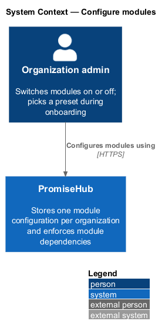
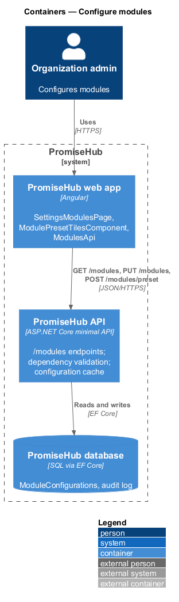
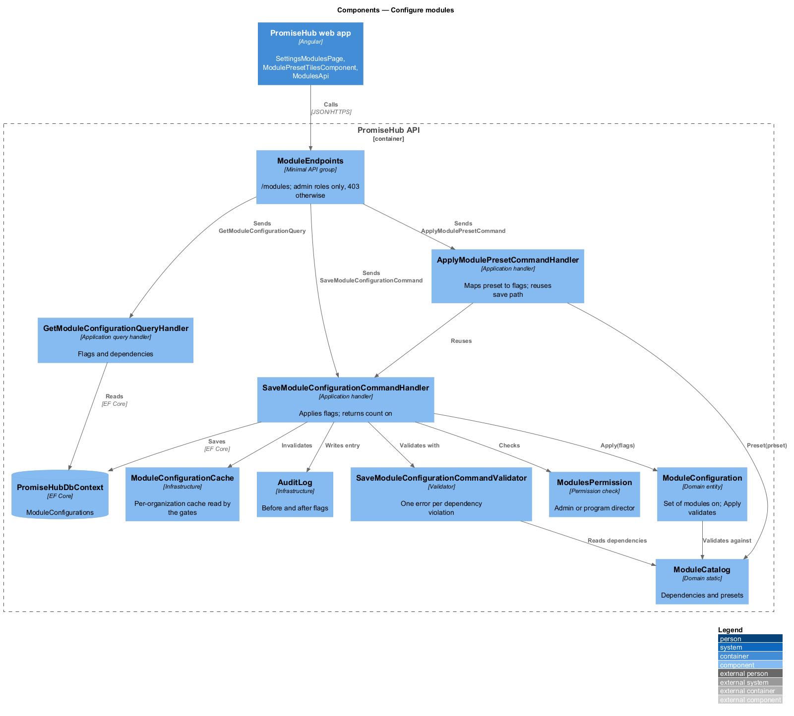
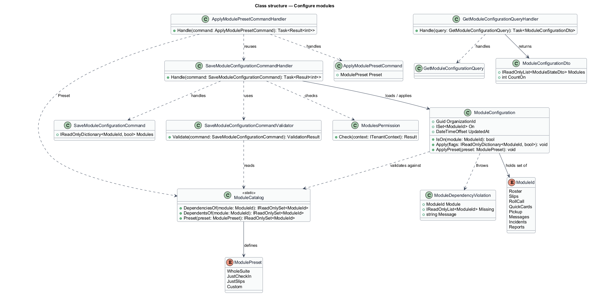
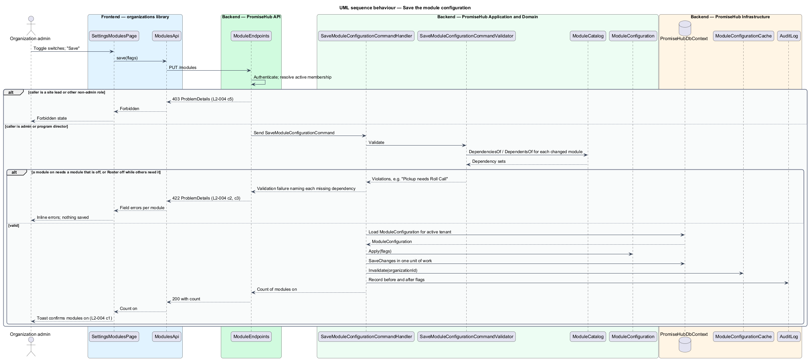
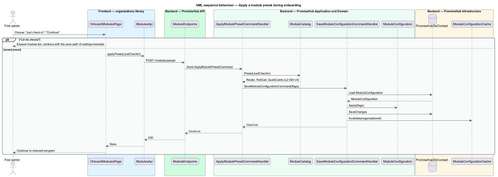

# Configure modules

## Overview

Every feature of PromiseHub is a **module** — unit of product functionality that an organization switches on or off: Roster, Permission slips, Roll Call, Quick Cards, Pickup, Messages, Incident log and Reports. The **module configuration** — the per-organization record of which modules are on. A **module dependency** — declared rule that one module needs another to be on; Roster is the data every other module reads, and Pickup needs Roll Call. A **module preset** — named configuration offered during onboarding and in settings: "Whole suite", "Just check-in", "Just permission slips" and "Let me choose".

Admins change the configuration on `settings-modules` or pick a preset on `onboard-modules`. The server owns the dependency rules and rejects a configuration that breaks one, naming every missing dependency. A module that is turned off hides its data; it never deletes it. The server-side and client-side effects of the saved configuration are the subject of `enforce-module-gates`.

## Description

### Frontend — `frontend/projects/organizations/`

- **`SettingsModulesPage`** — page for `/settings/modules` (`settings-modules`). It renders the eight modules as a `list` of rows with a `switch` each, the dependency caption ("Needs Roll Call") when a dependency is off, the preset chips and one Save. The `roleGuard` sends a site lead to the forbidden state (L2-004 criterion 5).
- **`ModulePresetTilesComponent`** — the four `choice-tiles` used on `onboard-modules`; "Let me choose" expands the same module list as the settings page.
- **`ModulesApi`** — typed client in `frontend/projects/api/` behind the `MODULES_API` token. Methods: `get()`, `save(request)`, `applyPreset(preset)`. The 422 body lists the violated dependencies, which the page maps to inline field errors (criterion 2 and 3).
- **`ModuleCatalog`** — static list in `frontend/projects/api/` of module ids, names and dependencies, used for the "Needs …" captions before save. The server remains the authority.

### Backend — `PromiseHub.Api`

- **`ModuleEndpoints`** — `GET /modules`, `PUT /modules`, `POST /modules/preset`. The group requires the `Admin` or `ProgramDirector` role; a site lead receives 403 (criterion 5).

### Backend — `PromiseHub.Application/Organizations/`

- **`GetModuleConfigurationQuery`** and **`GetModuleConfigurationQueryHandler`** — return the configuration with each module's on flag and declared dependencies.
- **`SaveModuleConfigurationCommand`** — `IReadOnlyDictionary<ModuleId, bool> Modules`.
- **`SaveModuleConfigurationCommandValidator`** — runs the dependency rules from `ModuleCatalog` and returns one error per violation: for a module turned on whose dependency is off, "Pickup needs Roll Call"; for a module turned off that others need, an error naming every dependent module (criteria 2 and 3). Roster is forced on whenever any other module is on.
- **`SaveModuleConfigurationCommandHandler`** — loads the organization's `ModuleConfiguration`, applies the new flags, saves in one unit of work and returns the count of modules on for the toast (criterion 1).
- **`ApplyModulePresetCommand`** and **`ApplyModulePresetCommandHandler`** — map a `ModulePreset` to flags through `ModuleCatalog.Preset(preset)` and reuse the save path. "Just check-in" yields Roster, Roll Call and Quick Cards on (criterion 4).
- **`ModulesPermission`** — permission check for the admin roles.

### Backend — `PromiseHub.Domain`

- **`ModuleId`** — enumeration: `Roster`, `Slips`, `RollCall`, `QuickCards`, `Pickup`, `Messages`, `Incidents`, `Reports`.
- **`ModuleCatalog`** — static declaration of each module's dependencies and of the presets. Pickup depends on Roll Call and Roster; every other module depends on Roster. Whether Quick Cards depends on Roll Call as well as Roster is `<TO SUPPLY>`.
- **`ModulePreset`** — `WholeSuite`, `JustCheckIn`, `JustSlips`, `Custom`.
- **`ModuleConfiguration`** — tenant-owned entity: `OrganizationId`, `ISet<ModuleId> On`, `UpdatedAt`. `Apply(flags)` validates against `ModuleCatalog` and throws `ModuleDependencyViolation` listing the violations. `IsOn(module)` is read by the gates.

### Backend — `PromiseHub.Infrastructure`

- **`PromiseHubDbContext`** — maps `ModuleConfigurations` with one row per organization. A module turned off leaves every other table untouched.
- **`ModuleConfigurationCache`** — per-organization cache read by the endpoint filter in `enforce-module-gates`; the save handler invalidates it.
- **`AuditLog`** — records each module change with before and after flags (L2-032).

## Requirements

| L2 ID | Refines (L1) | Requirement |
|-------|--------------|-------------|
| `L2-004` | `L1-002` | Admins switch modules on or off in `settings-modules` or choose a preset during onboarding (`onboard-modules`). Roster is the data every other module reads; dependencies are declared and enforced. |

## Diagrams

### System context

An admin configures the organization's modules through PromiseHub.

### Containers

The settings page and the onboarding step in the web app call the module endpoints of the API; the configuration is one row per organization in the database.

### Components

`ModuleEndpoints` dispatches to the save and preset handlers, whose validator consults `ModuleCatalog`; the save invalidates `ModuleConfigurationCache`.

### Class structure

`ModuleConfiguration` holds the set of modules that are on and validates against `ModuleCatalog`; the handlers call it and the validator surfaces violations as field errors.

### Behaviour — save the module configuration

The validator rejects a configuration that breaks a dependency with 422 naming each missing or dependent module (`L2-004` criteria 2 and 3); a valid one is saved and the toast confirms the count on (criterion 1).

### Behaviour — apply a preset during onboarding

The preset maps to flags on the server and reuses the save path (`L2-004` criterion 4).

