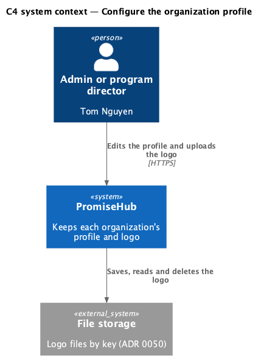
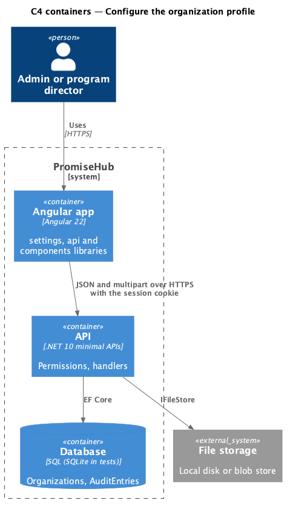
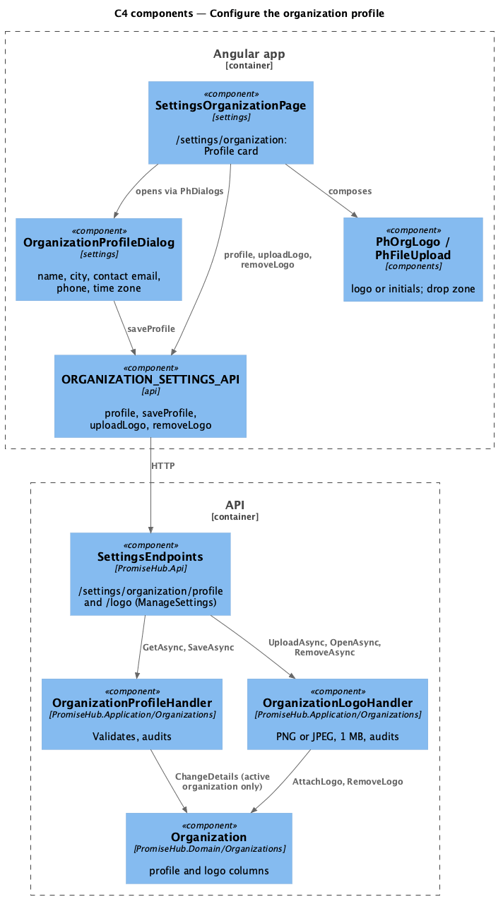
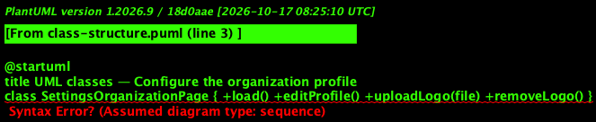
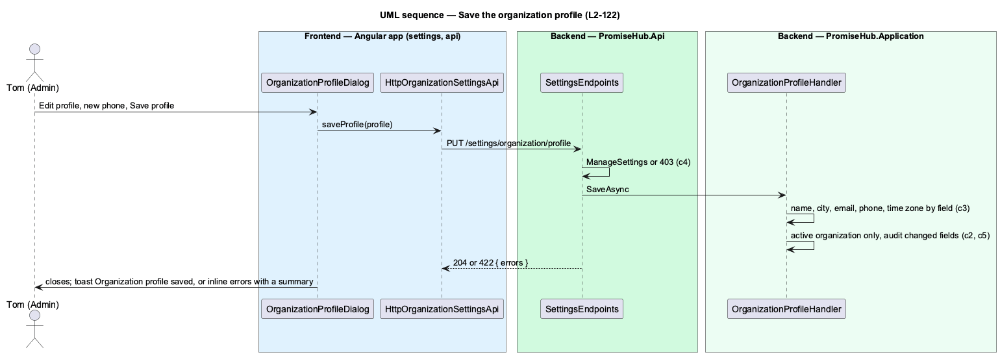
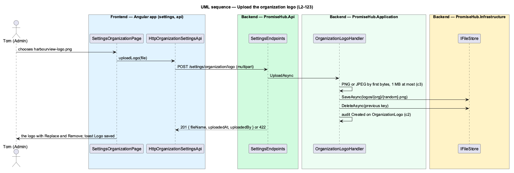

# Configure the organization profile

## Overview

PromiseHub serves many organizations from one deployment; each **organization** is a tenant. Its profile is what the organization says about itself: its name, the city it works in, a contact email, the phone guardians call, the time zone its sessions run in, and its logo. The setup wizard confirms the name and city once (`set-up-organization`); after that, admins and program directors keep the profile on Settings › Organization (`settings-organization`), the first Settings tab (ADR 0073).

Tom Nguyen (Admin) opens Settings, lands on Organization and reads the Profile card. Edit profile opens the `organization-profile` dialog; saving shows "Organization profile saved", the top bar shows the new name, every guardian page shows the new phone and the organization's today follows the new time zone. The logo uploads from the card.

Terms used in this document:

- **profile** — the name, city, contact email, phone and time zone of the organization of the signed-in membership
- **logo** — an image the organization uploads, kept in file storage under a key of the organization (ADR 0050)

Ported from Waypoint `program-administration/configure-organization-profile` (`L2-ADMIN-006` criteria 1 and 5). Settings belong to no module and are always on; who may change them follows `ManageSettings`.

## Description

Frontend:

- **`SettingsOrganizationPage`** (`frontend/projects/settings/`) — `/settings/organization`. Loads `ORGANIZATION_SETTINGS_API.profile()`; shows the Profile card (`ph-card`, `ph-description-list`, `ph-org-logo`, `ph-file-upload`) with Edit profile, the logo or the initials, Remove logo and the drop zone that adds or replaces it (a refused file says why under the zone, a failed upload shows an alert); states loading, error, forbidden, default and each saved toast. After a profile save it resets the session (`SESSION_API.reset()`) so the shell shows the new name.
- **`OrganizationProfileDialog`** — CDK dialog with `ph-text-field` (name, city, contact email, phone), `ph-select` (time zone), `ph-error-summary` and the failed `ph-alert`; closes with true once saved.
- **`ORGANIZATION_SETTINGS_API`** (`frontend/projects/api/`) — `profile`, `saveProfile`, `uploadLogo`, `removeLogo`, `logoUrl`.
- **`PhOrgLogo`** (`frontend/projects/components/`) — the design system's org-logo: the image, or the initials.

Backend:

- **`OrganizationProfileHandler`** (`Application/Organizations/`) — `GetAsync` answers the profile and whether a logo is set; `SaveAsync` validates (name and city 1 to 100 characters, an email or empty, ten digits or empty, a time zone from `OrganizationTimeZones`), changes the active organization only, audits Updated on `Organization` with the changed field names.
- **`OrganizationLogoHandler`** — `UploadAsync` checks the first bytes for PNG or JPEG and the size (at most 1 MB), saves under `logos/{organizationId}/{random}.png|jpg`, replaces and deletes the earlier file, audits Created on `OrganizationLogo`; `OpenAsync` streams it; `RemoveAsync` deletes it and audits Deleted.
- **`Organization`** — gains `ContactEmail`, `LogoKey`, `LogoFileName`, `LogoContentType`, `LogoUploadedAt`, `LogoUploadedBy`, `ChangeDetails(...)`, `AttachLogo(...)` and `RemoveLogo()`; migrations `OrganizationContactEmail` and `OrganizationLogo`.
- **`SettingsEndpoints`** — `GET`/`PUT /settings/organization/profile`, `POST`/`GET`/`DELETE /settings/organization/logo` under `ManageSettings`.

The fake API keeps the profile and logo per organization.

## Built so far

Prompt 79 delivered everything above: `OrganizationProfileHandler`, `OrganizationLogoHandler`, `EmailAddressRule`, `OrganizationTimeZones`, the profile and logo endpoints, `SettingsOrganizationPage`, `OrganizationProfileDialog`, `ORGANIZATION_SETTINGS_API` and `PhOrgLogo`. `/settings` now lands on Organization. Acceptance tests: `backend/tests/PromiseHub.Api.Tests/OrganizationProfileTests.cs`, `OrganizationLogoTests.cs`, `e2e/tests/settings/organization-profile.spec.ts`, `organization-logo.spec.ts`.

Deferred (ADR 0073): a display name separate from the name, per-organization colours, and showing the logo and contact email on guardian pages, the public website and the top bar.

## Requirements

| L2 ID | Refines (L1) | Requirement |
|-------|--------------|-------------|
| `L2-122` | `L1-001` | Admins and program directors keep their organization's profile in one place: Settings opens on Organization (`settings-organization`), which shows the name, city, contact email, phone and time zone and edits them in a dialog (`organization-profile`). |
| `L2-123` | `L1-001` | An admin uploads, replaces and removes the organization's logo from the Profile card. The file is checked on the server and kept under a key of the organization, never under the uploader's file name. |
| `L2-001` | `L1-001` | Every tenant-owned table carries the organization id; every query, search, export and background job filters by the organization of the signed-in person's active membership, never by a value from the client. |
| `L2-032` | `L1-017` | Every change and every sensitive view is recorded and searchable by admins. |

## Diagrams

An admin or program director changes the organization's profile; file storage keeps the logo.

The Angular app calls the API with the session cookie; the API writes the organization, the audit entry and the logo file.

The page composes library components and calls `ORGANIZATION_SETTINGS_API`; two handlers change the active organization only.

Both handlers depend on the tenant context and the audit writer; the logo handler also on file storage.

Saving the profile validates each field, changes one organization and answers 204 or 422.

Uploading a logo checks its content, stores it under the organization's key and replaces the earlier file.

