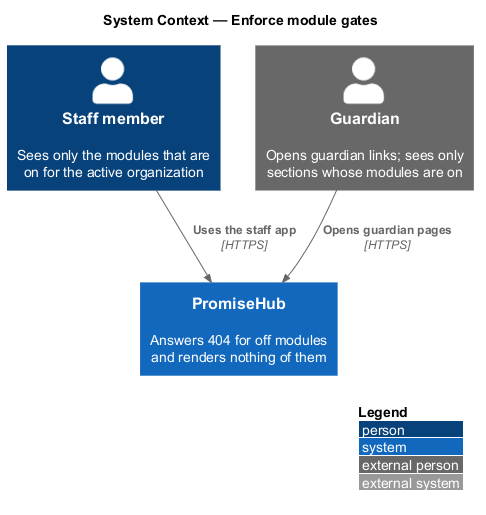
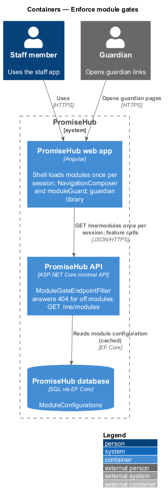
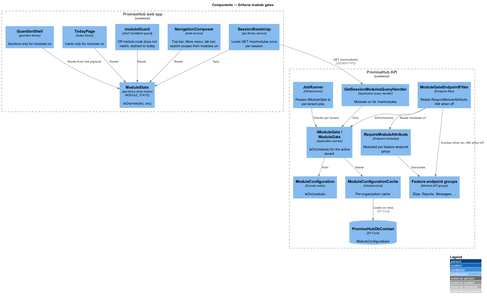
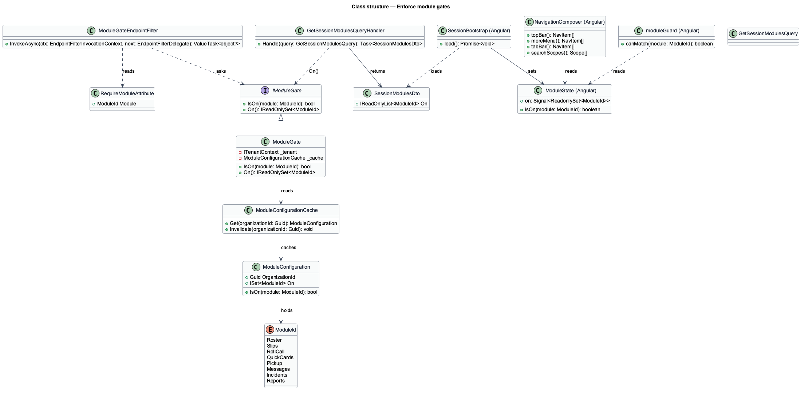
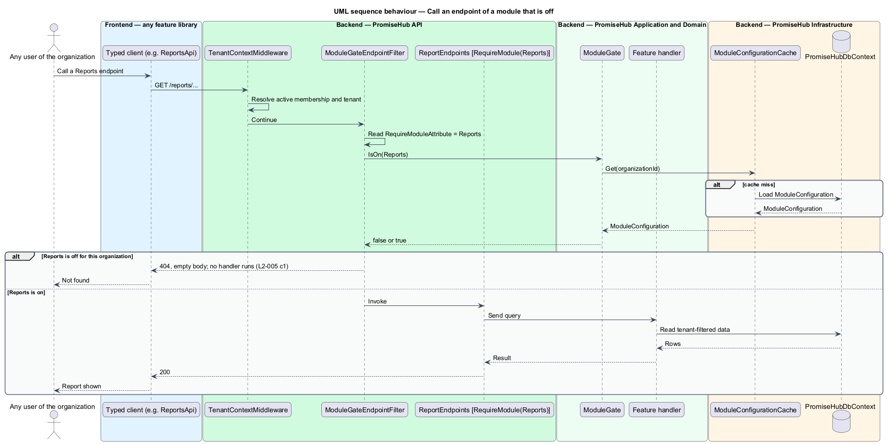
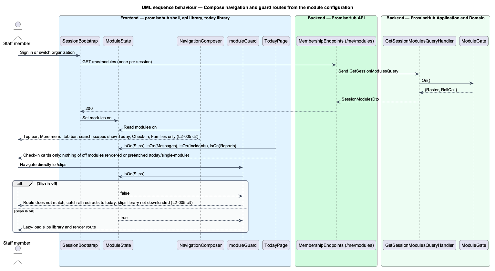

# Enforce module gates

## Overview

An organization's **module configuration** — per-organization record of which modules are on — is written by `configure-modules`. This feature makes that configuration bite. A **module gate** — check that refuses or hides a module's functionality when the module is off for the active organization. There are two gates, one on each side of the network.

The **server gate** — endpoint filter in the PromiseHub API that answers 404 for every endpoint of a module that is off for the request's tenant. The answer is 404, never 200 with hidden data, so an off module is indistinguishable from one that does not exist. The **client gate** — composition rule in the PromiseHub web app that reads the configuration once per session and builds the top bar, More menu, phone tab bar, search scopes, Today's cards and guardian pages only from modules that are on. Nothing that is off is rendered, linked, mentioned or prefetched. A route of a module that is off redirects to Today. The screen `today/single-module` shows the app as a pure check-in tool when only Roster and Roll Call are on.

Turning a module off hides it and turning it on again restores every record unchanged, because the gate reads configuration and never touches data.

## Description

### Backend — `PromiseHub.Api`

- **`RequireModuleAttribute`** — metadata attribute carrying a `ModuleId`, applied to each feature's endpoint group (`SlipEndpoints` carry `[RequireModule(ModuleId.Slips)]`, `ReportEndpoints` carry `Reports`, and so on). Organization, identity, membership and onboarding endpoints carry no module.
- **`ModuleGateEndpointFilter`** — endpoint filter registered on the authenticated endpoint groups. It reads `RequireModuleAttribute` from the endpoint metadata, asks `IModuleGate.IsOn(module)` for the active tenant and, when off, short-circuits with 404 and an empty body (L2-005 criterion 1). The filter runs after `TenantContextMiddleware` and before any handler.
- **`GuardianLinkEndpoints`** — guardian pages are served from one endpoint group, so the filter applies per sub-route: enrollment and slip routes carry their module, messaging routes carry `Messages` (criterion 4).

### Backend — `PromiseHub.Application/Organizations/`

- **`IModuleGate`** — contract: `bool IsOn(ModuleId module)` for the active tenant; `IReadOnlySet<ModuleId> On()`.
- **`ModuleGate`** — implementation reading `ModuleConfigurationCache` and falling back to `PromiseHubDbContext`. Background jobs ask the same gate inside their `TenantScope`, so a reminder job of a tenant with Slips off does nothing for that tenant.
- **`GetSessionModulesQuery`** and **`GetSessionModulesQueryHandler`** — return the set of modules on, served by `GET /me/modules` as part of the session bootstrap for the client gate.

### Backend — `PromiseHub.Domain`

- **`ModuleConfiguration`** and **`ModuleId`** — as defined in `configure-modules`; `IsOn(module)` is the only read the gates use.

### Backend — `PromiseHub.Infrastructure`

- **`ModuleConfigurationCache`** — per-organization in-memory cache with invalidation on save; replaced by a per-request read (ADR 0006).
- **`JobRunner`** — passes `IModuleGate` to each per-tenant job (see `isolate-tenant-data`).

### Frontend — `frontend/projects/promisehub/` (shell) and `frontend/projects/api/`

- **`SessionBootstrap`** — service in `frontend/projects/api/` that loads `GET /me/modules` once per session after sign-in or organization switch and exposes `ModuleState`: a signal of the modules on.
- **`ModuleState`** — read-only store in `frontend/projects/api/` behind the `MODULE_STATE` token: `isOn(module)`, `on()`.
- **`NavigationComposer`** — shell service that builds the top bar, More menu, phone tab bar and search scopes from a static `ModuleNavigation` table filtered by `ModuleState` (criterion 2). With only Roster and Roll Call on, the result is Today, Check-in and Families.
- **`moduleGuard(module)`** — `CanMatch` guard on each lazy route in the shell. When the module is off, the route does not match and a catch-all redirects to `today` (criterion 3). Because the guard is `CanMatch`, the feature library of an off module is never downloaded or prefetched.
- **`TodayPage`** (in `frontend/projects/today/`) — composes its cards from `ModuleState`, so slip, message, incident and report cards do not render when their modules are off (`today/single-module`).
- **`GuardianShell`** (in `frontend/projects/guardian/`) — reads the modules from the guardian link payload and renders only the enrollment, slip and messaging sections whose modules are on (criterion 4).

### Testing

Each feature's acceptance suite includes the case where its module is off: the route redirects to Today, the API answers 404, and after turning the module back on every record created before is present (criterion 5).

## Built so far

Slice 03 delivered `IModuleGate` and `ModuleGate` (per-request read), the `RequireModule` endpoint filter (applied to `GET /children/{id}` for Roster), modules in `GET /me`, navigation composed in the shell from the session's modules (`navigationFor`), and `moduleRoute` with its `canMatch` guards for every module route. Guardian pages, Today's cards, search scopes and per-tenant jobs adopt the gate as they are built.

## Waypoint modules (prompt 49)

- **Placeholder endpoints.** `GET /learning/me` and `GET /curriculum` carry `RequireModule(ModuleId.Learning)`; `GET /mentoring/youth` carries `RequireModule(ModuleId.Mentoring)`. Each answers 404 while its module is off for the caller's organization, and the same request from another organization with the module on answers 200 (`L2-005` criterion 6).
- **Public website.** `GET /website/{slug}` is anonymous, so there is no membership to read a tenant from. `PublicWebsiteHandler` finds the organization by `Organization.WebsiteSlug`, reads that organization's `ModuleConfiguration` with the query filter bypassed for that one id, and answers 404 for an unknown slug, a suspended organization or Public website off; otherwise it returns `PublicSiteDto(name, city)` (criterion 7).
- **Client gate.** `moduleRoute('learning', 'Learning', …)`, `moduleRoute('curriculum', 'Learning', …)` and `moduleRoute('mentoring', 'Mentoring', …)` load the libraries only while their module is on and redirect to Today otherwise (criterion 8). `/site/:slug` sits outside the shell with a `canMatch` that calls `WEBSITE_API.site(slug)`; when the server answers 404 the route does not match and the not-found page renders, so the `website` library is never downloaded.

## Requirements

| L2 ID | Refines (L1) | Requirement |
|-------|--------------|-------------|
| `L2-005` | `L1-002` | A module that is off is neither served nor rendered, including the Learning, Mentoring and Public website endpoints and routes (criteria 6 to 8). |

## Diagrams

### System context

Staff and guardians use PromiseHub; modules that are off for their organization are unreachable on the server and invisible in the web app and guardian pages.

### Containers

The web app loads the module set once per session and composes navigation from it; the API answers 404 for an off module on every request.

### Components

`ModuleGateEndpointFilter` reads `RequireModuleAttribute` and asks `IModuleGate`; `NavigationComposer` and `moduleGuard` read `ModuleState` in the shell.

### Class structure

`IModuleGate` on the server and `ModuleState` on the client both derive from the same `ModuleConfiguration`.

### Behaviour — call an endpoint of a module that is off

The filter answers 404 before any handler runs (`L2-005` criterion 1); an endpoint of a module that is on proceeds.

### Behaviour — compose navigation and guard routes

The shell loads the modules once per session, composes navigation only from modules that are on and redirects a direct navigation to an off module to Today (`L2-005` criteria 2 and 3).

