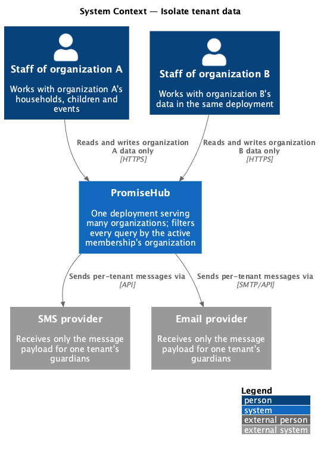
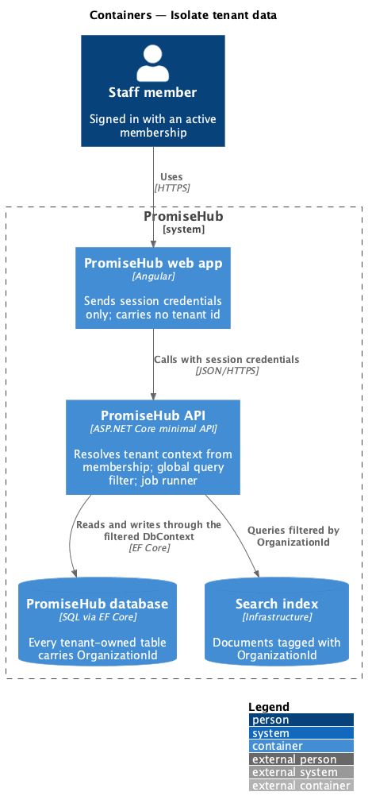
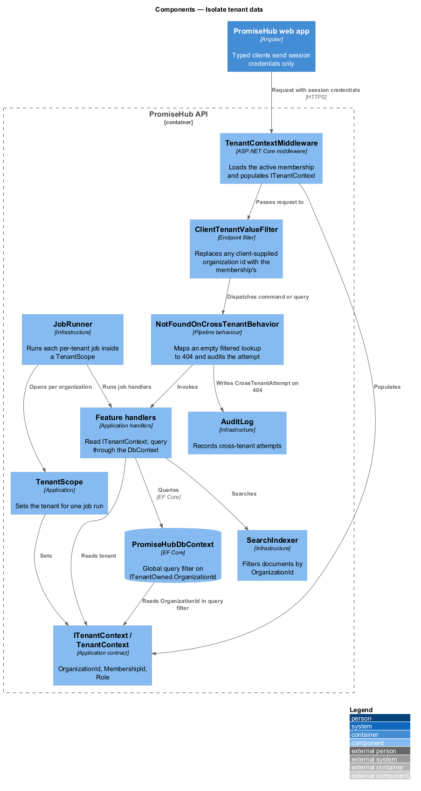
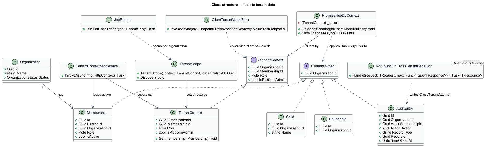
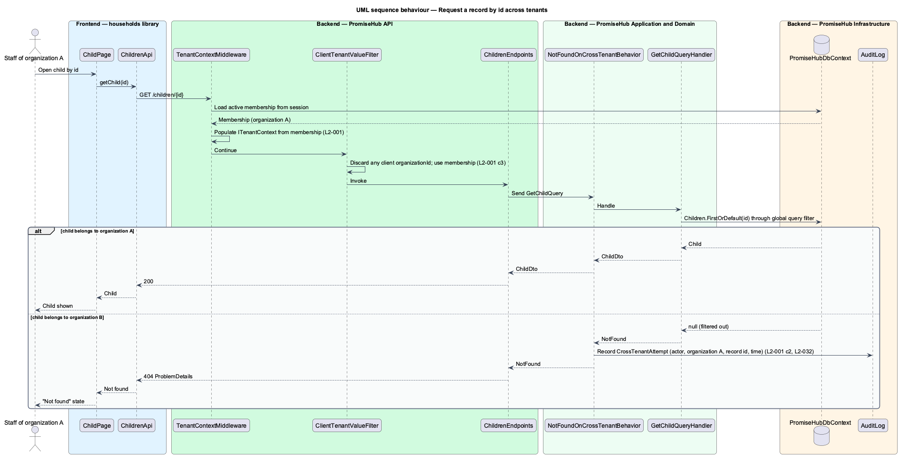
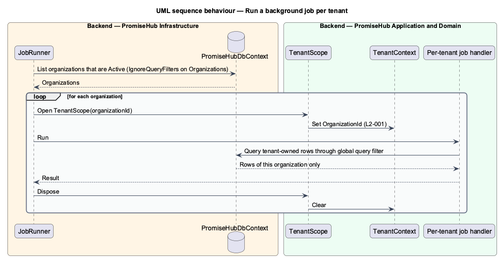

# Isolate tenant data

## Overview

PromiseHub serves many organizations from one deployment. An **organization** — tenant whose households, children, staff, settings, modules, plan and audit log belong to it alone. A **membership** — record that joins a person to one organization with one role. The **tenant context** — the organization id and role resolved on the server from the signed-in person's active membership for the duration of one request or one background job run.

This feature is the cross-cutting rule that keeps one tenant's data out of every other tenant's queries, search results, exports and background jobs. It has no screen of its own. Every other feature depends on it, and every feature's integration test suite carries one cross-tenant case that proves the rule holds for that feature.

The design rests on three mechanisms. First, every tenant-owned table carries `OrganizationId`. Second, an EF Core global query filter on `PromiseHubDbContext` appends `OrganizationId == current tenant` to every query of a tenant-owned entity. Third, the tenant context comes from the membership, never from a route, query string, header or body value supplied by the client. A request for a record of another organization answers 404, and the attempt is written to the audit log.

## Description

### Backend — `PromiseHub.Api`

- **`TenantContextMiddleware`** — runs after authentication. It reads the person's active membership id from the session (see `switch-organization`), loads the membership, and populates `ITenantContext` for the request. A missing or removed membership ends the request with 401 and clears the active membership.
- **`ClientTenantValueFilter`** — endpoint filter applied to every authenticated endpoint group. It ignores any `organizationId` present in the route, query or body by replacing it with the tenant context value before the command is dispatched (L2-001 criterion 3). It records a warning-level audit entry when the client value differs from the membership.

### Backend — `PromiseHub.Application/Organizations/`

- **`ITenantContext`** — contract: `Guid OrganizationId`, `Guid MembershipId`, `Role Role`, `bool IsPlatformAdmin`. Every handler and every background job reads the tenant from this contract.
- **`TenantContext`** — request-scoped implementation set by the middleware.
- **`TenantScope`** — disposable scope used by the job runner to set the tenant context for one organization while a per-tenant job runs.
- **`NotFoundOnCrossTenantBehavior`** — pipeline behaviour wrapping every query and command. When a handler loads an entity by id and the filtered query returns nothing, the behaviour returns `NotFound`, which the endpoint maps to 404 (criterion 2). It also writes an `AuditAction.CrossTenantAttempt` entry when the unfiltered lookup shows the id exists in another organization.

### Backend — `PromiseHub.Domain`

- **`ITenantOwned`** — marker interface: `Guid OrganizationId`. Every tenant-owned entity implements it: `Household`, `Child`, `Guardian`, `Program`, `Event`, `Slip`, `AttendanceRecord`, `Message`, `Incident`, `Membership`, `ModuleConfiguration`, `AuditEntry` and the others.
- **`Organization`** — the tenant root. It is not itself tenant-owned; platform admins read it across tenants (see `manage-organizations`).

### Backend — `PromiseHub.Infrastructure`

- **`PromiseHubDbContext`** — in `OnModelCreating`, applies `HasQueryFilter(e => e.OrganizationId == _tenant.OrganizationId)` to every entity that implements `ITenantOwned`. `SaveChanges` sets `OrganizationId` on every added `ITenantOwned` entity from the tenant context and rejects an entity whose `OrganizationId` differs from the context.
- **`TenantOwnedEntityConfiguration<T>`** — shared EF configuration adding the `OrganizationId` column and an index with `OrganizationId` as the leading key.
- **`SearchIndexer`** — the search index stores `OrganizationId` with every document and every search query filters by it (criterion 1).
- **`ExportWriter`** — exports run under a `TenantScope` and read only through the filtered context.
- **`JobRunner`** — enumerates organizations and runs each per-tenant job inside its own `TenantScope`, so reminders, no-show alerts and exports never see another tenant's rows.
- **`AuditLog`** — writes the cross-tenant attempt entry with actor, membership organization, requested record id and time.

### Frontend

The web app carries no tenant id in requests. The typed clients in `frontend/projects/api/` send the session cookie or token only; the active membership on the session identifies the tenant. The platform-admin screens of `manage-organizations` are the one exception and use the `IgnoreQueryFilters()` path described there.

### Testing

Every feature's integration suite in `backend/tests/PromiseHub.Api.Tests/` includes one cross-tenant test that signs in as organization A and requests organization B's record by id, asserting 404 and the audit entry (criterion 4). The seeder creates at least two organizations, each with a child named "Mateo Rivera", so the search case of criterion 1 is testable from seed data.

## Built so far

Slice 01 delivered `ITenantOwned`, the query filter and save guard on `PromiseHubDbContext`, `TenantContextMiddleware` (session claim `membership_id`) and the cross-tenant 404 with an `AccessDenied` audit entry on `GET /children/{id}`. Without a mediator (ADR 0003) the cross-tenant check lives in the handler; ADR 0002 records the rules. `ClientTenantValueFilter` is unnecessary because no handler reads an organization id from the request; `TenantScope`, `JobRunner`, search and exports arrive with their features.

## Requirements

| L2 ID | Refines (L1) | Requirement |
|-------|--------------|-------------|
| `L2-001` | `L1-001` | Every tenant-owned table carries the organization id; every query, search, export and background job filters by the organization of the signed-in person's active membership, never by a value from the client. |
| `L2-032` | `L1-017` | Every change and every sensitive view is recorded and searchable by admins. |

## Diagrams

### System context

Staff of two organizations use the same PromiseHub deployment; each sees only their own organization's data.

### Containers

The web app sends no tenant identifier. The API resolves the tenant from the membership and the database holds `OrganizationId` on every tenant-owned table.

### Components

`TenantContextMiddleware` populates `ITenantContext`; `PromiseHubDbContext` reads it in its global query filter; `JobRunner` sets it per tenant through `TenantScope`.

### Class structure

`ITenantOwned` marks each tenant-owned entity, `PromiseHubDbContext` filters by `ITenantContext`, and `NotFoundOnCrossTenantBehavior` turns an empty filtered lookup into 404 plus an audit entry.

### Behaviour — request a record by id

A request for an own-tenant record returns it. A request for another tenant's record by id returns 404 and writes the attempt to the audit log (`L2-001` criteria 2 and 3).

### Behaviour — run a background job per tenant

The job runner opens a `TenantScope` per organization so every query inside the job is filtered to that organization (`L2-001`).

