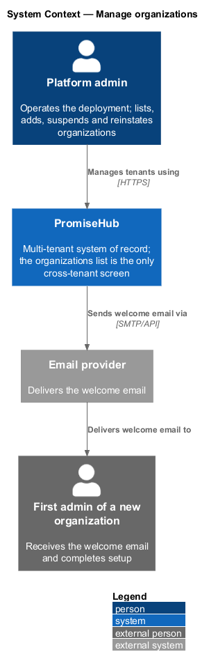
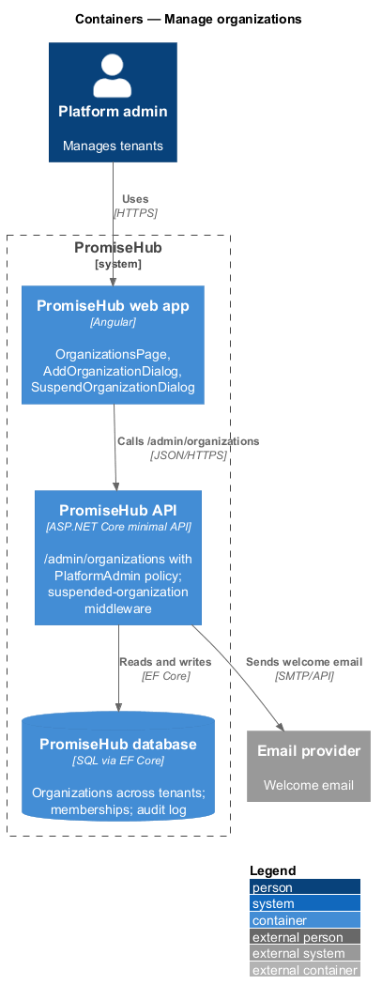
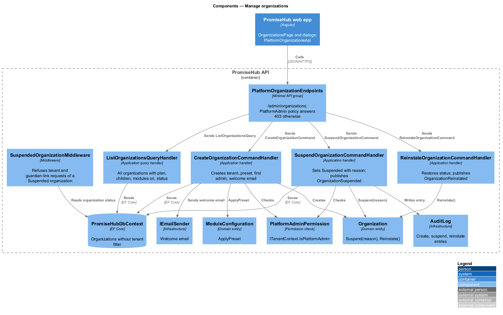
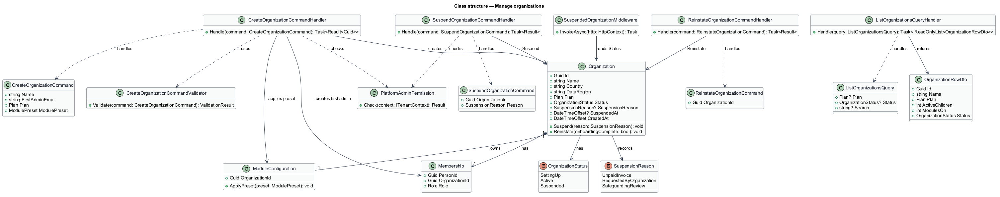
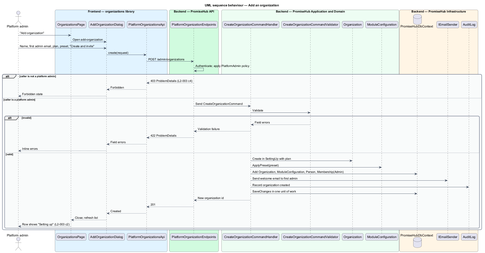
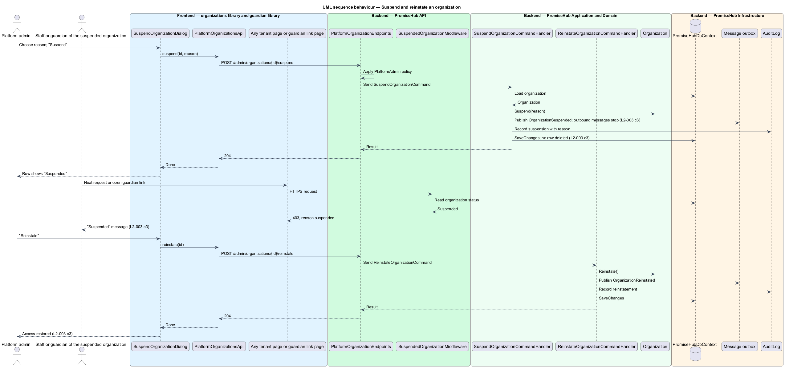

# Manage organizations

## Overview

PromiseHub serves many organizations from one deployment. A **platform admin** — person holding the `PlatformAdmin` role, who operates the deployment rather than any one organization. The **organizations list** — the page (`organizations`) on which a platform admin sees every tenant with its plan, active children, modules on and status. It is the only screen in PromiseHub that spans tenants.

From this list a platform admin adds an organization (`add-organization`), suspends one with a reason (`suspend-organization`) and reinstates a suspended one. A **suspended organization** — tenant whose staff sign-ins and guardian links are refused with a "suspended" message and whose outbound messages stop, while every record stays intact. Reinstating restores access. An organization admin who is not a platform admin is refused with 403.

## Description

### Frontend — `frontend/projects/organizations/`

- **`OrganizationsPage`** — page for `/admin/organizations`. It renders a table of organizations with name, plan, active children, modules on and status, the plan and status filter chips and a name search (L2-003 criterion 1). Row actions: open, suspend or reinstate. The `platformAdminGuard` from the shell redirects a non-platform-admin to the forbidden state (criterion 4).
- **`AddOrganizationDialog`** — CDK dialog (`add-organization`) with organization name, first admin's email, plan and module preset. Submit calls `createOrganization`; on success the new row shows "Setting up" (criterion 2).
- **`SuspendOrganizationDialog`** — CDK dialog (`suspend-organization`) with a reason choice and a danger confirm. The same dialog, with a confirm label of "Reinstate", drives reinstatement.
- **`PlatformOrganizationsApi`** — typed client in `frontend/projects/api/` behind the `PLATFORM_ORGANIZATIONS_API` token. Methods: `list(filter)`, `create(request)`, `suspend(id, reason)`, `reinstate(id)`.

### Backend — `PromiseHub.Api`

- **`PlatformOrganizationEndpoints`** — minimal-API group under `/admin/organizations` with the `PlatformAdmin` authorization policy: `GET /admin/organizations`, `POST /admin/organizations`, `POST /admin/organizations/{id}/suspend`, `POST /admin/organizations/{id}/reinstate`. A caller without the role receives 403 before any handler runs (criterion 4).
- **`SuspendedOrganizationMiddleware`** — runs after `TenantContextMiddleware`. When the active membership's organization is `Suspended`, it answers 403 with `reason: suspended` for every tenant request, and the guardian link endpoints answer the same for a suspended organization's links (criterion 3).

### Backend — `PromiseHub.Application/Organizations/`

- **`ListOrganizationsQuery`** and **`ListOrganizationsQueryHandler`** — read every `Organization` with its plan, active-children count, modules-on count and status, filtered by plan, status and name. Because `Organization` is not tenant-owned, no query filter applies; the handler uses `IgnoreQueryFilters()` for the tenant-owned counts.
- **`CreateOrganizationCommand`** — `Name`, `FirstAdminEmail`, `Plan`, `ModulePreset`.
- **`CreateOrganizationCommandValidator`** — requires a name and a valid email.
- **`CreateOrganizationCommandHandler`** — creates the `Organization` in `SettingUp` status, applies the preset through `ModuleConfiguration.ApplyPreset` (see `configure-modules`), creates the first admin `Person` and `Membership` with role `Admin`, sends the welcome email through `IEmailSender`, and saves in one unit of work.
- **`SuspendOrganizationCommand`** and **`SuspendOrganizationCommandHandler`** — set status to `Suspended` with `SuspensionReason`; no data changes otherwise. The handler publishes `OrganizationSuspended`, which the messaging subsystem's outbox consumes to stop outbound messages for that organization.
- **`ReinstateOrganizationCommand`** and **`ReinstateOrganizationCommandHandler`** — set status back to `Active` or `SettingUp` according to onboarding progress and publish `OrganizationReinstated`.
- **`PlatformAdminPermission`** — permission check used by every handler in this folder; it reads `ITenantContext.IsPlatformAdmin`.

### Backend — `PromiseHub.Domain`

- **`Organization`** — `Id`, `Name`, `Country`, `DataRegion`, `Plan`, `Status`, `SuspensionReason`, `SuspendedAt`, `CreatedAt`. Methods `Suspend(reason)` and `Reinstate()` enforce the status transitions.
- **`OrganizationStatus`** — `SettingUp`, `Active`, `Suspended`.
- **`SuspensionReason`** — enumeration from the dialog: `UnpaidInvoice`, `RequestedByOrganization`, `SafeguardingReview`.
- **`Plan`** — plan names and limits are owned by `billing/meter-plan-and-usage`.

### Backend — `PromiseHub.Infrastructure`

- **`PromiseHubDbContext`** — `Organizations` has no tenant query filter; a composite index on `Status, Plan` serves the list filters.
- **`IEmailSender`** — sends the welcome email with the confirmation link for the first admin.
- **`AuditLog`** — records create, suspend and reinstate with actor, organization and reason. The audit entry for a platform action is stored against the target organization.

## Requirements

| L2 ID | Refines (L1) | Requirement |
|-------|--------------|-------------|
| `L2-003` | `L1-001` | Platform admins list, add, suspend and reinstate organizations; this list is the only screen that spans tenants. |

## Diagrams

### System context

A platform admin manages tenants through PromiseHub, which emails the first admin of a new organization.

### Containers

The organizations page in the web app calls the platform endpoints of the API; the database holds organizations across tenants.

### Components

`PlatformOrganizationEndpoints` applies the `PlatformAdmin` policy and dispatches to the create, suspend and reinstate handlers; `SuspendedOrganizationMiddleware` refuses requests of a suspended tenant.

### Class structure

`Organization` owns the status transitions; the three command handlers call them and the list handler reads across tenants.

### Behaviour — add an organization

The platform admin submits the dialog, the handler creates the tenant, preset, first admin and welcome email in one unit of work, and the row shows "Setting up" (`L2-003` criterion 2). A non-platform-admin is refused with 403 (criterion 4).

### Behaviour — suspend and reinstate

Suspension changes the status and stops outbound messages; the next request from that tenant's staff or guardian links is refused with "suspended"; reinstating restores access (`L2-003` criterion 3).

