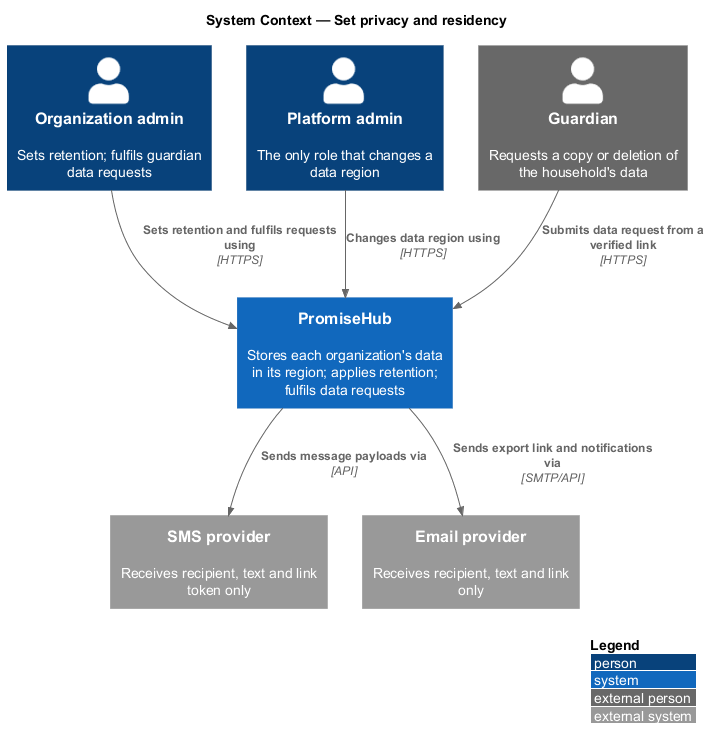
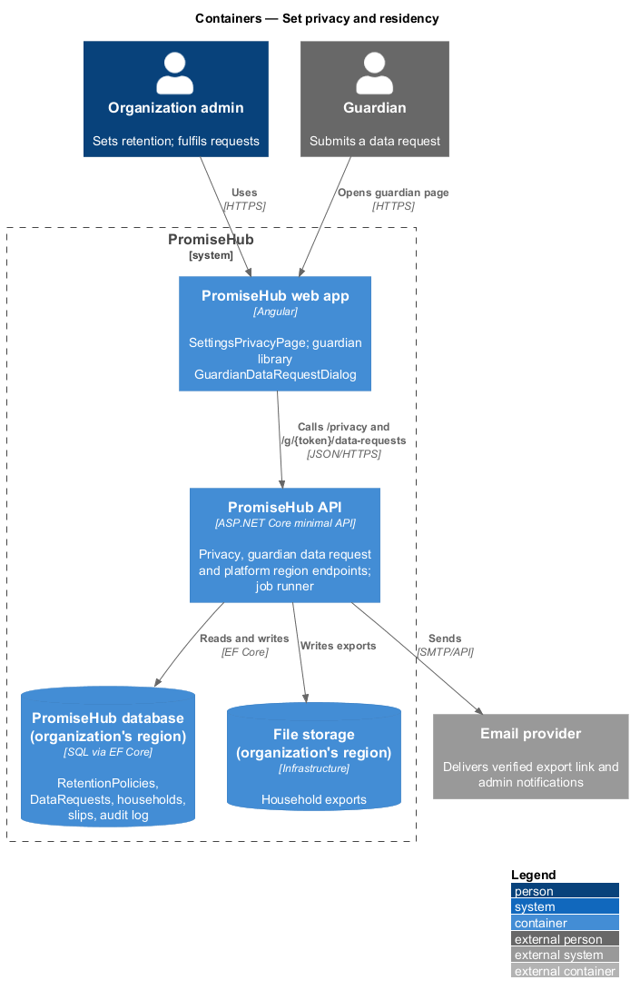
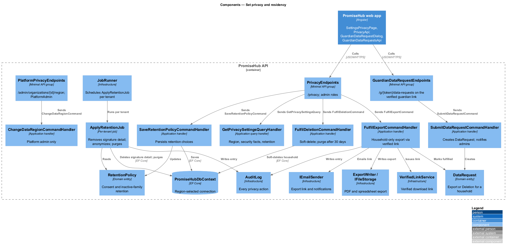
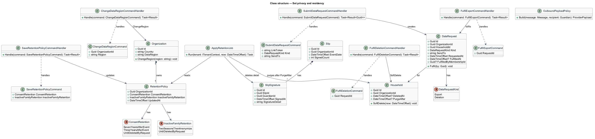
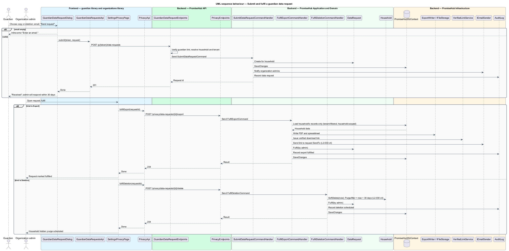
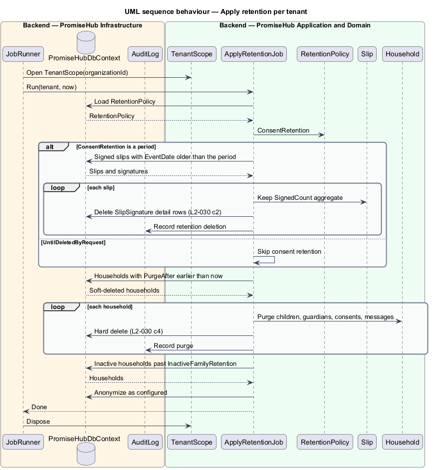

# Set privacy and residency

## Overview

PromiseHub holds child, medical and guardian data for each organization and uses it only to run programs. **Data residency** — the geographic region in which an organization's data is stored, chosen from the organization's country at creation. A **retention period** — the length of time an organization keeps a class of records before the system removes the personal detail. The **retention job** — per-tenant background job that applies the retention periods. A **data request** — a guardian's request, made from a guardian page (`guardian-data-request`), for a copy of their household's data or for its deletion.

Admins view residency and set retention on `settings-privacy`. The region is shown but cannot be changed without a platform admin. When a signed slip is older than the consent retention period, the retention job deletes the signature detail and keeps the aggregate count. Outbound integrations receive only what a message needs. When an admin fulfils a data request, the export contains the household's records only and is delivered through a verified link; deletion soft-deletes the household and purges it after 30 days.

## Description

### Frontend — `frontend/projects/organizations/`

- **`SettingsPrivacyPage`** — page for `/settings/privacy` (`settings-privacy`). It shows the residency and security facts (data residency region, encryption, multi-factor status), the retention form with two choices (consent records and slips; inactive family records), the guardian request actions (export a household, delete a household, open the audit log) and the export-all action. The region is read-only for organization admins (L2-030 criterion 1).
- **`PrivacyApi`** — typed client in `frontend/projects/api/` behind the `PRIVACY_API` token. Methods: `get()`, `saveRetention(request)`, `listDataRequests()`, `fulfilExport(requestId)`, `fulfilDeletion(requestId)`.

### Frontend — `frontend/projects/guardian/`

- **`GuardianDataRequestDialog`** — CDK dialog (`guardian-data-request`) opened from the family page. Choice "A copy of our data" or "Delete our data", plus the email address to send it to. Success copy states the admin will respond within 30 days.
- **`GuardianDataRequestsApi`** — typed client behind the `GUARDIAN_DATA_REQUESTS_API` token: `submit(linkToken, request)`.

### Backend — `PromiseHub.Api`

- **`PrivacyEndpoints`** — `GET /privacy`, `PUT /privacy/retention`, `GET /privacy/data-requests`, `POST /privacy/data-requests/{id}/export`, `POST /privacy/data-requests/{id}/delete`. Admin and program director roles only.
- **`GuardianDataRequestEndpoints`** — `POST /g/{token}/data-requests` on the guardian link group; the link is verified as in `guardian/verify-guardian-link`.
- **`PlatformPrivacyEndpoints`** — `PUT /admin/organizations/{id}/region` with the `PlatformAdmin` policy; this is the only way to change a region (criterion 1).

### Backend — `PromiseHub.Application/Organizations/`

- **`GetPrivacySettingsQuery`** and **`GetPrivacySettingsQueryHandler`** — return region, encryption and multi-factor facts and the current retention policy.
- **`SaveRetentionPolicyCommand`** and **`SaveRetentionPolicyCommandHandler`** — persist `ConsentRetention` and `InactiveFamilyRetention` for the organization.
- **`ChangeDataRegionCommand`** and **`ChangeDataRegionCommandHandler`** — platform-admin only; sets `Organization.DataRegion`. The migration of existing rows between regions is `<TO SUPPLY>`.
- **`SubmitDataRequestCommand`** and **`SubmitDataRequestCommandHandler`** — create a `DataRequest` for the household behind the verified guardian link and notify the organization's admins through in-app notification and email.
- **`FulfilExportCommand`** and **`FulfilExportCommandHandler`** — build the household export (children, guardians, consents, attendance and messages of that household only), store it, create a verified download link and email it to the request's address (criterion 4).
- **`FulfilDeletionCommand`** and **`FulfilDeletionCommandHandler`** — soft-delete the household and its children and guardians by setting `DeletedAt`, and schedule the purge 30 days later (criterion 4).
- **`ApplyRetentionJob`** — per-tenant job: for each signed slip older than `ConsentRetention`, delete the `SlipSignature` detail and keep the aggregate signed count on the slip (criterion 2); for each household inactive longer than `InactiveFamilyRetention`, anonymize as configured; for each soft-deleted household past 30 days, purge.
- **`OutboundPayloadPolicy`** — rule used by the messaging subsystem's provider adapters: the SMS and email payloads carry the recipient address, the message text and the link token only, never child records (criterion 3).

### Backend — `PromiseHub.Domain`

- **`Organization.DataRegion`** — string region code derived from `Country` at creation; Canada maps to the Canadian region.
- **`RetentionPolicy`** — tenant-owned entity: `OrganizationId`, `ConsentRetention`, `InactiveFamilyRetention`. `ConsentRetention` options: 7 years after the event, 3 years after the event, until deleted by request. `InactiveFamilyRetention` options: 2 seasons after the last enrollment then anonymize, until deleted by request.
- **`DataRequest`** — tenant-owned entity: `HouseholdId`, `Kind` (`Export`, `Deletion`), `SendTo`, `RequestedAt`, `FulfilledAt`, `FulfilledByMembershipId`.
- **`Household.DeletedAt`** and **`Household.PurgeAfter`** — soft-delete markers read by the retention job.
- **`SlipSignature`** — signature detail removed by retention; `Slip.SignedCount` is the aggregate that survives.

### Backend — `PromiseHub.Infrastructure`

- **`PromiseHubDbContext`** — connection string selected per region. The deployment topology for region separation (one database per region or one deployment per region) is `<TO SUPPLY>`.
- **`ExportWriter`** and **`IFileStorage`** — write the export as PDF and spreadsheet to tenant-scoped storage.
- **`VerifiedLinkService`** — issues the download link with the same verification as guardian links.
- **`JobRunner`** — schedules `ApplyRetentionJob` per tenant; the schedule interval is `<TO SUPPLY>`.
- **`AuditLog`** — records retention saves, region changes, each data request, each fulfilment and each retention deletion.

## Requirements

| L2 ID | Refines (L1) | Requirement |
|-------|--------------|-------------|
| `L2-030` | `L1-015` | Each organization chooses data residency and retention; child data is used only to run programs. |

## Diagrams

### System context

Admins set retention and fulfil requests, guardians submit requests, and PromiseHub sends only message payloads to the SMS and email providers.

### Containers

The settings page and the guardian dialog call the API; the database for the organization's region holds its data; the job runner applies retention per tenant.

### Components

`PrivacyEndpoints` and `GuardianDataRequestEndpoints` dispatch to the retention and data request handlers; `ApplyRetentionJob` runs under the job runner.

### Class structure

`RetentionPolicy` and `DataRequest` are tenant-owned; `ApplyRetentionJob` reads the policy and removes `SlipSignature` detail and purges soft-deleted households.

### Behaviour — submit and fulfil a data request

A guardian submits a request through a verified link; an admin fulfils it as an export delivered through a verified link, or as a deletion that soft-deletes the household and purges it after 30 days (`L2-030` criterion 4).

### Behaviour — apply retention

The per-tenant retention job removes signature detail older than the consent period while keeping the aggregate count, and purges households soft-deleted more than 30 days ago (`L2-030` criterion 2).

