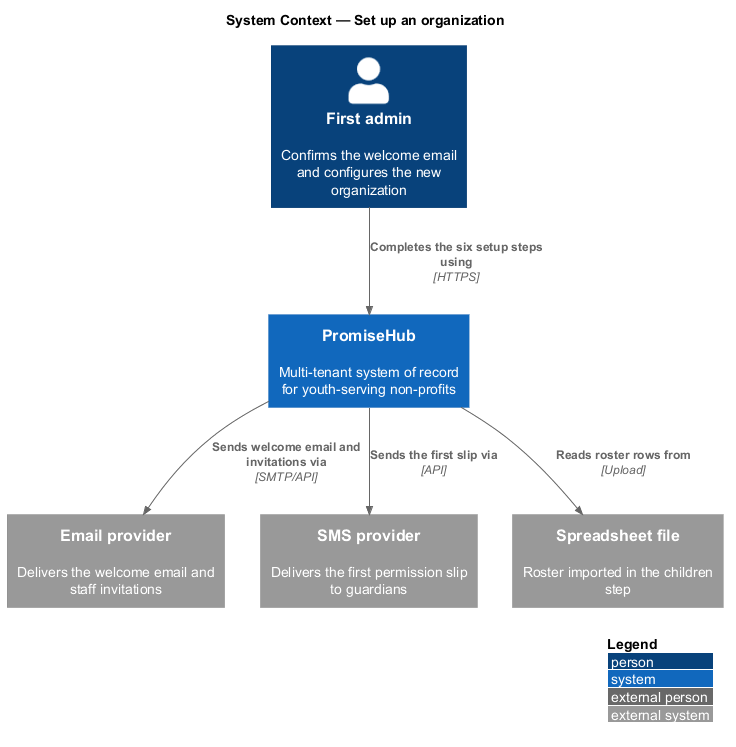
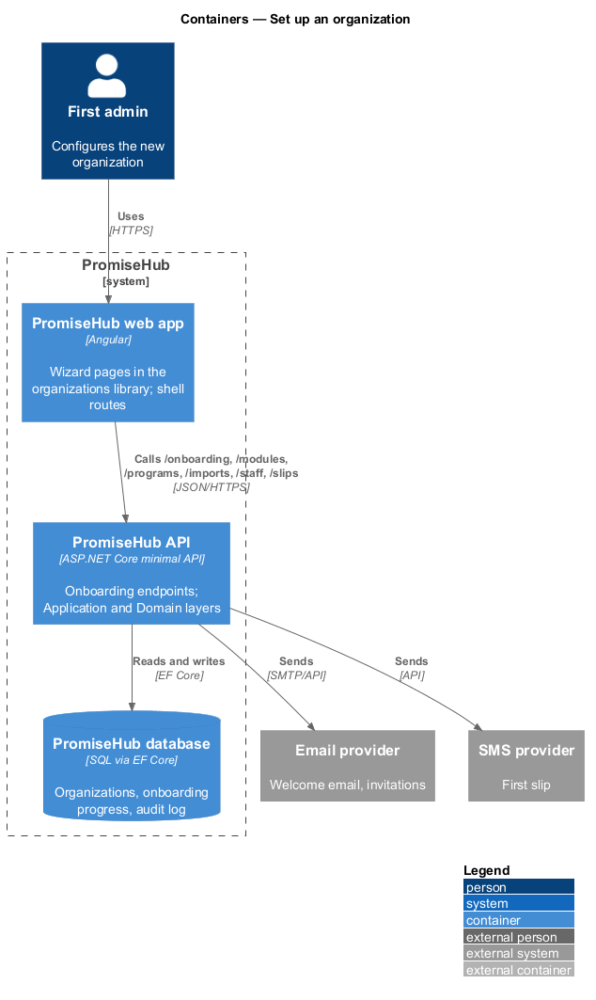
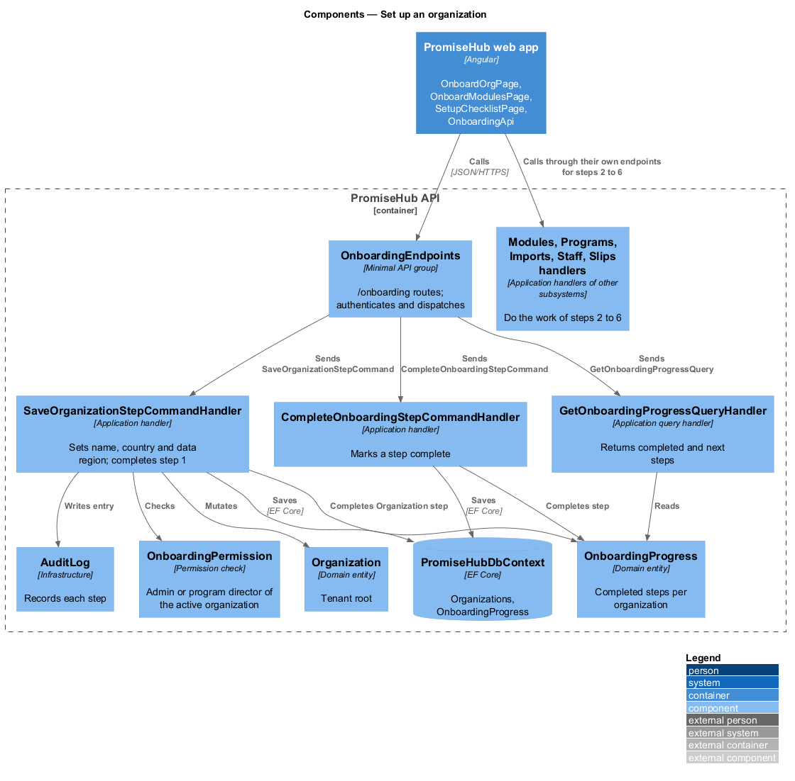
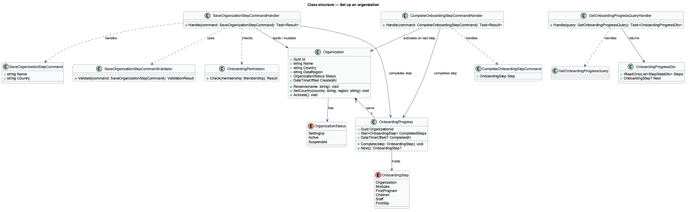
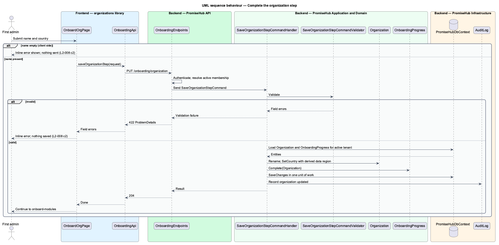
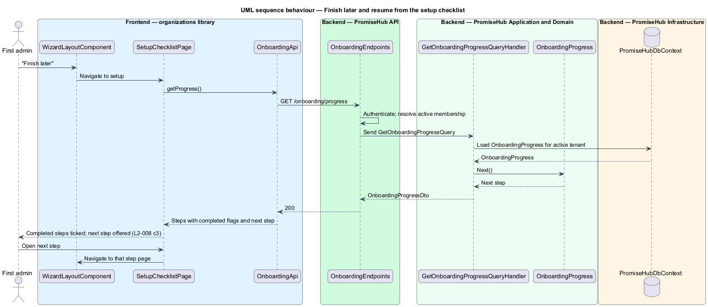

# Set up an organization

## Overview

PromiseHub is a multi-tenant, phone-first system of record for small youth-serving non-profits. An **organization** — tenant whose households, children, staff, settings, modules, plan and audit log belong to it alone. A new organization exists from the moment a platform admin creates it or a person confirms a sign-up email, but it holds no program, roster or staff. This feature carries the first admin from a confirmed email to a configured organization with its first permission slip sent.

The **setup wizard** — sequence of six short steps, one question per screen, that configures a new organization: organization, modules, first program, children, staff and first slip. The **setup checklist** — page (`setup`) that lists the six steps, marks the completed ones and offers the next one. The **onboarding progress record** — persisted set of completed steps per organization, so that "Finish later" keeps progress across sessions and devices.

The wizard composes work owned by other subsystems. The modules step reuses the module configuration of `configure-modules`. The children step reuses the roster import of `imports/import-roster`. The staff step reuses `staff/invite-and-onboard-staff`. The first-slip step reuses `slips/write-and-send-slip`. This design owns the wizard shell, the organization step, the progress record, the welcome and done screens and the checklist. The screens are `onboard-welcome`, `onboard-org`, `onboard-modules`, `onboard-program`, `onboard-roster`, `onboard-staff`, `onboard-first-event`, `onboard-done` and `setup`.

## Description

The feature is a vertical slice from the Angular wizard pages to the `Organizations` and `OnboardingProgress` tables.

### Frontend — `frontend/projects/organizations/`

- **`OnboardWelcomePage`** — page component for `onboard-welcome`. It renders one primary action and no shell navigation. The shell route guard sends a signed-in person with no organization membership to this page (L2-008 criterion 1).
- **`WizardLayoutComponent`** — composition of the `wizard-layout`, `wizard-steps` and `wizard-progress` components from `frontend/projects/components/`. It shows the six steps, the current step and the "Finish later" exit that returns to `setup`.
- **`OnboardOrgPage`** — step 1 (`onboard-org`). Fields: organization name and country. Country sets the data region and phone format. An empty name on submit shows the inline error and sends nothing (criterion 2).
- **`OnboardModulesPage`** — step 2 (`onboard-modules`). Four preset tiles: "The whole suite", "Just check-in", "Just permission slips" and "Let me choose". "Let me choose" embeds the same module list that `settings-modules` shows. The save calls the module configuration endpoint described in `configure-modules`.
- **`OnboardProgramPage`** — step 3 (`onboard-program`). Name, days and time of the first program. It calls the `programs` client.
- **`OnboardRosterPage`** — step 4 (`onboard-roster`). Choice tiles: import a spreadsheet, add children by hand or skip. The import path calls the `imports` client and shows the import summary: children, households, guardians, flagged medical rows and rows needing attention (criterion 4).
- **`OnboardStaffPage`** — step 5 (`onboard-staff`). A list of `invite-row` components; each row calls the staff invitation client.
- **`OnboardFirstEventPage`** — step 6 (`onboard-first-event`). First event and its permission slip. Sending the slip calls the `slips` client.
- **`OnboardDonePage`** — `onboard-done`. It lists the receipt of everything created and shows the "Slip sent" toast (criterion 5).
- **`SetupChecklistPage`** — `setup`. It reads the progress record and renders completed and next steps (criterion 3).
- **`OnboardingApi`** — typed client in `frontend/projects/api/` behind the `ONBOARDING_API` injection token. Methods: `getProgress()`, `saveOrganizationStep(request)`, `completeStep(step)`.

### Backend — `PromiseHub.Api`

- **`OnboardingEndpoints`** — minimal-API group under `/onboarding`: `GET /onboarding/progress`, `PUT /onboarding/organization`, `POST /onboarding/steps/{step}/complete`. Endpoints authenticate the caller and dispatch commands; they hold no business logic.

### Backend — `PromiseHub.Application/Organizations/`

- **`SaveOrganizationStepCommand`** — carries `Name` and `Country`.
- **`SaveOrganizationStepCommandValidator`** — rejects an empty `Name`; the endpoint answers 422 with the field error.
- **`SaveOrganizationStepCommandHandler`** — loads the active organization, sets its name and country, derives the data region from the country, marks the `Organization` step complete and saves in one unit of work.
- **`CompleteOnboardingStepCommand`** and **`CompleteOnboardingStepCommandHandler`** — mark a step complete after its owning subsystem has done its work. Completing `FirstSlip` marks the wizard done and moves the organization from `SettingUp` to `Active`.
- **`GetOnboardingProgressQuery`** and **`GetOnboardingProgressQueryHandler`** — return the six steps with their completed flags and the next step.
- **`OnboardingPermission`** — permission check: only the `Admin` or `ProgramDirector` role of the active organization may run the wizard.

### Backend — `PromiseHub.Domain`

- **`Organization`** — tenant root: `Id`, `Name`, `Country`, `DataRegion`, `Status`, `CreatedAt`.
- **`OnboardingProgress`** — one row per organization: `OrganizationId`, `CompletedSteps`, `CompletedAt`. `Complete(step)` is idempotent.
- **`OnboardingStep`** — enumeration: `Organization`, `Modules`, `FirstProgram`, `Children`, `Staff`, `FirstSlip`.

### Backend — `PromiseHub.Infrastructure`

- **`PromiseHubDbContext`** — maps `Organizations` and `OnboardingProgress`. The progress table is tenant-owned and carries `OrganizationId`.
- **`AuditLog`** — records the organization step save and each step completion.

The 60-minute completion target in criterion 5 is an acceptance measurement, not a runtime rule. The seeded spreadsheet used for that measurement is `<TO SUPPLY>`.

## Built so far

Slice 39 delivered `SetupHandler` (`GET /setup`, `PUT /settings/organization`), `Organization.ProfileConfirmedAt`, and `SetupPage` and `SetupOrganizationPage` at `/setup` linking each step to its feature's screen (ADR 0033). The one-step-per-screen wizard chrome is not built.

## Requirements

| L2 ID | Refines (L1) | Requirement |
|-------|--------------|-------------|
| `L2-008` | `L1-004` | After confirming their email, the first admin completes six steps: organization, modules, first program, children, staff, first slip (`onboard-welcome` … `onboard-done`). |

## Diagrams

### System context

The first admin sets up the organization through PromiseHub, which sends invitations and the first slip through the email and SMS providers and reads the roster from a spreadsheet file.

### Containers

The wizard pages live in the PromiseHub web app and call the PromiseHub API, which persists the organization and its progress in the PromiseHub database.

### Components

`OnboardingEndpoints` dispatches commands to the onboarding handlers, which mutate `Organization` and `OnboardingProgress`. Steps 2 to 6 call handlers owned by other subsystems.

### Class structure

`SaveOrganizationStepCommandHandler` depends on its command and validator and mutates `Organization` and `OnboardingProgress`. `OnboardingProgress` holds a set of `OnboardingStep` values.

### Behaviour — complete the organization step

The validator rejects an empty name before anything is saved (`L2-008` criterion 2). A valid name updates the organization and marks the step complete in one unit of work.

### Behaviour — finish later and resume

Leaving a step saves nothing new. The checklist reads the progress record and offers the next step (`L2-008` criterion 3).

