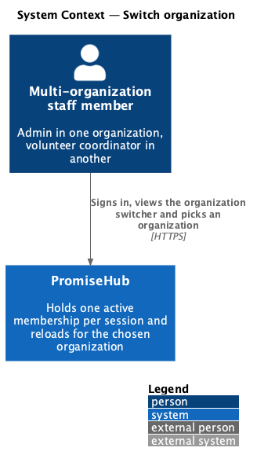
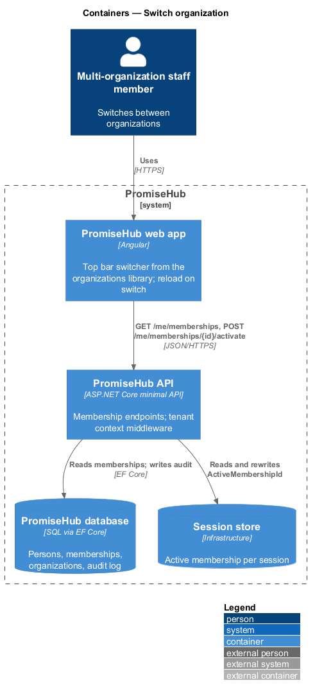
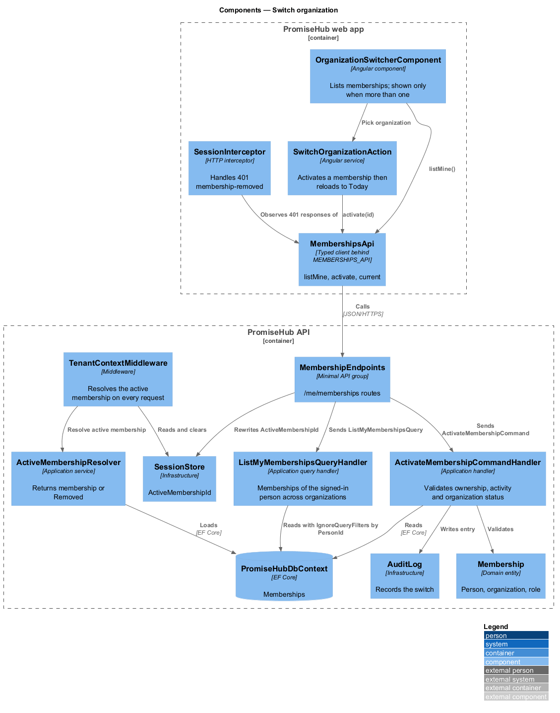
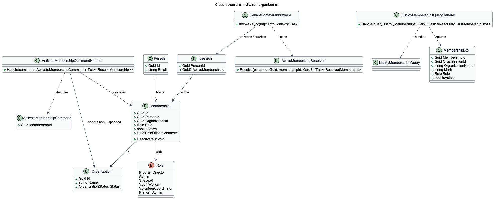
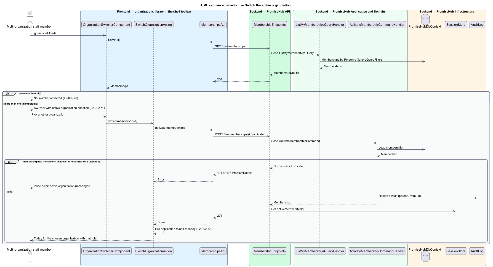
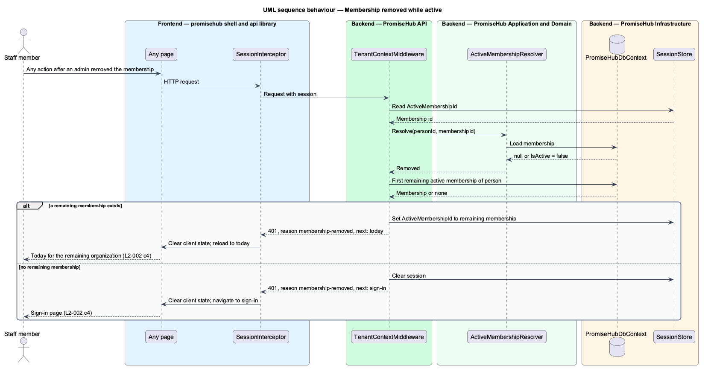

# Switch organization

## Overview

A person who works with more than one youth-serving organization holds a **membership** — record that joins a person to one organization with one role — in each. At any moment exactly one of those memberships is the **active membership** — the membership whose organization and role apply to the current session and to every request made in it. The **organization switcher** — menu in the top bar (`switch-organization`) that lists the person's organizations with their role in each and changes the active membership.

Switching is a deliberate reload, not a filter. Choosing another organization asks the server to change the active membership on the session, then reloads the app so that Today, navigation, module configuration and every cached client state belong to the chosen organization. A person with one membership never sees a switcher. A membership removed while active ends that organization's session on the next request.

## Description

### Frontend — `frontend/projects/organizations/`

- **`OrganizationSwitcherComponent`** — the `org-switcher` composition of `menu` and `brand-mark` components from `frontend/projects/components/`, placed in the shell top bar by the `shell` library through the `organizations` public API. It renders only when `MembershipsApi.listMine()` returns more than one membership (L2-002 criterion 3). Each item shows the organization name, mark and the person's role; the active one is checked.
- **`SwitchOrganizationAction`** — on choice, calls `MembershipsApi.activate(membershipId)` and then performs a full application reload to the `today` route (criterion 2). Nothing from the previous organization survives the reload.
- **`MembershipsApi`** — typed client in `frontend/projects/api/` behind the `MEMBERSHIPS_API` token. Methods: `listMine()`, `activate(membershipId)`, `current()`.
- **`SessionInterceptor`** — in `frontend/projects/api/`. On a 401 with `reason: membership-removed` it clears client state and navigates to `today` of the remaining organization or to sign-in (criterion 4).

### Backend — `PromiseHub.Api`

- **`MembershipEndpoints`** — `GET /me/memberships`, `GET /me/memberships/active`, `POST /me/memberships/{id}/activate`. The activate endpoint rewrites the session's active membership claim and returns 204.
- **`TenantContextMiddleware`** — (see `isolate-tenant-data`) loads the active membership on every request. When the membership no longer exists or is inactive, it clears the active membership from the session, selects the person's first remaining active membership if one exists, and answers 401 with `reason: membership-removed`.

### Backend — `PromiseHub.Application/Organizations/`

- **`ListMyMembershipsQuery`** and **`ListMyMembershipsQueryHandler`** — return the person's active memberships with organization name, mark and role. This query reads `Memberships` for the signed-in person across organizations, so it uses `IgnoreQueryFilters()` and filters by `PersonId` instead.
- **`ActivateMembershipCommand`** and **`ActivateMembershipCommandHandler`** — verify that the membership belongs to the signed-in person and is active, verify that its organization is not `Suspended`, then return the membership for the endpoint to store on the session. A membership of another person answers 404.
- **`ActiveMembershipResolver`** — service used by the middleware: given a person id and the session's membership id, returns the membership or `Removed`.

### Backend — `PromiseHub.Domain`

- **`Membership`** — `Id`, `PersonId`, `OrganizationId`, `Role`, `IsActive`, `CreatedAt`.
- **`Person`** — identity holder: `Id`, `Email`. A person has one or more memberships.
- **`Role`** — enumeration: `ProgramDirector`, `Admin`, `SiteLead`, `YouthWorker`, `VolunteerCoordinator`, `PlatformAdmin`.

### Backend — `PromiseHub.Infrastructure`

- **`SessionStore`** — persists the session including `ActiveMembershipId`. The storage mechanism of the session (cookie or server-side) is `<TO SUPPLY>` from the `identity/sign-in` design.
- **`AuditLog`** — records each switch with person, from-organization and to-organization.

## Built so far

Slice 40 delivered `SwitchOrganizationHandler` (`GET /me/organizations`, `POST /me/organization`), `SessionCookie.ReissueAsync`, the removed-membership fallback in `TenantContextMiddleware`, and the top bar's organization switcher (ADR 0034).

## Requirements

| L2 ID | Refines (L1) | Requirement |
|-------|--------------|-------------|
| `L2-002` | `L1-001` | A person can belong to several organizations with a different role in each. One organization is active per session; switching reloads the app for the chosen organization. |

## Diagrams

### System context

A person with memberships in two organizations uses PromiseHub and switches which organization is active.

### Containers

The switcher in the web app calls the membership endpoints of the API; the session store holds the active membership.

### Components

`OrganizationSwitcherComponent` calls `MembershipEndpoints`, which dispatches `ActivateMembershipCommand`; `TenantContextMiddleware` resolves the active membership on every later request.

### Class structure

`Person` has many `Membership` rows; `ActivateMembershipCommandHandler` validates one and the session stores its id.

### Behaviour — switch the active organization

The person picks an organization, the server stores the new active membership, and the app reloads Today for that organization (`L2-002` criteria 1 and 2).

### Behaviour — membership removed while active

The next request after removal is refused; the person lands on their remaining organization or on sign-in (`L2-002` criterion 4).

