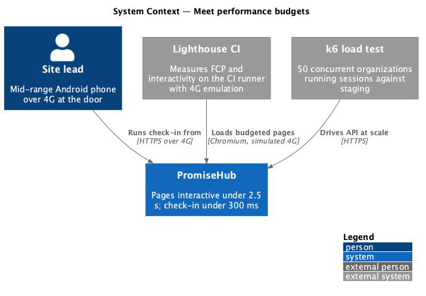
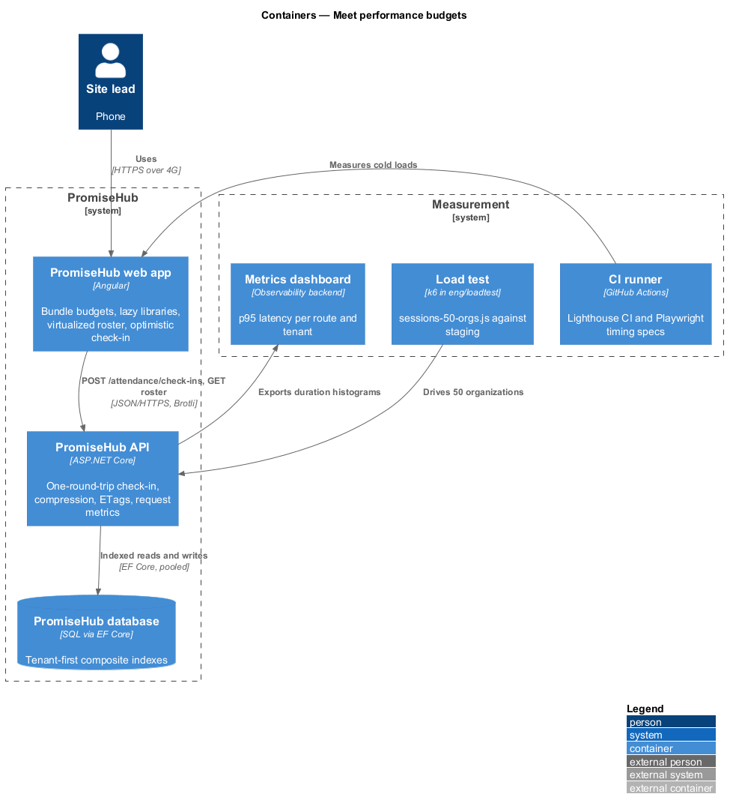
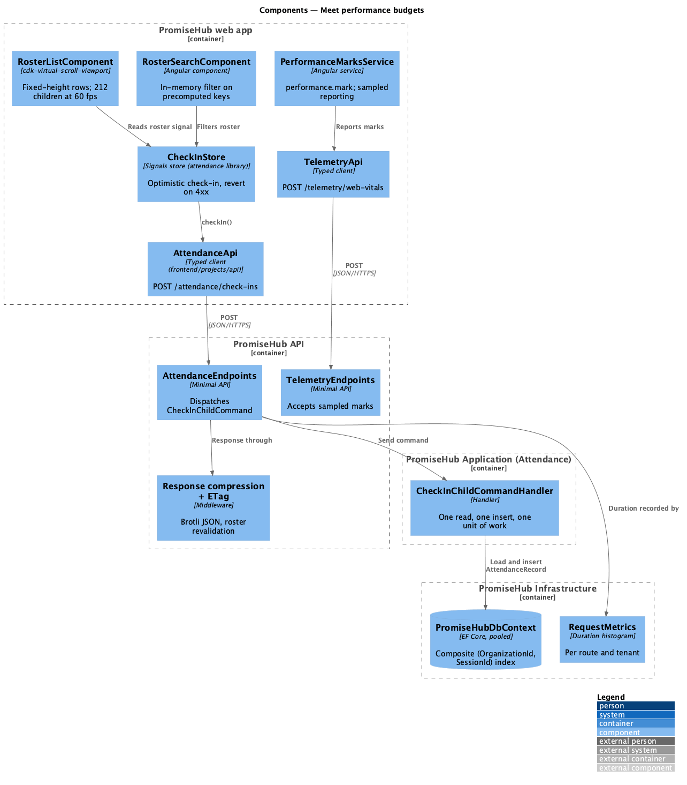
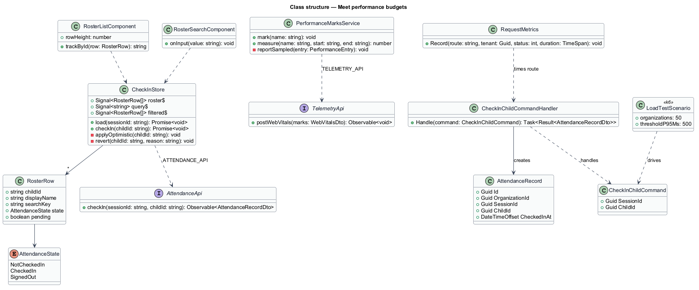
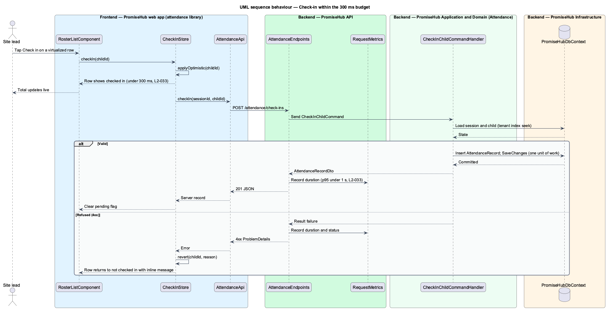
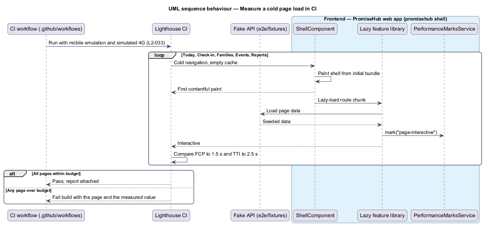

# Meet performance budgets

## Overview

A site lead runs check-in from a mid-range Android phone over 4G at a door with a line of children. `L1-018` sets the expectation: staff pages open in under two seconds, a check-in registers in under 300 milliseconds, and the API stays responsive while 50 organizations run sessions at once. `L2-033` turns that into four measurable budgets.

This feature designs where each budget is enforced and where it is measured: bundle and rendering choices in the Angular workspace, a virtualized roster in `frontend/projects/attendance/`, optimistic check-in in the client, a load test against `PromiseHub.Api`, and the places in CI and production where the numbers are read.

- **performance budget** — numeric limit on a user-facing measurement that a build or release shall not exceed
- **first contentful paint (FCP)** — time from navigation until the browser first paints text or an image
- **time to interactive (TTI)** — time until the page responds to input within 50 ms
- **optimistic update** — client state change applied before the server confirms, reverted if the server refuses
- **virtualized list** — list that renders only the rows inside and near the viewport
- **95th percentile (p95)** — value that 95 percent of measurements fall under

## Built so far

Slice 48 measures the budgets in CI (ADR 0042). The Playwright `budgets` project runs `e2e/tests/shell/performance-budgets.spec.ts` against the production build on port 4318 with Pixel 7 emulation, one test at a time. It checks cold first contentful paint and DOM interactive on Today, Check-in, Families, Events and Reports, the check-in row update and each search keystroke, all timed inside the page. `PerformanceBudgetTests` reads the server's p95 from `RequestMetrics` for check-ins and for two tenants' concurrent session reads. Deferred, outside this slice: Lighthouse with 4G throttling, a weekly device run, `PerformanceMarksService` and `TelemetryApi`, a virtualized 212-child roster with frame-rate checks, and the k6 load test across 50 organizations.

## Description

### Budgets and where they are measured

| Budget (`L2-033`) | Enforced in | Measured by |
|---|---|---|
| FCP under 1.5 s and interactive under 2.5 s on Today, Check-in, Families, Events and Reports, cold load | `frontend/angular.json` budgets; lazy-loaded feature libraries; preconnect to the API; critical CSS of the shell | Lighthouse CI in the `e2e` job on the CI runner with mobile emulation and simulated 4G; a weekly run on a mid-range Android device <TO SUPPLY> device model |
| Check-in tap updates the UI within 300 ms; server confirms within 1 s at p95 | `CheckInStore` optimistic update; `POST /attendance/check-ins` handler with one round trip to the database | Playwright trace timing in `e2e/tests/attendance/`; API duration from request logs (`platform/observe-and-alert`) |
| 212-child roster scrolls at 60 fps; search updates within 200 ms per keystroke (`check-in/long`) | CDK `cdk-virtual-scroll-viewport` in `RosterListComponent`; in-memory filter with a 0 ms debounce and precomputed search keys | Playwright with `page.evaluate` frame timing on the `check-in/long` seed; `performance.measure` around filter |
| 50 concurrent organizations each running a session; API p95 under 500 ms | Tenant-filtered indexes; no N+1 queries; connection pooling | k6 load test in `eng/` against a staging deployment seeded with 50 organizations |

### Frontend — `frontend/projects/promisehub/` and `frontend/angular.json`

- **Bundle budgets** — `angular.json` sets `initial` and `anyComponentStyle` budgets so the shell's initial bundle stays within the FCP target. Exact byte limits are <TO SUPPLY> after the first measured build.
- **Lazy routes** — every feature library loads on its route (`shell/compose-navigation`); libraries of modules that are off are never fetched.
- **Shell critical path** — the shell inlines the token stylesheet and defers non-critical fonts with `font-display: swap`. The `index.html` carries `preconnect` to the API origin.
- **`PerformanceMarksService`** — records `performance.mark` for shell ready, page data loaded and page interactive, and reports them through `TelemetryApi` on a sampled basis. Sampling rate is <TO SUPPLY>.

### Frontend — `frontend/projects/attendance/`

- **`RosterListComponent`** — renders the session roster inside a `cdk-virtual-scroll-viewport` with a fixed row height from the roster component's size token, so 212 rows cost the same as 20. Rows are `OnPush` and tracked by child id.
- **`RosterSearchComponent`** — filters the in-memory roster by a lower-cased, diacritics-folded search key computed once per load. Results update on each keystroke without a server call.
- **`CheckInStore`** — holds today's roster and attendance state as signals. `checkIn(childId)` marks the row checked in at once, enqueues the request through `AttendanceApi`, and reverts with an inline message if the server answers 4xx. Offline behaviour continues in `attendance/sync-offline-queue`.

### Frontend — `frontend/projects/api/`

- **`AttendanceApi`** (`ATTENDANCE_API`) — `checkIn(sessionId, childId)` posts one small body and returns the server record.
- **`TelemetryApi`** (`TELEMETRY_API`) — posts sampled performance marks to `POST /telemetry/web-vitals`.

### Backend — `PromiseHub.Api` and `PromiseHub.Application`

- **`AttendanceEndpoints`** — `POST /attendance/check-ins` dispatches `CheckInChildCommand`. The handler performs one read of the session and child with the tenant filter and one insert of `AttendanceRecord`, in one unit of work. No notification is sent inline; the no-show job reads state later (`platform/run-background-jobs`).
- **`TelemetryEndpoints`** — `POST /telemetry/web-vitals` accepts sampled marks and writes them as structured metrics, anonymous of child data.
- **Response compression and caching** — Brotli compression for JSON; `ETag` on roster reads so a reopened Check-in page revalidates instead of re-downloading.

### Backend — `PromiseHub.Infrastructure`

- **Indexes** — composite indexes on `(OrganizationId, SessionId)` for attendance and `(OrganizationId, ProgramId)` for enrolment so tenant-filtered reads are index seeks.
- **`PromiseHubDbContext` pooling** — `AddDbContextPool` and provider connection pooling.
- **`RequestMetrics`** — duration histogram per route and tenant, exported for the p95 dashboard (`platform/observe-and-alert`).

### Load test — `eng/loadtest/`

- **`sessions-50-orgs.js`** — k6 script that signs in one site lead per seeded organization, opens a session and checks in a roster in parallel for 50 organizations. It fails the run when API p95 exceeds 500 ms or any request fails authorization (`L2-033` criterion 4).
- The staging environment size and the run cadence are <TO SUPPLY>.

## Requirements

| L2 ID | Refines (L1) | Requirement |
|-------|--------------|-------------|
| `L2-033` | `L1-018` | Measured on a mid-range Android phone over simulated 4G and on the CI runner. |

## Diagrams

### System context

Staff on phones use PromiseHub. Lighthouse CI and the k6 load test measure it from the CI runner and a staging environment.

### Containers

The web app enforces bundle and rendering budgets. The API enforces query and response budgets. Measurement containers read the same deployment.

### Components

`CheckInStore`, `RosterListComponent` and `PerformanceMarksService` on the client; `AttendanceEndpoints`, `CheckInChildCommandHandler` and `RequestMetrics` on the server.

### Class structure

`CheckInStore` applies the optimistic state and calls `AttendanceApi`. `RosterListComponent` virtualizes rows. `RequestMetrics` records the server duration.

### Behaviour — check-in within the 300 ms budget

The tap updates the row at once, the request completes in one unit of work, and a refusal reverts the row with a message.

### Behaviour — measure a cold page load in CI

Lighthouse CI loads each budgeted page with mobile emulation and 4G throttling and fails the build when FCP or interactivity exceed the budget.

