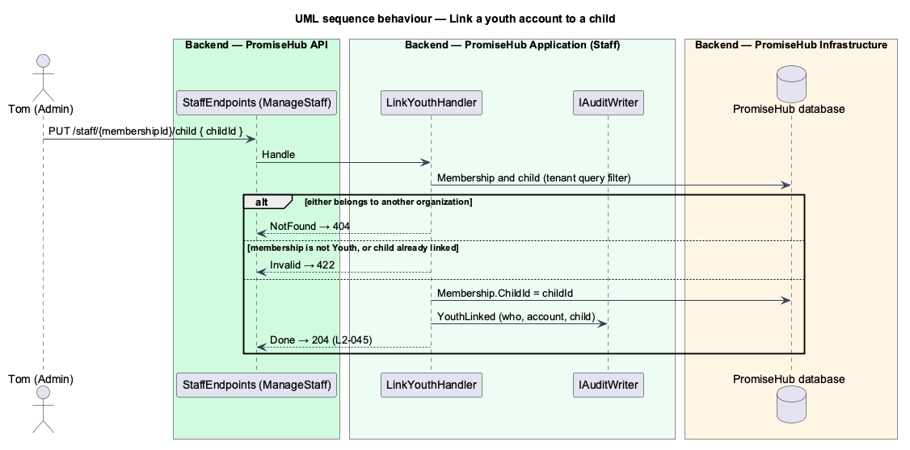

# Merge Waypoint: foundation

## Overview

Waypoint is a youth leadership platform with lessons, quizzes, mentoring and a public site. Prompts 50 to 81 bring its journeys into PromiseHub one at a time. The **foundation** is the slice every one of those journeys needs first: the merge mapping (ADR 0043), three switchable modules (**Learning**, **Mentoring** and **Public website**), three roles (**Youth**, **Mentor** and **Volunteer**), the link from a youth account to a child record, the four new feature libraries and the seeded cast. Everything PromiseHub already does stays unchanged.

## Description

- **`ModuleId` and `ModuleCatalog`** (`PromiseHub.Domain/Organizations/`) gain `Learning`, `Mentoring` and `PublicWebsite`, each needing Roster; see `organizations/configure-modules`.
- **`Role`** gains `Youth`, `Mentor` and `Volunteer`; **`Permission`** gains `UseStaffApp`, `Learn`, `MentorYouth` and `AuthorCurriculum`; the fallback policy requires `UseStaffApp`; see `identity/authorize-request`.
- **`Membership.ChildId`** and **`LinkYouthHandler`** link a youth account to one child in the same organization (`L2-045`).
- **`Organization.WebsiteSlug`** names an organization on its public website; see `website/serve-public-site`.
- **Placeholder slices** in `learning/read-own-record`, `curriculum/open-curriculum`, `mentoring/list-assigned-youth` and `website/serve-public-site`.
- **Navigation by role** in the shell; see `shell/compose-navigation`.
- **Seed** of the Waypoint cast in both organizations; see `platform/migrate-and-seed`.

## Requirements

| L2 ID | Refines (L1) | Requirement |
|-------|--------------|-------------|
| `L2-004` | `L1-002` | Admins switch modules on or off in `settings-modules` or choose a preset during onboarding (`onboard-modules`). Roster is the data every other module reads; dependencies are declared and enforced. |
| `L2-007` | `L1-003` | Permissions are enforced per endpoint and per field by role; the UI reflects them but never substitutes for them. |
| `L2-042` | `L1-022` | Migrations run only through the CLI; seed data is idempotent and multi-tenant. |
| `L2-045` | `L1-003` | A youth signs in with a membership whose role is Youth, and that membership links to exactly one child record in the same organization, so every youth-facing page reads that child's data and no other. |

## Diagrams

### Behaviour — link a youth account to a child

An admin links a Youth membership to a child of the same organization; another organization's child is not found and a second link is refused (`L2-045`).

