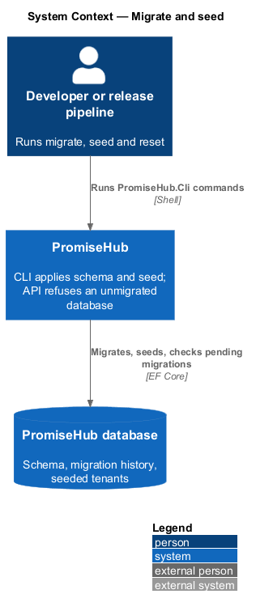
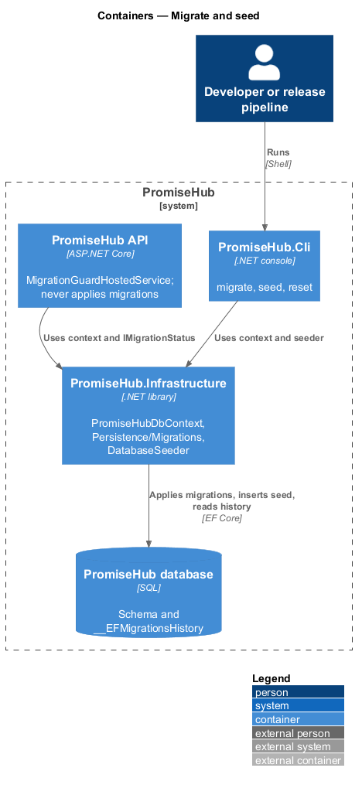
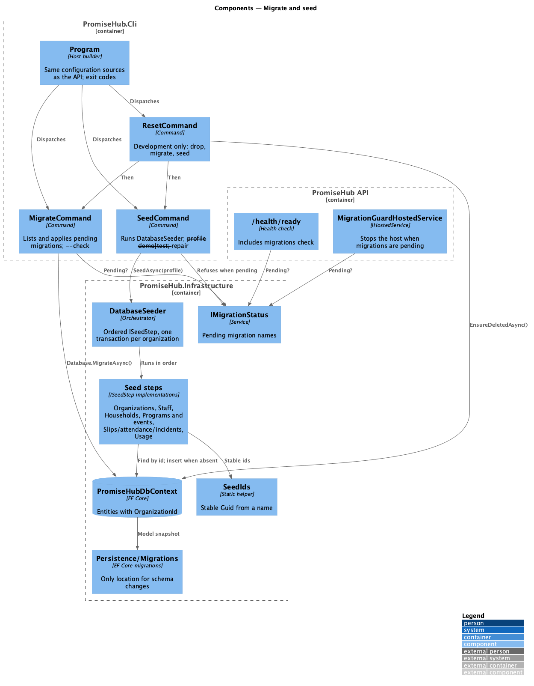
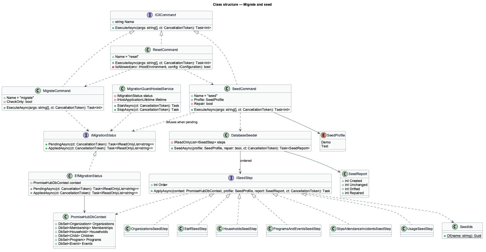
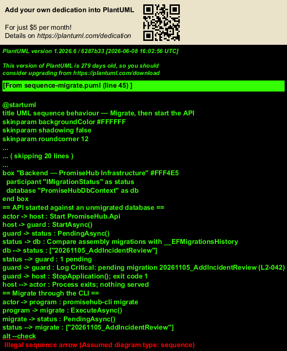
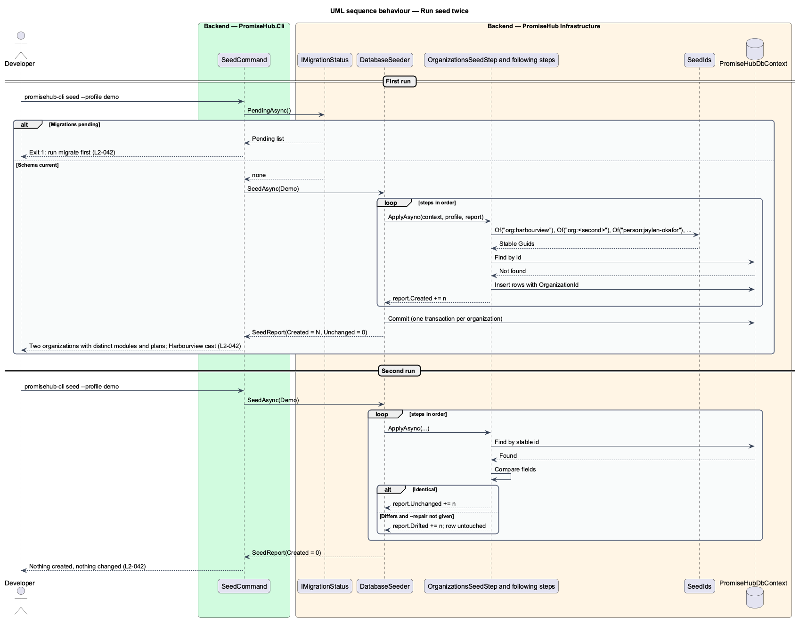

# Migrate and seed

## Overview

PromiseHub's schema evolves with every feature, and every developer, test run and demo needs a database that is current and holds believable multi-tenant data. `AGENTS.md` fixes the rule: EF Core migrations live only in `PromiseHub.Infrastructure/Persistence/Migrations/` and are applied by `PromiseHub.Cli`, never by the API. `L1-022` adds that seed data is idempotent and contains at least two organizations.

This feature designs the three commands of `PromiseHub.Cli` (`migrate`, `seed`, `reset`), the start-up check in `PromiseHub.Api` that refuses to serve an unmigrated database, and the seeder in `PromiseHub.Infrastructure` that creates the Harbourview cast used by the mocks and tests.

- **migration** — versioned EF Core change set that moves the schema from one revision to the next
- **pending migration** — migration present in the assembly but not recorded in the database's migration history table
- **seed** — deterministic set of organizations, people, households, programs, events and records inserted with stable identifiers
- **idempotent seed** — seed run that creates nothing new and changes nothing when the data is already present
- **Harbourview cast** — fixture of Harbourview Youth Collective, its staff (Jaylen Okafor, Marisol Delgado, Tom Nguyen, Priya Raman, Aisha Bello, Sam Lee), its households (Rivera, Thompson, Tran, Haddad, Okonkwo, Petrov, Adeyemi, Fitzgerald-Vanderbroucke), programs and events, as described in `docs/mocks/README.md`
- **reset** — development-only command that drops the database, migrates and seeds

## Description

### CLI — `PromiseHub.Cli`

- **`Program.cs`** — builds a generic host with the same configuration sources as the API (`appsettings`, environment, user secrets), registers `PromiseHubDbContext` and the seeder from `PromiseHub.Infrastructure`, and dispatches to one of three commands by the first argument. Exit code 0 on success, 1 on failure, 2 on usage error. Arguments are parsed by hand in `CliApp`; the three commands need no parsing library.
- **`MigrateCommand`** — lists pending migrations, logs each by name, calls `Database.MigrateAsync()`, and reports the final revision. With `--check` it exits 3 when migrations are pending and applies nothing, for CI gates.
- **`SeedCommand`** — runs `DatabaseSeeder.SeedAsync()`. It refuses to run when migrations are pending. With `--profile demo` (the default) it seeds the two organizations below; with `--profile test` it seeds the minimal fixture used by `PromiseHub.Api.Tests`.
- **`ResetCommand`** — allowed only when `ASPNETCORE_ENVIRONMENT` is `Development` or `--force` is given with a non-production connection. It calls `EnsureDeletedAsync()`, then runs `MigrateCommand` and `SeedCommand`. Production connection strings are detected by a configuration marker `Database:AllowReset = false`.
- **`backend/tests/PromiseHub.Cli.Tests/`** — runs each command against the fake database: `migrate` is current afterwards; `seed` twice yields identical row counts and content hashes; `reset` is refused outside Development.

### Infrastructure — `PromiseHub.Infrastructure`

- **`PromiseHubDbContext`** — `DbContext` with every tenant-owned entity carrying `OrganizationId` and the global query filter from `organizations/isolate-tenant-data`.
- **`Persistence/Migrations/`** — the only folder holding EF Core migrations, generated with `dotnet ef migrations add` against the `PromiseHub.Cli` startup project.
- **`DatabaseSeeder`** — orchestrates `ISeedStep` implementations in dependency order inside one transaction per organization. Every seeded row has a fixed `Guid` derived from a stable name (for example `SeedIds.Of("org:harbourview")`), so a re-run finds existing rows by id and compares field by field. A row that matches is left untouched; a row that differs is reported as drift and left untouched unless `--repair` is given (`L2-042` criterion 2).
- **Seed steps** (`Persistence/Seed/`):
  - `OrganizationsSeedStep` — Harbourview Youth Collective (Hamilton, Ontario; Standard plan; every module on) and a second organization with a different plan and module set. The second organization is Northgate Community Church Kids (Burlington, Ontario) on the Free plan; its module subset arrives with `configure-modules`.
  - `StaffSeedStep` — the six Harbourview staff with their roles; Priya Raman also holds a membership in the second organization so `switch-organization` has data. Sam Lee is left in the invited state.
  - `HouseholdsSeedStep` — the eight households with guardians, children, languages, medical flags and approved pickups as the mocks describe.
  - `ProgramsAndEventsSeedStep` — After-School Tutoring, Saturday Sports, One-to-one Mentoring, Winter Camp 2026, Summer Camp 2026 (archived), and the six events including the Fall field trip slip and the cancelled Saturday Sports.
  - `SlipsAttendanceIncidentsSeedStep` — slip signatures, tonight's session with attendance, the Thompson incident, the Okonkwo refused-pickup incident.
  - `UsageSeedStep` — SMS segments used this month and the audit entries that the audit log mocks show.
  - Passwords for seeded staff come from configuration (`Seed:StaffPassword`), never from source (`L2-031`).
- **`IMigrationStatus`** — service that reports pending migrations; used by the API start-up check and the readiness probe.

### API start-up check — `PromiseHub.Api`

- **`MigrationGuardHostedService`** — `IHostedService` that runs first at start-up. It asks `IMigrationStatus` for pending migrations. When any are pending it logs each by name at `Critical`, and stops the host with a non-zero exit code so the process never serves requests (`L2-042` criterion 1). It never applies a migration.
- **Readiness** — `/health/ready` includes a `migrations` check so an orchestrator does not route traffic to an instance whose database drifted after start-up.

### Where the commands run

- Local development: `dotnet run --project backend/src/PromiseHub.Cli -- reset`.
- CI: `migrate --check` fails the build when a migration is missing for a model change; the API integration tests seed the `test` profile into the fake database.
- Deployment: `eng/` runs `migrate` as a release step before the new API instances start, then `seed --profile demo` only in demo environments.
- Restore drill: `migrate` is applied to the restored copy (`platform/run-background-jobs`).

## Built so far

Slice 01 (walking skeleton) delivered `migrate` and `migrate --check`, `seed`, `reset` (Development or `--force`), the API start-up guard (`MigrationGuard`) and a first seed of both organizations, their staff and the Rivera, Thompson and Tran households (with a second Mateo Rivera in Northgate). The database is SQLite (ADR 0001). Seed profiles, `--repair`, drift reporting and the rest of the cast arrive with the features that need them.

## Waypoint cast (prompt 49)

A migration adds `Memberships.ChildId` (nullable) and `Organizations.WebsiteSlug` (nullable, unique). `DatabaseSeeder` adds, by stable id: at Harbourview youth accounts for Sofía Rivera (linked to her child record) and Nadia Haddad (18, a new child in the Haddad household), mentors Daniel Osei and Hana Kim and volunteer Leo Martins assigned to tonight's Tutoring night; at Northgate mentor Samuel Boateng and youth Lucía Rivera (14, a new child in Ana Rivera's household). Harbourview's configuration lists the eight operations modules plus Learning and Mentoring; Northgate's is unchanged; Public website is off for both. The slugs are `harbourview` and `northgate`. A second run finds every row by its id and adds nothing (`L2-042` criterion 4). The e2e fake API seeds the same cast.

## Requirements

| L2 ID | Refines (L1) | Requirement |
|-------|--------------|-------------|
| `L2-042` | `L1-022` | Migrations run only through the CLI; seed data is idempotent and multi-tenant. |

## Diagrams

### System context

A developer or the release pipeline runs the CLI against the database. The API only checks that the schema is current.

### Containers

`PromiseHub.Cli` and `PromiseHub.Api` share `PromiseHub.Infrastructure` and the database. Only the CLI writes schema; the API refuses to start when migrations are pending.

### Components

`MigrateCommand`, `SeedCommand` and `ResetCommand` call `PromiseHubDbContext` and `DatabaseSeeder`. `MigrationGuardHostedService` in the API calls `IMigrationStatus`.

### Class structure

The three commands share `IMigrationStatus`. `DatabaseSeeder` runs ordered `ISeedStep` implementations that use `SeedIds` for stable identifiers.

### Behaviour — migrate, then start the API

The CLI applies pending migrations. The API's start-up guard then finds none and serves. Had the guard run first, it would have logged the pending migration and stopped.

### Behaviour — run seed twice

The first run inserts the two organizations and the Harbourview cast. The second run finds every row by stable id and changes nothing.

