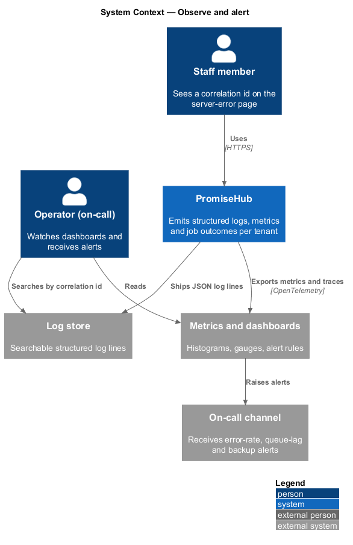
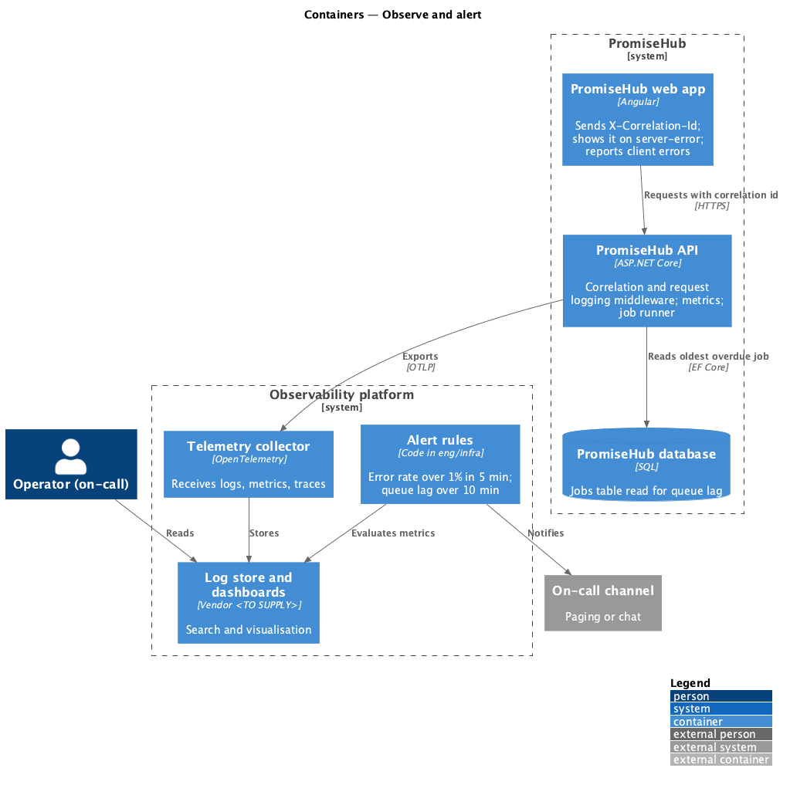
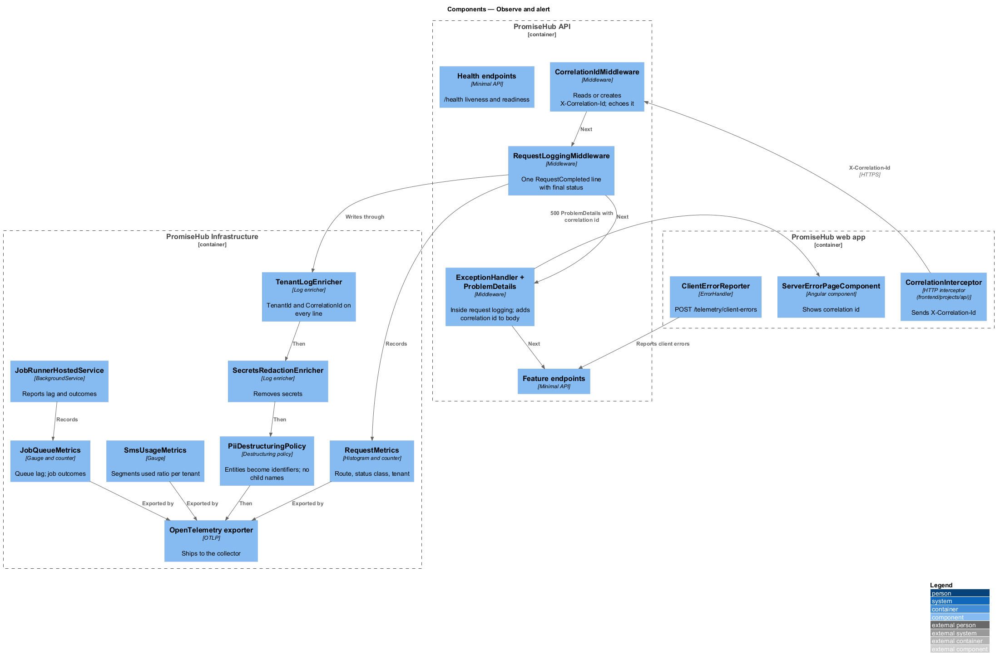
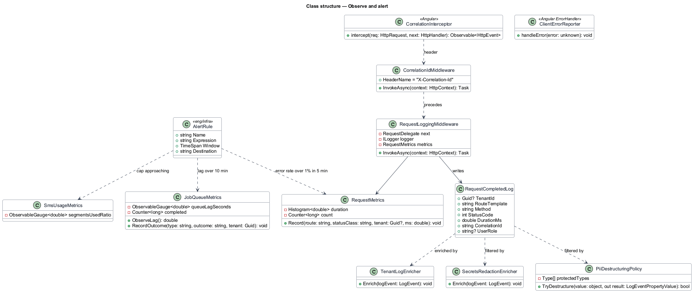
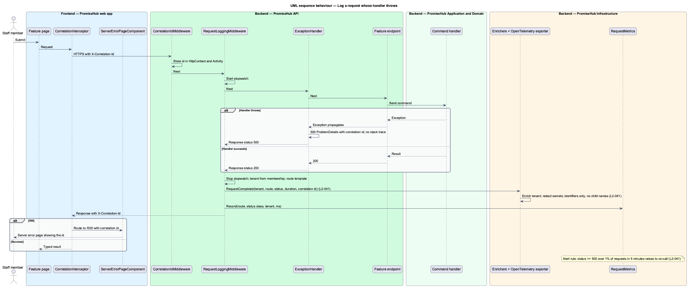
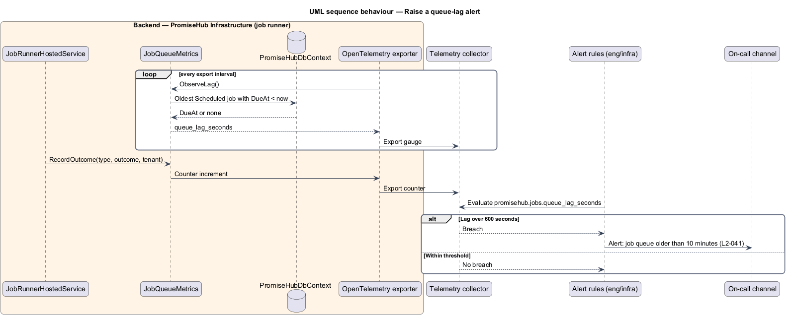

# Observe and alert

## Overview

PromiseHub serves many organizations from one deployment and sends messages that families rely on. Operators shall be able to see what each request did, for which tenant, how long it took and whether it failed, and shall be told when the error rate or the job queue crosses a threshold. `L1-022` requires structured logs, request metrics and job outcomes per tenant and alerts on error-rate, queue-lag and SMS-cap conditions. Because the logs describe children's organizations, they shall never carry a child's name or a secret.

This feature designs the logging pipeline in `PromiseHub.Api` and `PromiseHub.Infrastructure`, the metrics the API and job runner emit, the alert rules, and where request logging sits in the middleware order.

- **structured log line** — log event emitted as named fields (tenant, route, status, duration, correlation id) rather than free text
- **correlation id** — identifier created at the edge of a request, carried in the `X-Correlation-Id` header, and attached to every log line and job the request causes
- **request logging middleware** — middleware that writes one structured line per request after the response status is final
- **error rate** — share of requests with status 500 or higher over a sliding window
- **queue lag** — age of the oldest scheduled job that is past its due time
- **on-call channel** — destination for alerts, for example a paging service or a chat channel

## Description

### Backend — `PromiseHub.Api`

- **Middleware order** — `UseHttpsRedirection`; `SecurityHeadersMiddleware`; `CorrelationIdMiddleware`; `RequestLoggingMiddleware`; `UseExceptionHandler`; `MaintenanceMiddleware`; authentication; authorization; endpoints. Request logging sits outside the exception handler so a handled exception that becomes a 500 or a 422 `ProblemDetails` is logged with that final status (`L2-041` criterion 4).
- **`CorrelationIdMiddleware`** — reads `X-Correlation-Id` from the request or creates a new identifier, stores it in `HttpContext.Items` and `Activity.Current`, and echoes it in the response header.
- **`RequestLoggingMiddleware`** — starts a stopwatch, awaits the rest of the pipeline, and writes one `RequestCompleted` line with `TenantId` (from the authenticated membership, or none for anonymous endpoints), `RouteTemplate` (the endpoint pattern, not the concrete path, so a child id or guardian token never appears), `Method`, `StatusCode`, `DurationMs`, `CorrelationId` and `UserRole`. It never logs headers, bodies or query strings (`L2-041` criterion 1).
- **`ProblemDetails` correlation** — the exception handler adds the correlation id to the `ProblemDetails` body so the `server-error` page can show it and a user can quote it to support.
- **`/health`** — anonymous liveness and readiness endpoints; readiness fails when the database is unreachable or unmigrated (`platform/migrate-and-seed`).

### Backend — `PromiseHub.Infrastructure`

- **Logging provider** — Serilog or `Microsoft.Extensions.Logging` with a JSON console sink shipped by the platform to the log store. The sink and store are <TO SUPPLY>.
- **`TenantLogEnricher`** — adds `TenantId` and `CorrelationId` to every line written inside a request or a job scope, including lines from handlers and providers.
- **`SecretsRedactionEnricher`** — removes configuration values registered as secrets and the `Authorization` header value (`platform/secure-transport-and-storage`).
- **`PiiDestructuringPolicy`** — destructuring policy that refuses to serialise `Child`, `Guardian`, `Household`, `Incident` and `AttendanceRecord` entities and replaces them with their identifiers. Handlers log identifiers, never display names (`L2-041` criterion 1).
- **`RequestMetrics`** — `System.Diagnostics.Metrics` histogram `promisehub.http.request.duration` tagged with route, status class and tenant, and counter `promisehub.http.request.count`.
- **`JobQueueMetrics`** — gauge `promisehub.jobs.queue_lag_seconds` (oldest `Scheduled` job past `DueAt`), counter `promisehub.jobs.completed` tagged with type, outcome and tenant (`platform/run-background-jobs`).
- **`SmsUsageMetrics`** — gauge `promisehub.sms.segments_used_ratio` per tenant from `messaging/enforce-sms-cap`.
- **OpenTelemetry exporter** — exports metrics and traces to the platform's collector. The collector and dashboard product are <TO SUPPLY>.

### Alert rules — `eng/infra/`

| Alert | Condition (`L2-041`) | Destination |
|---|---|---|
| High error rate | Requests with status 500 or higher exceed 1% of requests over 5 minutes | On-call channel |
| Queue lag | `promisehub.jobs.queue_lag_seconds` exceeds 600 (10 minutes) | On-call channel |
| Backup failed | `promisehub.jobs.completed{type=DailyBackup,outcome=failed}` increments | On-call channel |
| SMS cap approaching | `promisehub.sms.segments_used_ratio` crosses the warning threshold from `L2-022` | Organization admins in the notification center |

Alert definitions live as code next to the infrastructure in `eng/infra/`. The on-call channel and paging tool are <TO SUPPLY>.

### Frontend — `frontend/projects/promisehub/` and `frontend/projects/api/`

- **`CorrelationInterceptor`** (`frontend/projects/api/`) — generates a correlation id per page session, sends it as `X-Correlation-Id`, and keeps the one returned on error for display.
- **`ServerErrorPageComponent`** (`server-error`) — shows the correlation id in small text under the error message so support can find the log line.
- **`ClientErrorReporter`** — Angular `ErrorHandler` that posts unhandled client errors with the correlation id and route to `POST /telemetry/client-errors`, with no form values or names.

### Tests — `backend/tests/PromiseHub.Api.Tests/`

- Integration tests assert that a request producing a handled 500 is logged once with status 500, that a 401 line carries no tenant, and that a line written while handling a child never contains the seeded child's name.

## Requirements

| L2 ID | Refines (L1) | Requirement |
|-------|--------------|-------------|
| `L2-041` | `L1-022` | Structured logs, metrics and alerts per tenant. |

## Diagrams

### System context

Operators watch PromiseHub through the log store, the metrics dashboard and the on-call channel that receives alerts.

### Containers

The API and job runner emit structured logs and metrics to the collector. Alert rules evaluate metrics and notify the on-call channel.

### Components

`CorrelationIdMiddleware` and `RequestLoggingMiddleware` sit before the exception handler. Enrichers and metrics in the infrastructure shape what leaves the process.

### Class structure

`RequestLoggingMiddleware` writes a `RequestCompletedLog`. `TenantLogEnricher`, `SecretsRedactionEnricher` and `PiiDestructuringPolicy` filter every event. `RequestMetrics` and `JobQueueMetrics` feed the alert rules.

### Behaviour — log a request whose handler throws

The exception handler turns the exception into a 500 `ProblemDetails`. Because request logging wraps it, the line records status 500 and the correlation id. The error-rate rule evaluates the counter.

### Behaviour — raise a queue-lag alert

The job runner reports the age of the oldest overdue job. When it passes 10 minutes the alert rule notifies the on-call channel.

