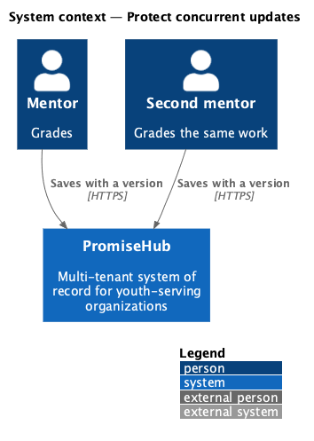
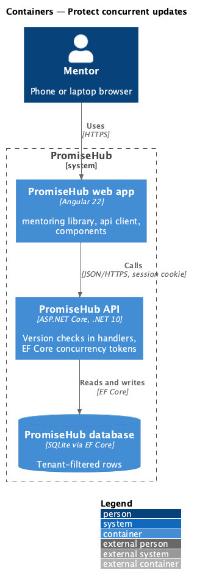
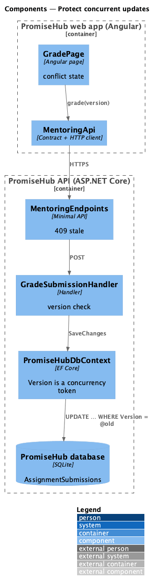
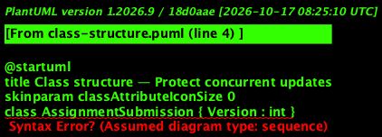
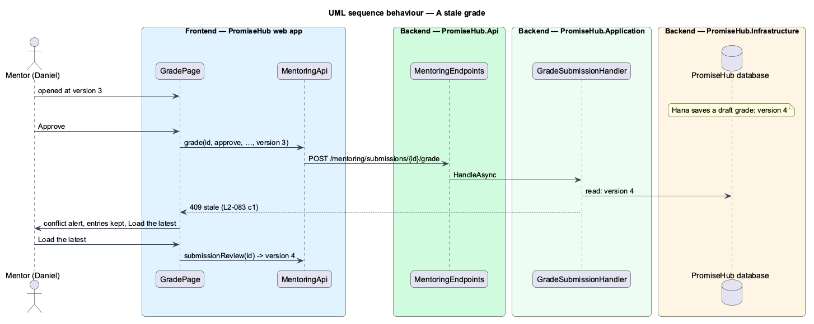

# Protect concurrent updates

## Overview

Two people can change the same record at once: two mentors of one youth grading her submission, or one mentor in two tabs. Without a check the second save silently overwrites the first. This design gives a record a version that every change advances; a save names the version it was read at and is refused when the record has moved on.

Terms used in this document:

- **version** — an integer on the record, configured as an EF Core concurrency token, advanced by every domain change
- **stale save** — a save whose version is not the record's current one; answered 409 `{{ code: "stale" }}`

Ported from Waypoint `non-functional/protect-concurrent-updates` (`L2-NFR-006`), which uses a GUID stamp; applied first to `AssignmentSubmission` (ADR 0057).

## Description

- **`AssignmentSubmission.Version`** — starts at 1; `Submitted`, `Resubmit`, `StartReview`, `SaveDraftGrade`, `RequestRevision` and `Accept` advance it. `PromiseHubDbContext` marks it `IsConcurrencyToken()`, so an update whose row changed since it was read fails with `DbUpdateConcurrencyException`.
- **`GradeSubmissionHandler`** — compares the request's version first (409 `stale`), applies the change, and catches `DbUpdateConcurrencyException` on save as the same 409. The status, scores, history step, notification and audit entry share one `SaveChanges`, so a grade is all or nothing.
- **`GradePage`** — on 409 `stale` keeps the scores and comment, shows the conflict alert and Load the latest, which reloads the submission and its version.
- Other records adopt a version when their journey needs one.

## Requirements

| L2 ID | Refines (L1) | Requirement |
|-------|--------------|-------------|
| `L2-083` | `L1-018` | A save against a version of a record that has since changed is refused instead of silently overwriting it. |

## Diagrams

### System context

### Containers

### Components

### Class structure

### Behaviour — a stale grade

The second mentor's save names an old version and is refused; nothing is overwritten.

## Open questions

- Which other records need versions is decided per journey.
