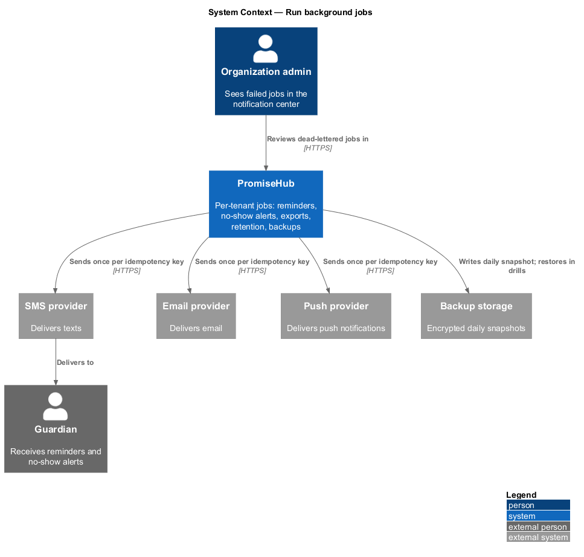
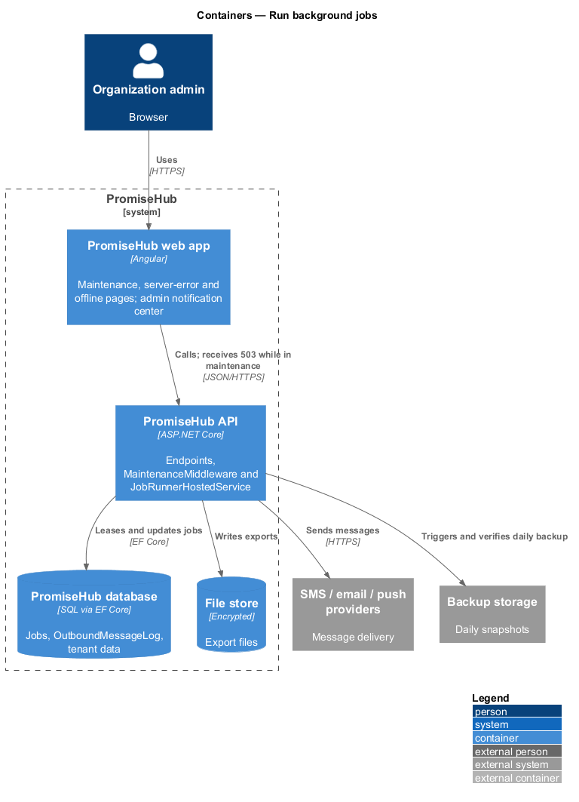
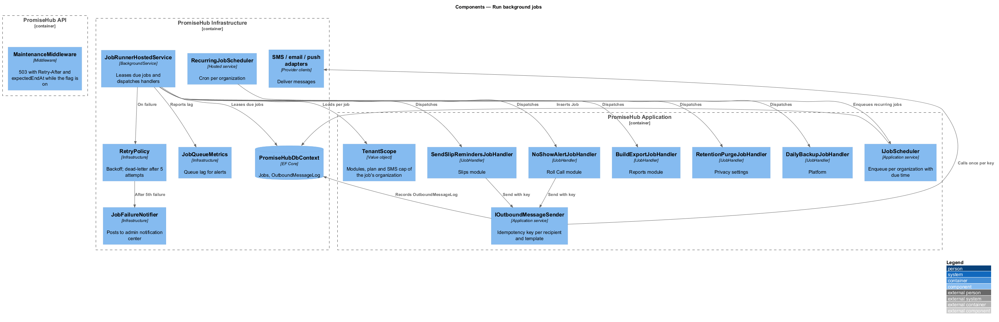
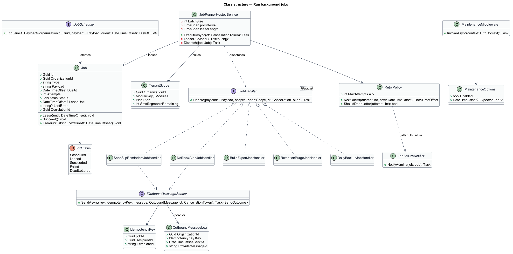
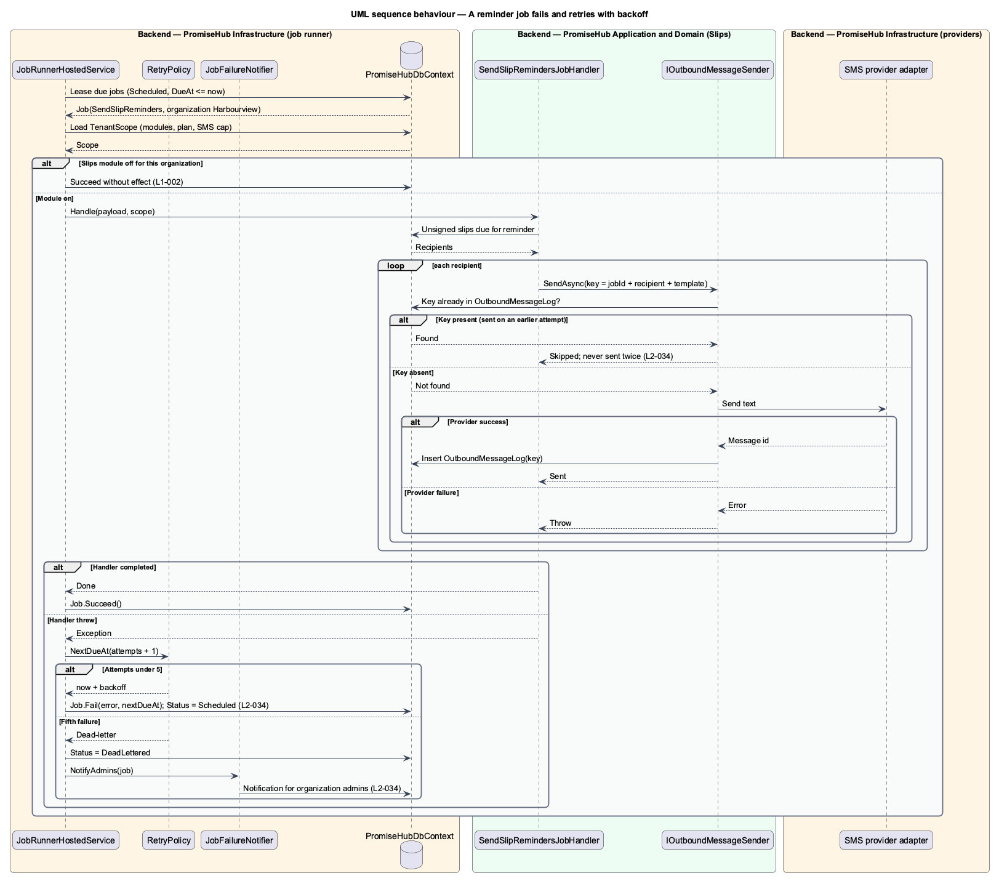
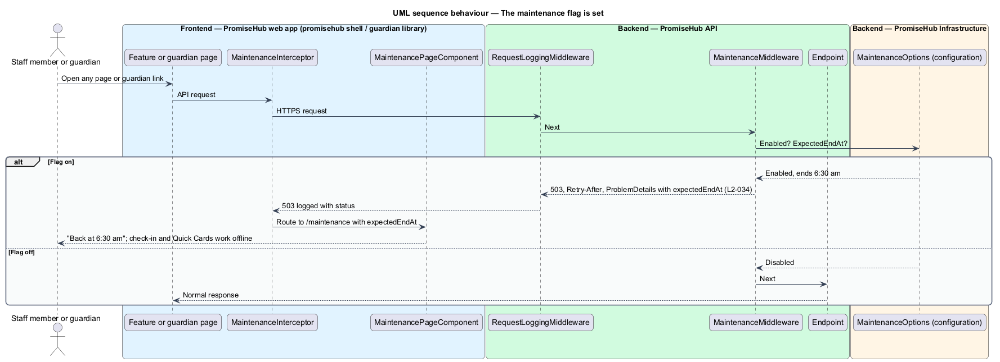

# Run background jobs

## Overview

PromiseHub does work after the request that triggered it has returned: slip reminders go out on a schedule, a guardian is alerted when a child is not checked in a set number of minutes after a session starts, a report export is built and stored, consent records older than the organization's retention period are purged, and the database is backed up every day. `L1-018` requires these jobs to run per tenant and recover from failure. `L1-022` requires a maintenance page for planned downtime.

This feature designs the job runner in `PromiseHub.Infrastructure`, the per-tenant job contracts in `PromiseHub.Application`, the retry and idempotency rules that prevent a message from being sent twice, the daily backup and restore drill, and the maintenance flag with its three static pages (`maintenance`, `server-error`, `offline`).

- **job** — unit of background work scoped to one organization, with a type, a payload and a due time
- **job runner** — hosted service in the API process that leases due jobs and executes their handlers
- **tenant scope** — organization context a job runs under, which fixes the modules, plan and SMS cap it respects
- **backoff** — growing delay between retries of a failed job
- **idempotency key** — stable identifier of a side effect, recorded when the effect happens so a retry can skip it
- **maintenance flag** — configuration value that makes every page and guardian link show the maintenance page with the expected end time
- **restore drill** — scheduled exercise that restores a backup into a scratch environment and verifies it

## Built so far

Slice 10 delivered the first per-tenant job: the message send job, run by `MessageDispatchRunner` in each organization's scope and skipped when its module is off, with per-delivery idempotency and retry after 2 and 4 minutes (ADR 0013). The generic `Job` table, recurring schedules, dead-lettering, the maintenance flag and backups are not built yet.

## Description

### Backend — `PromiseHub.Domain` and `PromiseHub.Application`

- **`Job`** (`PromiseHub.Domain`) — entity with `Id`, `OrganizationId`, `Type`, `Payload`, `DueAt`, `Attempts`, `Status` (`Scheduled`, `Leased`, `Succeeded`, `Failed`, `DeadLettered`), `LeaseUntil`, `LastError` and `CorrelationId`.
- **`IJobHandler<TPayload>`** (`PromiseHub.Application/Jobs/`) — contract each job type implements: `Task Handle(TPayload payload, TenantScope scope, CancellationToken ct)`.
- **`TenantScope`** — organization id, enabled modules, plan and remaining SMS segments, loaded once per job execution. A handler for a module that is off exits without effect.
- **`SendSlipRemindersJobHandler`** (`Slips/`) — finds unsigned slips due for a reminder and enqueues one `OutboundMessage` per guardian. Scheduled per organization by the slip's reminder schedule (`slips/remind-and-clear`).
- **`NoShowAlertJobHandler`** (`Attendance/`) — scheduled at session start plus the organization's configured minutes; alerts guardians of children not checked in (`attendance/alert-no-show-and-end-session`).
- **`BuildExportJobHandler`** (`Reports/`) — computes the report, writes the file to `IFileStorage`, and notifies the requester in the notification center (`reports/export-report`).
- **`RetentionPurgeJobHandler`** (`Organizations/`) — deletes consent records older than the organization's retention period and writes an audit entry (`organizations/set-privacy-and-residency`).
- **`DailyBackupJobHandler`** (`Platform/`) — triggers the provider backup, verifies that a snapshot exists, and records the outcome. A failure raises an alert (`L2-034` criterion 2).
- **`IOutboundMessageSender`** — every message a job sends goes through this service with an idempotency key `(jobId, recipientId, templateId)`. The sender records the key in `OutboundMessageLog` in the same transaction as the provider call result. A retry that finds the key skips the send (`L2-034` criterion 3).
- **`IJobScheduler`** — `Enqueue<TPayload>(organizationId, payload, dueAt)` used by command handlers and by recurring schedules.

### Backend — `PromiseHub.Infrastructure`

- **`JobRunnerHostedService`** — `BackgroundService` that polls `Jobs` for due rows, leases a batch with `UPDATE ... WHERE Status = Scheduled AND DueAt <= now` under a lease time, and dispatches each to its handler inside a `TenantScope`. Batch size, poll interval and lease length are <TO SUPPLY>.
- **`RetryPolicy`** — on failure, increments `Attempts`, sets `DueAt = now + backoff(Attempts)` and returns the job to `Scheduled`. After the fifth failed attempt the job becomes `DeadLettered` and `JobFailureNotifier` posts a notification to the organization's admins (`L2-034` criterion 3). The backoff base and cap are <TO SUPPLY>; the design uses exponential growth with jitter.
- **`RecurringJobScheduler`** — enqueues the daily backup, the retention purge and the reminder sweep per organization from cron expressions in configuration.
- **`JobQueueMetrics`** — exports the age of the oldest `Scheduled` job past its `DueAt` as queue lag for alerting (`platform/observe-and-alert`).
- **`OutboundMessageLog`** table — unique index on the idempotency key.
- **`PromiseHubDbContext`** — persists `Job` and `OutboundMessageLog`; both carry `OrganizationId`.
- **Backups** — the provider's automated daily backup with point-in-time retention. The restore drill runs quarterly into a scratch environment, applies `PromiseHub.Cli migrate`, and runs a smoke query; the drill runbook lives in `eng/`. Retention length is <TO SUPPLY>.

### Maintenance flag — `PromiseHub.Api` and the web app

- **`MaintenanceOptions`** — `Enabled` and `ExpectedEndAt` read from configuration and reloadable without a restart.
- **`MaintenanceMiddleware`** — placed after request logging and before authentication. When the flag is on, every request except `/health` answers 503 with `Retry-After` and a `ProblemDetails` body carrying `expectedEndAt`. Guardian link endpoints answer the same (`L2-034` criterion 4).
- **`MaintenanceInterceptor`** (`frontend/projects/api/`) — on a 503 with `expectedEndAt`, routes to `/maintenance`.
- **`MaintenancePageComponent`** (`frontend/projects/promisehub/`) — composes the `error-page` library component: "Back at 6:30 am", the window in the organization's time zone, and "Check-in and Quick Cards work offline". Guardian pages render the same through `GuardianShellComponent`.
- **`ServerErrorPageComponent`** (`/500`, `server-error`) — shown by the global `ErrorHandler` on an unrecoverable 5xx with a Try again action.
- **`OfflinePageComponent`** (`/offline`, `offline`) — shown by the service worker when a page is not cached: "This page isn't saved on your phone. Check-in and Quick Cards still work", with Open check-in and Try again.
- **Planned maintenance banner** — a day ahead, admins see the dismissible info banner from the notifications design.

### Frontend — admin notification center

Dead-lettered jobs appear in the admin notification center through `notifications/notify-in-app`, with the job type, organization and a link to retry.

## Requirements

| L2 ID | Refines (L1) | Requirement |
|-------|--------------|-------------|
| `L2-034` | `L1-018` | Uptime target, backups and resilient jobs. |

## Diagrams

### System context

PromiseHub runs scheduled work per organization and sends through external SMS, email and push providers. The backup target is the provider's storage.

### Containers

The job runner is a hosted service in the API container. Jobs and the outbound message log live in the database. Backups go to encrypted backup storage.

### Components

`JobRunnerHostedService` leases jobs and dispatches them to typed handlers inside a `TenantScope`. `RetryPolicy` and `IOutboundMessageSender` keep retries safe. `MaintenanceMiddleware` answers 503 while the flag is on.

### Class structure

`Job` carries attempts and status. `JobRunnerHostedService` uses `RetryPolicy` and dispatches `IJobHandler<T>` implementations, which send through `IOutboundMessageSender` with idempotency keys.

### Behaviour — a reminder job fails and retries with backoff

The runner leases the job, the handler enqueues sends with idempotency keys, a provider failure returns the job to the queue with backoff, and the retry skips recipients already sent. The fifth failure dead-letters the job and notifies admins.

### Behaviour — the maintenance flag is set

With the flag on, the API answers 503 with the expected end time and the web app and guardian pages show the maintenance page.

