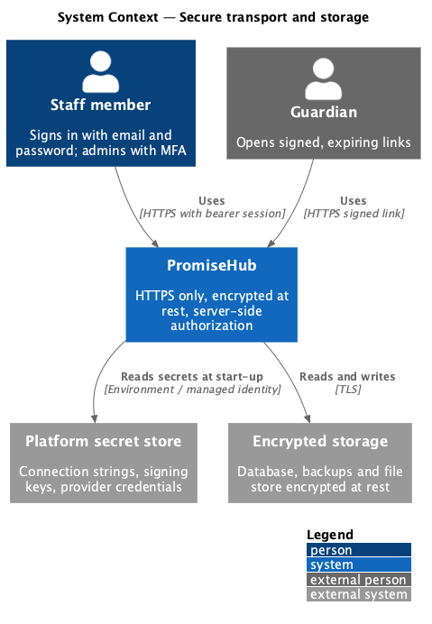
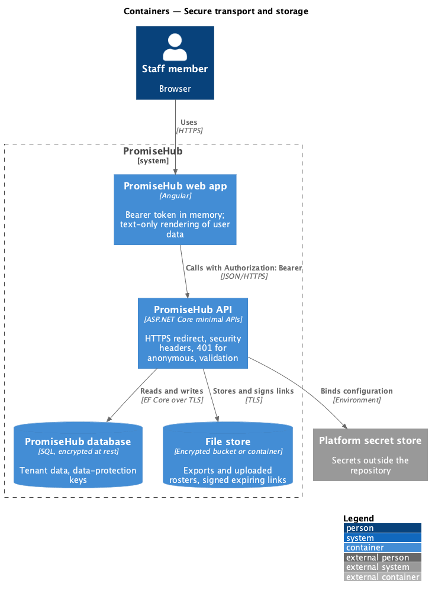
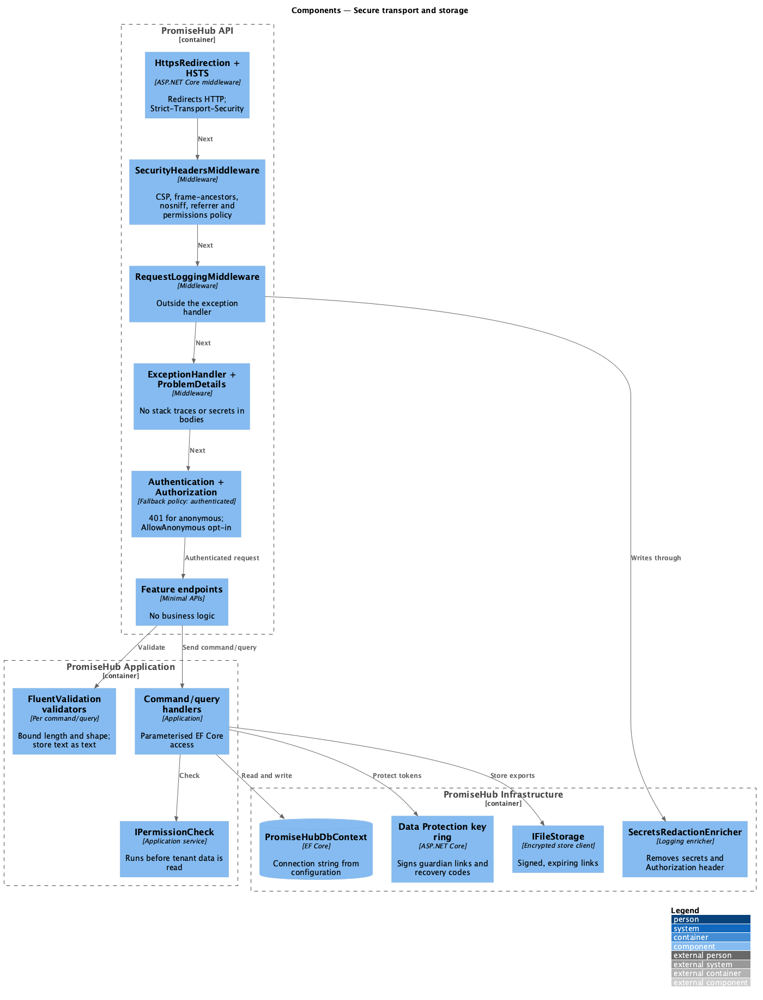
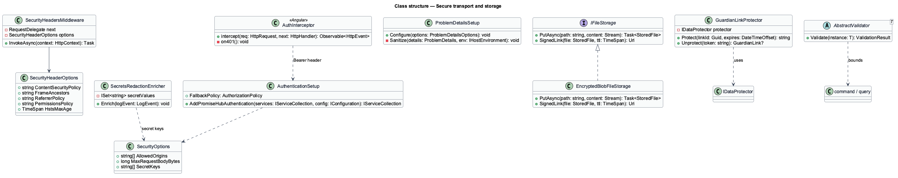
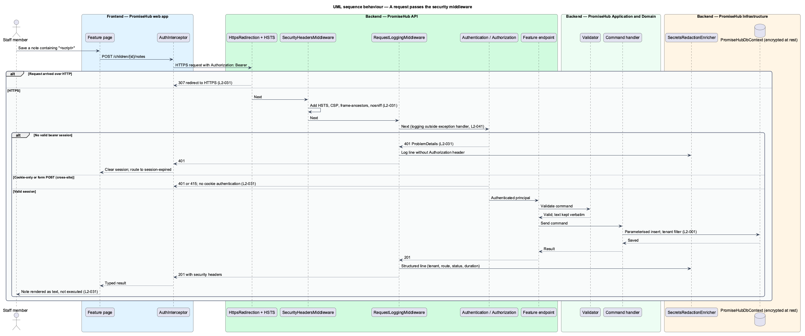

# Secure transport and storage

## Overview

PromiseHub stores children's medical details, household contacts and incident records for many organizations in one deployment. `L1-016` requires encryption in transit and at rest, server-side authorization on every request, defences against the OWASP Top 10, session expiry and secrets kept outside the repository. This feature designs the cross-cutting security posture of the `PromiseHub.Api` request pipeline, the storage configuration in `PromiseHub.Infrastructure`, and the input and output rules every handler and component follows.

Tenant isolation (`L2-001`), role authorization (`L2-007`) and sign-in (`L2-006`) are designed in their own features. This feature covers what sits around them: the transport, the headers, the encoding, the anonymous-request behaviour and the secret handling.

- **security headers middleware** — ASP.NET Core middleware that adds HSTS, Content-Security-Policy, X-Content-Type-Options and frame-ancestors to every response
- **encryption at rest** — storage-level encryption of the database, backups and file storage so data on disk is unreadable without the key
- **output encoding** — rendering of stored text as text, never as markup or code, in every client
- **bearer session** — signed, expiring access token sent in the `Authorization` header, never in a cookie the browser attaches automatically
- **secret** — connection string, signing key or provider credential read from configuration or environment, never from the repository or a log

## Description

### Backend — `PromiseHub.Api`

- **`Program.cs` pipeline order** — `UseHttpsRedirection()` and `UseHsts()` first; `SecurityHeadersMiddleware`; request logging (`platform/observe-and-alert`); `UseExceptionHandler` with `ProblemDetails`; `UseAuthentication()`; `UseAuthorization()`; then endpoints. The API serves nothing over plain HTTP; an HTTP request receives a 307 or 308 redirect to the HTTPS origin (`L2-031` criterion 1).
- **`SecurityHeadersMiddleware`** — adds `Strict-Transport-Security` with `includeSubDomains`, `Content-Security-Policy` (`default-src 'self'`; `frame-ancestors 'none'`; `object-src 'none'`; `base-uri 'self'`), `X-Content-Type-Options: nosniff`, `Referrer-Policy: strict-origin-when-cross-origin` and `Permissions-Policy` to every response, including `ProblemDetails`. The `max-age` values and any CSP allowances for the push or SMS provider SDKs are <TO SUPPLY>.
- **Authentication default** — `builder.Services.AddAuthorization(o => o.FallbackPolicy = authenticated)` makes every endpoint require an authenticated bearer session. An endpoint opts into anonymous access with `.AllowAnonymous()`; the guardian link endpoints and `/health` are the only such endpoints. A request without a valid session answers 401 with `WWW-Authenticate: Bearer`, never 302 (`L2-031` criterion 4).
- **CSRF posture** — the API accepts only bearer tokens from the `Authorization` header and rejects a `Cookie`-authenticated request. A cross-site form POST carries no bearer token and receives 401. `Content-Type` is constrained to `application/json` for state-changing endpoints, so a simple cross-site form POST (`application/x-www-form-urlencoded`) answers 415. CORS allows only the configured web origin.
- **`ProblemDetailsFactory` configuration** — error responses carry type, title, status and a correlation id. Exception messages and stack traces are never written to the body outside the Development environment (`L2-031` criterion 5).
- **Request size and rate limits** — Kestrel request body limit and the ASP.NET Core rate limiter on sign-in and guardian code endpoints. Values are <TO SUPPLY>.

### Backend — `PromiseHub.Application`

- **FluentValidation validators** — every command and query has a validator that bounds length and shape. Text is accepted as text; validators never strip or interpret markup, so `<script>` in a child's note is stored as those characters (`L2-031` criterion 3).
- **Parameterised data access** — handlers use EF Core LINQ; raw SQL is limited to migrations in `PromiseHub.Infrastructure`. Search uses parameterised `LIKE` or full-text calls, never string concatenation.
- **Permission checks** — every handler runs its `IPermissionCheck` before reading tenant data (`L2-007`, designed in `identity/authorize-request`).

### Backend — `PromiseHub.Infrastructure`

- **`PromiseHubDbContext`** — connects with a connection string from configuration (`ConnectionStrings:PromiseHub`). The database and its automated backups use the provider's encryption at rest. The provider and key-management choice are <TO SUPPLY> in an ADR (`L2-031` criterion 2).
- **`IFileStorage`** implementation — exports and uploaded rosters are stored in an encrypted bucket or container; links are signed and expire.
- **`IDataProtector` usage** — guardian link tokens and recovery codes are signed with keys from the ASP.NET Core Data Protection ring, persisted in the database and protected with a key from configuration.
- **`SecretsRedactionEnricher`** — the structured logging pipeline redacts configuration values registered as secrets and the `Authorization` header before a line is written (`L2-031` criterion 5; `platform/observe-and-alert`).
- **Backup job** — daily backup and the quarterly restore drill are designed in `platform/run-background-jobs`.

### Frontend — `frontend/projects/promisehub/` and `frontend/projects/api/`

- **`AuthInterceptor`** (`frontend/projects/api/`) — attaches the bearer token to API calls and, on 401, clears the session and routes to `session-expired`. No token is stored in a cookie.
- **Angular output encoding** — templates interpolate text; `innerHTML` and `bypassSecurityTrust*` are not used for user data. Guardian pages render typed names and notes as text (`L2-031` criterion 3).
- **Service worker** — caches only the today roster and Quick Cards needed offline (`attendance/sync-offline-queue`); it never caches a response carrying `Cache-Control: no-store`.

### Configuration and repository

- Secrets live in environment variables, user secrets in development and the deployment platform's secret store in production (`eng/infra/`). `appsettings.json` holds names and defaults, never values. A pre-commit hook in `.husky/` and a CI secret scan block a committed secret.
- Automated OWASP checks (`L2-031` criterion 3) run in CI: `PromiseHub.Api.Tests` submit script and SQL fragments to every form endpoint and assert the stored value round-trips unchanged and the response is encoded. The Playwright suite asserts no `<script>` executes on rendered pages. The scanner tool, if any, is <TO SUPPLY>.

## Requirements

| L2 ID | Refines (L1) | Requirement |
|-------|--------------|-------------|
| `L2-031` | `L1-016` | TLS everywhere, encryption at rest, OWASP Top 10 defences, secrets outside the repository. |

## Diagrams

### System context

Staff and guardians reach PromiseHub only over HTTPS. The deployment platform supplies encrypted storage and the secret store.

### Containers

The web app calls the API with a bearer token. The API persists to an encrypted database and file store and reads secrets from the platform secret store.

### Components

The API pipeline runs HTTPS redirection, security headers, request logging, exception handling and authentication before any endpoint. Handlers validate input and the infrastructure redacts secrets from logs.

### Class structure

`SecurityHeadersMiddleware` and `SecurityHeaderOptions` shape every response. `SecretsRedactionEnricher` and `SecurityOptions` bind configuration without exposing values.

### Behaviour — a request passes the security middleware

An HTTP request is redirected. An HTTPS request receives security headers, is logged, is authenticated or refused with 401, and reaches a handler whose validator accepts a script fragment as text.

