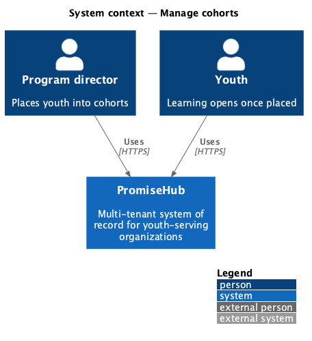
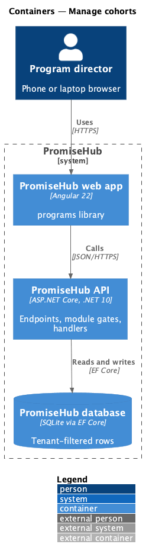
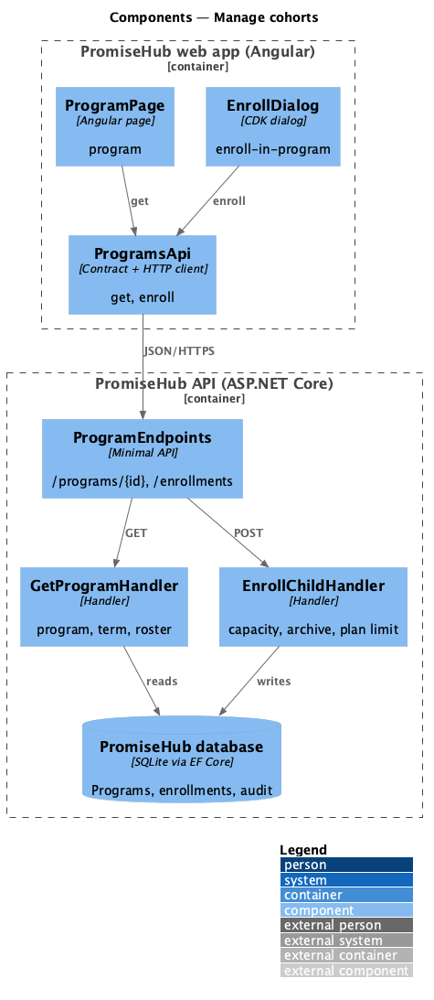
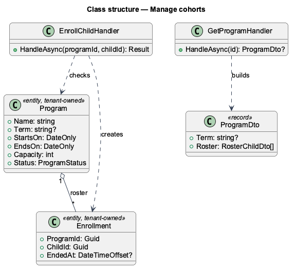
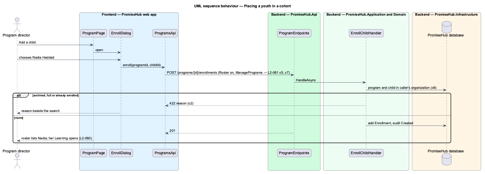

# Manage cohorts

## Overview

Waypoint runs youth in **cohorts**: a group that moves through a program together for a term. PromiseHub already has programs with a roster, capacity, events and archiving, so a cohort is a PromiseHub program (ADR 0043) and this feature adds only what a cohort needs beyond that: placing youth on its roster from the program page, and reading the cohort's term and mentors there. The term itself is [manage-terms-and-tracks](../manage-terms-and-tracks/README.md); mentors are [assign-mentors](../../mentoring/assign-mentors/README.md).

Terms used in this document:

- **cohort** — a program whose roster holds youth; nothing distinguishes it in the data, so every program can serve as one
- **placing** — enrolling a youth's child record on the program's active roster; the same enrollment `L2-012` and `L2-013` define, and the placement Learning reads (ADR 0047)

Ported from Waypoint `program-administration/manage-cohorts` (`L2-ADMIN-003`), with tenancy, the Roster module gate and PromiseHub types (ADR 0043, ADR 0048).

## Description

Frontend (`frontend/projects/programs/`):

- **`ProgramPage`** (`program`) — the header reads schedule, term, season and enrollment state; the roster lists the placed youth and, while Mentoring is on, each one's mentor and a **Mentor** action; the **Mentors** card shows the team. Add a child opens `EnrollDialog`. An archived program renders every action hidden (`L2-061` criterion 3).
- **`EnrollDialog`** — searches the organization's children and enrolls one; refusals (already enrolled, full, archived, plan limit) show beside the search.

API client (`frontend/projects/api/`): **`ProgramsApi`** (`get`, `enroll`, `removeFromRoster`) behind `PROGRAMS_API`.

Backend:

- **`ProgramEndpoints`** — `GET /programs/{id}`, `POST /programs/{id}/enrollments`, `DELETE /programs/{id}/enrollments/{childId}`, under `RequireModule(Roster)`; writes need `ManagePrograms`.
- **`GetProgramHandler`** — the program with its term, active roster and events; **`EnrollChildHandler`** — refuses a child of another organization, an archived or full program and a child already enrolled, checks the plan limit and audits Created on `Enrollment`.
- **`Program`** and **`Enrollment`** (`Domain/Programs/`) — tenant-owned; ending an enrollment keeps the row.

Every query filters by the organization (ADR 0002). Placing takes effect on the next request; the youth's Learning opens at once (`L2-060`).

Open questions: Waypoint required a track and a meeting location; tracks wait for curriculum (prompt 56) and the schedule text carries the place. Waypoint's "invite a new youth" path from the cohort is the youth invitation on the child record (`L2-054`).

## Built so far

Prompt 54 delivered everything above on top of prompt 05's programs. Acceptance tests: `backend/tests/PromiseHub.Api.Tests/CohortTests.cs`, `e2e/tests/programs/cohorts.spec.ts`.

## Requirements

| L2 ID | Refines (L1) | Requirement |
|-------|--------------|-------------|
| `L2-061` | `L1-005` | A program director gives a program a term so the programs that run together read as one intake, and places youth into it by enrolling their child records. Capacity and archiving work as they do for every program. |
| `L2-012` | `L1-005` | Programs hold events; both have schedules, locations, capacity and staff; archiving hides without deleting. |

## Diagrams

### System context

Who uses this slice of PromiseHub.

### Containers

The web app calls the API; the API owns the database and checks the organization's modules on every request.

### Components

The pages, dialogs and client in the web app, and the endpoints, handlers and entities in the API.

### Class structure

The entities, handlers and contracts with their relationships.

### Behaviour — placing a youth in a cohort

The steps in order, with the requirement criterion each enforces.

