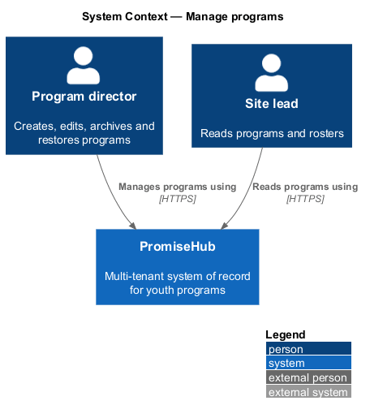
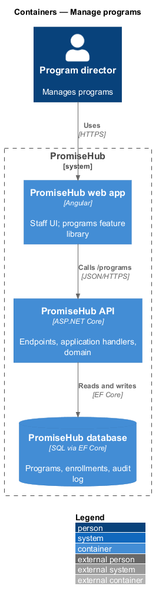
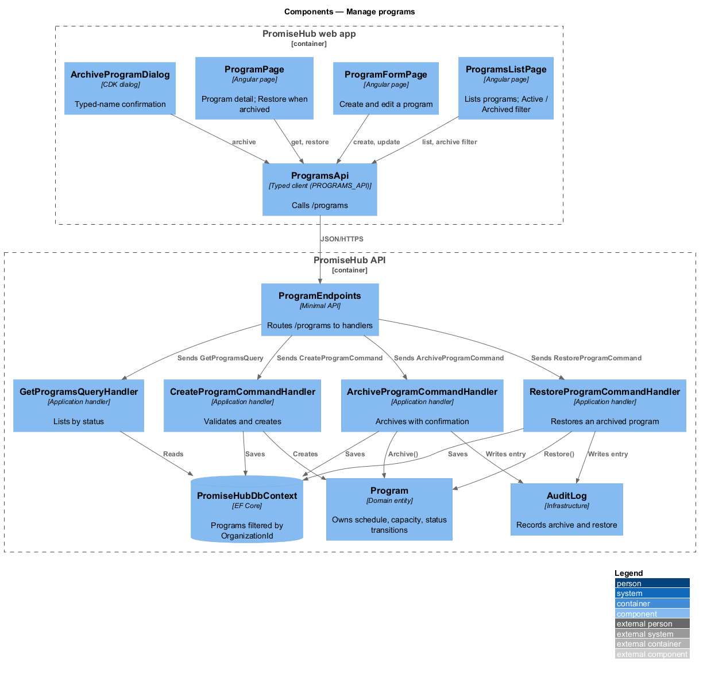
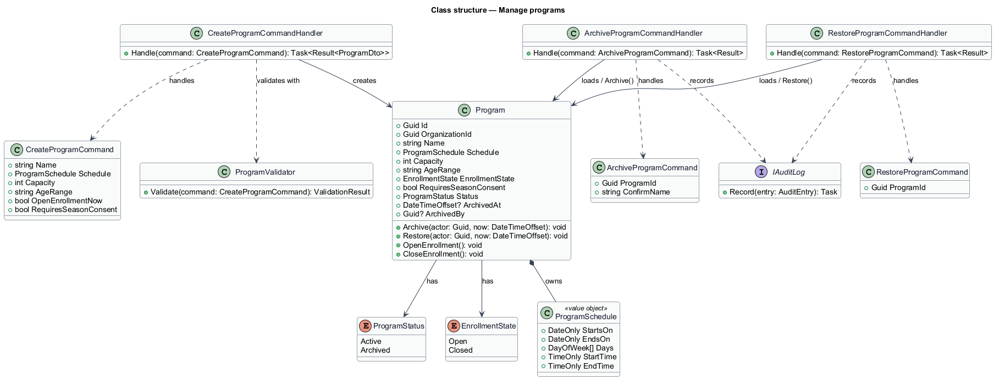
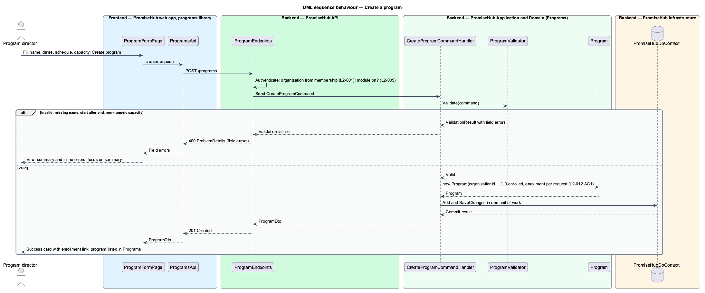
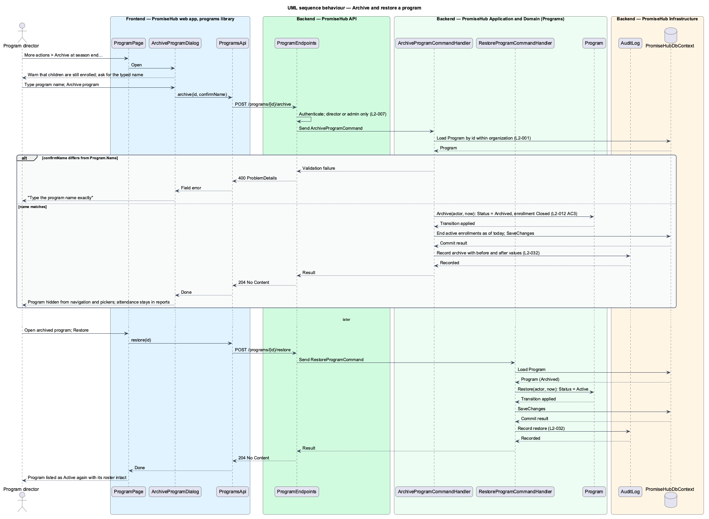

# Manage programs

## Overview

PromiseHub is a multi-tenant system of record for youth-serving organizations. A **program** — recurring offering with a schedule, a capacity and an enrolled roster of children. Programs hold events, and every other module (slips, attendance, reports) reads the program roster. This feature covers the program half of `L2-012`: creating and editing a program, listing programs, and archiving a program with the option to restore it.

An **archive** — reversible state change that hides a program from navigation and pickers while keeping its roster, attendance and slips. Archiving deletes nothing. Attendance recorded under an archived program stays in reports, and a program director may restore the program at any time.

Local terms used below:

- **program schedule** — days, start and end times, season start and end dates of a program
- **capacity** — number of places in a program; enrollments beyond it join the waitlist
- **enrollment state** — whether guardians can currently enroll a child in the program (`Open` or `Closed`)

Every program belongs to one organization (`L2-001`), and the Roster module gates the programs pages and endpoints (`L2-005`).

## Description

The feature is a vertical slice from the staff UI to the database.

### Frontend (`frontend/projects/programs/`)

- **`ProgramsListPage`** — page component for the `programs` screen (`/programs`). It lists active programs with enrolled counts against capacity and offers the `Active` / `Archived` filter chips and the `New program` action. It renders the `empty`, `loading`, `error` and `no-results` states.
- **`ProgramPage`** — page component for the `program` screen (`/programs/:id`). It shows the key numbers, the roster, the program's events and the enrollment link. An archived program renders read-only with `Export report` and `Restore`.
- **`ProgramFormPage`** — page component for the `program-form` screen (`/programs/new`, `/programs/:id/edit`). Fields: name, starts, ends, schedule, capacity, ages, enrollment (`Open now` / `Closed`) and the season consent switch. On an invalid submit it renders the inline errors and the error summary and moves focus to the summary.
- **`ProgramActionsMenu`** — CDK overlay menu for the `program-actions` dialog: attendance, funder report, close enrollment and `Archive at season end…`.
- **`ArchiveProgramDialog`** — CDK dialog for the `archive-program` screen. The confirm step asks the director to type the program name exactly. When children are still enrolled, a warning states that their enrollment ends today.
- Pages compose `page-header`, `list`, `chip`, `kpi`, `form-field`, `error-summary`, `dialog`, `menu`, `badge` and `empty-state` from `frontend/projects/components/`.

### API client (`frontend/projects/api/`)

- **`ProgramsApi`** — contract behind the `PROGRAMS_API` injection token with `list(filter)`, `get(id)`, `create(request)`, `update(id, request)`, `archive(id, confirmName)` and `restore(id)`. The HTTP implementation calls `/programs`. Pages depend on the token only.

### Backend

- **`ProgramEndpoints`** (`PromiseHub.Api`) — minimal-API group under `/programs`: `GET /programs`, `GET /programs/{id}`, `POST /programs`, `PUT /programs/{id}`, `POST /programs/{id}/archive` and `POST /programs/{id}/restore`. Endpoints authenticate, resolve the active organization from the membership and dispatch to handlers. They hold no business logic.
- **`PromiseHub.Application/Programs/`**
  - `GetProgramsQuery` / `GetProgramsQueryHandler` — lists programs of the active organization filtered by `ProgramStatus`.
  - `GetProgramQuery` / `GetProgramQueryHandler` — returns one program with its counts (enrolled, waitlisted, attendance, slips signed, sessions).
  - `CreateProgramCommand` / `CreateProgramCommandHandler` — validates and creates a program. A new program starts with 0 enrolled and enrollment `Closed` unless the request opens it (`L2-012` AC 1).
  - `UpdateProgramCommand` / `UpdateProgramCommandHandler` — edits name, schedule, capacity and ages.
  - `ArchiveProgramCommand` / `ArchiveProgramCommandHandler` — requires the typed confirmation name to equal the program name, sets `ProgramStatus.Archived`, closes enrollment, ends active enrollments as of today and writes an audit entry (`L2-012` AC 3, `L2-032`).
  - `RestoreProgramCommand` / `RestoreProgramCommandHandler` — sets `ProgramStatus.Active` and writes an audit entry. Enrollment stays `Closed` until a director opens it.
  - `ProgramValidator` — rules: name required, start before end, capacity a whole number greater than 0.
  - `ProgramPermissions` — program directors and admins may create, edit, archive or restore; site leads may read (`L2-007`).
- **`PromiseHub.Domain/Programs/`**
  - `Program` — entity with `Id`, `OrganizationId`, `Name`, `Schedule`, `Capacity`, `AgeRange`, `EnrollmentState`, `RequiresSeasonConsent`, `Status`, `ArchivedAt` and `ArchivedBy`. `Archive(actor, now)` and `Restore(actor, now)` enforce the transitions.
  - `ProgramSchedule` — value object with `StartsOn`, `EndsOn`, `Days`, `StartTime` and `EndTime`.
  - `ProgramStatus` — `Active`, `Archived`. `EnrollmentState` — `Open`, `Closed`.
- **`PromiseHub.Infrastructure`** — `PromiseHubDbContext` maps `Programs` with a global query filter on `OrganizationId`. `AuditLog` records archive and restore. Picker and navigation queries exclude `Archived` programs; report queries include them.

Decided in ADR 0008: names are at most 120 characters; archiving does not cancel future events.

## Built so far

Slice 05 delivered `ProgramsListPage` (`ProgramsPage`), `ProgramPage` (stats, roster with add and remove, events, archived read-only state with Restore), `ProgramFormPage` for new and edit, `EnrollDialog`, `RemoveFromRosterDialog`, `ProgramActionsDialog` and `ArchiveProgramDialog`, `PROGRAMS_API`, every endpoint above plus `POST /programs/{id}/enrollments` and `DELETE /programs/{id}/enrollments/{childId}`, the handlers with audit entries and the `Enrollment` entity. Schedule is free text as in the mock. Waitlists, the enrollment link, attendance figures and the funder report arrive with their features.

## Requirements

| L2 ID | Refines (L1) | Requirement |
|-------|--------------|-------------|
| `L2-012` | `L1-005` | Programs hold events; both have schedules, locations, capacity and staff; archiving hides without deleting. |
| `L2-001` | `L1-001` | Every tenant-owned table carries the organization id; every query, search, export and background job filters by the organization of the signed-in person's active membership, never by a value from the client. |
| `L2-005` | `L1-002` | A module that is off is neither served nor rendered. |
| `L2-032` | `L1-017` | Every change and every sensitive view is recorded and searchable by admins. |

## Diagrams

### System context

A program director manages programs in PromiseHub; no external system takes part in this slice.

### Containers

The `programs` feature library in the PromiseHub web app calls the PromiseHub API, which persists programs and audit entries in the PromiseHub database.

### Components

`ProgramEndpoints` dispatches commands and queries to the handlers in `PromiseHub.Application/Programs/`. The handlers load and mutate the `Program` entity through `PromiseHubDbContext` and record changes in the audit log.

### Class structure

`Program` owns a `ProgramSchedule` and holds a `ProgramStatus`; the archive and restore handlers call its transition methods.

### Behaviour — create a program

The form posts the program. The validator rejects a missing name, an inverted date range or a non-numeric capacity. A valid program is created with 0 enrolled and enrollment closed (`L2-012` AC 1).

### Behaviour — archive and restore a program

Archiving requires the typed program name, hides the program from navigation and pickers and keeps attendance in reports. Restoring reverses the status (`L2-012` AC 3).

