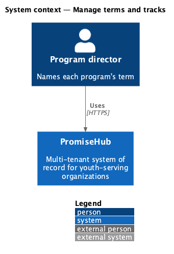
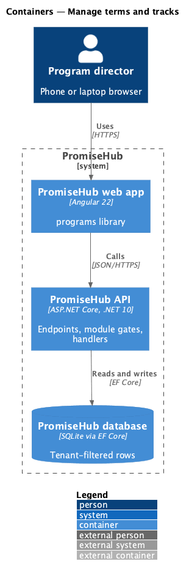
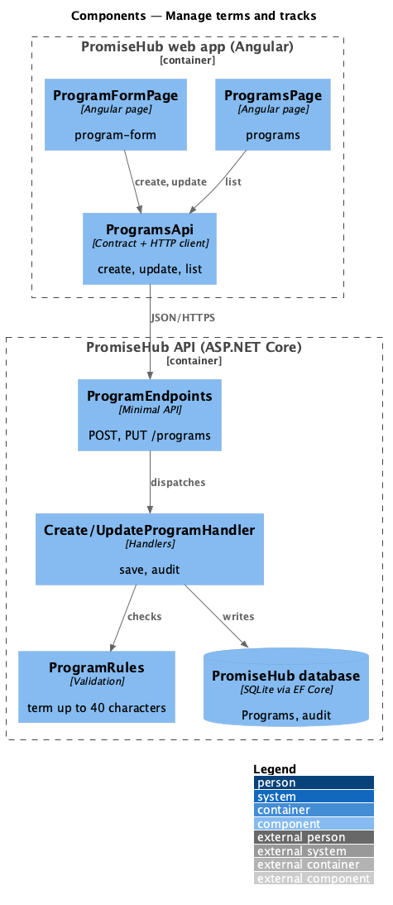
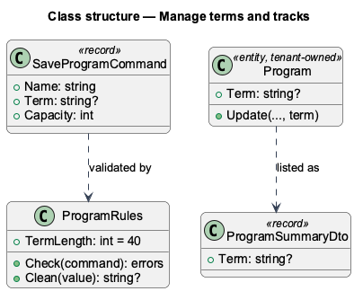
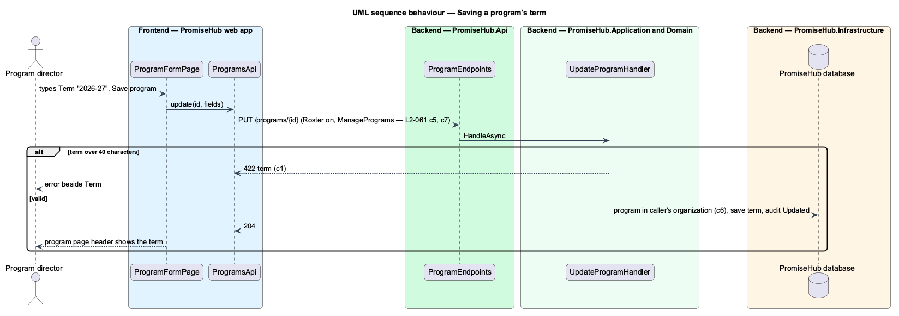

# Manage terms and tracks

## Overview

A **term** names the period a cohort runs in, such as "2026–27" or "Fall 2026", so a program director can tell this year's intake from last year's at a glance. Waypoint kept terms in their own table with an Upcoming, Active or Completed status and gave each cohort a curriculum **track**. In PromiseHub a cohort is a program (ADR 0043) whose start and end dates already bound the term, so the term is an optional label on the program (ADR 0048). Tracks belong to curriculum and are deferred to prompt 56.

Terms used in this document:

- **term** — a label of up to 40 characters on a program; blank means none
- **track** — a published curriculum path a cohort follows; not part of this slice

Ported from Waypoint `program-administration/manage-terms-and-tracks` (`L2-ADMIN-006` criterion 2), with tenancy, the Roster module gate and PromiseHub types.

## Description

Frontend (`frontend/projects/programs/`):

- **`ProgramFormPage`** (`program-form`) — gains the optional **Term** text field beside Schedule; a 422 for `term` shows beside the field.
- **`ProgramsPage`** (`programs`) — each row's meta reads schedule, term and enrolled against capacity.
- **`ProgramPage`** (`program`) — the header subtitle includes the term.

API client: **`ProgramFields.term`** and **`Program.term`**, **`ProgramSummary.term`**.

Backend:

- **`SaveProgramCommand`** gains `Term`; **`ProgramRules.Check`** refuses more than 40 characters with "Keep the term under 40 characters."; **`ProgramRules.Clean`** stores a blank term as none.
- **`CreateProgramHandler`** and **`UpdateProgramHandler`** save it and audit Created or Updated on `Program` with the term in the before and after values.
- **`Program.Term`** (`Domain/Programs/`), a nullable column added by the `CohortMentors` migration; **`ProgramDto`** and **`ProgramSummaryDto`** return it.

Open questions: a term table with one active term, filtering Programs by term and tracks wait for curriculum (prompt 56).

## Built so far

Prompt 54 delivered everything above. Acceptance tests: `backend/tests/PromiseHub.Api.Tests/CohortTests.cs`, `e2e/tests/programs/cohorts.spec.ts`.

## Requirements

| L2 ID | Refines (L1) | Requirement |
|-------|--------------|-------------|
| `L2-061` | `L1-005` | A program director gives a program a term so the programs that run together read as one intake, and places youth into it by enrolling their child records. Capacity and archiving work as they do for every program. |

## Diagrams

### System context

Who uses this slice of PromiseHub.

### Containers

The web app calls the API; the API owns the database and checks the organization's modules on every request.

### Components

The pages, dialogs and client in the web app, and the endpoints, handlers and entities in the API.

### Class structure

The entities, handlers and contracts with their relationships.

### Behaviour — saving a program's term

The steps in order, with the requirement criterion each enforces.

