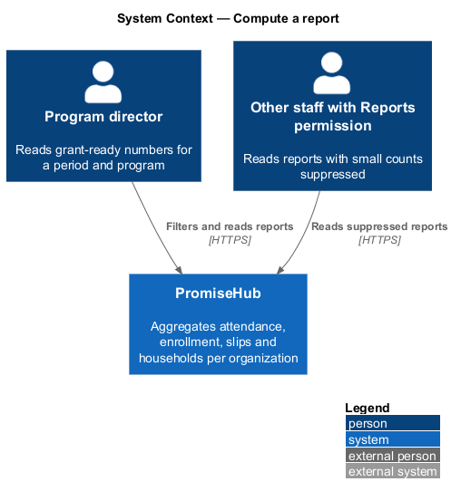
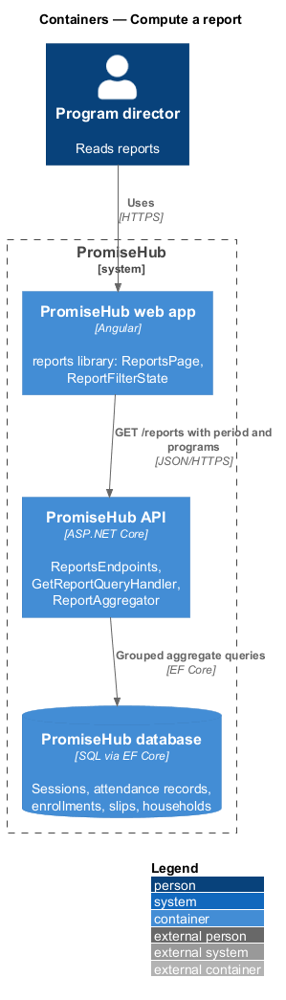
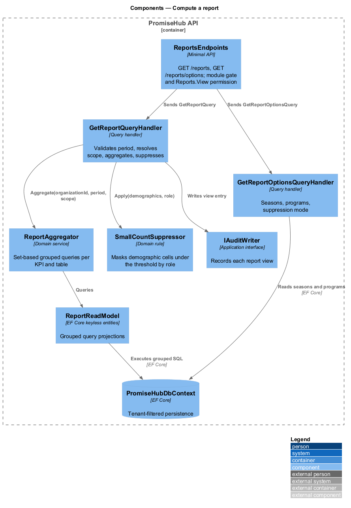
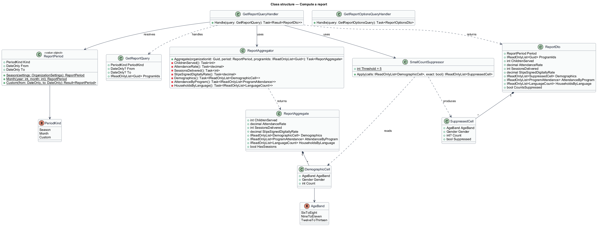
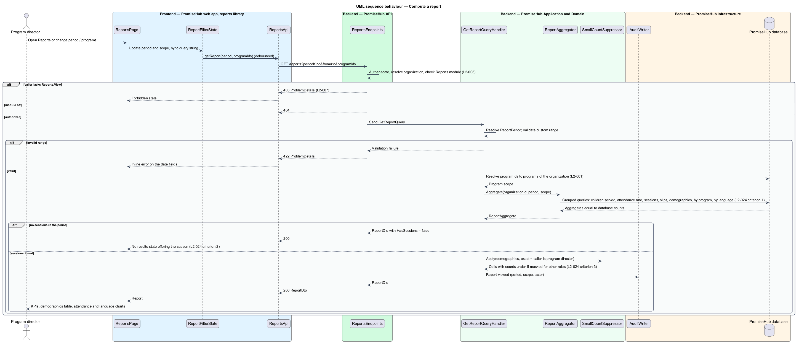

# Compute a report

## Overview

Program directors at a youth-serving non-profit answer to funders with numbers: how many children were served, how often they attended, how many sessions ran, and who the children are by age, gender and household language. PromiseHub already holds every record those numbers come from. The Reports module turns the records into a report page for any period and any program set, with no re-entry, and protects children by suppressing small demographic counts for roles that do not need exact figures.

A report is computed on request from the live attendance, enrollment, slip and household tables of the active organization. Nothing is pre-aggregated in phase 1; every number on the page equals the corresponding database aggregate at the moment of the query. The page shows headline KPIs, a demographics table, attendance by program and households by language, and offers the export designed in `reports/export-report`.

Local terms:

- **report period** — date range over which sessions and enrollments are counted, chosen as the current season, a named month or a custom range
- **program scope** — set of programs whose sessions and enrolled children are included; all programs by default
- **children served** — count of distinct children with at least one attendance record marked present in the period and scope
- **attendance rate** — present attendance records divided by expected attendance records across recorded sessions in the period and scope, as a percentage
- **sessions delivered** — count of sessions in the period and scope whose attendance was recorded and that were not cancelled
- **small-count suppression** — rule that replaces a demographic cell below a threshold with a masked value for roles other than program director

The slice spans the `reports` screen and its default, loading, empty, error and no-results states. Submitting and success states of the same screen belong to `reports/export-report`.

## Description

### Frontend

The Angular feature library `frontend/projects/reports/` owns the page; it composes `frontend/projects/components/` and calls `ReportsApi` from `frontend/projects/api/`.

- **`ReportsPage`** — the report (`reports`). A filter toolbar holds the period select (this season, each month of the season, custom range with two date pickers) and the program multi-select. Below it, a KPI row (children served, attendance rate, sessions delivered, slips signed digitally), the demographics table "Children by age and gender", the attendance-by-program progress chart and the households-by-language chart. The export button opens `ExportDialog` (designed in `export-report`). States: loading (skeleton KPIs and lists), empty (no attendance recorded yet, with a link to check-in), error (with retry and a raw-attendance export fallback), no-results (custom range with no sessions, offering the season).
- **`ReportFilterState`** — signal-based store in the library that holds period and scope, syncs them to the query string so a report URL is shareable within the organization, and debounces filter changes before calling the API.
- **`SuppressedCount`** — component in `frontend/projects/components/` that renders either an exact number or the masked value with an accessible label explaining the suppression. The page renders whatever the server returns; it never decides suppression itself.
- **`ReportsApi`** — service behind the `REPORTS_API` injection token with `getReport(period, programIds)` and `getReportOptions()` (seasons and programs available to the organization).

### Backend

`PromiseHub.Api` exposes `ReportsEndpoints` with `GET /reports` (query parameters `periodKind`, `from`, `to`, `programIds`) and `GET /reports/options`. Endpoints authenticate, resolve the organization, check that the Reports module is on (404 otherwise, `L2-005`) and require the `Reports.View` permission (403 otherwise).

Application components in `PromiseHub.Application/Reports/`:

- **`ReportPeriod`** — value object resolved from the query: `Season(start, end)`, `Month(year, month)` or `Custom(from, to)`; the season boundaries come from the organization's settings.
- **`GetReportQuery`** and **`GetReportQueryHandler`** — validates the period (custom `to` not before `from`), resolves the program scope to programs of the organization only (`L2-001`), and calls `ReportAggregator`. It then applies `SmallCountSuppressor` to the demographic table according to the caller's role and returns a `ReportDto`.
- **`ReportAggregator`** — domain service that issues set-based EF Core queries against `PromiseHubDbContext`. Each KPI and table is one grouped query with the organization filter, the period predicate on `Session.StartsAt` and the scope predicate on `ProgramId`. The service never loads rows into memory to count them. It returns `ReportAggregate` with `ChildrenServed`, `AttendanceRate`, `SessionsDelivered`, `SlipsSignedDigitallyRate`, `Demographics` (age band by gender), `AttendanceByProgram` and `HouseholdsByLanguage`.
- **`SmallCountSuppressor`** — domain rule. For callers who are not program directors, any demographic cell whose count is under the threshold is replaced by a masked value and the row and column totals are recomputed so the masked cell cannot be derived from them. Program directors receive exact counts on screen. The threshold is 5, per `L2-024` criterion 3 and the mocks' funder-export note. Exports always apply the rule regardless of role (see `export-report`).
- **`GetReportOptionsQueryHandler`** — returns the season list, the program list (including archived programs, whose attendance stays reportable per `L2-012`) and the caller's suppression mode so the page can explain masked cells.
- **`ReportReadModel`** — EF Core keyless entity types mapping the grouped queries, so attendance recorded moments ago is included on the next request (`L2-024` criterion 4).

Domain types in `PromiseHub.Domain/Reports/`: `ReportPeriod`, `AgeBand` (`6-8`, `9-11`, `12-13` as in the mocks; the band definition is `<TO SUPPLY>`), `ReportAggregate`, `DemographicCell`.

`PromiseHub.Infrastructure` provides the `PromiseHubDbContext` keyless entity configurations, indexes on `AttendanceRecord(OrganizationId, SessionId)` and `Session(OrganizationId, ProgramId, StartsAt)` that keep the season query under the 3-second budget of `L2-024` criterion 1, and the audit entry each report view writes through `IAuditWriter`.

### Undecided details

- Age band boundaries and the handling of children outside the bands are `<TO SUPPLY>`.
- Whether `AttendanceRate` counts excused absences as expected is `<TO SUPPLY>`.
- Whether the report response is cached per organization and filter for a short window is `<TO SUPPLY>`; the design assumes no cache in phase 1.

## Requirements

The feature realizes the following level-2 (L2) requirement and enforces the cross-cutting ones listed with it.

| L2 ID | Refines (L1) | Requirement |
|-------|--------------|-------------|
| `L2-024` | `L1-012` | Reports show children served, attendance rate, sessions delivered, slips signed digitally, demographics by age and gender, attendance by program and households by language for a period and program. |
| `L2-001` | `L1-001` | Every tenant-owned table carries the organization id; every query, search, export and background job filters by the organization of the signed-in person's active membership, never by a value from the client. |
| `L2-005` | `L1-002` | A module that is off is neither served nor rendered. |
| `L2-007` | `L1-003` | Permissions are enforced per endpoint and per field by role; the UI reflects them but never substitutes for them. |

## Diagrams

### System context

The program director reads reports in PromiseHub; no external system takes part in computing them.

### Containers

The Reports page calls the API, which aggregates directly from the database.

### Components

`ReportsEndpoints` dispatches `GetReportQuery`; `ReportAggregator` runs the grouped queries and `SmallCountSuppressor` masks small cells by role.

### Class structure

`GetReportQueryHandler` depends on `ReportAggregator` and `SmallCountSuppressor` and returns a `ReportDto` built from `ReportAggregate`.

### Behaviour — compute a report

The page sends period and scope; the handler validates, aggregates, suppresses by role and returns the report, or the no-results state when the period holds no sessions.

