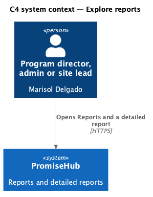
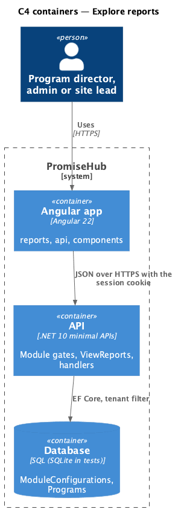
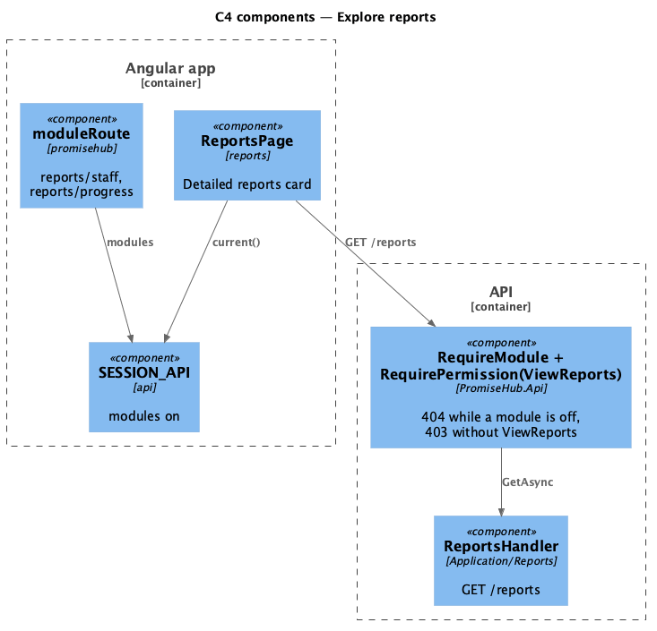
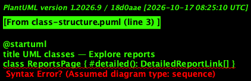
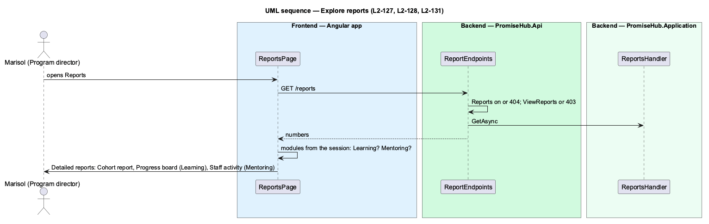

# Explore reports

## Overview

Reports (`reports`, L2-024) shows a program director the organization's headline numbers for funders. Waypoint's reports hub also leads to detailed reports about youth, cohorts and staff. In PromiseHub the hub stays the existing Reports page and gains a **Detailed reports** card that lists each detailed report whose modules are on: the cohort report always (it shows enrolment and attendance even without Learning), the progress board while Learning is on and staff activity while Mentoring is on. A youth report opens from a name on the cohort report. Nothing about an off module is rendered, linked or requested (ADR 0074).

Terms used in this document:

- **detailed report** — one of the cohort report, the youth report, the staff activity report and the progress board, each with its own page and endpoint
- **hub** — the Reports page, `/reports`

Ported from Waypoint's `reporting-and-data/explore-reports` design (`L2-REPORT-001` criteria 1 and 5).

## Description

Frontend:

- **`ReportsPage`** (`frontend/projects/reports/`) — unchanged numbers; adds the Detailed reports card (`ph-card` flush, `ph-list` of `ph-list-item` links) composed from `SESSION_API.current()` modules: Cohort report (`/reports/cohorts/{first program}`), Progress board (`/reports/progress`, Learning) and Staff activity (`/reports/staff`, Mentoring).
- **App routes** (`frontend/projects/promisehub/`) — `moduleRoute('reports/staff', ['Reports', 'Mentoring'], …)` and `moduleRoute('reports/progress', ['Reports', 'Learning'], …)` before `moduleRoute('reports', 'Reports', …)`, so an off module redirects to Today and its code is never downloaded.

Backend: no change; each detailed report has its own design (`view-cohort-report`, `view-youth-report`, `view-staff-report`, `view-progress-board`).

## Built so far

Prompt 80 delivered the Detailed reports card on `ReportsPage` (cohort report always; progress board while Learning is on; staff activity while Mentoring is on) and the `moduleRoute` entries for `reports/staff` and `reports/progress`. Acceptance tests: `e2e/tests/reports/cohort-report.spec.ts`, `staff-report.spec.ts`, `progress-board.spec.ts` (the card and the redirects).

## Requirements

| L2 ID | Refines (L1) | Requirement |
|-------|--------------|-------------|
| `L2-127` | `L1-023` | Program directors, admins and site leads open a cohort report for one program (`report-cohort`) and a youth report for one child (`report-youth`) from Detailed reports on Reports. Each section is shown only while its module is on: learning progress needs Learning, attendance Roll Call, mentoring activity Mentoring. |
| `L2-128` | `L1-024` | While Mentoring is on, program directors, admins and site leads see each mentor's caseload, check-ins and reviews and whether the load is balanced (`report-staff`). |
| `L2-131` | `L1-023` | While Learning is on, program directors, admins and site leads see every youth of a cohort against every module of its track, the spreadsheet replaced (`progress-board`). |
| `L2-005` | `L1-002` | Every endpoint of a module that is off answers 404 for that organization, and the frontend never renders, links or prefetches it. |

## Diagrams

A program director, admin or site lead reads the report; youth, mentors and other staff have no access.

The Angular app calls the API; the API reads the module configuration and the tenant on every request.

The page calls one endpoint behind the module and permission gates; the handler computes the report on read.

The card lists only the reports whose modules are on in the session.

Opening Reports reads the session's modules once and composes the card from them.

