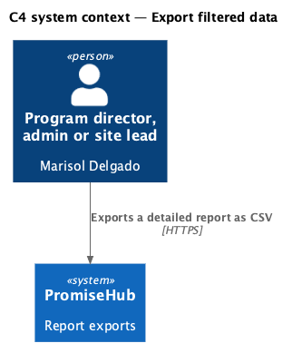
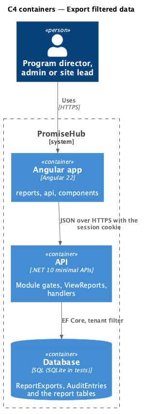
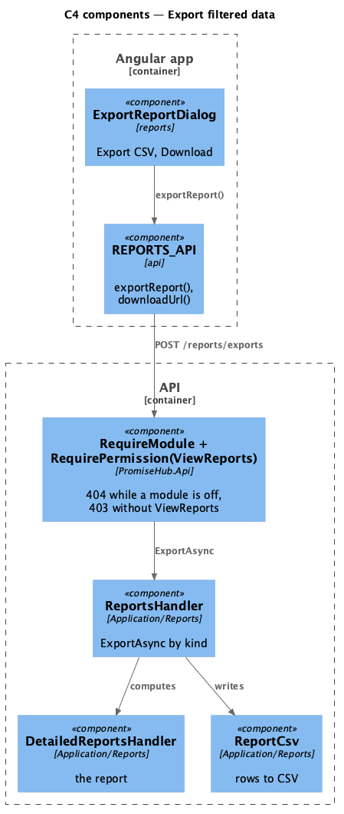
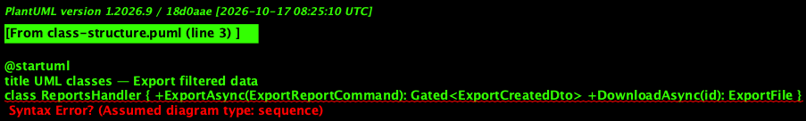
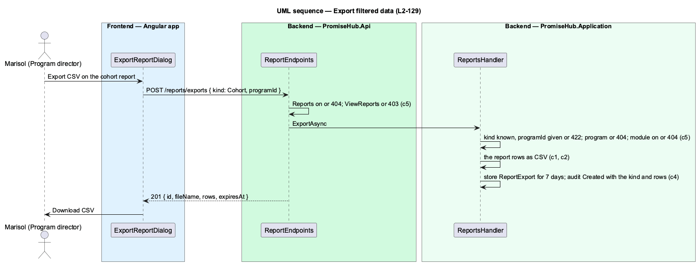

# Export filtered data

## Overview

Each detailed report exports as CSV exactly what it shows for its filters (the cohort, the period), so a program director can take the numbers into a funder template without retyping (`export-report`). The export is the same stored `ReportExport` the summary export writes (L2-025): a file of names and numbers kept for 7 days behind `GET /reports/exports/{id}` and audited with who, which kind and how many rows. Sections whose module is off are left out of the file as they are off the page.

Terms used in this document:

- **kind** — `Summary` (the existing report export), `Cohort`, `Progress` or `Staff`

Ported from Waypoint's `reporting-and-data/export-filtered-data` design (`L2-REPORT-003`). PDF, Google Sheets and the audit-log export are deferred (ADR 0074).

## Description

Frontend:

- **`ExportReportDialog`** (`frontend/projects/reports/`) — title and description from its caller, Export CSV (busy), the failed `ph-alert` and, once written, Download CSV linking `REPORTS_API.downloadUrl(id)`; opened by the cohort report, the progress board and the staff report with `{ kind, programId, days }`.
- **`REPORTS_API.exportReport(request)`** — `POST /reports/exports`.

Backend:

- **`ReportsHandler.ExportAsync(ExportReportCommand)`** — `Kind` absent or `Summary` keeps L2-025; `Cohort` and `Progress` need `ProgramId` (422) and the program (404); `Progress` needs Learning and `Staff` Mentoring (404); computes the report through `DetailedReportsHandler` and writes its rows with **`ReportCsv`** (quoting, one header row).
- **`ExportReportCommand`** — gains `Kind` and `Days`.
- **`ReportExport`** — unchanged; the audit summary names the kind: `{file} · CSV · {rows} rows · {kind}`.

## Built so far

Prompt 80 is building this design; this section lists what is delivered when it merges. <TO SUPPLY>

## Requirements

| L2 ID | Refines (L1) | Requirement |
|-------|--------------|-------------|
| `L2-129` | `L1-012` | Every detailed report exports as CSV exactly what it shows for its filters, and nothing a section whose module is off would show. |
| `L2-025` | `L1-012` | One click exports CSV or a funder template; large exports run in the background and are emailed. |
| `L2-005` | `L1-002` | Every endpoint of a module that is off answers 404 for that organization, and the frontend never renders, links or prefetches it. |

## Diagrams

A program director, admin or site lead reads the report; youth, mentors and other staff have no access.

The Angular app calls the API; the API reads the module configuration and the tenant on every request.

The page calls one endpoint behind the module and permission gates; the handler computes the report on read.

The export command names the kind; the CSV writer turns the report's rows into the stored file.

The export computes the same report the page shows, then stores and audits the file.

