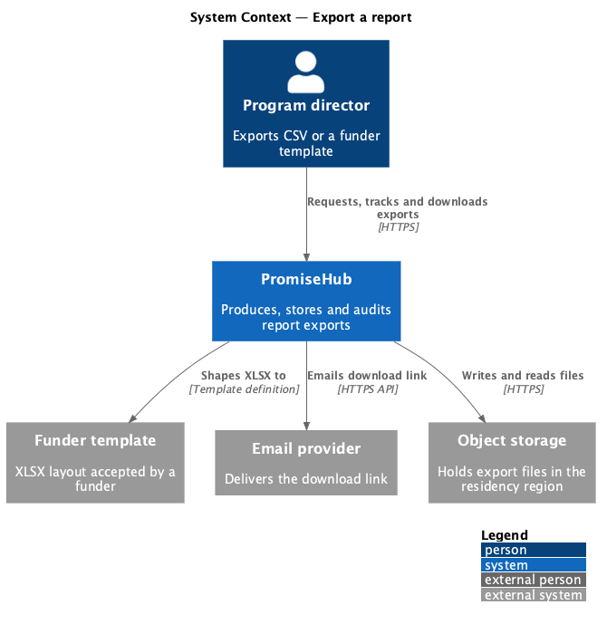
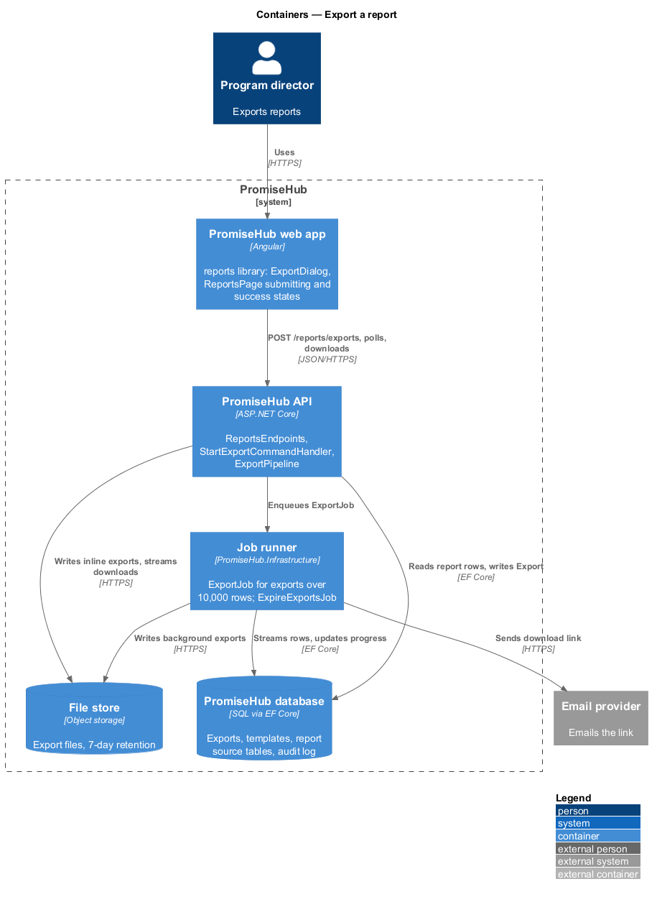
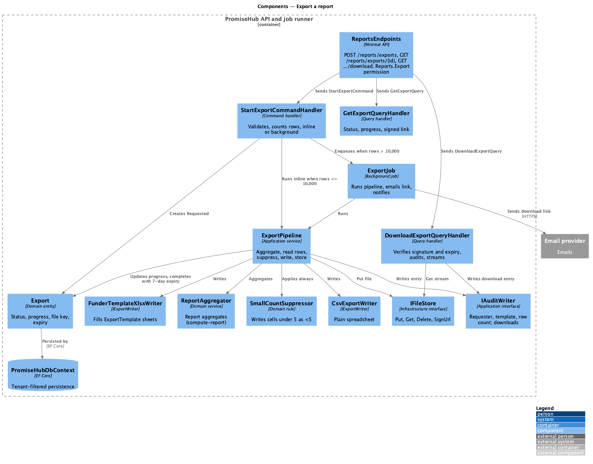
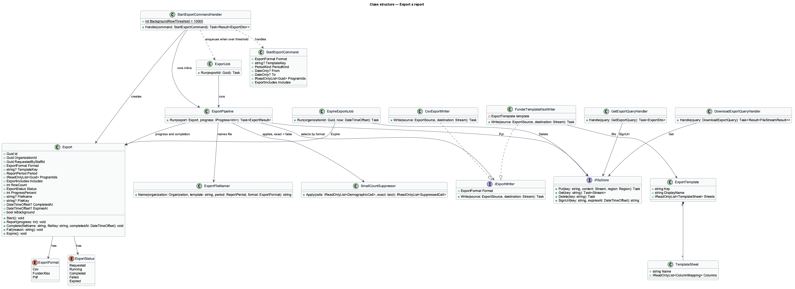
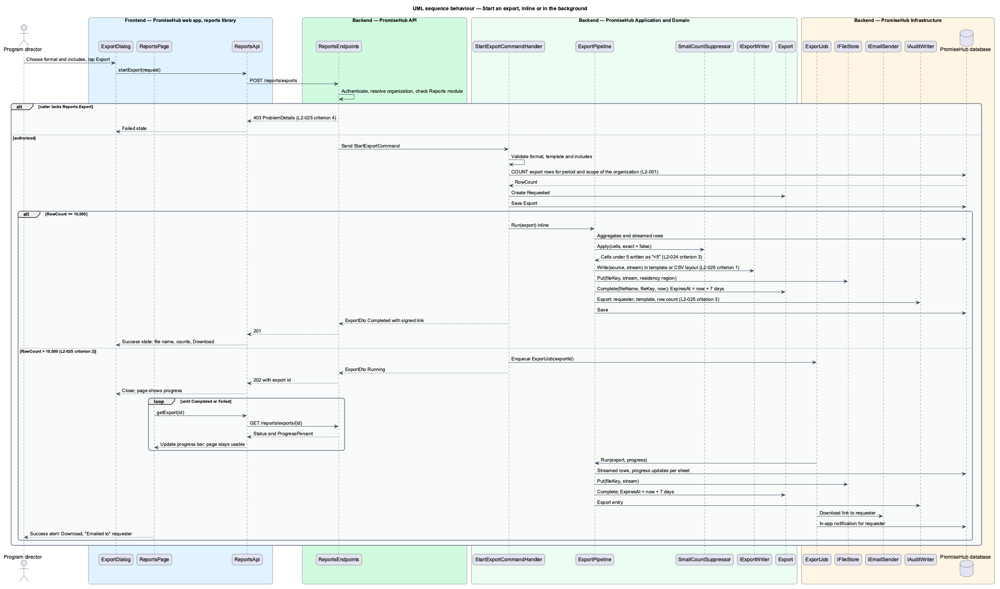
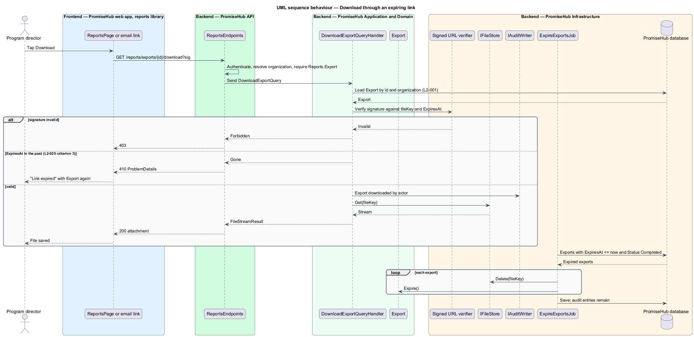

# Export a report

## Overview

Funders ask youth-serving organizations for numbers in their own spreadsheet layouts. PromiseHub turns a computed report into a downloadable file in one click: a plain CSV, or an XLSX that follows a funder's template with its sheets and column order. Small exports return at once; large exports run in the background, show progress, and arrive by email so the director can keep working. Every export is audited and every download link expires.

An export is a request against the same period and program scope as the report on screen, so the file and the page agree. The export reads the aggregates from `reports/compute-report` and, for attendance-by-session and demographic sheets, the underlying rows. Small-count suppression is always applied to a file, whatever the requester's role, because a file leaves the system.

Local terms:

- **export** — request to produce a file from a report's period, scope and chosen format, tracked from request to download
- **funder template** — named XLSX layout with fixed sheets and headings that a funder accepts, such as the Ontario Trillium Foundation template
- **export row** — one line of the largest sheet in the export; the row count decides whether the export runs inline or in the background
- **background export** — export over the row threshold that runs as a job, reports progress and is emailed on completion
- **download link** — signed URL to the produced file that stops working after its expiry

The slice spans the `export-data` dialog (default, busy, failed and success states) and the submitting and success states of `reports`. The same dialog is reused from the household, child, event and audit-log actions for other export kinds; those entry points pass a different export kind but share the pipeline described here.

## Description

### Frontend

- **`ExportDialog`** — CDK dialog in `frontend/projects/reports/` (`export-data`). Format radio group: Ontario Trillium Foundation template (.xlsx), United Way template (.xlsx), plain spreadsheet (.csv), PDF summary for the board (the PDF format is `<TO SUPPLY>` for phase 1 and is shown disabled when the server lists it as unavailable). Include checkboxes: attendance by session, demographics, children's names (internal copies only, disabled for funder templates). An info alert states that the export is recorded in the audit log. States: default, busy, failed, success (file name, row counts, "Emailed to" line and a Download button).
- **`ReportsPage`** — `reports/submitting` shows the export button busy with a determinate progress bar fed by polling, while the rest of the page stays usable; `reports/success` shows a success alert with Download and the note that the file was emailed.
- **`ExportProgress`** — component in `frontend/projects/components/` wrapping the design-system progress bar with an accessible live region announcing percent complete.
- **`ReportsApi`** gains `startExport(request)`, `getExport(id)` and `downloadUrl(id)`. `startExport` returns either a completed export (inline path) or a running export with an id to poll.

### Backend

`PromiseHub.Api` exposes in `ReportsEndpoints`: `POST /reports/exports`, `GET /reports/exports/{id}`, `GET /reports/exports/{id}/download`. All three authenticate, resolve the organization, check the Reports module and require the `Reports.Export` permission; a caller without it receives 403 (`L2-025` criterion 4). The download route additionally validates the signed link and its expiry.

Application components in `PromiseHub.Application/Reports/`:

- **`StartExportCommand`** and **`StartExportCommandHandler`** — validates format and includes with `StartExportCommandValidator`, resolves period and scope exactly as `GetReportQueryHandler` does, counts export rows with one `COUNT` query, and creates an `Export` entity in state `Requested`. When the row count is at most 10,000 the handler runs `ExportPipeline` inline and returns the completed export; otherwise it enqueues `ExportJob` and returns the running export (`L2-025` criterion 2). Both paths write the audit entry with requester, template and row count at completion (`L2-025` criterion 3).
- **`ExportPipeline`** — application service that runs an export: `ReportAggregator` for aggregate sheets, `ExportRowReader` for row sheets (streamed, never buffered in memory), `SmallCountSuppressor` in always-on mode so cells under 5 are written as `<5`, then the `IExportWriter` matching the format, then `IFileStore.Put`. It updates `Export.Progress` after each sheet.
- **`IExportWriter`** with `CsvExportWriter` and `FunderTemplateXlsxWriter`. The XLSX writer loads an `ExportTemplate` definition (sheet names, headings, cell map) and fills it. File names follow `{organization-slug}-{template}-{season}.xlsx` (`L2-025` criterion 1), produced by `ExportFileNamer`.
- **`ExportTemplate`** — domain entity describing a funder template: `Key`, `DisplayName`, `Sheets` with `ColumnMappings`. Phase 1 ships the Ontario Trillium Foundation and United Way definitions as seeded data; their exact cell maps are `<TO SUPPLY>`.
- **`ExportJob`** — per-tenant background job that runs `ExportPipeline` for a background export, then emails the requester a download link through `IEmailSender` and raises an in-app notification. Retries follow `L2-034`; a retry resumes from `Requested` and never produces two files for one export.
- **`GetExportQueryHandler`** — returns state, progress percent, row counts, file name and, when `Completed`, a signed download link.
- **`DownloadExportQueryHandler`** — verifies the signature and that `ExpiresAt` is in the future, writes an audit entry for the download, and streams the file from `IFileStore`. Expired links answer 410 and the page offers to export again.
- **`ExpireExportsJob`** — daily job that deletes files whose `ExpiresAt` has passed and marks the export `Expired`; the audit entries remain.

Domain in `PromiseHub.Domain/Reports/`: `Export` (`OrganizationId`, `RequestedByStaffId`, `Format`, `TemplateKey`, `Period`, `ProgramIds`, `Includes`, `RowCount`, `Status`, `Progress`, `FileName`, `FileKey`, `ExpiresAt`), `ExportStatus` (`Requested`, `Running`, `Completed`, `Failed`, `Expired`), `ExportFormat` (`Csv`, `FunderXlsx`, `Pdf`). `ExpiresAt` is set to 7 days after completion.

`PromiseHub.Infrastructure` provides `FileStore` (object storage in the organization's residency region per `L2-030`), the signed-URL signer, the XLSX library adapter, `EmailProvider`, the job runner and the audit writer.

### Undecided details

- The exact sheets and cell maps of the Ontario Trillium Foundation and United Way templates are `<TO SUPPLY>`.
- The PDF board summary format is `<TO SUPPLY>` and may ship after phase 1.
- Object storage provider and signing scheme are `<TO SUPPLY>`.

## Built so far

Slice 37 delivered CSV exports stored as `ReportExport` with a seven-day link, masking, audit, and `ExportDialog` (ADR 0031). Funder XLSX templates and background exports with email are not built.

## Requirements

The feature realizes the following level-2 (L2) requirement and enforces the cross-cutting ones listed with it.

| L2 ID | Refines (L1) | Requirement |
|-------|--------------|-------------|
| `L2-025` | `L1-012` | One click exports CSV or a funder template; large exports run in the background and are emailed. |
| `L2-024` | `L1-012` | Reports show children served, attendance rate, sessions delivered, slips signed digitally, demographics by age and gender, attendance by program and households by language for a period and program. |
| `L2-001` | `L1-001` | Every tenant-owned table carries the organization id; every query, search, export and background job filters by the organization of the signed-in person's active membership, never by a value from the client. |
| `L2-032` | `L1-017` | Every change and every sensitive view is recorded and searchable by admins. |

`L2-024` appears for its third criterion: a demographic cell under 5 is written as `<5` in every export.

## Diagrams

### System context

The director requests an export; PromiseHub writes the file to object storage, emails the link through the email provider, and shapes XLSX output to the funder template.

### Containers

The dialog calls the API; small exports complete inline, large ones run in the job runner; files live in the file store and links arrive by email.

### Components

`StartExportCommandHandler` decides inline or background by row count; `ExportPipeline` drives the aggregator, suppressor, writer and file store.

### Class structure

`Export` tracks the request through its statuses; `ExportPipeline` depends on `IExportWriter` implementations and `IFileStore`.

### Behaviour — start an export, inline or in the background

The handler counts rows and either completes the export inline or enqueues the job; the page polls progress and shows the emailed result.

### Behaviour — download through an expiring link

The download route verifies the signature and the 7-day expiry, audits the download and streams the file.

