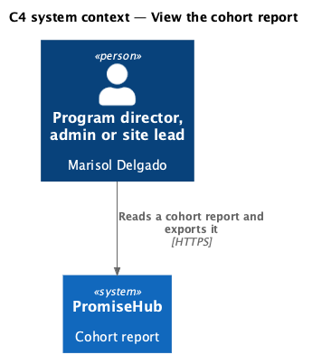
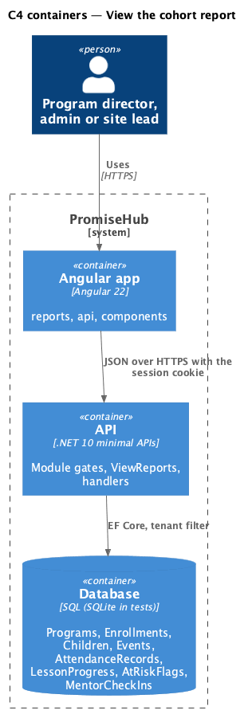
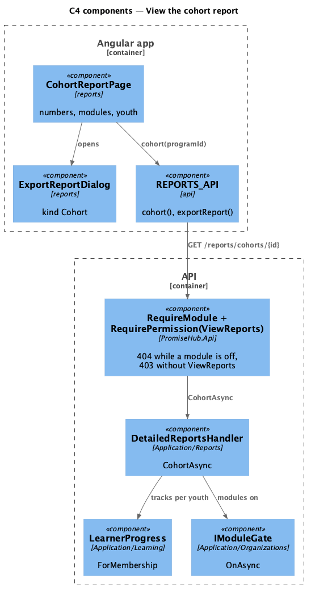
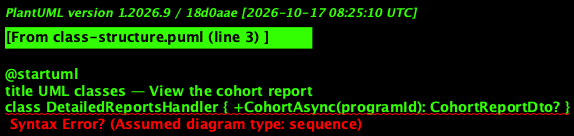
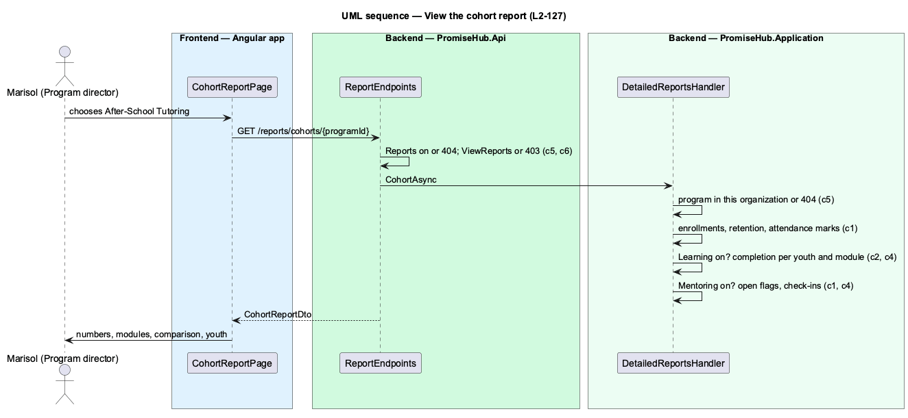

# View the cohort report

## Overview

A **cohort** is a program (ADR 0043). The cohort report (`report-cohort`) shows a program director how one cohort is doing: how many youth are enrolled and how many left, how often they come, how far they are through their track and who is at risk, next to the same numbers for the whole organization. It replaces the cohort tab of the spreadsheets programs keep today.

Marisol opens it from Detailed reports or chooses another cohort in its select. Each youth's name opens the youth report. Learning numbers need Learning, attendance Roll Call and the at-risk count and check-ins Mentoring; at Northgate, where Learning and Mentoring are off, Grace sees enrolment, retention and attendance only.

Terms used in this document:

- **retention** — active enrollments of all enrollments of the program, a whole percent
- **completion** — lessons done of the published lessons of the program's track, read for the child's youth membership through `LearnerProgress`
- **comparison** — the same attendance, retention and average completion across every active program of the organization

Ported from Waypoint's `reporting-and-data/view-cohort-report` design (`L2-REPORT-001` criterion 3).

## Description

Frontend:

- **`CohortReportPage`** (`frontend/projects/reports/`, `/reports/cohorts/:programId`) — `ph-select` of the active programs (navigates), `ph-stat` numbers, Completion by module (`ph-progress-bar`, Learning only), the comparison (`ph-description-list`), the youth `ph-table` with link cells to `/reports/youth/:childId` and badge cells for status; Export CSV opens `ExportReportDialog` (`kind: 'Cohort'`); loading, empty, error, forbidden and not found.
- **`REPORTS_API.cohort(programId)`** (`frontend/projects/api/`) — `CohortReport`.

Backend:

- **`DetailedReportsHandler.CohortAsync(programId)`** (`Application/Reports/`) — the program inside the tenant filter or not found; enrollments active and ended; attendance from `AttendanceMarks` over the program's past, not cancelled sessions; `LearnerProgress.ForMembership` for each child's youth membership while Learning is on; open `AtRiskFlag`s and `MentorCheckIn`s since `Program.StartsOn` while Mentoring is on; the comparison across active programs.
- **`CohortReportDto`**, **`CohortLearningDto`**, **`ModuleCompletionDto`**, **`CohortComparisonDto`**, **`CohortYouthDto`** — the answer; a section is null while its module is off.
- **`ReportEndpoints`** — `GET /reports/cohorts/{programId:guid}` under `RequireModule(Reports)` and `ViewReports`.

## Built so far

Prompt 80 delivered everything above: `DetailedReportsHandler.CohortAsync`, `GET /reports/cohorts/{programId}`, `CohortReportPage` with the cohort select, the numbers, completion by module, the comparison card ("Compared with the organization") and the youth table, and the fake API's cohort report. Acceptance tests: `backend/tests/PromiseHub.Api.Tests/CohortReportTests.cs`, `e2e/tests/reports/cohort-report.spec.ts`.

Deferred (ADR 0074): date ranges, the comparison with another cohort or the previous term, charts by week.

## Requirements

| L2 ID | Refines (L1) | Requirement |
|-------|--------------|-------------|
| `L2-127` | `L1-023` | Program directors, admins and site leads open a cohort report for one program (`report-cohort`) and a youth report for one child (`report-youth`) from Detailed reports on Reports. Each section is shown only while its module is on: learning progress needs Learning, attendance Roll Call, mentoring activity Mentoring. |
| `L2-129` | `L1-012` | Every detailed report exports as CSV exactly what it shows for its filters, and nothing a section whose module is off would show. |
| `L2-005` | `L1-002` | Every endpoint of a module that is off answers 404 for that organization, and the frontend never renders, links or prefetches it. |

## Diagrams

A program director, admin or site lead reads the report; youth, mentors and other staff have no access.

The Angular app calls the API; the API reads the module configuration and the tenant on every request.

The page calls one endpoint behind the module and permission gates; the handler computes the report on read.

The handler reads programs, enrollments, attendance, learning progress, flags and check-ins and returns one record per section.

Each section is read only while its module is on; the rest is null and not rendered.

