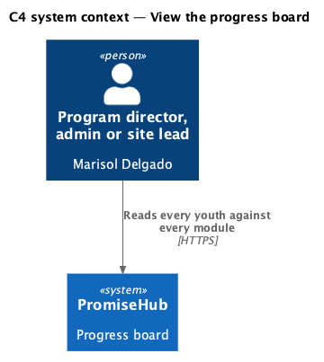
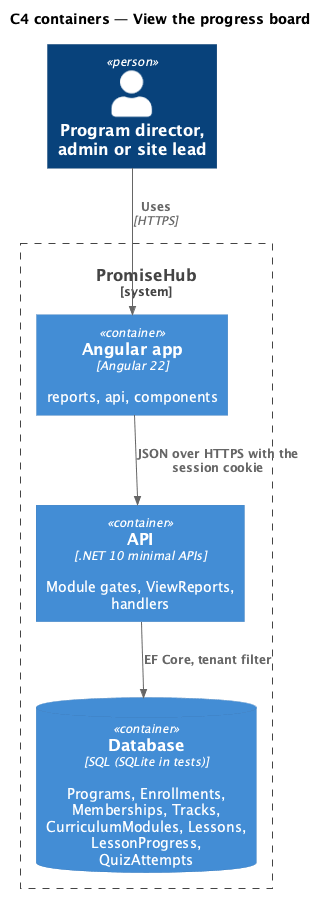
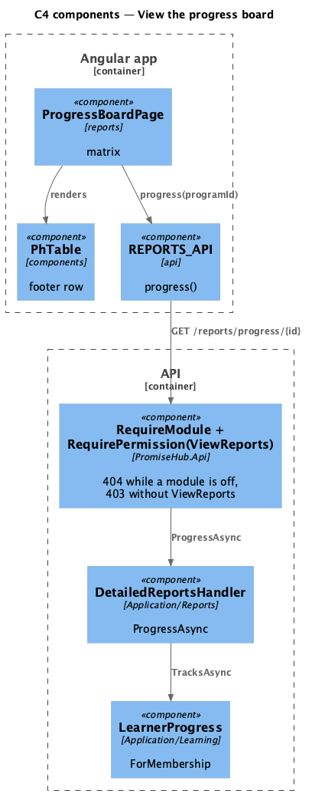
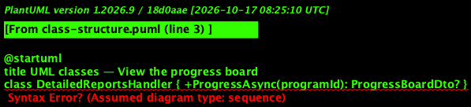
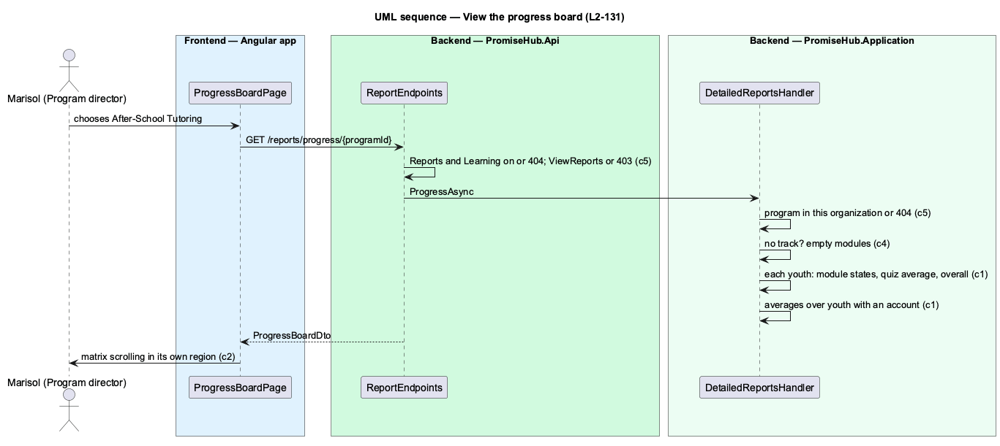

# View the progress board

## Overview

The progress board (`progress-board`) is the spreadsheet programs keep today: one row per youth, one column per module of the cohort's track, each cell saying Done, In progress, Not started or No account, with a quiz average, an overall percent and a cohort average row underneath. It exists only while Learning is on.

On a phone the matrix scrolls sideways inside its own frame (`PhTable`'s scrolling region), never the page. It refreshes when reopened; live updates are deferred (ADR 0074).

Ported from Waypoint's `program-administration/view-progress-board` design (`L2-ADMIN-004`).

## Description

Frontend:

- **`ProgressBoardPage`** (`frontend/projects/reports/`, mounted at `/reports/progress` while Reports and Learning are on) — the cohort `ph-select` (from `PROGRAMS_API.list('active')`, the first by default, the choice in `?programId=`), the key of `ph-badge`s, the `ph-table` with a badge cell per module and the footer row for the cohort average, Export CSV (`kind: 'Progress'`); empty, no track, loading, error and forbidden.
- **`PhTable`** (`frontend/projects/components/`) — gains the `footer` input: a `tfoot` row whose first cell is a row header (design system: table, footer row).
- **`REPORTS_API.progress(programId)`** — `ProgressBoard`.

Backend:

- **`DetailedReportsHandler.ProgressAsync(programId)`** — the program or not found; its track's published modules in order; each actively enrolled child; with a youth membership, `LearnerProgress.ForMembership` for that track's `ModuleStatus` (Done when complete, InProgress with lessons done, NotStarted otherwise), best quiz scores and lessons done; the averages over youth with an account.
- **`ProgressBoardDto`**, **`ProgressModuleDto`**, **`ProgressRowDto`**, **`ProgressAverageDto`**.
- **`ReportEndpoints`** — `GET /reports/progress/{programId:guid}` under `RequireModule(Reports)`, `RequireModule(Learning)` and `ViewReports`.

## Built so far

Prompt 80 is building this design; this section lists what is delivered when it merges. <TO SUPPLY>

## Requirements

| L2 ID | Refines (L1) | Requirement |
|-------|--------------|-------------|
| `L2-131` | `L1-023` | While Learning is on, program directors, admins and site leads see every youth of a cohort against every module of its track, the spreadsheet replaced (`progress-board`). |
| `L2-129` | `L1-012` | Every detailed report exports as CSV exactly what it shows for its filters, and nothing a section whose module is off would show. |
| `L2-005` | `L1-002` | Every endpoint of a module that is off answers 404 for that organization, and the frontend never renders, links or prefetches it. |

## Diagrams

A program director, admin or site lead reads the report; youth, mentors and other staff have no access.

The Angular app calls the API; the API reads the module configuration and the tenant on every request.

The page calls one endpoint behind the module and permission gates; the handler computes the report on read.

The board is a matrix of rows and module cells with an average row.

The board reads each youth's progress on the cohort's track through the same LearnerProgress the youth's own pages use.

