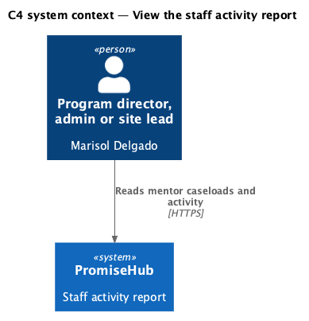
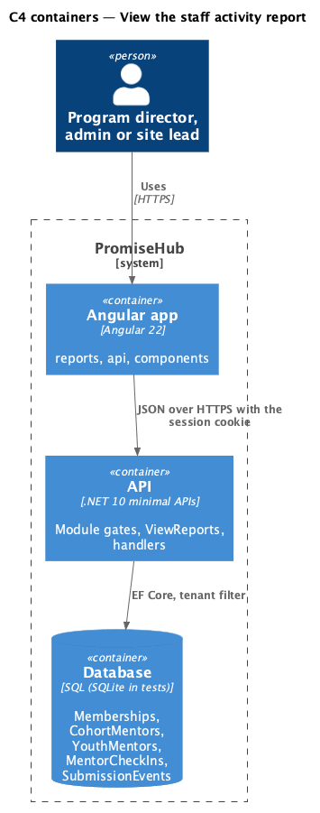
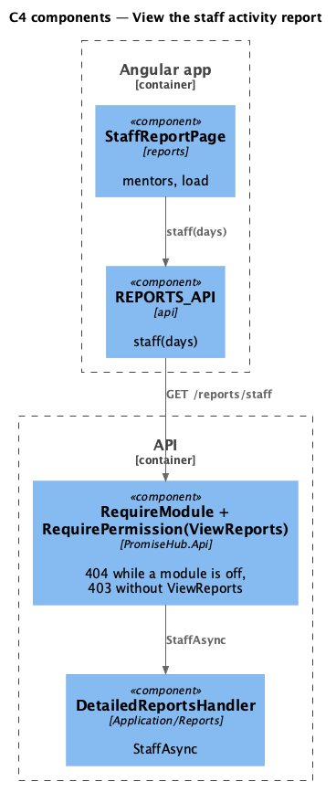
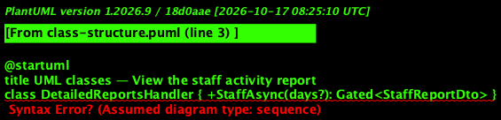
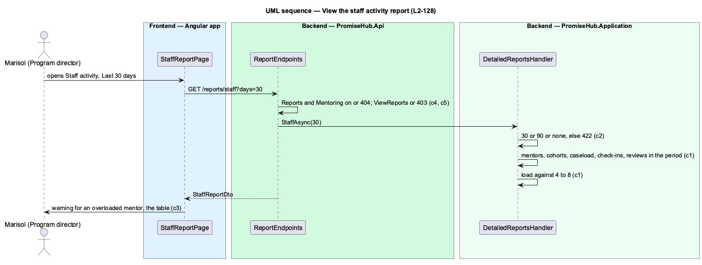

# View the staff activity report

## Overview

The staff activity report (`report-staff`) answers whether mentors are carrying a fair share: how many youth each mentor has, how many check-ins they logged and how much work they reviewed, and whether anyone is overloaded. It exists only while Mentoring is on.

Terms used in this document:

- **caseload** — the youth assigned to a mentor (`YouthMentor`)
- **review** — a submission the mentor accepted or sent back for revision, recorded as a `SubmissionEvent` (`Accepted` or `RevisionRequested`) under the mentor's name
- **load** — `Overloaded` above 8 youth, `Underloaded` below 4, otherwise `Balanced` (Waypoint's target of 4 to 8)

Ported from Waypoint's `reporting-and-data/view-staff-report` design (`L2-REPORT-001` criterion 4).

## Description

Frontend:

- **`StaffReportPage`** (`frontend/projects/reports/`, mounted at `/reports/staff` while Reports and Mentoring are on) — period `ph-select` (All time, Last 30 days, Last 90 days), `ph-stat` totals, the warning `ph-alert` naming an overloaded mentor, the mentor `ph-table` (numeric columns, badge cell for load), Export CSV (`kind: 'Staff'`); empty, loading, error and forbidden.
- **`REPORTS_API.staff(days)`** — `StaffReport`.

Backend:

- **`DetailedReportsHandler.StaffAsync(days)`** — active, not removed, not deactivated Mentor memberships; their `CohortMentor` programs; `YouthMentor` caseload; `MentorCheckIn`s dated within `days` of the organization's today; reviews within `days` while Learning is on (null while off); the totals.
- **`StaffReportDto`**, **`MentorActivityRowDto`** — the answer.
- **`ReportEndpoints`** — `GET /reports/staff?days=` under `RequireModule(Reports)`, `RequireModule(Mentoring)` and `ViewReports`; `days` other than 30 or 90 answers 422.

## Built so far

Prompt 80 is building this design; this section lists what is delivered when it merges. <TO SUPPLY>

## Requirements

| L2 ID | Refines (L1) | Requirement |
|-------|--------------|-------------|
| `L2-128` | `L1-024` | While Mentoring is on, program directors, admins and site leads see each mentor's caseload, check-ins and reviews and whether the load is balanced (`report-staff`). |
| `L2-129` | `L1-012` | Every detailed report exports as CSV exactly what it shows for its filters, and nothing a section whose module is off would show. |
| `L2-005` | `L1-002` | Every endpoint of a module that is off answers 404 for that organization, and the frontend never renders, links or prefetches it. |

## Diagrams

A program director, admin or site lead reads the report; youth, mentors and other staff have no access.

The Angular app calls the API; the API reads the module configuration and the tenant on every request.

The page calls one endpoint behind the module and permission gates; the handler computes the report on read.

One row per mentor, with totals across them.

The Mentoring gate answers 404 before the handler runs while Mentoring is off.

