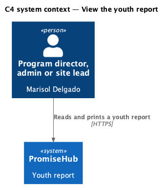
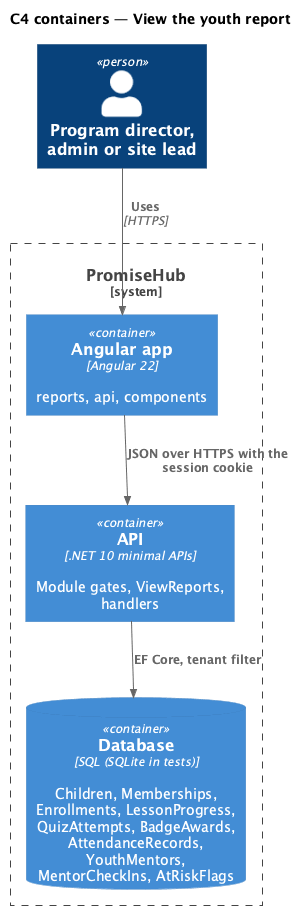
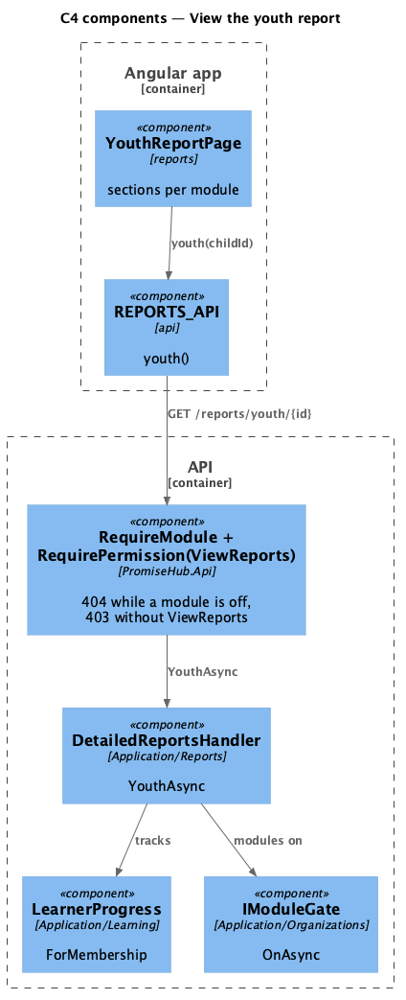
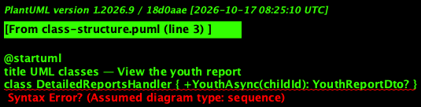
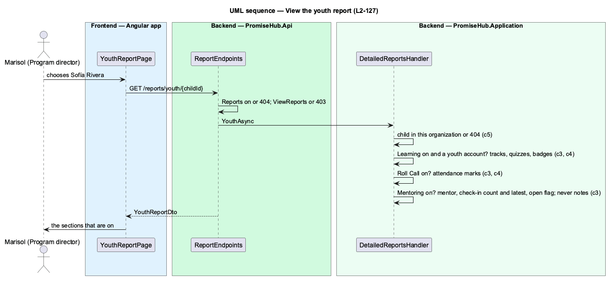

# View the youth report

## Overview

The youth report (`report-youth`) is a printable snapshot of one child for a guardian meeting, a review or a funder: how far through the track they are and how they did in quizzes, how often they came, and how their mentoring is going. It opens from a name on the cohort report.

The child is a Roster child record. Learning lives on the child's **youth account** (a membership linked to the child, ADR 0043), so a child without one, such as Mateo who is 9, has no learning section and the page says so while Learning is on. Mentor check-ins are private to the mentor who wrote them (ADR 0061): the report shows how many there were and the latest date and engagement, never what was said.

Ported from Waypoint's `reporting-and-data/view-youth-report` design (`L2-REPORT-001` criterion 2). Waypoint's competency levels and mentor-notes text are not shown here; competencies stay on the mentor's sheet.

## Description

Frontend:

- **`YouthReportPage`** (`frontend/projects/reports/`, `/reports/youth/:childId`) — `ph-stat` numbers, Learning (`ph-table` of modules with badge cells), Quizzes (`ph-table`), Attendance and Mentoring (`ph-description-list`), the no-account `ph-alert`, Print (`window.print`); loading, error, forbidden and not found.
- **`REPORTS_API.youth(childId)`** — `YouthReport`.

Backend:

- **`DetailedReportsHandler.YouthAsync(childId)`** — the child inside the tenant filter or not found; active programs; the youth membership (`Membership.ChildId`, not removed); `LearnerProgress.ForMembership` tracks, best quiz scores and `BadgeAwards` while Learning is on; `AttendanceMarks` over every marked record while Roll Call is on; the child's `YouthMentor`, `MentorCheckIn` count, the latest date and engagement and an open `AtRiskFlag` while Mentoring is on.
- **`YouthReportDto`**, **`YouthLearningDto`**, **`YouthModuleDto`**, **`YouthQuizDto`**, **`YouthAttendanceSummaryDto`**, **`YouthMentoringDto`**.
- **`ReportEndpoints`** — `GET /reports/youth/{childId:guid}`.

## Built so far

Prompt 80 delivered everything above: `DetailedReportsHandler.YouthAsync`, `GET /reports/youth/{childId}`, `YouthReportPage` with the no-account alert, Print, not found, error and forbidden, and the fake API's youth report. Acceptance tests: `backend/tests/PromiseHub.Api.Tests/YouthReportTests.cs`, `e2e/tests/reports/youth-report.spec.ts`.

Deferred (ADR 0074): competency levels, a printable layout of its own and a youth picker outside the cohort report.

## Requirements

| L2 ID | Refines (L1) | Requirement |
|-------|--------------|-------------|
| `L2-127` | `L1-023` | Program directors, admins and site leads open a cohort report for one program (`report-cohort`) and a youth report for one child (`report-youth`) from Detailed reports on Reports. Each section is shown only while its module is on: learning progress needs Learning, attendance Roll Call, mentoring activity Mentoring. |
| `L2-005` | `L1-002` | Every endpoint of a module that is off answers 404 for that organization, and the frontend never renders, links or prefetches it. |

## Diagrams

A program director, admin or site lead reads the report; youth, mentors and other staff have no access.

The Angular app calls the API; the API reads the module configuration and the tenant on every request.

The page calls one endpoint behind the module and permission gates; the handler computes the report on read.

The youth report composes one record per section from the child, the youth membership and the module configuration.

The child is found in the organization first; each section follows its module.

