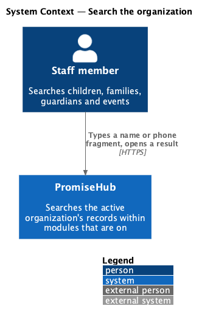
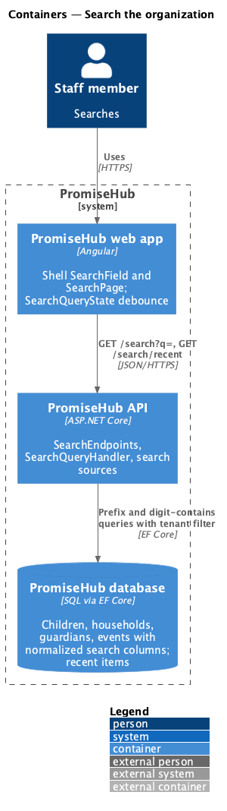
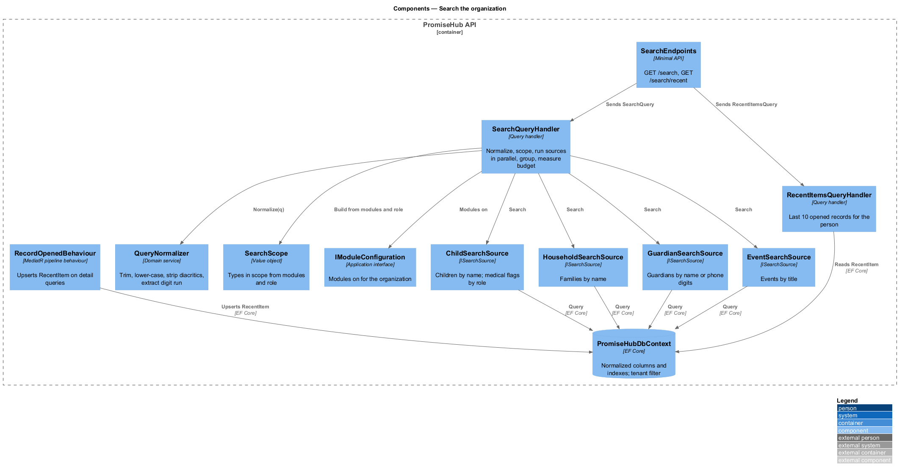
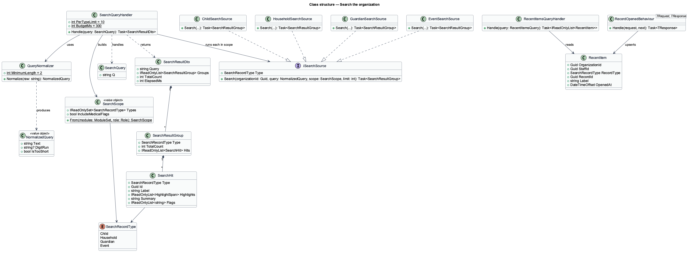
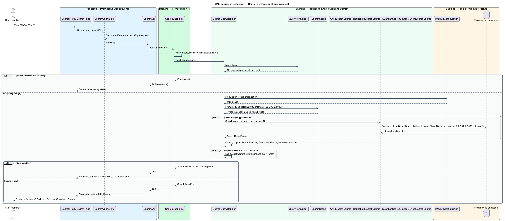

# Search the organization

## Overview

Staff at a youth-serving organization ask the same questions many times a day: which household is this phone number, which program is Sofía in, when is the swim trip. PromiseHub answers them from one search field in the shell. A query returns results grouped by type, children, families, guardians and events, drawn from the active organization only and from modules that are on, within a response budget that keeps typing fluid.

Search is a read over existing records, not a separate index in phase 1. The query runs against the Roster tables and the Events table with the same tenant filter and role checks as every other endpoint, so a result a person cannot open never appears. Phone-number fragments match guardians, because a parent at the door often gives a number before a name.

Local terms:

- **search scope** — set of record types a query may return, derived from the modules that are on and the caller's role
- **result group** — results of one record type, children, families, guardians or events, shown under its own heading with a count
- **phone fragment** — contiguous run of digits typed by the user that is matched against the digits of stored guardian numbers
- **recent items** — records the person opened most recently in this organization, shown before a query is typed
- **highlight** — marked span in a result label showing the matched text

The slice spans the `search` screen in its default, loading, empty (recent items), error and no-results states, and the search field in the shell top bar from 1200 px (`L2-036`).

## Description

### Frontend

The shell (`frontend/projects/promisehub/`) hosts the search field; the page lives in `frontend/projects/promisehub/` as a shell route because it spans modules; both use `frontend/projects/components/` and `SearchApi` from `frontend/projects/api/`.

- **`SearchField`** — component in `frontend/projects/components/` rendered in the top bar from 1200 px and reachable from the More menu on narrower widths. Typing navigates to the search page with the query in the URL; Enter submits.
- **`SearchPage`** — the results (`search`). The query input is autofocused with the placeholder "Child, guardian, phone, event…". A status line announces the result count. Results render as `SearchResultGroup` sections (Children, Families, Guardians, Events) with counts, each row showing the highlighted label, a summary line and trailing flags such as allergy badges. The empty state shows recent items; no-results offers Add family (`L2-039` criterion 4); error offers retry and Browse families.
- **`SearchResultGroup`** — component in `frontend/projects/components/` wrapping a heading with count and the design-system list.
- **`SearchQueryState`** — signal store that debounces keystrokes by 150 ms, cancels an in-flight request when a new one starts, and syncs the query to the URL.
- **`SearchApi`** — behind the `SEARCH_API` injection token: `search(query)` and `recent()`.

The shell composes the search field only when at least one searchable module is on, per the module rules in `shell/compose-navigation`.

### Backend

`PromiseHub.Api` exposes `SearchEndpoints`: `GET /search?q=` and `GET /search/recent`. Both authenticate and resolve the organization. Search is not itself a module; its scope is derived from modules.

Application components in `PromiseHub.Application/Search/`:

- **`SearchQuery`** and **`SearchQueryHandler`** — normalizes the query (`QueryNormalizer`: trim, collapse whitespace, lower-case, strip diacritics for name matching, extract a digit run for phone matching), rejects queries under 2 characters with an empty result, builds the `SearchScope` from `IModuleConfiguration` and the caller's role, runs one `ISearchSource` per type in scope in parallel, and returns `SearchResultDto` with groups ordered Children, Families, Guardians, Events. Each source is capped at 10 results; the response carries each group's total count.
- **`SearchScope`** — value object listing the record types in scope. Children, families and guardians require the Roster module; events require Roster plus Permission slips or Roll Call (events exist for either). Slip results are not a type in phase 1 and are never offered or returned when Permission slips is off (`L2-039` criterion 3). Role restrictions apply per field: a volunteer coordinator receives children without medical flags.
- **`ISearchSource`** with `ChildSearchSource`, `HouseholdSearchSource`, `GuardianSearchSource` and `EventSearchSource`. Each issues one EF Core query with the organization filter (`L2-001`) and a prefix match on normalized name columns; `GuardianSearchSource` also matches the digit run against `Guardian.PhoneDigits` with a contains match (`L2-039` criterion 2). Each source returns `SearchHit` with id, label, highlight spans, summary and flags.
- **`RecentItemsQueryHandler`** — reads `RecentItem` rows for the person and organization, newest first, 10 at most. `RecordOpenedBehaviour`, a MediatR pipeline behaviour on detail queries (`GetChildQuery`, `GetHouseholdQuery`, `GetEventQuery`), upserts a `RecentItem`.
- **`SearchBudget`** — the handler measures its own elapsed time and logs a warning when it exceeds 300 ms (`L2-039` criterion 1); the Playwright suite asserts the budget against the fake API, and the integration suite asserts it against the seeded database.

Domain in `PromiseHub.Domain/Search/`: `SearchHit`, `SearchScope`, `RecentItem` (`OrganizationId`, `StaffId`, `RecordType`, `RecordId`, `Label`, `OpenedAt`).

`PromiseHub.Infrastructure` adds persisted normalized columns `Child.SearchName`, `Household.SearchName`, `Guardian.SearchName` and `Guardian.PhoneDigits`, maintained by EF Core value generation on save, with indexes `(OrganizationId, SearchName)` and `(OrganizationId, PhoneDigits)` so prefix and contains matches stay within budget on the roster sizes of phase 1. Searching is not audited; opening a result is audited by the detail query where `L2-032` requires it.

### Undecided details

- Whether phone matching should also accept formatted input with separators beyond digit extraction is `<TO SUPPLY>`.
- Whether a dedicated full-text index replaces the normalized columns above a roster size threshold is `<TO SUPPLY>`.
- Whether the cross-tenant search test in `L2-001` criterion 1 is satisfied by the global query filter alone or by an explicit assertion per source is a test-design choice left to implementation.

## Requirements

The feature realizes the following level-2 (L2) requirement and enforces the cross-cutting ones listed with it.

| L2 ID | Refines (L1) | Requirement |
|-------|--------------|-------------|
| `L2-039` | `L1-021` | Search covers children, households, guardians and events of the active organization, scoped to modules that are on. |
| `L2-001` | `L1-001` | Every tenant-owned table carries the organization id; every query, search, export and background job filters by the organization of the signed-in person's active membership, never by a value from the client. |
| `L2-005` | `L1-002` | A module that is off is neither served nor rendered. |
| `L2-007` | `L1-003` | Permissions are enforced per endpoint and per field by role; the UI reflects them but never substitutes for them. |

## Diagrams

### System context

Staff search PromiseHub from the shell; no external system takes part.

### Containers

The shell search field and page call the API, which queries the roster and events tables.

### Components

`SearchQueryHandler` builds the scope from modules and role and fans out to one source per type.

### Class structure

`SearchQueryHandler` depends on `QueryNormalizer`, `SearchScope` and the `ISearchSource` implementations, and returns grouped `SearchHit` results.

### Behaviour — search by name or phone fragment

The page debounces, the handler normalizes, scopes by module and role, runs the sources in parallel and returns grouped results within 300 ms or the no-results state.

