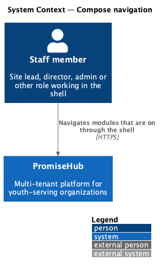
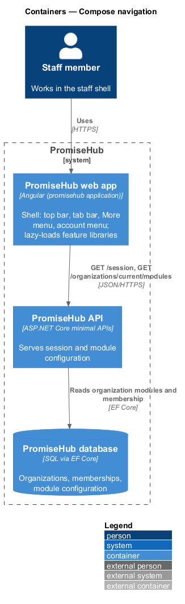
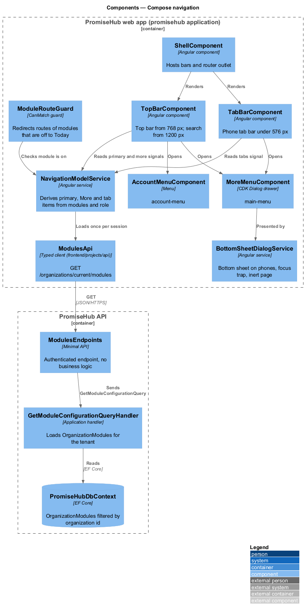
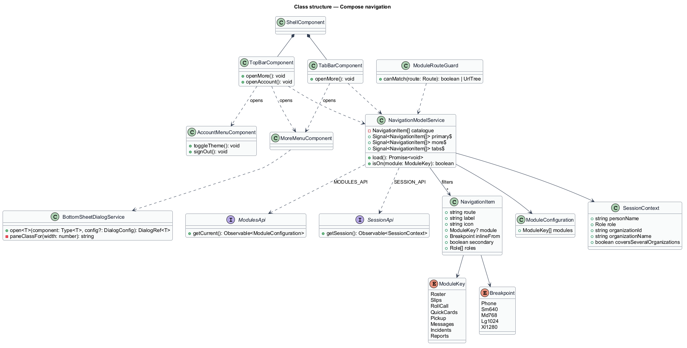
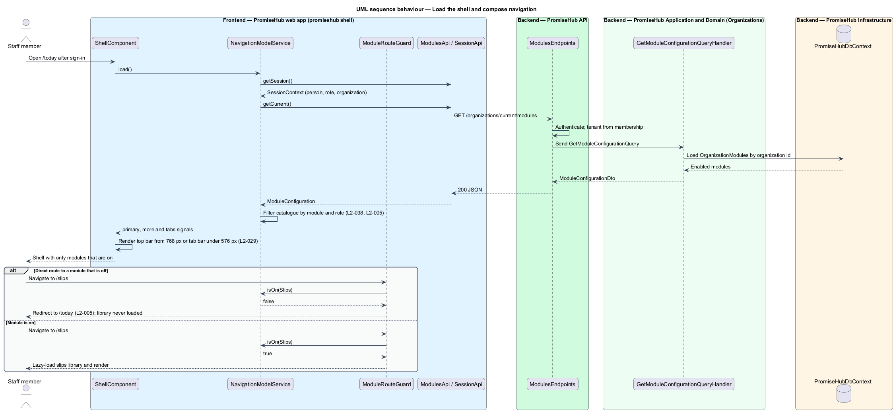
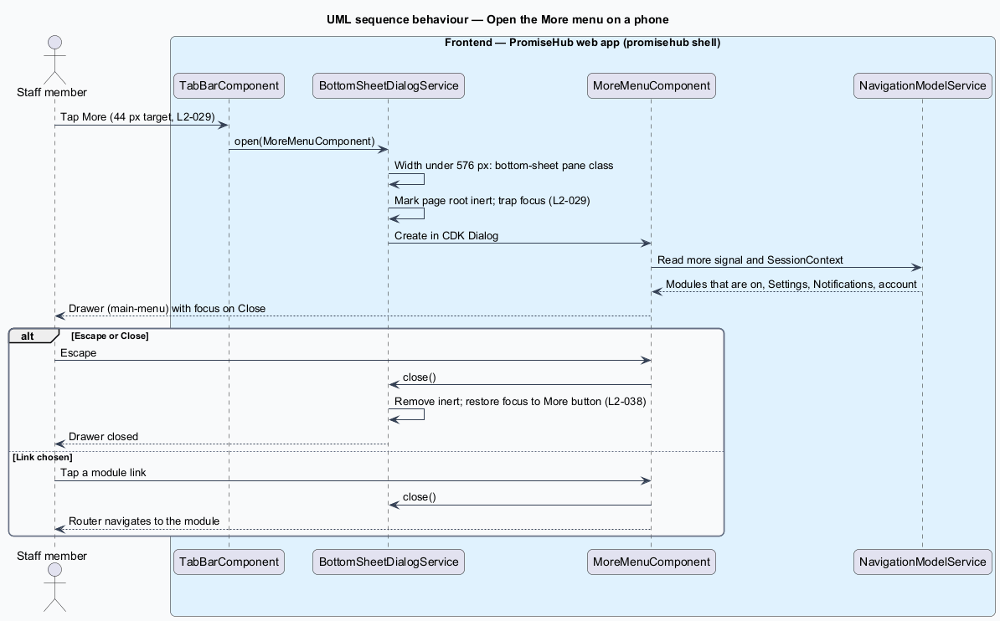

# Compose navigation

## Overview

PromiseHub is a multi-tenant, phone-first web application for youth-serving organizations. Staff work inside one shell: the `promisehub` Angular application in `frontend/projects/promisehub/`, which owns the top bar, the phone tab bar, the More menu drawer and the account menu, and lazy-loads one feature library per module. This feature covers how that shell composes its navigation from two inputs: the active organization's module configuration and the signed-in person's role.

Every PromiseHub feature is a module that an organization switches on or off (`L1-002`). The shell renders, links and prefetches only modules that are on. Incidents and Settings live in the More menu at every width and never appear inline. On phones, dialogs present as bottom sheets with focus trapped and the page behind inert.

- **module configuration** — per-organization set of modules that are on, read once per session from the API
- **navigation model** — ordered list of navigation items the shell derives from the module configuration and the role
- **top bar** — header shown from 768 px with Today, Check-in, Families, Events and More, extended by Programs, Messages and Reports from 1024 px
- **phone tab bar** — bottom navigation shown under 640 px with Today, Check-in, Families, Events and More
- **More menu** — drawer (`main-menu`) listing every module that is on plus Settings, Notifications and account
- **account menu** — menu (`account-menu`) off the avatar showing the person, role, organization, theme toggle and sign out
- **bottom sheet** — dialog presentation on a phone that anchors to the bottom edge, traps focus and makes the page inert
- **touch target** — hit area of an interactive control, at least 44 by 44 CSS pixels

## Description

The slice runs from the shell components in the `promisehub` application to the endpoint that returns the module configuration. The frontend owns composition; the backend owns the configuration and its enforcement (`L2-005` server behaviour is designed in `organizations/enforce-module-gates`).

### Frontend — `frontend/projects/promisehub/`

- **`ShellComponent`** — root layout component. It renders `TopBarComponent` from 768 px and `TabBarComponent` under 640 px, hosts the router outlet, and applies the layout container.
- **`NavigationModelService`** — derives the navigation model. It reads the `SessionContext` (person, role, active organization) and the module configuration from `MODULES_API`, filters `NAVIGATION_ITEMS` by module and role, and exposes `primary$`, `more$` and `tabs$` as signals.
- **`NAVIGATION_ITEMS`** — static catalogue of navigation items. Each item names its route, label, icon, the module it belongs to (`Roster`, `Slips`, `RollCall`, `QuickCards`, `Pickup`, `Messages`, `Incidents`, `Reports`, or none), the minimum breakpoint at which it is inline, and whether it is secondary (More only).
- **`TopBarComponent`** — composes the `top-bar` library component with the brand mark, the organization name, the organization switcher when the person covers more than one organization, the primary links, the search field from 1280 px, the notification bell and the avatar trigger. It applies the `L2-038` overflow rules through the breakpoint classes of the navigation model.
- **`TabBarComponent`** — composes the `bottom-navigation` library component with Today, Check-in, Families, Events and More, each item only when its module is on (`L2-029` criterion 4).
- **`MoreMenuComponent`** — opens the `drawer` library component as a CDK Dialog (`main-menu`). It lists every module that is on, then Settings, Notifications and "Your account", then Sign out, and shows the person and role in the footer. Escape closes it.
- **`AccountMenuComponent`** — opens the `menu` library component (`account-menu`) with the person's name, role and organization, "Your account", Notifications, Switch theme and Sign out.
- **`BottomSheetDialogService`** — thin wrapper over the CDK `Dialog`. It picks the bottom-sheet pane class under 640 px and the centred pane class otherwise. It sets `aria-modal`, traps focus and marks the page root `inert` while open (`L2-029` criterion 3).
- **`ModuleRouteGuard`** — `CanMatch` guard on each lazy route. It allows the route when the module is on and redirects to Today otherwise, so the module's library is never loaded.
- **`today`** feature library (`frontend/projects/today/`) — the home route. `TodayPageComponent` composes its cards only for modules that are on, which the `today/single-module` mock illustrates.

### Frontend — `frontend/projects/api/`

- **`ModulesApi`** (`MODULES_API` token) — typed client for `GET /organizations/current/modules` returning `ModuleConfiguration` (`modules: ModuleKey[]`).
- **`SessionApi`** (`SESSION_API` token) — returns the signed-in person, role and active organization. The shell reads both once after sign-in and caches them for the session.

### Frontend — `frontend/projects/components/`

`top-bar`, `bottom-navigation`, `drawer`, `menu`, `dialog`, `avatar`, `badge` and `brand-mark` are the library components used. The library enforces the 44 px touch target on buttons, chips, switches and list links through its size tokens. The shell never overrides them.

### Backend

- **`ModulesEndpoints`** (`PromiseHub.Api`) — `GET /organizations/current/modules`, authenticated, no business logic. It dispatches `GetModuleConfigurationQuery`.
- **`GetModuleConfigurationQueryHandler`** (`PromiseHub.Application/Organizations/`) — loads the `OrganizationModules` aggregate for the tenant taken from the membership and returns `ModuleConfigurationDto`.
- **`OrganizationModules`** (`PromiseHub.Domain`) — entity holding the set of enabled modules and their dependencies.
- **`PromiseHubDbContext`** (`PromiseHub.Infrastructure`) — persists `OrganizationModules`, filtered by organization id.

### Rules the shell enforces

- Programs, Messages and Reports are inline from 1024 px and in More below that. Incidents and Settings are in More at every width.
- The search field appears from 1280 px and keeps at least 9 rem of width.
- Items of modules that are off are absent from the DOM, not hidden. No route, bundle or request of such a module is prefetched.
- The role filters items the person may not open. The server remains the authority (`L2-007`).
- The breakpoints are the design system's `--layout-breakpoint-*` tokens (640, 768, 1024 and 1280 px); `L2-036` names the same values, so the shell and the tokens agree.

## Built so far

Slice 33 composed Today from the modules that are on: `GET /today` (`TodayHandler`, ADR 0027) gives counts, slips due, what is coming up and the work waiting, and the page renders a card only for a module that is on, with skeletons while loading.

Slice 01 delivered the shell (`Shell` in the app) composed from `ph-skip-link`, `ph-top-bar`, `ph-bottom-navigation` and the `ph-nav-drawer` More menu (CDK Dialog, closes on Escape). Navigation is a static list until module configuration (slice 03) filters it. The avatar opens the same drawer until the account menu arrives with sign-out (slice 02).

## Participant shells (prompt 49)

- **Roles on sections.** Each `Section` in `shell/navigation.ts` may name the roles it serves; a section without roles serves the five staff roles. `navigationFor(modules, role)` keeps a section only when its module is on and the role is served. Staff keep today's sections plus Curriculum (Learning; Admin and Program director) in More. Youth get Today, Learning, Notifications and Your account; mentors Today, Mentoring, Notifications and Your account; volunteers Today, Check-in, Notifications and Your account (`L2-038` criteria 6 to 8).
- **Search.** `PhTopBar` gains a `searchable` input; the shell sets it false for participant roles, so no search field renders.
- **Today.** `TodayPage` reads the role from the session. For a participant role it renders a welcome and one card per module that is on and serves the role, through `ParticipantToday`, and never calls `GET /today`; the staff summary stays unchanged.
- **Libraries.** `learning`, `curriculum` and `mentoring` export `routes` with one placeholder page each, composed of `ph-page-header`, `ph-card` and `ph-empty-state`; `website` exports `routes` with the public page, loaded at `/site/:slug` outside the shell.

## Requirements

| L2 ID | Refines (L1) | Requirement |
|-------|--------------|-------------|
| `L2-029` | `L1-014` | Every staff screen works in a phone browser at 360px with the bottom tab bar, touch targets of at least 44px and no horizontal scroll. |
| `L2-038` | `L1-021` | The top bar, More menu, phone tab bar and account menu reflect modules, role and organization and never overflow. |
| `L2-005` | `L1-002` | A module that is off is neither served nor rendered. |

## Diagrams

### System context

Staff use the PromiseHub web app. The shell composes navigation from the organization's module configuration served by PromiseHub.

### Containers

The `promisehub` application reads the module configuration and session from the PromiseHub API, which reads the organization's settings from the database.

### Components

Inside the web app, `NavigationModelService` feeds `TopBarComponent`, `TabBarComponent`, `MoreMenuComponent` and `ModuleRouteGuard`. The API side is one endpoint and one query handler.

### Class structure

`NavigationModelService` filters `NavigationItem` entries by `ModuleConfiguration` and `SessionContext`. `ModuleRouteGuard` and the two bars read its signals.

### Behaviour — load the shell and compose navigation

After sign-in the shell loads the session and module configuration once, derives the navigation model, and renders only modules that are on. A direct route to a module that is off redirects to Today.

### Behaviour — open the More menu on a phone

The More button opens the drawer as a bottom sheet through `BottomSheetDialogService`. Focus is trapped, the page is inert, and Escape closes it.

