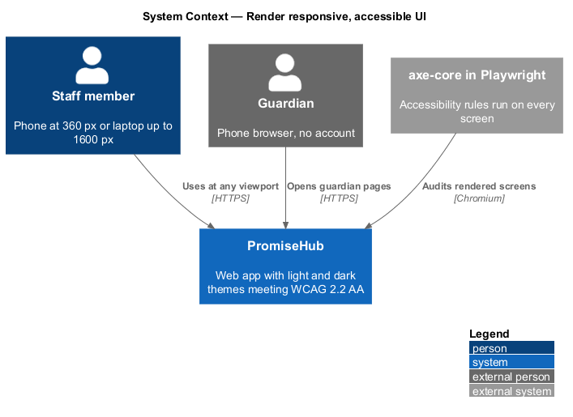
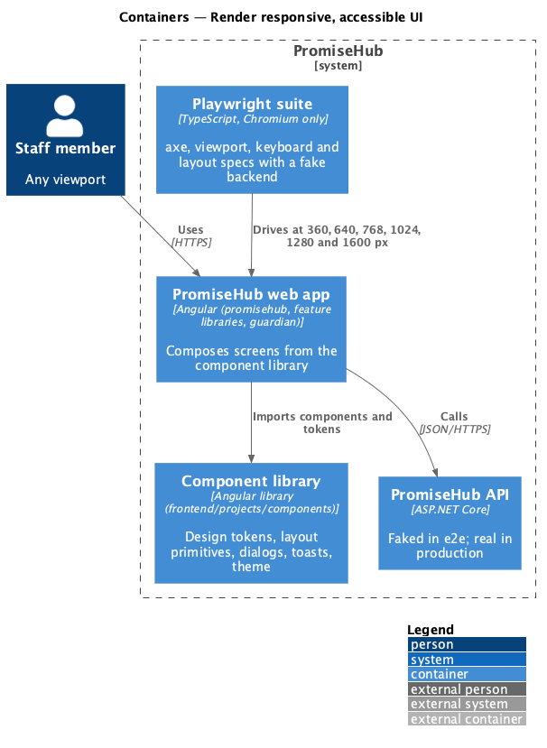
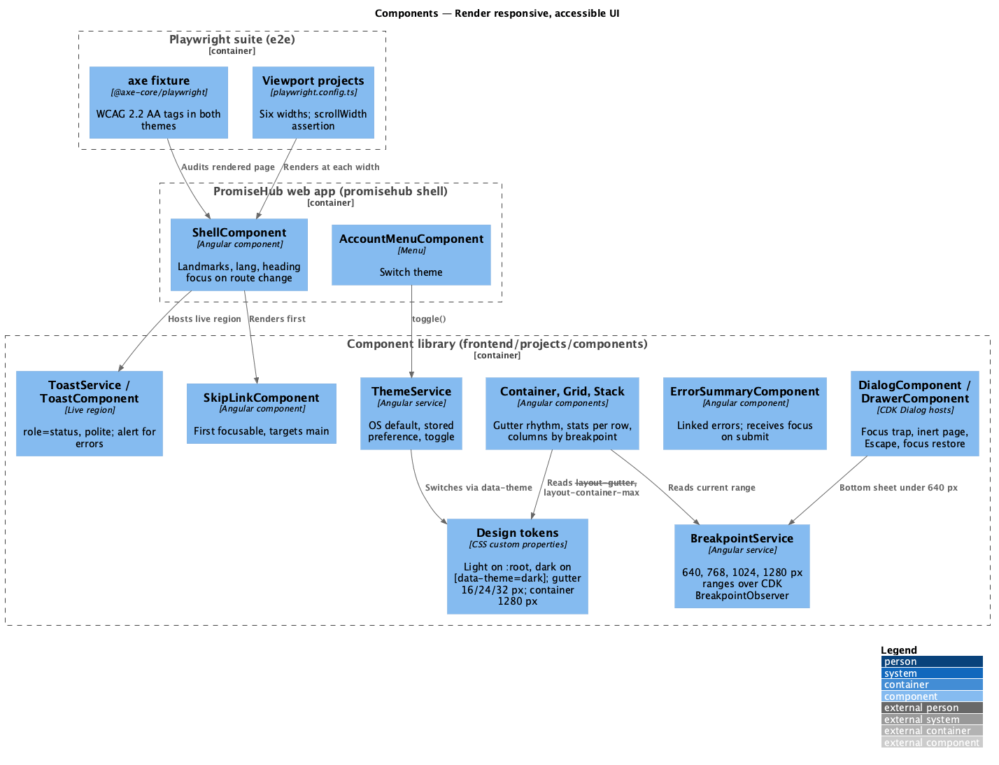
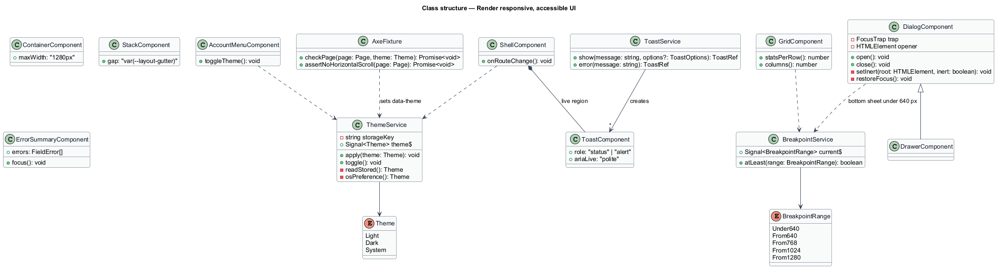
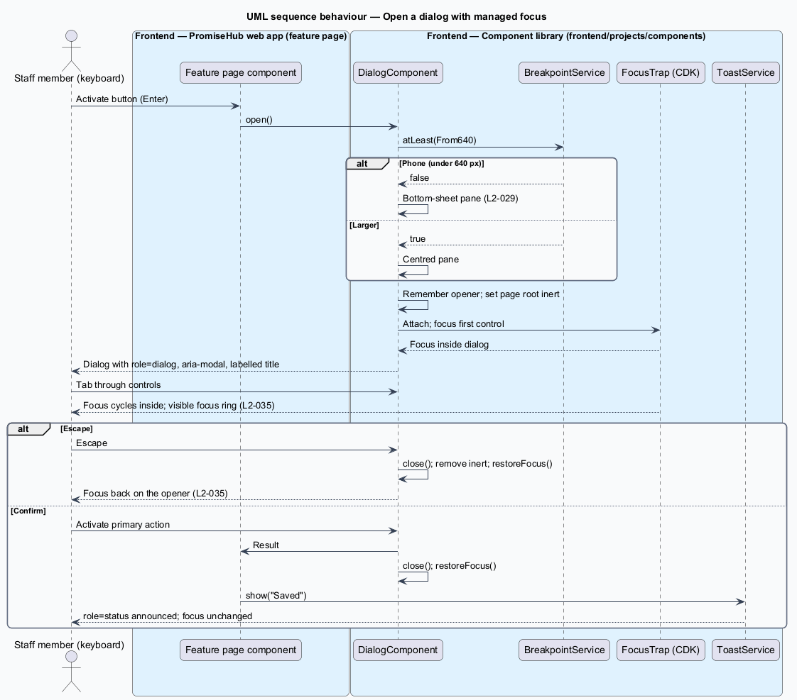
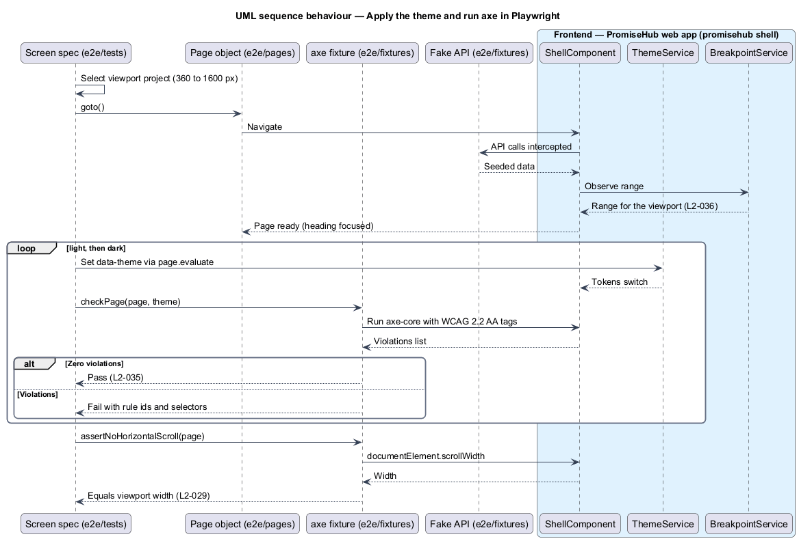

# Render responsive, accessible UI

## Overview

PromiseHub staff use the same web application on a 360 px phone at a check-in table and on a laptop in the office. Guardians open lightweight pages on their own phones. Every screen shall meet WCAG 2.2 AA in a light and a dark theme and shall adapt across the viewport widths the specification names, with no horizontal page scroll.

This feature is cross-cutting. It designs the layout and theming foundations in the shared component library `frontend/projects/components/`, the shell behaviour in `frontend/projects/promisehub/` that depends on them (breakpoint detection, theme application, focus management for dialogs and toasts), and the Playwright checks in `e2e/` that prove the result on every screen. Feature libraries compose screens from the library and inherit the behaviour without local code.

- **breakpoint** — viewport width at which the layout changes: 640, 768, 1024 and 1280 px, with 360 px the smallest supported phone and 1600 px the widest tested width
- **layout container** — centred block that limits content width to 1280 px from the largest breakpoint
- **layout gutter** — vertical and horizontal gap between sections and columns: 16 px under 768 px, 24 px from 768 px, 32 px from 1024 px
- **design token** — named CSS custom property read by role (`--color-brand-foreground`, `--layout-gutter`) and defined in `frontend/projects/components/` from `docs/design-system/tokens/`
- **theme** — light or dark set of token values, applied through `data-theme` on the document root and defaulting to the operating system preference
- **focus trap** — behaviour that keeps keyboard focus inside an open dialog and returns it to the opener on close
- **axe** — accessibility rules engine run by Playwright against each rendered screen

## Description

### Frontend — `frontend/projects/components/`

- **Design tokens** (`tokens/tokens.css`, exported by the library) — colour, typography, spacing, radius, elevation, motion and layout tokens with the light values on `:root`, dark values under `[data-theme="dark"]` and under `prefers-color-scheme: dark` when no theme is forced. `--layout-gutter` resolves to 16, 24 or 32 px by breakpoint and `--layout-container-max` to 1280 px. The breakpoint tokens `--layout-breakpoint-sm/md/lg/xl` are 640, 768, 1024 and 1280 px, the values `L2-036` names.
- **`ContainerComponent`, `GridComponent`, `StackComponent`** (`container-grid-stack`) — layout primitives. `Stack` places sections at the layout gutter so no component carries an outer margin (`L2-036` criterion 5). `Grid` renders stats two per row under 640 px and four per row from 768 px, and two-column layouts from 1024 px.
- **`BreakpointService`** — wraps CDK `BreakpointObserver` with the five named ranges and exposes `current$` and `atLeast(bp)`. Shell and library components read it instead of media queries in TypeScript.
- **`ThemeService`** — reads the stored preference, falls back to the OS preference, sets `data-theme` on `document.documentElement`, and exposes `toggle()` to the account menu. It persists the choice in `localStorage` under one key.
- **`DialogComponent`, `DrawerComponent`** — CDK Dialog hosts. They set `role="dialog"`, `aria-modal`, `aria-labelledby`, trap focus with CDK `FocusTrap`, close on Escape, mark the page root `inert` and restore focus to the opener (`L2-035` criterion 2).
- **`ToastService`, `ToastComponent`** — toasts render in an `aria-live="polite"` region (`role="status"`), are reachable by Tab when they hold an action, and never steal focus. Error toasts use `role="alert"`.
- **`ErrorSummaryComponent`** — lists form errors as links to the fields. On submit with errors the form moves focus to the summary, which announces through `role="alert"` (`L2-035` criterion 5).
- **`StatusComponent`, `BadgeComponent`, roster stripes** — every colour-coded status pairs the colour with a word or icon (`L2-035` criterion 4).
- **`SkipLinkComponent`** — first focusable element, targets the main landmark.
- **Focus ring** — one `:focus-visible` style on every interactive component, 3:1 against adjacent colours in both themes.

### Frontend — `frontend/projects/promisehub/`

- **`ShellComponent`** — hosts `SkipLinkComponent`, the `main` landmark, the layout container and the live regions. It sets `lang` on the document and announces route changes by moving focus to the page heading.
- **`AccountMenuComponent`** — calls `ThemeService.toggle()` for Switch theme (`L2-038`).
- **`ShellComponent` overflow rule** — the top bar hides items below their breakpoint and the body uses `overflow-x: clip` only as a defence; the design constraint is that nothing lays out wider than the viewport (`L2-029` criterion 1).

### Frontend — `frontend/projects/guardian/`

Guardian pages use `GuardianShellComponent` from the library: one column, a thin bar, one primary action, the same tokens and both themes.

### Tests — `e2e/`

- **`axe` fixture** (`e2e/fixtures/axe.ts`) — runs `@axe-core/playwright` with WCAG 2.2 AA tags against the page after each page object reports ready. Every screen spec calls it in light and in dark theme (`L2-035` criterion 1, criterion 3).
- **Viewport projects** (`e2e/playwright.config.ts`) — Chromium at 360, 640, 768, 1024, 1280 and 1600 px widths. A shared assertion compares `document.documentElement.scrollWidth` with the viewport width (`L2-029` criterion 1).
- **Keyboard specs** — tab through a page, a dialog and a toast; assert reading order, visible focus ring, focus trap and Escape (`L2-035` criterion 2).
- **Layout specs** — stats per row, stacked filters, phone tab bar and wrapped badges under 640 px; four stats per row and the top bar from 768 px; two columns from 1024 px; search from 1280 px; 1280 px container at 1600 px with the organization switcher (`L2-036`).
- **Contrast** — `docs/design-system/tokens/contrast-pairs.json` is checked by the design-system script; the e2e axe run re-checks rendered pairs.

## Built so far

Prompt 78 (ADR 0072) replaced the planned `ThemeService` and its `localStorage` key: the theme, text size and reduce motion are saved with the person (`StaffUser`) and carried by `GET /me`, and the library's `PhDisplayRoot` sets `data-theme`, `data-text-size` and `data-motion` on the root; the shell applies them once per session and resets them on sign-out, so signed-out and guardian pages follow the device. The choice is made on Display (`configure-display`, `switch-theme`), not in the account menu.

Slice 01 delivered tokens and foundations in the components library, the Today empty state, the five error pages and axe checks on every screen at desktop and phone widths.

## Requirements

| L2 ID | Refines (L1) | Requirement |
|-------|--------------|-------------|
| `L2-035` | `L1-019` | WCAG 2.2 AA on every screen in both themes. |
| `L2-036` | `L1-019` | Layouts adapt at the design system's breakpoints of 640, 768, 1024 and 1280 pixels (its `--layout-breakpoint-*` tokens), from 360 pixel phones up to 1600 pixel screens. |
| `L2-029` | `L1-014` | Every staff screen works in a phone browser at 360px with the bottom tab bar, touch targets of at least 44px and no horizontal scroll. |

## Diagrams

### System context

Staff and guardians reach PromiseHub from phones and laptops. The Playwright suite verifies accessibility and layout against the same application.

### Containers

The web app composes screens from the component library and tokens. The Playwright suite drives Chromium at six widths with a faked backend.

### Components

Tokens, layout primitives, `BreakpointService`, `ThemeService`, dialog and toast hosts live in the component library. The shell wires them to the document.

### Class structure

`ThemeService` and `BreakpointService` are read by the shell and the layout primitives. `DialogComponent` owns the focus trap and `ToastService` the live region.

### Behaviour — open a dialog with managed focus

A button opens a dialog. The host traps focus, makes the page inert and restores focus to the opener on Escape. On a phone the same dialog presents as a bottom sheet.

### Behaviour — apply the theme and run axe in Playwright

A spec sets the viewport and theme, waits for the page object, runs axe and asserts zero violations and no horizontal scroll.

