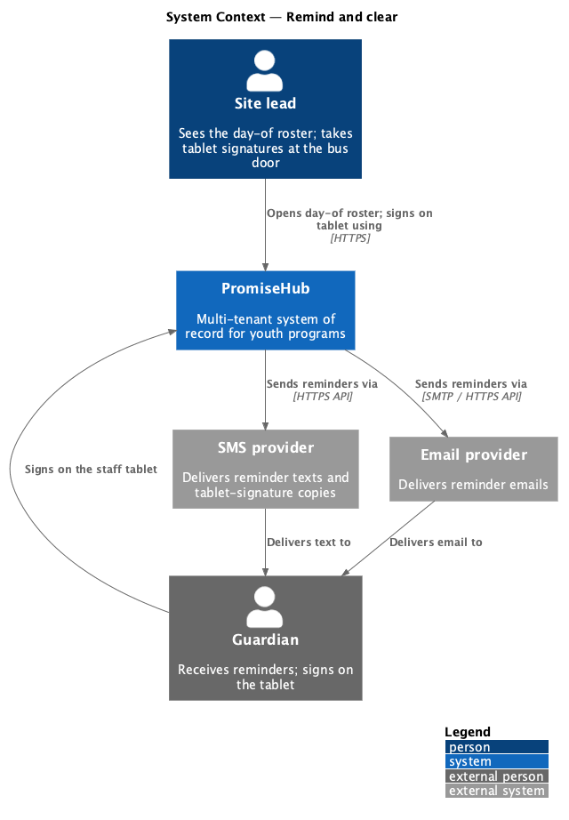
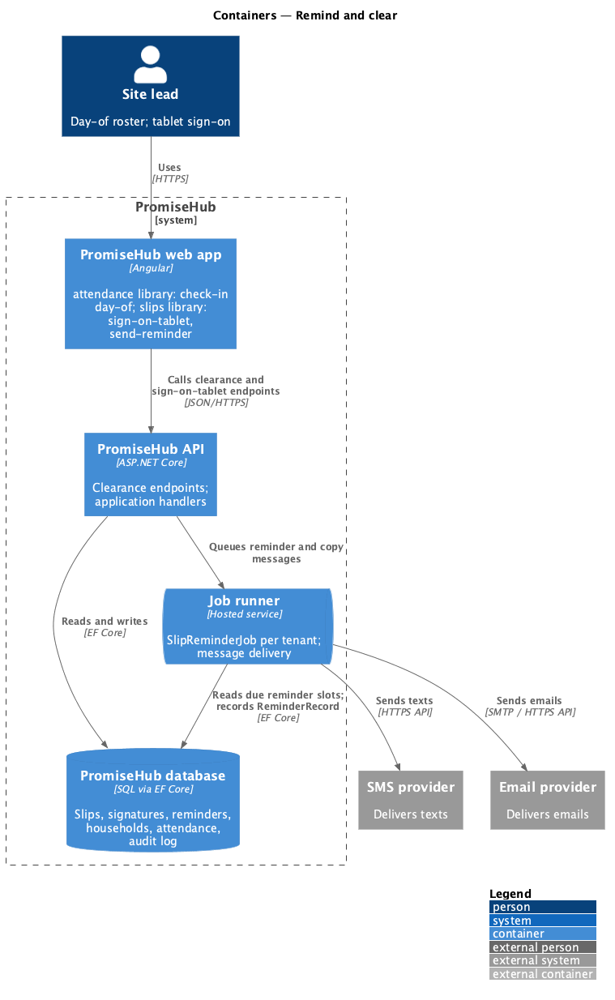
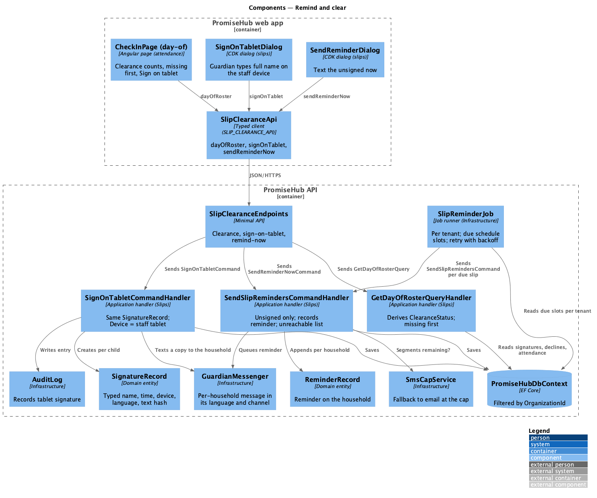
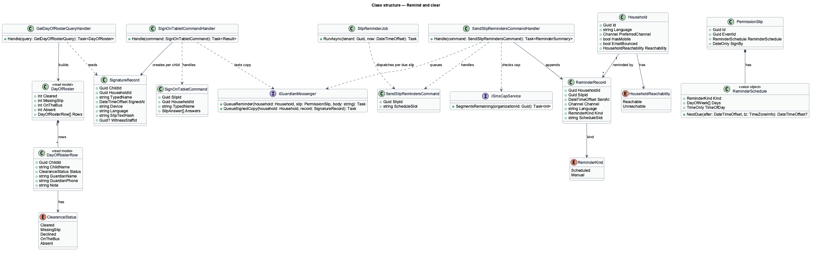
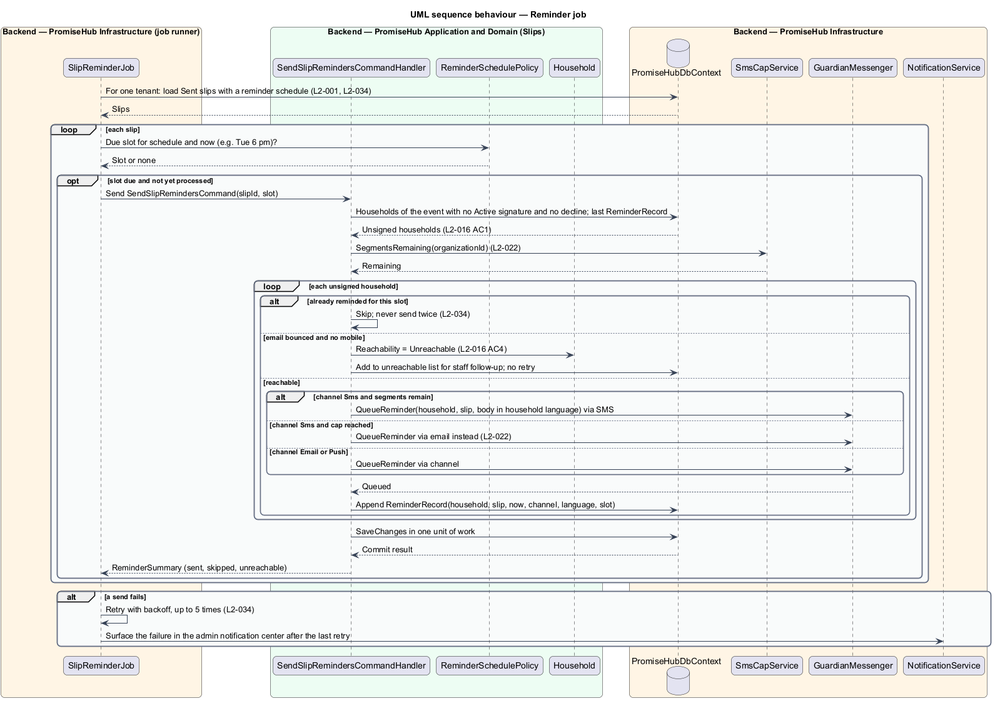
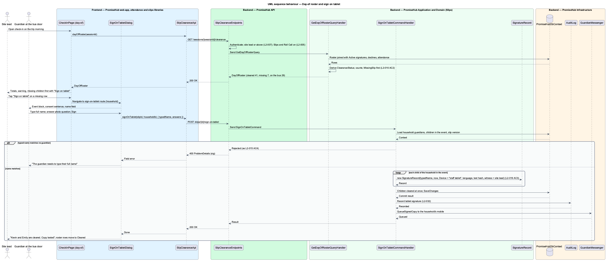

# Remind and clear

## Overview

Once a permission slip is sent, PromiseHub works to get every child cleared before the event. This feature covers the reminder job that follows the slip's reminder schedule, the day-of roster that shows who is cleared, who is missing a slip and who is on the bus, the tablet sign-on fallback at the bus door, and the handling of households that cannot be reached (`L2-016`).

A **reminder** — automatic message to a household that has not signed, sent on the slip's reminder schedule in the household's language and channel, and recorded on the household. Only unsigned households are reminded; a household that signs stops receiving reminders.

A **clearance status** — a child's standing for an event derived from slips and attendance: `Cleared` (slip signed), `MissingSlip` (unsigned), `Declined` (guardian declined) and, once the session is open, `OnTheBus` (checked in with a signed slip) and `Absent`. The day-of roster lists missing children first.

A **tablet sign-on** — signature taken on a staff device at the event, where the site lead hands the tablet to the guardian who types their name. The signature record has the same format as a remote signature, with `Device` set to the staff tablet, and the child is cleared at once.

An **unreachable household** — household whose email bounced and who has no mobile number. The reminder job lists it for staff follow-up instead of retrying.

Local terms used below:

- **reminder schedule** — rule chosen on the slip: twice weekly on set days and time, daily, once two days before, or none (designed in `slips/write-and-send-slip`)
- **day-of roster** — the `check-in/day-of` state of the check-in screen, which adds clearance counts and filters to the session roster
- **manual reminder** — `send-reminder` dialog that texts the unsigned households now with a per-family link

The Permission slips module gates every endpoint here; the day-of roster also needs Roll Call (`L2-005`). Background jobs run per tenant and respect the SMS cap (`L2-022`, `L2-034`).

## Built so far

Slice 13 delivered the reminder job (`ReminderSlots`, `SendDueRemindersHandler`, `SlipReminder` once per slot, unreachable families recorded), `RemindNowHandler` and `SendReminderDialog` with `{child}` and `{link}`, `GET /slips/{id}/unsigned`, the day-of clearance on `CheckInPage` (`GET /sessions/{id}/clearance`, missing first, warning, counts) and `SignOnTabletPage` at `/check-in/:sessionId/sign-on-tablet/:householdId` with the staff member recorded on the signature (ADR 0016). "On the bus" counts, the "Text unsigned" action on check-in and translated reminder copy are not built yet.

## Description

### Frontend

- **`CheckInPage`** in `frontend/projects/attendance/` — the `check-in/day-of` state. When the session's event has a slip, the page shows the trip totals (`Cleared`, `Missing slip`, `On the bus`, `Absent`), the warning that children without a signed slip cannot board, the `Show the 7` and `Text 7 unsigned` actions, filter chips by clearance status and the roster with missing children first. Each missing row carries `Sign on tablet`. The page reads clearance through `SlipClearanceApi` from `frontend/projects/api/` so the attendance library depends only on `api` and `components`.
- **`SignOnTabletDialog`** in `frontend/projects/slips/` — CDK dialog for `sign-on-tablet`, reached through a route the `slips` library exposes (`/check-in/:sessionId/sign-on-tablet/:householdId`) and the shell lazy-loads, so no feature library imports another. It shows the event block, the consent sentence, the `Guardian types their full name` field and the photo question. Success states that the children are cleared and that a copy was texted to the household.
- **`SendReminderDialog`** in `frontend/projects/slips/` — CDK dialog for `send-reminder`: lists the unsigned households with their last reminder, marks unreachable households with `Can't reach`, takes the message with `{child}` and `{link}` placeholders and shows the SMS segment estimate against the cap.
- Components from `frontend/projects/components/`: `roster`, `stat`, `alert`, `chip`, `dialog`, `form-field`, `sms-preview`, `badge`, `list`.

### API client (`frontend/projects/api/`)

- **`SlipClearanceApi`** — contract behind the `SLIP_CLEARANCE_API` token with `dayOfRoster(sessionId)`, `signOnTablet(eventId, householdId, request)` and `sendReminderNow(slipId, request)`. The HTTP implementation calls `/slips`.

### Backend

- **`SlipClearanceEndpoints`** (`PromiseHub.Api`) — minimal-API group: `GET /sessions/{sessionId}/clearance`, `POST /slips/{id}/sign-on-tablet`, `POST /slips/{id}/remind-now`. Staff-authenticated; site leads and above (`L2-007`).
- **`PromiseHub.Application/Slips/`**
  - `GetDayOfRosterQuery` / `GetDayOfRosterQueryHandler` — joins the event roster with signature records, declines and attendance, computes `ClearanceStatus` per child and the four counts, and orders `MissingSlip` first (`L2-016` AC 2).
  - `SendSlipRemindersCommand` / `SendSlipRemindersCommandHandler` — run by the job for one slip: selects households with no `Active` signature and no decline, skips households already reminded in this schedule slot, marks a household `Unreachable` when its email bounced and it has no mobile (`L2-016` AC 4), and for each reachable household queues a reminder in its language and channel through `IGuardianMessenger`, falling back to email at the SMS cap (`L2-022`). Each reminder is appended as a `ReminderRecord` on the household (`L2-016` AC 1).
  - `SendReminderNowCommand` / `SendReminderNowCommandHandler` — the manual `send-reminder` path with a staff-written message; same selection and recording.
  - `SignOnTabletCommand` / `SignOnTabletCommandHandler` — staff-authenticated signing: verifies the household belongs to the event, matches the typed name to a guardian as in `slips/sign-slip`, creates `SignatureRecord`s with `Device = "staff tablet"` and the staff member as witness, clears the children at once, texts a copy of the signed slip to the household and writes an audit entry (`L2-016` AC 3).
  - `ReminderSchedulePolicy` — turns a `ReminderSchedule` into the next due instant per slip in the organization's time zone.
- **`PromiseHub.Domain/Slips/`**
  - `ClearanceStatus` — `Cleared`, `MissingSlip`, `Declined`, `OnTheBus`, `Absent`.
  - `ReminderRecord` — `HouseholdId`, `SlipId`, `SentAt`, `Channel`, `Language`, `Kind` (`Scheduled`, `Manual`).
  - `HouseholdReachability` — `Reachable`, `Unreachable` with `Reason`.
  - `SignatureRecord` — as in `slips/sign-slip`, with `Device` and optional `WitnessStaffId`.
- **`PromiseHub.Infrastructure`**
  - `SlipReminderJob` — job-runner job that runs per tenant, finds slips with a due reminder slot, dispatches `SendSlipRemindersCommand` per slip, retries with backoff up to 5 times and never sends a reminder twice for the same slot (`L2-034`).
  - `GuardianMessenger`, `SmsCapService`, `AuditLog`, `PromiseHubDbContext` as in the other slip features.

Undecided details: the exact SMS copy of the reminder in each language `<TO SUPPLY>`; the staff-witness field on the tablet signature record `<TO SUPPLY>`; the job polling interval `<TO SUPPLY>`.

## Requirements

| L2 ID | Refines (L1) | Requirement |
|-------|--------------|-------------|
| `L2-016` | `L1-006` | Unsigned households are reminded on the slip's schedule; the site lead sees cleared, missing and declined on the day and can have a guardian sign on a tablet. |
| `L2-022` | `L1-010` | Each organization has a monthly SMS segment cap by plan; at the cap, texts pause and email continues. |
| `L2-034` | `L1-018` | Uptime target, backups and resilient jobs. |
| `L2-005` | `L1-002` | A module that is off is neither served nor rendered. |
| `L2-032` | `L1-017` | Every change and every sensitive view is recorded and searchable by admins. |

## Diagrams

### System context

The reminder job reaches guardians through the SMS and email providers; the site lead uses the day-of roster and the tablet sign-on in PromiseHub.

### Containers

The job runner sends reminders per tenant; the `attendance` and `slips` libraries of the web app call the PromiseHub API for the day-of roster and the tablet signature.

### Components

`SlipReminderJob` dispatches `SendSlipRemindersCommand`; `SlipClearanceEndpoints` dispatches the day-of query and the tablet sign-on command. All three read signature records and write through `PromiseHubDbContext`.

### Class structure

`ReminderRecord`s accumulate on a household per slip; `GetDayOfRosterQueryHandler` derives `ClearanceStatus` from signatures, declines and attendance; `SignOnTabletCommandHandler` creates the same `SignatureRecord` as a remote signature.

### Behaviour — reminder job

On the schedule, only unsigned households are messaged, each reminder is recorded on the household (`L2-016` AC 1), unreachable households are listed instead of retried (`L2-016` AC 4) and texts fall back to email at the cap (`L2-022`).

### Behaviour — day-of roster and sign on tablet

The roster shows cleared, missing-slip and on-the-bus counts with missing children first (`L2-016` AC 2). `Sign on tablet` takes the guardian's signature on the device and clears the child at once (`L2-016` AC 3).

