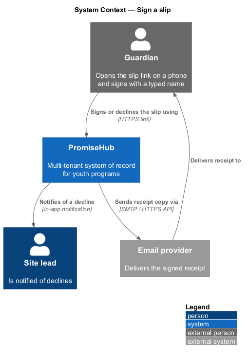
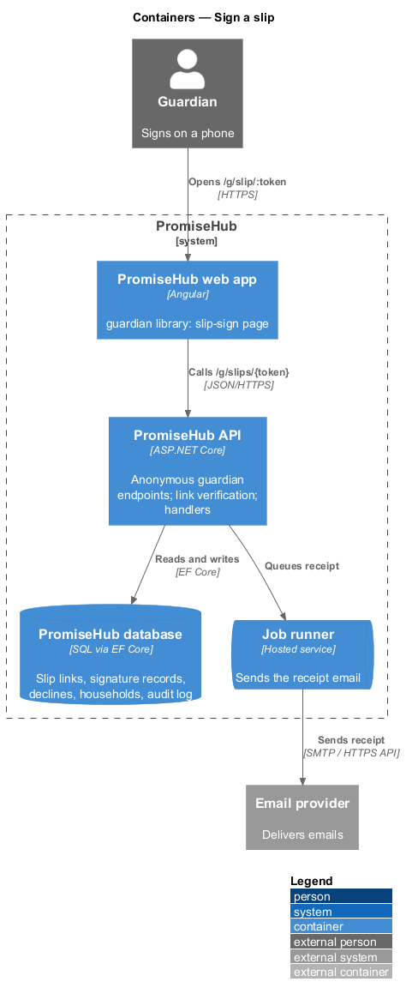
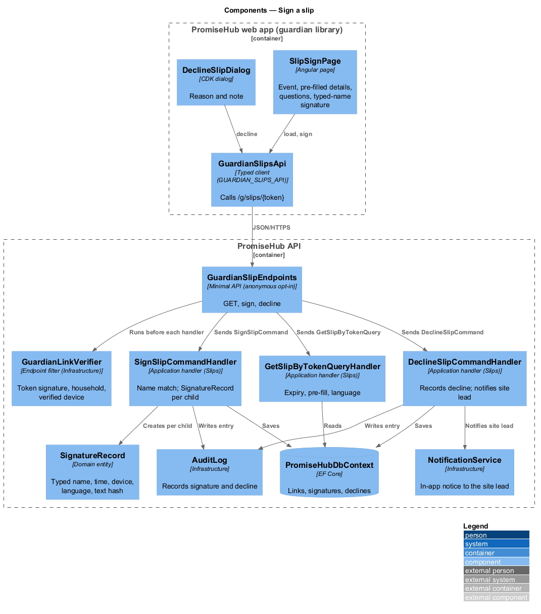
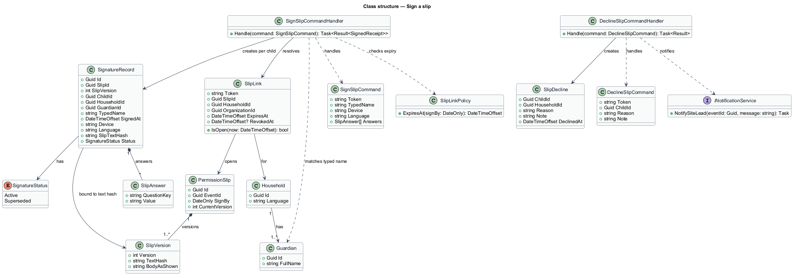
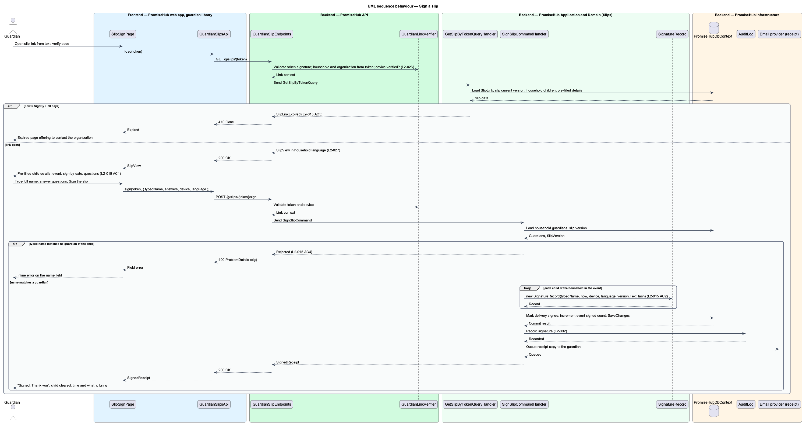
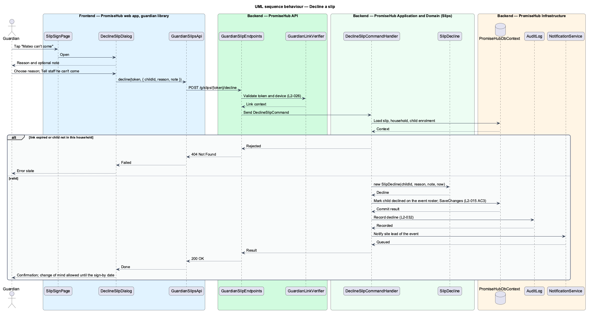

# Sign a slip

## Overview

Guardians in PromiseHub never install an app or create an account. A guardian reaches a permission slip through a link tied to their phone number or email, verifies the device with a six-digit code (designed in `guardian/verify-guardian-link`), and signs with one tap and a typed name. This feature covers the guardian's `slip-sign` page, the signature itself, declining, the name check and link expiry (`L2-015`).

A **signature record** — immutable record of one guardian's consent for one child on one slip version, storing the typed name, the timestamp, the device, the language the slip was shown in and a hash of the slip text as shown. The hash ties the signature to the exact wording; a material edit of the slip (designed in `slips/write-and-send-slip`) supersedes earlier records and asks for a fresh signature.

A **slip link** — signed, unguessable, single-household URL that opens the slip for that household's children. A link stays valid until the slip's sign-by date plus 30 days; after that the expired page offers to contact the organization.

A **decline** — guardian's statement that the child cannot attend. A declined child shows as declined on the roster and the site lead is notified.

Local terms used below:

- **typed name** — guardian's full name typed into the signature field; it shall match a guardian of the child or the signature is rejected
- **device** — user agent and a short device label (`this phone`, `staff tablet`) captured at signing
- **pre-filled details** — child name, allergies, medication and emergency contact copied from the household record so the guardian confirms instead of retyping

The Permission slips module gates the guardian slip endpoints (`L2-005`). Pages render in the household's language (`L2-027`).

## Description

### Frontend (`frontend/projects/guardian/`)

- **`SlipSignPage`** — guardian page for `slip-sign` (`/g/slip/:token`). Sections: the event block, "Please check" with pre-filled child details and a link to update them, the optional questions ("Two quick questions"), and "Sign" with the consent sentence, the full-name signature field, the live signature preview with date and device, the one primary button `Sign the slip` and the ghost `Mateo can't come`. States: `loading`, `invalid` (name missing), `submitting`, `success` (receipt with time, what to bring, calendar link), `error` (answers kept), `expired`, `already-signed` and `es`. The page sets `html lang` to the household language.
- **`DeclineSlipDialog`** — CDK dialog for `decline-slip`: reason (`Away that day`, `Not feeling well`, `Prefer not to say`) and an optional note for staff.
- Components from `frontend/projects/components/`: `guardian-shell`, `slip-event`, `summary`, `radio`, `form-field`, `signature`, `button`, `alert`, `dialog`, `error-summary`.

### API client (`frontend/projects/api/`)

- **`GuardianSlipsApi`** — contract behind the `GUARDIAN_SLIPS_API` token with `load(token)`, `sign(token, request)` and `decline(token, request)`. Requests carry the link token and the verified-device cookie; no staff session is involved.

### Backend

- **`GuardianSlipEndpoints`** (`PromiseHub.Api`) — anonymous-opt-in minimal-API group under `/g/slips/{token}`: `GET /g/slips/{token}`, `POST /g/slips/{token}/sign`, `POST /g/slips/{token}/decline`. Each endpoint runs the `GuardianLinkVerifier` filter, which validates the token signature, resolves the household and organization from the token (never from the client body) and requires a verified device (`L2-026`).
- **`PromiseHub.Application/Slips/`**
  - `GetSlipByTokenQuery` / `GetSlipByTokenQueryHandler` — resolves the `SlipLink`, checks expiry (`SignBy + 30 days`), loads the slip's current version, the household's children enrolled in the event and their pre-filled details, and returns the slip in the household language. An expired link yields `SlipLinkExpired`; an already-signed slip yields the signed state.
  - `SignSlipCommand` / `SignSlipCommandHandler` — validates the typed name against the household's guardians (case- and whitespace-insensitive match on full name `<TO SUPPLY>` exact rule), rejects a mismatch with an inline error (`L2-015` AC 4), stores the question answers, creates one `SignatureRecord` per child with typed name, timestamp, device, language and the current version's text hash (`L2-015` AC 2), marks the delivery signed, increments the event's signed count, writes an audit entry (`L2-032`) and queues a receipt copy to the guardian.
  - `DeclineSlipCommand` / `DeclineSlipCommandHandler` — records a `SlipDecline` with reason and note, marks the child declined on the roster and notifies the site lead through the in-app notification center (`L2-015` AC 3).
  - `SlipLinkPolicy` — computes expiry as `SignBy + 30 days` and the "closed" state once the event has started.
- **`PromiseHub.Domain/Slips/`**
  - `SlipLink` — `Token`, `SlipId`, `HouseholdId`, `OrganizationId`, `ExpiresAt`, `RevokedAt`.
  - `SignatureRecord` — `Id`, `SlipId`, `SlipVersion`, `ChildId`, `HouseholdId`, `GuardianId`, `TypedName`, `SignedAt`, `Device`, `Language`, `SlipTextHash`, `Status` (`Active`, `Superseded`), `Answers`.
  - `SlipDecline` — `ChildId`, `HouseholdId`, `Reason`, `Note`, `DeclinedAt`.
  - `SlipAnswer` — `QuestionKey`, `Value`.
  - `Guardian` (from `Households`) — supplies `FullName` for the name match.
- **`PromiseHub.Infrastructure`** — `GuardianLinkVerifier` validates HMAC-signed tokens of at least 128 bits and the verified-device cookie; `PromiseHubDbContext` maps links, signatures, declines; `AuditLog` records signature and decline; `NotificationService` notifies the site lead; the email provider sends the receipt.

Undecided details: the exact name-matching rule (diacritics, middle names) `<TO SUPPLY>`; the hash algorithm for the slip text `<TO SUPPLY>`; retention period of signature records, which follows the organization's consent retention setting (`L2-030`).

## Requirements

| L2 ID | Refines (L1) | Requirement |
|-------|--------------|-------------|
| `L2-015` | `L1-006` | A guardian signs with one tap and a typed name; the record stores name, time, device and the slip text as shown. |
| `L2-026` | `L1-013` | Guardian pages are reached by links tied to a phone number or email; a six-digit code verifies the device; no password exists. |
| `L2-027` | `L1-013` | Guardian pages, texts and emails are in English, Spanish or French as the household chose; every page has one primary action. |
| `L2-005` | `L1-002` | A module that is off is neither served nor rendered. |
| `L2-032` | `L1-017` | Every change and every sensitive view is recorded and searchable by admins. |

## Diagrams

### System context

A guardian opens the slip link from a text or email and signs in PromiseHub, which emails a receipt copy.

### Containers

The `guardian` library of the PromiseHub web app calls the anonymous guardian endpoints of the PromiseHub API, which stores signature records in the PromiseHub database.

### Components

`GuardianSlipEndpoints` runs `GuardianLinkVerifier` before dispatching to the handlers. `SignSlipCommandHandler` checks the typed name against the household's guardians and writes `SignatureRecord`s.

### Class structure

A `SlipLink` opens one `PermissionSlip` for one household; signing creates one `SignatureRecord` per child bound to the `SlipVersion` text hash.

### Behaviour — sign a slip

The link is verified and the slip loads pre-filled (`L2-015` AC 1). An expired link shows the expired page (`L2-015` AC 5). A typed name that matches no guardian is rejected (`L2-015` AC 4). A valid signature stores the record and increments the signed count (`L2-015` AC 2).

### Behaviour — decline a slip

A decline records the reason, marks the child declined on the roster and notifies the site lead (`L2-015` AC 3).

