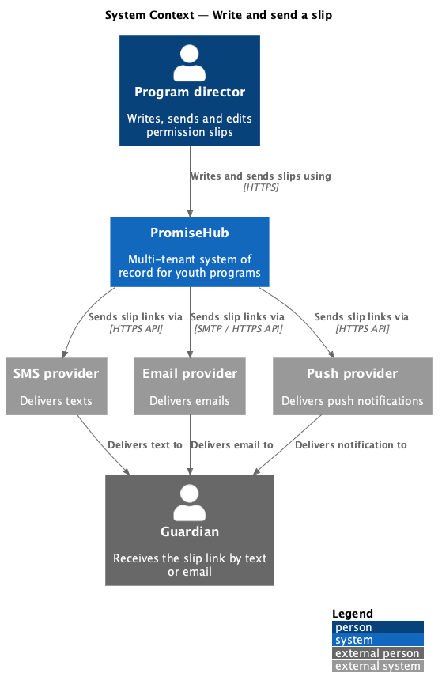
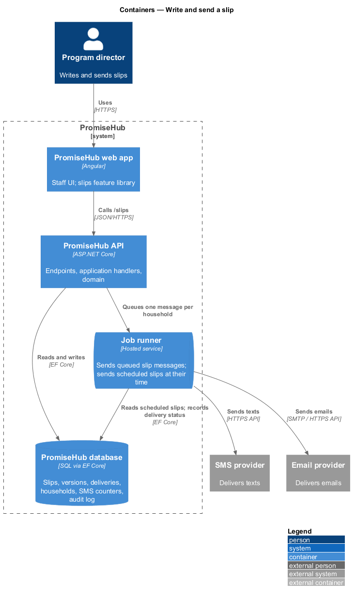
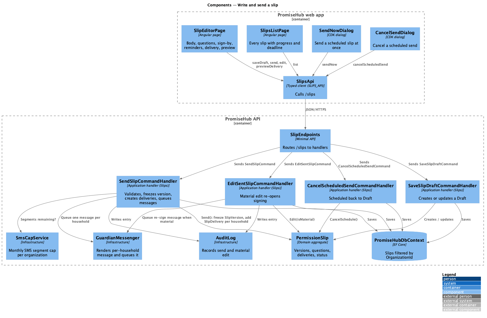
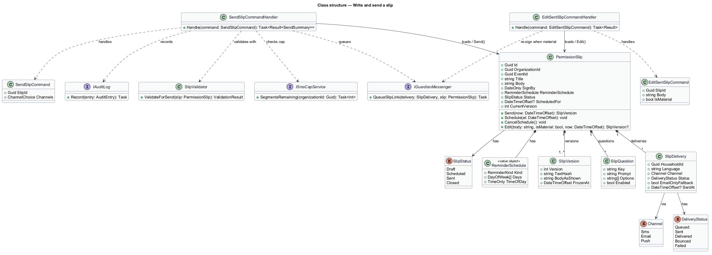
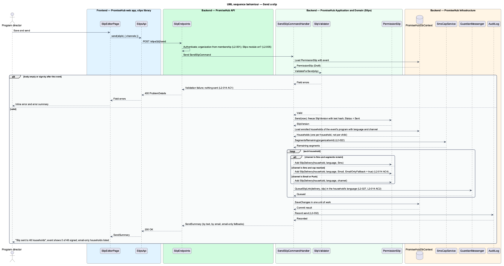
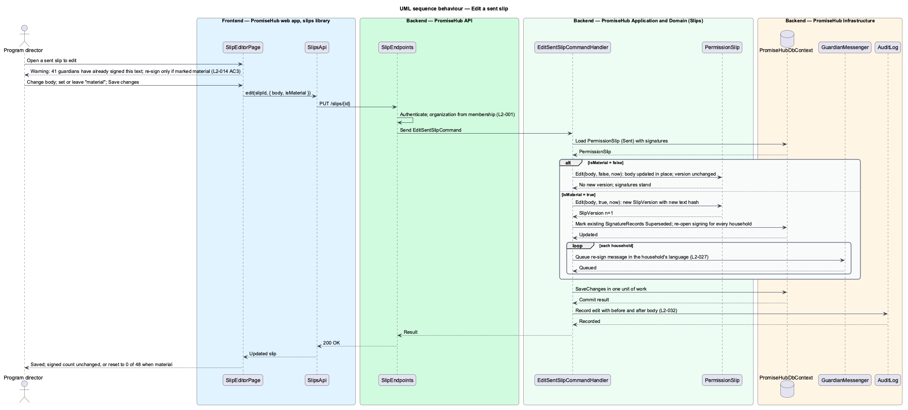
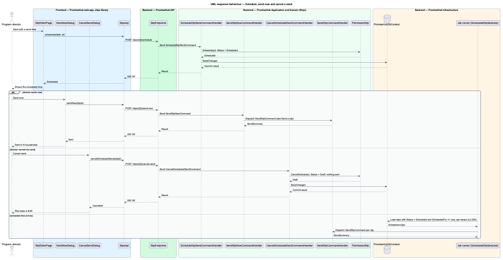

# Write and send a slip

## Overview

PromiseHub replaces paper permission slips with a digital slip that guardians sign on their phone. A **permission slip** — consent document that belongs to one event, with a plain-language body, optional questions, a sign-by date and a reminder schedule. Staff write the slip once, send it by SMS and email link to every enrolled household, and track who has signed. This feature covers writing the slip, sending it, scheduling or cancelling a send, and editing a slip that has already been sent (`L2-014`).

A **slip delivery** — record of the one message sent to one household for a slip, with the household's language, the channel used (`Sms`, `Email` or `Push`) and the delivery status. Sending a slip to 48 enrolled children creates one delivery per household, not per child, in the household's language and preferred channel. When the organization's monthly SMS cap is reached, texts are skipped and the delivery falls back to email; the sender sees which households got email only (`L2-022`).

A **material edit** — change to a sent slip's terms that invalidates existing signatures. Editing the wording of a sent slip warns the editor that signed guardians are asked to re-sign only when the change is marked material. A material edit increments the slip version, stores a new text hash and re-opens signing for every household.

Local terms used below:

- **sign-by date** — date by which guardians are asked to sign; unsigned children stay flagged until the event
- **reminder schedule** — rule for reminding unsigned households, chosen from `Tue and Thu at 6 pm until signed`, `Daily at 6 pm until signed`, `Once, 2 days before` or `None`; the reminder job is designed in `slips/remind-and-clear`
- **slip text hash** — hash of the slip body and questions as shown to the guardian, stored on the slip version and on each signature record

The Permission slips module gates every page and endpoint here (`L2-005`); the Messages module and the SMS cap govern delivery (`L2-021`, `L2-022`).

## Built so far

Slice 11 delivered `SlipsPage` (progress per slip, due date, unsigned badge), `SlipEditorPage` at `/events/:eventId/slip` (the slip, what the guardian confirms, delivery with now, later or not yet, the error summary, the scheduled state with `SendNowDialog` and `CancelSendDialog`, and once sent the signatures, answers by child, the SMS-cap notice and edits with the material switch), `SLIPS_API`, the slip endpoints, `PermissionSlip` and `SlipSignature`, `SlipSender` on the message path and scheduled sends in the per-tenant job (ADR 0014). Translation, per-household links, reminders, the delivery preview in the editor and the list chips are not built yet.

## Description

### Frontend (`frontend/projects/slips/`)

- **`SlipsListPage`** — page component for the `slips` screen (`/slips`). It lists every slip with its progress bar (`41 of 48 · 85%`), deadline and unsigned badge, with the `Open` / `Closed` / `All` chips. It renders the `empty`, `loading`, `error` and `no-results` states.
- **`SlipEditorPage`** — page component for the `slip-editor` screen (`/events/:id/slip`). Cards: the slip (title, body with character count, sign-by, reminders), what the guardian confirms (pre-filled child details and emergency contact always; photo permission, swimming ability and lunch as switches), delivery (`Text and email`, `Email only`, `Don't send yet`) with the SMS usage alert, and a phone preview of the text. Actions: `Save and send`, `Save draft`, and `Save changes` in edit mode. The `edit` state of a sent slip shows the warning that signed guardians re-sign only on a material change and exposes the `This change is material` switch `<TO SUPPLY>` (the mock implies the switch; its exact copy is undecided). An empty body on send renders the inline error and the error summary and sends nothing (`L2-014` AC 1).
- **`SendNowDialog`** — CDK dialog for `send-now`: sends a scheduled slip at once instead of at its scheduled time.
- **`CancelSendDialog`** — CDK dialog for `cancel-send`: cancels a scheduled send; the slip stays a draft.
- Pages compose `page-header`, `card`, `form-field`, `textarea`, `switch`, `radio`, `error-summary`, `alert`, `progress`, `sms-preview`, `dialog` and `badge` from `frontend/projects/components/`.

### API client (`frontend/projects/api/`)

- **`SlipsApi`** — contract behind the `SLIPS_API` injection token with `list(filter)`, `getForEvent(eventId)`, `saveDraft(eventId, request)`, `send(slipId, request)`, `schedule(slipId, at)`, `sendNow(slipId)`, `cancelScheduledSend(slipId)`, `edit(slipId, request)` and `previewDelivery(slipId)` (counts by channel and SMS segments). The HTTP implementation calls `/slips`.

### Backend

- **`SlipEndpoints`** (`PromiseHub.Api`) — minimal-API group under `/slips` and `/events/{eventId}/slip`: `GET /slips`, `GET /events/{eventId}/slip`, `PUT /events/{eventId}/slip` (save draft), `POST /slips/{id}/send`, `POST /slips/{id}/schedule`, `POST /slips/{id}/send-now`, `POST /slips/{id}/cancel-send`, `PUT /slips/{id}` (edit), `GET /slips/{id}/delivery-preview`.
- **`PromiseHub.Application/Slips/`**
  - `GetSlipsQuery` / `GetSlipsQueryHandler` — lists slips of the active organization with signed, total and deadline.
  - `GetSlipForEventQuery` / `GetSlipForEventQueryHandler` — one slip with its questions, schedule and delivery summary.
  - `SaveSlipDraftCommand` / `SaveSlipDraftCommandHandler` — creates or updates a `Draft` slip. The body may be empty while drafting.
  - `SendSlipCommand` / `SendSlipCommandHandler` — validates the body is not empty and the sign-by date is before the event, freezes a `SlipVersion` with the text hash, loads the enrolled households of the event's program, and for each household creates a `SlipDelivery` in the household's language and preferred channel. The handler asks `ISmsCapService` whether SMS segments remain; when the cap is reached, SMS deliveries fall back to `Email` and are marked `EmailOnlyFallback` (`L2-014` AC 2 and AC 4, `L2-022`). It queues the messages through `IGuardianMessenger`, sets `SlipStatus.Sent` and writes an audit entry. The event then shows 0 of N signed.
  - `ScheduleSlipSendCommand` / `ScheduleSlipSendCommandHandler` — sets `SlipStatus.Scheduled` with `ScheduledFor`; the job runner sends at that time.
  - `SendSlipNowCommand` / `SendSlipNowCommandHandler` — dispatches `SendSlipCommand` for a scheduled slip at once.
  - `CancelScheduledSendCommand` / `CancelScheduledSendCommandHandler` — returns a `Scheduled` slip to `Draft`; nothing is sent.
  - `EditSentSlipCommand` / `EditSentSlipCommandHandler` — edits a sent slip. With `IsMaterial` false, the body changes in place and signatures stand. With `IsMaterial` true, the handler creates a new `SlipVersion`, marks existing signatures `Superseded`, re-opens signing for every household and queues a re-sign message (`L2-014` AC 3).
  - `DeliveryPreviewQuery` / `DeliveryPreviewQueryHandler` — counts households by channel and estimates SMS segments against the cap.
  - `SlipValidator` — body required on send, sign-by before the event start, at most one slip per event.
  - `SlipPermissions` — program directors, admins and site leads may write and send; others may read (`L2-007`).
- **`PromiseHub.Domain/Slips/`**
  - `PermissionSlip` — aggregate with `Id`, `OrganizationId`, `EventId`, `Title`, `Body`, `Questions`, `SignBy`, `ReminderSchedule`, `Status`, `ScheduledFor`, `CurrentVersion`, `Versions`, `Deliveries`. Methods `Send(now)`, `Schedule(at)`, `CancelSchedule()`, `Edit(body, isMaterial, now)`.
  - `SlipVersion` — `Version`, `TextHash`, `FrozenAt`; the text as shown to guardians.
  - `SlipQuestion` — `Key`, `Prompt`, `Options`, `Enabled`.
  - `SlipDelivery` — `HouseholdId`, `Language`, `Channel`, `Status`, `EmailOnlyFallback`, `SentAt`.
  - `ReminderSchedule` — value object: `Kind` (`TwiceWeekly`, `Daily`, `Once`, `None`), `Days`, `TimeOfDay`.
  - `SlipStatus` — `Draft`, `Scheduled`, `Sent`, `Closed`. `Channel` — `Sms`, `Email`, `Push`.
- **`PromiseHub.Infrastructure`** — `PromiseHubDbContext` maps slips, versions, deliveries with the organization filter; `SmsCapService` reads the organization's monthly segment counter; `GuardianMessenger` renders the message in the household's language, signs the per-household slip link (`L2-026`) and queues it for the SMS, email and push providers through the job runner; `AuditLog` records send and material edit.

Undecided details: the maximum body length, shown as 600 characters in the mock `<TO SUPPLY>`; the hash algorithm for the slip text `<TO SUPPLY>`; the machine translation flow for Spanish and French bodies `<TO SUPPLY>`.

## Requirements

| L2 ID | Refines (L1) | Requirement |
|-------|--------------|-------------|
| `L2-014` | `L1-006` | A slip belongs to one event, has a plain-language body, optional questions, a sign-by date and reminder schedule, and is sent by SMS and email. |
| `L2-022` | `L1-010` | Each organization has a monthly SMS segment cap by plan; at the cap, texts pause and email continues. |
| `L2-027` | `L1-013` | Guardian pages, texts and emails are in English, Spanish or French as the household chose; every page has one primary action. |
| `L2-005` | `L1-002` | A module that is off is neither served nor rendered. |
| `L2-032` | `L1-017` | Every change and every sensitive view is recorded and searchable by admins. |

## Diagrams

### System context

A program director writes and sends the slip in PromiseHub, which reaches guardians through the SMS, email and push providers.

### Containers

The `slips` feature library calls the PromiseHub API. The API persists the slip, its versions and deliveries, and queues one message per household for the job runner to hand to the providers.

### Components

`SlipEndpoints` dispatches to the Slips handlers. `SendSlipCommandHandler` consults `SmsCapService`, creates deliveries and queues messages through `GuardianMessenger`.

### Class structure

`PermissionSlip` owns its `SlipVersion`s, `SlipQuestion`s and `SlipDelivery`s and holds a `ReminderSchedule`; the send and edit handlers drive its transitions.

### Behaviour — send a slip

An empty body is rejected and nothing is sent (`L2-014` AC 1). A valid send freezes the text, creates one delivery per household in its language and channel, falls back to email when the SMS cap is reached (`L2-014` AC 4, `L2-022`) and leaves the event at 0 of N signed (`L2-014` AC 2).

### Behaviour — edit a sent slip

Editing a sent slip warns about existing signatures. Only a change marked material creates a new version, supersedes signatures and asks guardians to re-sign (`L2-014` AC 3).

### Behaviour — schedule, send now and cancel a send

A scheduled slip is sent by the job runner at its time; `send-now` dispatches it at once and `cancel-send` returns it to draft with nothing sent.

